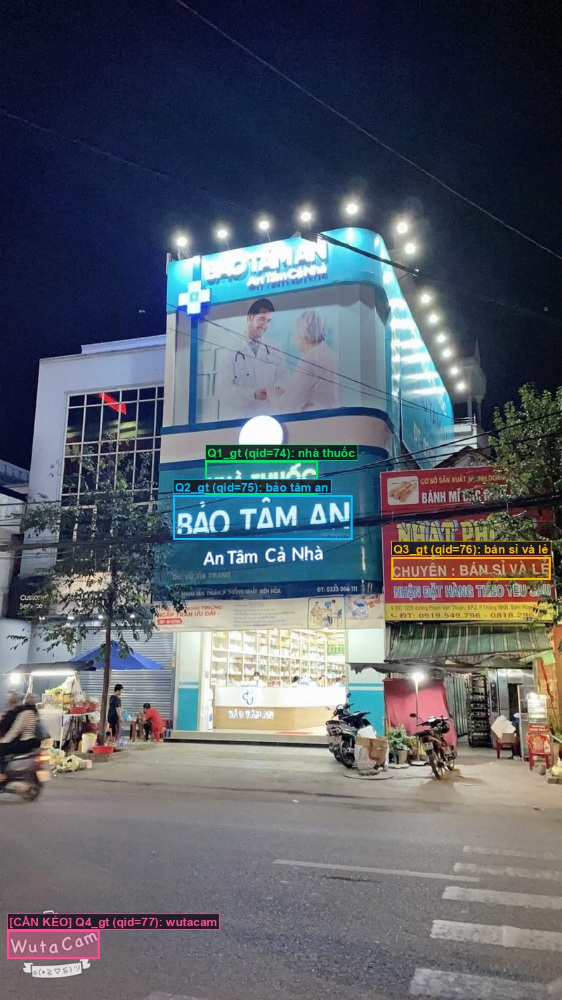
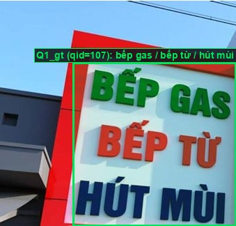
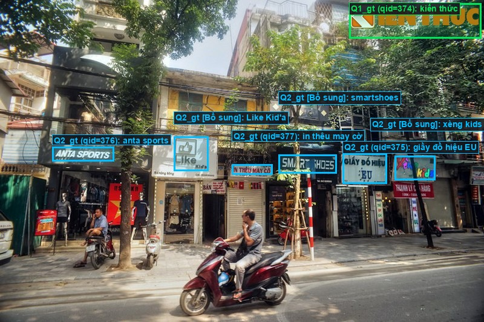
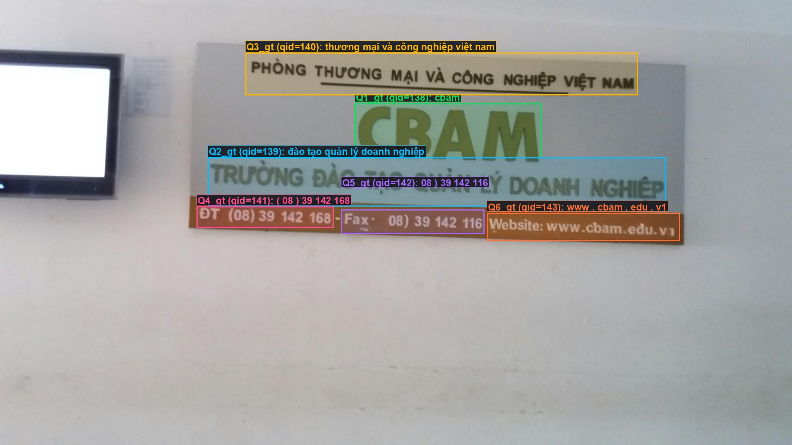

# Quy Trình Gán Nhãn ViTextVQA (400 Ảnh) Với X-AnyLabeling

Hướng dẫn cài đặt nhanh và mở ứng dụng **X-AnyLabeling** theo từng gói ảnh của 4 thành viên.

---

## 1. Cài đặt thư viện (Chạy 1 lần trên Windows)

Mở **PowerShell** tại thư mục gốc của project và chạy:

```powershell
# Tạo môi trường ảo (nếu chưa có)
python -m venv venv

# Cài đặt X-AnyLabeling + bộ PyQt6 ổn định (tránh lỗi QtCore DLL trên Windows)
.\venv\Scripts\pip.exe install x-anylabeling-cvhub==4.2.0 pyqt6==6.7.1 pyqt6-qt6==6.7.3 pyqt6-sip==13.8.0 pyqt6-webengine==6.7.0 pyqt6-webengine-qt6==6.7.3 Pillow
```

*(Nếu máy đã cài `uv`, chạy nhanh bằng: `uv pip install --python .\venv\Scripts\python.exe x-anylabeling-cvhub==4.2.0 pyqt6==6.7.1 pyqt6-qt6==6.7.3 pyqt6-sip==13.8.0 pyqt6-webengine==6.7.0 pyqt6-webengine-qt6==6.7.3 Pillow`)*

---

## 2. Phân công & Lệnh mở App theo từng thành viên

Mỗi thành viên phụ trách **100 ảnh** trong `data/xanylabeling_workspace/`. Chỉ cần chạy đúng 1 lệnh tương ứng với tên mình:

| Thành viên | Gói ảnh phụ trách | Số ảnh | Số câu hỏi | Lệnh mở App X-AnyLabeling |
| :--- | :--- | :---: | :---: | :--- |
| **Cao_Anh** *(Member 1)* | `data/xanylabeling_workspace/Cao_Anh_001_100` | 100 | 275 | `.\venv\Scripts\python.exe scripts/benchmark/launch_xanylabeling.py --member Cao_Anh` |
| **Trieu** *(Member 2)* | `data/xanylabeling_workspace/Trieu_101_200` | 100 | 314 | `.\venv\Scripts\python.exe scripts/benchmark/launch_xanylabeling.py --member Trieu` |
| **Cam_Tu** *(Member 3)* | `data/xanylabeling_workspace/Cam_Tu_201_300` | 100 | 320 | `.\venv\Scripts\python.exe scripts/benchmark/launch_xanylabeling.py --member Cam_Tu` |
| **Thanh_Tam** *(Member 4)* | `data/xanylabeling_workspace/Thanh_Tam_301_400` | 100 | 304 | `.\venv\Scripts\python.exe scripts/benchmark/launch_xanylabeling.py --member Thanh_Tam` |

> **Lưu ý:** Trong mỗi thư mục của từng thành viên đã có sẵn file **`ASSIGNMENT_CHECKLIST.md`** liệt kê các ảnh ưu tiên cần kéo box trước.

---

## 3. Quy tắc kiểm tra & chỉnh sửa BBox (Kèm ví dụ mẫu của `Cao_Anh`)

Mỗi câu hỏi trên ảnh được gán 1 nhãn màu riêng biệt (`Q1_gt`, `Q2_gt`, `Q3_gt`...). Phía trên mỗi box hiển thị trực tiếp:
`Hỏi: <câu hỏi> || ĐA: <đáp án>`

### Phím tắt cần nhớ trên X-AnyLabeling:
- **`D` / `A`**: Chuyển ảnh Tiếp theo / Quay lại *(App đã bật Auto-Save, tự động lưu khi chuyển ảnh)*.
- **`R`**: Vẽ thêm khung chữ nhật mới (khi cần bổ sung thêm vùng đáp án).
- **Chỉnh khung**: Click vào khung $\rightarrow$ kéo 4 góc trắng sao cho bao trọn vùng chữ của đáp án.

### 4 Trường hợp điển hình:

#### Case 1: Box bị lệch hoặc câu hỏi chưa bắt được chữ (`22.jpg`)
- Với các câu hỏi model chưa tự bắt được (ví dụ `Q4_gt: wutacam` trên `22.jpg`), hệ thống đã tạo sẵn **1 box nét đứt ở góc trên bên trái**.
- Chỉ cần click chọn box đó và **kéo về đúng vị trí chữ trong ảnh** (ví dụ góc dưới trái `WutaCam`).



#### Case 2: Nhiều đáp án của cùng 1 câu hỏi nằm sát nhau trên 1 biển hiệu (`30.jpg`)
- Câu hỏi: `Hỏi: cửa tiệm trong ảnh bán gì ? || ĐA: bếp gas / bếp từ / hút mùi`.
- Vì 3 dòng chữ nằm liền kề trên cùng 1 biển hiệu, **gộp chung thành 1 box `Q1_gt` duy nhất** bao trọn cả 3 dòng.



#### Case 3: Cùng 1 câu hỏi nhưng các đáp án nằm rời nhau + Bổ sung đáp án bị thiếu trong GT gốc (`126.jpg`)
- Câu hỏi `Q2_gt`: `Hỏi: ở đây có những cửa hàng gì ? || ĐA: giầy đồ hiệu / anta sports / in thêu may cờ`.
- **Không gộp 1 box dài ngang phố** vì các cửa hàng nằm cách xa nhau. Giữ thành **các box rời nhưng cùng mang nhãn `Q2_gt`**.
- **Khi phát hiện bộ dữ liệu gốc thiếu đáp án đúng** (trên phố có 6 cửa hàng nhưng GT gốc chỉ ghi 3, thiếu `Like Kid's`, `SMART SHOES`, `Yến Kids`):
  1. Nhấn phím **`R`**, kẻ box mới bao quanh biển hiệu bị thiếu (ví dụ `Like Kid's`), chọn nhãn **`Q2_gt`** (cùng nhãn với câu hỏi đó).
  2. Click vào box vừa vẽ $\rightarrow$ nhìn ô **Description** (góc dưới bên phải) $\rightarrow$ **gõ tên đáp án mới** vào (ví dụ: `Like Kid'a`, `smartshoes`, `xèng kids`).



#### Case 4: Ảnh có nhiều câu hỏi khác nhau trên cùng 1 bảng (`38.jpg`)
- Mỗi câu hỏi tương ứng 1 nhãn riêng (`Q1_gt` $\rightarrow$ `Q6_gt`). Kiểm tra từng box theo đúng cặp `Hỏi || ĐA` hiển thị trên đỉnh box.



---

## 4. Nộp kết quả sau khi hoàn thành

1. **Đối với các thành viên (`Cao_Anh`, `Trieu`, `Cam_Tu`, `Thanh_Tam`)**:
   - Sau khi kiểm tra và gán nhãn xong toàn bộ 100 ảnh trong thư mục của mình (`data/xanylabeling_workspace/<Tên_Thành_Viên>`), **upload nguyên thư mục của mình** lên Google Drive chung tại link sau:
   - 🔗 **Link nộp bài (Google Drive):** [https://drive.google.com/drive/folders/1WR7wmf57ljGHHpia6R3b4xs-15bl0xH3?usp=drive_link](https://drive.google.com/drive/folders/1WR7wmf57ljGHHpia6R3b4xs-15bl0xH3?usp=drive_link)

2. **Đối với Leader (`Cao_Anh`) — Gộp kết quả 400 ảnh**:
   - Tải 4 thư mục đã hoàn thành từ Google Drive về đặt lại vào `data/xanylabeling_workspace/`, sau đó chạy lệnh gộp dữ liệu chuẩn:
   ```powershell
   .\venv\Scripts\python.exe scripts/benchmark/setup_xanylabeling_workspace.py --merge
   ```
   - File kết quả tổng hợp cuối cùng sẽ được xuất ra tại: `results/swintextspotter_auto_annot/answer_bboxes_400_verified.json`.
