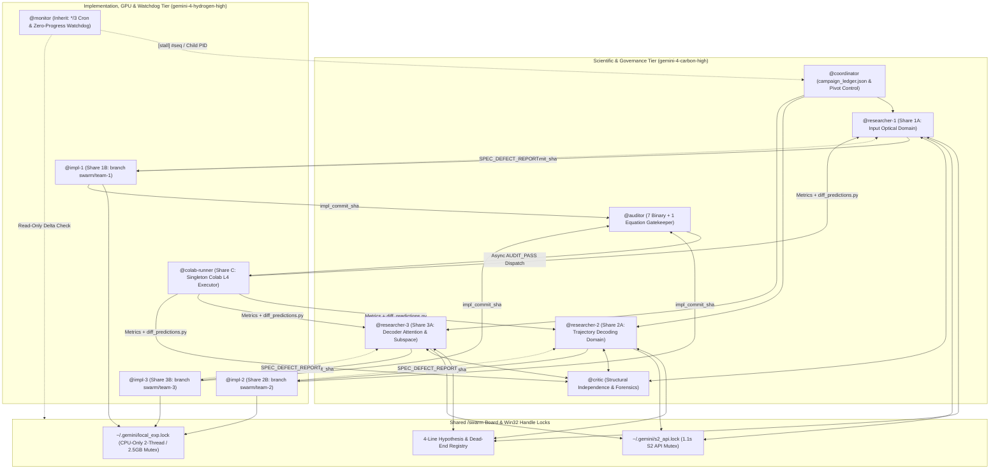
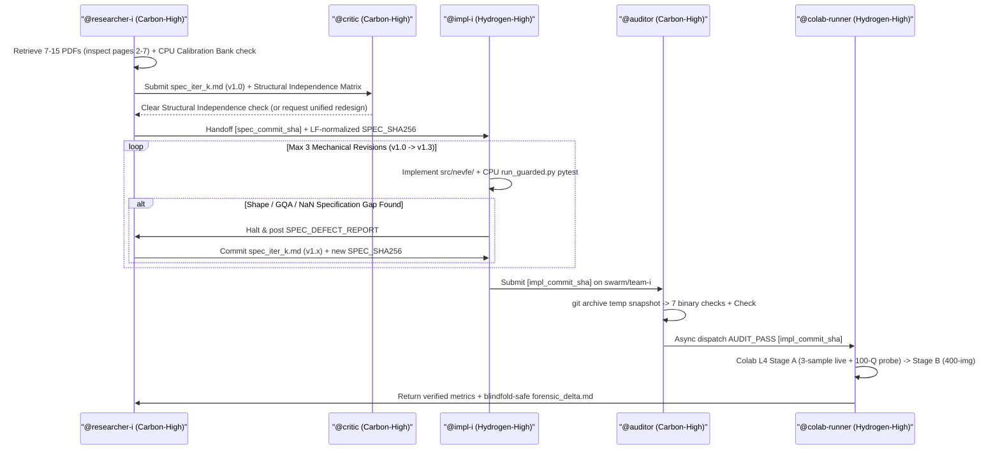

# Parallel Multi-Team Swarm Benchmark System for Training-Free VLM Scene-Text Reading

* **Author**: CaoAnhNato
* **Status**: Proposed
* **Date**: 2026-11-13

--------------------------------------------------------------------------------

## Overview

This design defines a parallel multi-agent research and benchmarking system inside Antigravity `/swarm` to invent, verify, and evaluate training-free scene-text reading operators for frozen Vision-Language Models (`5CD-AI/Vintern-1B-v3_5` on the 400-image / 1,222-question human-verified ViTextVQA benchmark). In this repository ([PROJECT.md](../../PROJECT.md)), `NEVFE` (*Non-Equilibrium Variational Free-Energy*) wraps frozen `Vintern-1B-v3_5` by contrasting two per-step decoder logit distributions over vocabulary $V = 151,936$: a visual-conditioned stream `logits_plus` (computed from unwarped `InternViT` `[N_tiles, 256, 896]` `bfloat16` visual embeddings) and a visual-null prior stream `logits_zero` (computed with zeroed visual tokens to isolate language-model prior bias). All teams branch from a dedicated campaign base `swarm/base` initialized at `iter23_staging` (`148f870`, Iteration-23 *Information-Geometric Variational Free-Energy Decoding* `IG-VFED` parameterized by `lambda_param=0.50` and `beta_param=0.05`: `60.19%` Token F1, `61.46%` Substring Match, `48.86%` ANLS, `31.59%` Exact Match), rather than `main` (`ab3e9c4`, Iteration-22 `MF-CD` at `58.50%` Token F1 / `61.70%` Substring Match), because `148f870` holds the highest composite Pareto frontier (`60.83%` vs. `60.10%`). Three isolated teams explore disjoint physical stages of the frozen VLM for up to 10 iterations each, pairing `gemini-4-carbon-high` reasoning and governance roles with `gemini-4-hydrogen-high` implementers, CPU-only local micro-experiments, a cron-driven `gemini-4-hydrogen-high` `@monitor` (`swarm_monitor` + zero-progress liveness watchdog), and a single `gemini-4-hydrogen-high` Google Colab L4 runner.

## The Problem

Single-threaded algorithm research (Iterations 1–23 in [PROJECT.md](../../PROJECT.md)) raised `Vintern-1B-v3_5` scene-text reading from `48.28%` Token F1 / `36.80%` Substring Match to `60.19%` / `61.46%`, leaving an ~`10 pp` gap below the `> 70.0%` Token F1 and `> 70.0%` Substring Match target across four empirical failure modes: conversational preamble echo (`24.9%`), language-prior hallucination (`23.0%`), multi-token entity truncation (`11.6%`), and sub-pixel optical stroke collapse on `< 4px` text (`CLASS_A` at `15.60%` F1). Scaling this campaign across parallel agent teams exposes six operational bottlenecks that built-in `/teamwork` (`mode = 'benchmark'`) cannot address directly:

1. **Inflexible Model Assignment & Duplicate Exploration**: Native `/teamwork` locks subagents to uniform internal model configurations across isolated team instances, preventing role-specific model pinning (`gemini-4-carbon-high` for mathematical synthesis and governance vs. `gemini-4-hydrogen-high` for code translation and GPU execution) and causing parallel teams to explore overlapping hypotheses.
2. **Multi-Paper Heuristic Composition**: Left unguided with 7–15 papers per turn, LLM agents often stitch together formulas from multiple VLM decoding papers. That pattern violates mathematical parsimony (capped in this campaign at `<= 3` total tunable parameters, superseding the `<= 2` cap in `.agents/rules/strict-a-star-research-protocol.md`) and pollutes per-direction reading logs needed for author citation selection.
3. **Unverified PDF Skimming & API Contention**: Parallel agents querying Semantic Scholar concurrently hit `HTTP 429` (`1 req/sec` global limit) or inspect only titles and abstracts instead of reading body pages `>= 2`.
4. **Silent Specification-vs-Code Drift**: Coding models (`gemini-4-hydrogen-high`) encountering specification gaps, Grouped-Query Attention (`14` query vs. `2` KV heads) broadcasting mismatches, or `bfloat16` `NaN` boundaries tend to patch equations directly in Python, leaving specifications out of sync with evaluated code.
5. **Subjective Pre-Screening & Regressed-Code Stacking**: Subjective gatekeeper filtering risks discarding unconventional mathematical formulations, while stacking patches onto failed commits obscures causal attribution and leaves dead code in `src/nevfe/`.
6. **Host Laptop Exhaustion, Silent Terminal Hangs & Colab Session Stalls**: Loading live `Vintern-1B` weights locally (`2.31 GB` VRAM, `4.60 GB` RAM per [PROJECT.md](../../PROJECT.md)) across 3 parallel teams overwhelms the host laptop (`RTX 3050 Ti 4 GB VRAM`), silent `30–60 min` terminal or `torch.multiprocessing` hangs freeze `local_exp.lock` or L4 runtimes without emitting progress updates (whereas vanilla `swarm_monitor` ignores stalls whenever any worker reports `working`), and concurrent Colab sessions or premature `nohup` disconnects corrupt notebook state and leak L4 Compute Units.

## Goals

* **Surpass Benchmark Target Under Campaign Parsimony**: Achieve `Token F1 > 70.0%` and `Substring Match > 70.0%` simultaneously on the 400-image / 1,222-question verified ViTextVQA dataset using a unified, backbone-agnostic, training-free operator with **at most `3` total tunable scalar or discrete parameters** (counting any retained baseline `lambda_param` or `beta_param` fields, `<= 250` non-docstring AST statement lines in `src/nevfe/core/`, zero regex/stopword heuristics, and immutable `scripts/benchmark/metrics.py`).
* **Execute 3 Disjoint Parallel Research Teams Across 2 Model Tiers**: Operate 3 isolated teams (`workspace:"share"`, branches `swarm/team-<id>` rooted at `swarm/base`, zero commits to `main` or `iter23_staging`) for up to 10 iterations per team, pinning `@coordinator`, `@critic`, `@auditor`, and `@researcher-1..3` to `gemini-4-carbon-high` and pinning `@impl-1..3`, `@colab-runner`, and `@monitor` to `gemini-4-hydrogen-high`, with full access to `arxiv`, `keenable`, `keenable-select`, `github`, and `octocode` MCP servers.
* **Enforce Abductive Literature Synthesis & Per-Direction Reading History**: Require each new hypothesis iteration to retrieve and read body pages `>= 2` of **at least `7` related PDFs (target `7–15` papers, overriding the `>= 10` floor in `.agents/rules/strict-a-star-research-protocol.md`)** across 4 epistemic buckets via rate-locked `tools/s2_folks_cli/fetch_papers.py` plus MCP search tools. Verify reads via cursor-segmented `transcript.jsonl` + `read_manifest.json` checks, and commit per-direction logs (`reading_history.md` + `reading_history.bib`) so the author manually selects manuscript citations from winning directions and ignores failed ones.
* **Maintain `1:1` Specification-to-Code Synchronization**: Lock `docs/specs/` write access to `@researcher-<id>`, require `@impl-<id>` to halt and post a `SPEC_DEFECT_REPORT` on any mathematical, dimensional, or `NaN`/`Inf` ambiguity (up to 3 mechanical spec revisions per iteration before `@coordinator` adjudication), and enforce SHA-256 spec-version binding plus `@auditor` Equation-to-AST equivalence review.
* **Protect Host Laptop Resources, Zero-Progress Liveness & Popup-Free Colab Lifecycle**: Ban local `1B` weight loading (`CUDA_VISIBLE_DEVICES=""`), running `< 0.5s` CPU open-loop diagnostics on a 30-sample Offline Calibration Bank (`< 200 MB`) and synthetic `7:1` GQA unit tests under a single-process OS mutex (`<= 2` CPU threads, `BELOW_NORMAL_PRIORITY_CLASS`, `<= 2.5 GB` RSS, `--idle-timeout-s 1800` zero-output cutoff). Supervise the swarm via a `*/3 * * * *` daemon `@monitor` (`swarm_monitor` + read-only `check_swarm_liveness.py`) that leaves progressing tasks (`delta > 0`) untouched while recovering quiet board stalls and `30–60 min` zero-progress terminal hangs via child-PID termination before any last-resort `fork` session replacement. Dispatch `AUDIT_PASS` commits asynchronously to `@colab-runner` over `colab-mcp` following the 5-step popup-free `/colab-workflow` SOP (`userdata` `HF_TOKEN`/`RCLONE_DRIVE_TOKEN` in-memory inheritance, pure-Python `google-api-python-client` Drive upload with zero `drive.mount()`, `gdrive readonly ls` cloud visibility check, immediate `runtime.unassign()` + cell purge whenever no next `AUDIT_PASS` commit is queued, and headless `gdrive readonly download` local pull).
* **Enforce Path-Scoped Rollback Ratchet & 10-Iteration Synthesis**: Promote checkpoints only when `0.5 * (Token F1 + Substring Match)` rises by `>= +0.25 pp` while keeping `Token F1 >= max(60.19%, Best_F1 - 0.50 pp)` and `Substring Match >= max(61.46%, Best_Sub - 0.50 pp)`. After failed runs, compute blindfold-safe error deltas, restore code cleanly via `git checkout <team_best_commit> -- src/nevfe/ tests/` without erasing `reports/team_<i>/`, pivot after 3 consecutive strikes, and deliver Iteration-10 team synthesis reports.

## Non-Goals

* **Model Training or Weight Modification**: Fine-tuning, LoRA, prompt tuning, learned adapters, calibration networks, or gradient updates are out of scope.
* **String Post-Processing or External OCR Pipelines**: Regular expressions, prefix/suffix stripping, Vietnamese stopword/keyword tables, hardcoded prompt templates inside `src/nevfe/core/`, or external OCR engines (`PaddleOCR`, `Tesseract`, `EasyOCR`, `SwinTextSpotter` at inference) are prohibited.
* **Evaluation Metric Relaxation**: Modifying `scripts/benchmark/metrics.py` or `tests/test_metrics_relaxation.py` is forbidden.
* **Automated Final Bibliography Selection**: Agents do not select final manuscript references or merge all screened papers into one master `.bib` file; agents log verified per-direction reading histories for manual selection by the human author.
* **Local GPU Weight Loading or Benchmarking**: Loading real `Vintern-1B-v3_5` weights or running 100-question / 400-image evaluations on the host `RTX 3050 Ti 4 GB` laptop GPU is prohibited.

## Open Questions

None.

## Critical User Journeys (CUJs)

### CUJ 1: Abductive Hypothesis Formulation & Per-Direction Reading History Logging

* **Given**: Team `i` begins Iteration `k` on branch `swarm/team-<i>` from `<team_best_commit>` (initially `swarm/base`, derived from `iter23_staging` `148f870`), with access to the 30-sample Calibration Bank and the shared `/swarm` message board.
* **When**: `@researcher-<i>` (`gemini-4-carbon-high`) posts a 4-line non-overlapping Hypothesis Claim on the `/swarm` board, downloads and inspects pages `2–7` of 7–15 papers across Buckets A–D (`fetch_papers.py --inspect-pages 2-7` + `arxiv`/`keenable` MCPs), inspects open-loop Calibration Bank tensors on CPU, derives one unified `<= 3`-parameter operator, appends entries to `reports/team_<i>/direction_<d>/reading_history.{md,bib}`, and submits `spec_iter_<k>.md` (`v1.0`) to `@critic`.
* **Then**: `@critic` blocks any multi-paper heuristic patchwork before coding starts; once cleared, `spec_iter_<k>.md` (`v1.0`) and the updated per-direction reading history are committed onto `swarm/team-<i>`.

### CUJ 2: Spec-Locked Implementation, CPU Guarded Testing & `SPEC_DEFECT_REPORT` Escalation

* **Given**: `@impl-<i>` (`gemini-4-hydrogen-high`) fetches `<spec_commit_sha>` on `swarm/team-<i>` in its isolated `workspace:"share"` worktree and runs synthetic `7:1` GQA unit tests plus open-loop Calibration Bank contract checks via `run_guarded.py` (`CUDA_VISIBLE_DEVICES=""`, `<= 2` CPU threads, `<= 2.5 GB` RSS, single-process host mutex).
* **When**: `@impl-<i>` encounters a GQA tensor-rank mismatch, `bfloat16` `NaN`/`Inf` boundary, or underspecified equation in `spec_iter_<k>.md`.
* **Then**: Instead of patching formulas silently in Python, `@impl-<i>` halts and posts a `SPEC_DEFECT_REPORT` on the `/swarm` board naming `@researcher-<i>`. `@researcher-<i>` commits mechanical clarifications in `spec_iter_<k>.md` (`v1.1..v1.3`; any governing-equation or parameter change must re-clear `@critic`), `@impl-<i>` updates `# SPEC_REF` in `engine.py` to the new LF-normalized SHA-256 digest, and unresolved `v1.3` deadlocks trigger `@coordinator` rollback (`k -> k+1`, `+1` strike).

### CUJ 3: 7-Binary + 1-Semantic Audit & Asynchronous Colab L4 Execution

* **Given**: `@impl-<i>` commits candidate code onto `swarm/team-<i>` (`<impl_commit_sha>`) and requests gatekeeper audit.
* **When**: `@auditor` (`gemini-4-carbon-high`) unpacks `<impl_commit_sha>` into a clean temporary directory via `git archive`, runs the 7 automated binary checks (`run_auditor_checks.py`, including guarded `pytest` execution inside the temp snapshot) plus LLM Equation-to-AST equivalence check (#7b), and dispatches `AUDIT_PASS` commits asynchronously to `@colab-runner` (`gemini-4-hydrogen-high`).
* **Then**: `@auditor` emits structured `FIXABLE_DEFECT` items if an invariant fails (never rejecting on subjective novelty); `@colab-runner` copies `run_colab_swarm_wave.sh` to `/tmp/`, injects `HF_TOKEN` and `RCLONE_DRIVE_TOKEN_JSON` in-memory from `google.colab.userdata` (never calling `drive.mount()` or `rclone` binary installers), checks out `<impl_commit_sha>` detached on Colab L4, runs a 3-sample live smoke check + 100-question factorial probe (Stage A) followed by dynamic-worker 400-image evaluation (Stage B), uploads all 8 benchmark artifacts + `config_used.json` + streaming `sha256sum.txt` to Google Drive via pure-Python `google-api-python-client`, confirms Drive Cloud visibility via `gdrive readonly ls`, executes IPython `runtime.unassign()` + purges `added_cell_ids` whenever no next wave is queued, and pulls locally via `gdrive readonly download`.

### CUJ 4: Blindfold-Safe Forensics, Path-Scoped Rollback & 10-Iteration Delivery

* **Given**: `@colab-runner` and Check #8 verify a completed benchmark run for `swarm/team-<i>` Iteration `k`.
* **When**: Candidate metrics are evaluated against the anchored promotion ratchet (`+0.25 pp` composite gain, `<= 0.50 pp` single-metric drop, and neither metric below initial `60.19%` F1 / `61.46%` Substring), repeating until Iteration 10 completes across all 3 teams.
* **Then**: Winning runs advance `<team_best_commit>`, reset strikes to `0`, and mark `direction_<d>/reading_history.md` as `PROMOTED_BEST_CHECKPOINT`. Failing runs generate `forensic_delta.md` (emitting sample-level diffs only on the 30 calibration QIDs to prevent test-set leakage) for joint `@researcher-<i>` + `@critic` triage: Action A (prune masked-out dead terms/params within Iteration `k`, `0` strikes), Action B (path-scoped `git checkout <team_best_commit> -- src/nevfe/ tests/` preserving `reports/team_<i>/`, `+1` strike, `k -> k+1`), or Action C (3-strike pivot marking `direction_<d>` `FAILED_ROLLED_BACK` and opening `direction_<d+1>`). At Iteration 10, the author receives per-team synthesis reports and clean per-direction reading histories.

### CUJ 5: Cron-Driven Quiet-Stall & Zero-Progress Subprocess Recovery (`@monitor`)

* **Given**: `@monitor` (`gemini-4-hydrogen-high`, `workspace:"inherit"`) loads the built-in `swarm_monitor` skill, schedules a daemon cron (`*/3 * * * *`, `IsDaemon: true`), and tracks per-worker progress deltas via read-only `scripts/audit/check_swarm_liveness.py` (`~/.gemini/vlm_swarm_state/liveness_snapshot.json`).
* **When**: Either (a) every live member is `waiting` or `stopped` due to an unaddressed board post, missed `@mention`, model quota failure, or host server restart, or (b) a `working` agent or Colab wave produces `delta == 0` across `transcript.jsonl`, `heartbeats/*.json`, worktree `mtime`, and `checkpoint.json` / `/tmp/wave.log` for `30–60` consecutive minutes (while legitimately long `> 60 min` runs with `delta > 0` continue untouched).
* **Then**: Quiet stalls trigger a single `@member [stall]` re-ping followed by `@coordinator [stall] #<seq>` escalation; `30 min` idle-output hangs inside `run_guarded.py` or `/tmp/run_colab_swarm_wave.sh` self-terminate their child process trees (`exit 124` / `WAVE_STALLED_MARKER`); unwrapped `30 min` zero-progress local `run_command` hangs prompt `@coordinator` to terminate **only** the hung OS child PID (`taskkill /PID <child_pid> /T /F`) so the worker resumes in-place without `swarm(action="kill")`; and `60 min` platform RPC freezes with zero child PIDs trigger `swarm(action="add", name="<role>-2", fork:"<role>", workspace:"share")` prior to killing the frozen session.

## Technical Plan (Architecture)

### 1. 11-Agent `/swarm` Topology, Board Mechanics & Workspace Isolation

Antigravity `/swarm` provides a persistent multi-agent roster communicating over a shared append-only message board (`swarm` tool actions `add`, `status`, `model`, `kill`, `title`), where @mentioning a `waiting` worker wakes its conversation (`0` token cost while asleep). Two workspace modes are used:
* `workspace:"inherit"`: Shares the parent coordinator working directory (`swarm/base` checked out read-only; `git config gc.auto 0` set at Phase 0 to prevent Windows NTFS `.git/packed-refs.lock` contention). `@coordinator` maintains `~/.gemini/vlm_swarm_state/campaign_ledger.json` (recording each agent's conversation UUID, worktree path, active `direction_id`, iteration `k`, strike count, `<team_best_commit>`, and `transcript.jsonl` `step_index` cursor), `@monitor` writes `~/.gemini/vlm_swarm_state/liveness_snapshot.json` during its 3-minute read-only ticks, and `@auditor` inspects candidate commits via `git archive <impl_sha>` into `tempfile.TemporaryDirectory()` (`0` working-tree mutations, `0` extra worktrees).
* `workspace:"share"`: Gives each Researcher, Implementer, and `@colab-runner` an independent working directory backed by the shared `.git` object store so concurrent file edits and test runs never collide on disk. Workers are never terminated with `swarm(action="kill")` for quiet stalls or hung terminal commands (which recover in-place via script idle-output cutoffs or child-PID `taskkill`); `swarm(action="kill")` is reserved strictly for `>= 60 min` (`20` cron ticks) of `delta == 0` platform RPC freeze with no local child PID, executed only after `swarm(action="add", name="<role>-2", fork:"<role>", workspace:"share")` preserves conversation history (`@monitor` itself is never killed and stops its cron upon `[done]`).

| Roster Name | Pinned Model | Workspace Mode | Branch & Write Ownership | Core Responsibility |
| :--- | :--- | :--- | :--- | :--- |
| `@coordinator` | `gemini-4-carbon-high` | `inherit` | Read-only repo; writes `~/.gemini/vlm_swarm_state/campaign_ledger.json` | Spawns 10 workers, moderates Hypothesis Registry ties by board post order, handles `@monitor [stall]` recovery (`taskkill` child PID, `@monitor resume`, or 60-min `fork` replacement), adjudicates `v1.3` deadlocks, enforces 3-strike pivots, posts `[done]` & triggers final Colab teardown |
| `@critic` | `gemini-4-carbon-high` | `inherit` | Read-only reviewer | Audits `spec_iter_<k>.md` Structural Independence Matrix (blocks heuristic composition) and co-diagnoses post-Colab `forensic_delta.md` |
| `@auditor` | `gemini-4-carbon-high` | `inherit` | Writes `reports/audit/team_<i>_iter_<k>.json` | Executes 7 automated binary checks (`run_auditor_checks.py` on `git archive` temp snapshot) + 1 LLM Equation-to-AST check (#7b) + post-Colab Check #8 |
| `@researcher-1` | `gemini-4-carbon-high` | `share` | `swarm/team-1` (`docs/specs/team_1/`, `reports/team_1/`) | Input Optical & Native RGB Sensing lead; `7–15` PDF synthesis, open-loop Calibration Bank inspection, spec authoring |
| `@researcher-2` | `gemini-4-carbon-high` | `share` | `swarm/team-2` (`docs/specs/team_2/`, `reports/team_2/`) | Autoregressive Trajectory & Output Distribution lead |
| `@researcher-3` | `gemini-4-carbon-high` | `share` | `swarm/team-3` (`docs/specs/team_3/`, `reports/team_3/`) | Intra-Decoder Cross-Modal Routing & Latent Subspace lead |
| `@impl-1` | `gemini-4-hydrogen-high` | `share` | `swarm/team-1` (`src/nevfe/`, `tests/`) | Translates `team_1` specs to code, runs CPU `run_guarded.py` tests, files `SPEC_DEFECT_REPORT` on mechanical spec gaps |
| `@impl-2` | `gemini-4-hydrogen-high` | `share` | `swarm/team-2` (`src/nevfe/`, `tests/`) | Translates `team_2` specs to code, runs CPU `run_guarded.py` tests, files `SPEC_DEFECT_REPORT` on mechanical spec gaps |
| `@impl-3` | `gemini-4-hydrogen-high` | `share` | `swarm/team-3` (`src/nevfe/`, `tests/`) | Translates `team_3` specs to code, runs CPU `run_guarded.py` tests, files `SPEC_DEFECT_REPORT` on mechanical spec gaps |
| `@colab-runner` | `gemini-4-hydrogen-high` | `share` | Detached checkout on Colab L4; writes local `results/swarm_runs/` | Runs asynchronous non-merging Stage A/B waves on singleton `colab-mcp` L4 via 5-step popup-free `/colab-workflow` (`google-api-python-client` Drive sync, `gdrive readonly ls` check, queue-empty `runtime.unassign()` + cell purge, `gdrive readonly download`) |
| `@monitor` | `gemini-4-hydrogen-high` | `inherit` | Read-only repo; writes `~/.gemini/vlm_swarm_state/liveness_snapshot.json` | Runs `*/3 * * * *` daemon cron (`swarm_monitor` + `check_swarm_liveness.py`) to break quiet board stalls and flag `30–60 min` `delta == 0` hangs without disturbing progressing (`delta > 0`) workers |

Because `@impl-1..3`, `@colab-runner`, and `@monitor` share the `gemini-4-hydrogen-high` quota pool (sparing `gemini-4-carbon-high` research quota from 3-minute heartbeat wakes), `@colab-runner` never runs interactive polling loops inside LLM turns: it launches `/tmp/run_colab_swarm_wave.sh` via `nohup` on Colab and yields turn execution using `default_api:schedule` timers, while `@monitor` executes only `< 0.2s` read-only board/liveness checks per tick and kills its cron when idle or `[done]`.

### 2. Single-Branch Team Handoff & SHA-256 Spec-Version Binding

1. **Phase 0 Base Initialization (`swarm/base`)**: Before Iteration 1, Phase 0 creates branch `swarm/base` from `iter23_staging` (`148f870`), strips dead pre-Iteration-22 functions from `src/nevfe/core/engine.py`, commits all swarm scripts/configs/templates, and sets initial `<team_best_commit> = swarm/base` for Teams 1–3.
2. **Spec Commit (`@researcher-<i>`)**: On `swarm/team-<i>`, `@researcher-<i>` ensures `src/nevfe/` and `tests/` match `<team_best_commit>`, writes `docs/specs/team_<i>/spec_iter_<k>.md` (`spec_version: v1.0`, omitting any self-hash field inside the file) plus `reports/team_<i>/direction_<d>/reading_history.{md,bib}`, commits `[spec_commit_sha]`, and computes `SPEC_SHA256 = sha256(spec_bytes.replace(b"\r\n", b"\n"))`.
3. **Implementation Commit (`@impl-<i>`)**: `@impl-<i>` fetches `swarm/team-<i>` at `[spec_commit_sha]`, places `# SPEC_REF: docs/specs/team_<i>/spec_iter_<k>.md@v1.0 (sha256=<SPEC_SHA256>)` on line 2 of `src/nevfe/core/engine.py`, implements the operator, and commits `[impl_commit_sha]` without touching `docs/specs/` or `reports/`.
4. **Mechanical-Only `SPEC_DEFECT_REPORT` Handshake**: Every `spec_iter_<k>.md` declares a **Backbone Tensor Invariant Header** (`InternViT` tiles `[N_tiles, 256, 896]` `bfloat16`; `Qwen2.5-0.5B-Instruct` `24` layers, `14` query heads, `2` KV heads with `7:1` GQA group ratio, hidden size `896`, dynamic `vocab_size`). If `@impl-<i>` hits a shape/GQA broadcast bug, `NaN`/`Inf` edge case, or missing boundary condition, `@impl-<i>` halts and posts a `SPEC_DEFECT_REPORT` naming `@researcher-<i>`. Revisions `v1.1..v1.3` are restricted to mechanical shape/dtype/`NaN` completions; if fixing the defect alters any governing equation or parameter in `spec_iter_<k>.md`, `@researcher-<i>` must re-clear `@critic` first. If `v1.3` still fails local checks, `@coordinator` rolls code back via `git checkout <team_best_commit> -- src/nevfe/ tests/`, increments `k -> k+1`, and records `+1` strike.
5. **Git-Level Immutability Check**: `git diff <spec_commit_sha>..<impl_commit_sha> -- docs/specs/ reports/` verifies `0` diff lines before Check #7b runs.

### 3. Literature Discovery Stack (`s2-folks` + MCPs), 4-Bucket Synthesis & Per-Direction Reading History

* **Exclusive Locked `s2-folks` CLI & Multi-Source PDF Retrieval**: To prevent unlocked API calls from bypassing rate limits, researchers route 100% of Semantic Scholar queries through `tools/s2_folks_cli/fetch_papers.py` (never calling the `semantic-scholar` MCP server directly). `fetch_papers.py` adapts the reference `requests` patterns in [allenai/s2-folks/examples/python](https://github.com/allenai/s2-folks/tree/main/examples/python) (`get_open_access_pdf/simple.py`, `search_bulk/get_dataset.py`, `find_and_recommend_papers/find_papers.py`, `self_citations_on_a_paper/main.py`) under a Win32 kernel handle lock (`~/.gemini/s2_api.lock` via `msvcrt.locking`, `<= 90s` timeout, `>= 1.1s` spacing, 5 retries on `HTTP 429`/`504`, `https://` with `verify=True`, `<= 50 MB` stream cap, reading `SEMANTIC_SCHOLAR_API_KEY` with `S2_API_KEY` fallback and omitting `X-API-KEY` when empty to avoid `HTTP 403`). When `openAccessPdf` is absent, researchers retrieve open-access PDFs via `arxiv:download_paper` / `get_paper_latex_section`, `keenable:search_web_pages` / `fetch_page_content`, and `keenable-select:select`, and inspect official code via `github` and `octocode` MCPs. Calling `fetch_papers.py --inspect-pages 2-7` extracts bounded body text (`<= 6` pages, `<= 20 KB` via `pypdf`) and appends `{team, iter, pdf_sha256, pages_read, body_chars}` to `~/.gemini/vlm_paper_cache/team_<i>/iter_<k>/read_manifest.json`.
* **Gitignored Binary Cache vs. Persistent Per-Direction Reading History**: Raw PDFs (`>= 7` distinct papers per new hypothesis iteration, target `7–15`, each `> 50 KB` with `%PDF-` magic header) reside in gitignored `~/.gemini/vlm_paper_cache/team_<i>/iter_<k>/`. Inside `swarm/team-<i>`, each direction `direction_<d>` (`d = 1, 2, ...`, incremented on 3-strike pivots) maintains two committed files preserved across all path-scoped code rollbacks under `reports/team_<i>/direction_<d>/`:
  * `reading_history.md`: Header recording `Direction ID`, `Problem Framing`, `Iterations Covered`, and `Verdict` (`IN_PROGRESS` | `PROMOTED_BEST_CHECKPOINT` | `FAILED_ROLLED_BACK`), plus a unified table with columns `Iteration | BibTeX Key | Title | Venue & Q1/A* Tier | DOI/ArXiv | Cached PDF SHA256 | Bucket [A/B/C/D] | Pages Inspected | Verbatim Page>=2 Anchor & Principle | Repo URL`.
  * `reading_history.bib`: BibTeX entries matching `reading_history.md` `1:1` so the author copies selected references only from `PROMOTED_BEST_CHECKPOINT` directions.
* **4-Bucket Epistemic Quotas & Q1 Journal Criteria**: Modeled on the citation anatomy of A*/Q1 VLM papers (such as [Kang et al., CVPR 2025](https://arxiv.org/abs/2503.06287) and [Huang et al., CVPR 2024](https://arxiv.org/abs/2311.17911)), each iteration's literature set must cover:
  * `Bucket A (1–3 papers) — Task & Failure Anchors`: Scene-text VQA / OCR benchmarks or empirical VLM hallucination analyses establishing the target failure mode.
  * `Bucket B (2–4 papers) — Prior SOTA Structural Foils`: Training-free VLM contrastive/attention methods analyzed strictly to identify broken assumptions (never combined or chained).
  * `Bucket C (2–4 papers) — Mechanistic Interpretability`: Transformer GQA routing, logit-lens, entropy, or vision-token dynamics inside frozen decoders.
  * `Bucket D (2–4 papers) — Q1 Journal Mathematical Primitives`: Peer-reviewed Q1 journal articles (verified via journal `ISSN` + Scimago SJR Q1 / Clarivate JCR Q1 journal venue such as *TPAMI*, *IJCV*, *TIP*, *TIT*, *JMLR*, *TSP*; conference proceedings alone do not satisfy Bucket D) providing foundational information-geometric, variational, or signal-processing operators.

### 4. Core Algorithm Contract (`src/nevfe/`) & Factorial Ablation Interface

`src/nevfe/` maintains a strict boundary between backbone-agnostic math and `Vintern-1B-v3_5` tensor plumbing:

1. **Backbone-Agnostic Core (`src/nevfe/core/engine.py`, `<= 250` non-docstring AST statement lines)**:
   * `src/nevfe/core/` may contain only `__init__.py` and `engine.py` (preventing multi-file LOC evasion).
   * Defines `@dataclass(frozen=True) class AlgorithmConfig` holding **at most `3` total custom scalar or discrete parameters** (initially `lambda_param: float = 0.50` and `beta_param: float = 0.05`, occupying 2 of the 3 slots unless an iteration replaces them with parameter-free closed forms) plus `ablation_mask: Tuple[int, ...] = (1, 1, 1)` used solely to zero individual operator sub-terms during factorial probes.
   * Preserves exact Iteration-23 `148f870` `IG-VFED` numerical parity at `swarm/base` while stripping dead pre-Iteration-22 functions and `mu_param`/`barrier_*` legacy knobs; each isolated team adds only the specific operator method required by its `spec_iter_<k>.md`.
2. **Model-Specific Adapter (`src/nevfe/adapter/vintern_adapter.py` & `src/nevfe/pipeline.py`)**:
   * Queries decoder/vision attributes safely via `getattr(getattr(self.model, "language_model", self.model), "config", ...)` and dynamic `force_image_size` (preserving compatibility with synthetic `DummyModel` unit tests).
   * Preserves the physical invariant from Iterations 9–23 ([PROJECT.md](../../PROJECT.md)): `self._cached_vit_embeds` extracted from `extract_feature(pixel_values)` (`[N_tiles, 256, 896]`) remains immutable across multi-question images and enters LLM Layer 0 unwarped. Team 1 question-guided native RGB crops concatenate transiently per question (reusing coordinate helpers in `scripts/benchmark/sg_vcd/roi_cropper.py`), and Team 3 intra-decoder hooks register inside `try...finally` blocks to handle Qwen2 `sdpa` (`attentions=None`) cleanly (referencing `scripts/benchmark/sg_vcd/attention_extractor.py`).

### 5. 7-Binary + 1-Semantic `@auditor` Gate (`scripts/audit/`)

`@auditor` (`gemini-4-carbon-high`) invokes `python scripts/audit/run_auditor_checks.py --mode pre-colab --team <i> --iter <k> --spec-sha <sha1> --impl-sha <sha2> --ledger ~/.gemini/vlm_swarm_state/campaign_ledger.json`, unpacking `<impl-sha>` via `git archive` into a clean temporary snapshot to run Automated Binary Checks #1–#6 and #7a, followed by LLM Equation-Equivalence Check #7b and post-Colab Check #8:

1. **Cursor-Scoped Transcript & Reading History Check (`verify_transcript_pdf_reads.py`)**: Reads `<appDataDir>/brain/<researcher-id>/.system_generated/logs/transcript.jsonl` (joining `transcript_full.jsonl` when `truncated_fields` is present) strictly above the previous iteration's `step_index` cursor in `campaign_ledger.json`. Verifies `>= 7` distinct new PDFs (`> 50 KB`, `%PDF-` header), matching `read_manifest.json` (`--inspect-pages 2-7`) or non-abstract `arxiv:get_paper_latex_section` tool calls in the transcript, Bucket quotas (`1–3` A; `2–4` B, C, D with valid journal `ISSN`/venue in D), and `1:1` `.md`/`.bib` alignment.
2. **`<= 3` Parameter & Operator Literal AST Check**: Verifies `AlgorithmConfig` defines `<= 3` tunable fields (excluding `ablation_mask`) and scans mathematical operator functions in `src/nevfe/core/engine.py` (excluding `AlgorithmConfig` field defaults/bounds) for undeclared numeric literals outside `{0, 0.0, 0.5, 1, 1.0, -1, 2, 2.0, 1e-6, 1e-8, 1e-12, -1e9}`, `math.pi`, `math.e`, `±float("inf")`, and integer tensor ranks/axes `-4..4` inside `.dim()`, `dim=`, `permute`, `transpose`, `unsqueeze`, or `view`.
3. **Zero-Heuristic, Directory & Line-Count Check**: Verifies `src/nevfe/core/` contains only `__init__.py` and `engine.py`, `<= 250` non-docstring AST statement lines, and zero imports/calls of `re`, `difflib`, `unicodedata`, OCR libraries, string `.replace`/`.strip`, or ground-truth JSON keys (`answer`, `gt`, `verified`).
4. **Metric & Relaxation Lock**: Verifies `git diff iter23_staging -- scripts/benchmark/metrics.py tests/test_metrics_relaxation.py` is empty and `pytest tests/test_metrics_relaxation.py` passes `6/6`.
5. **Backbone-Agnostic Core Check**: Scans `src/nevfe/core/` for hardcoded `Vintern`/`Qwen` dimension literals (`151936`, `151643`, `151667`, `896`, `256`, `448`, `64`, `24`, `14`).
6. **In-Snapshot Guarded Test Execution**: Runs `python scripts/local/run_guarded.py -- pytest tests/test_nevfe_engine.py` directly inside the clean `<impl-sha>` temp snapshot and verifies exit code `0` within CPU/RSS ceilings (`0` cross-worktree receipt handoff).
7. **SHA-256 Spec-Version Binding & Equation-to-AST Equivalence**: (7a) Binary check verifying `# SPEC_REF` in `engine.py` matches LF-normalized `sha256(spec_iter_<k>.md)` and `git diff <spec_sha>..<impl_sha> -- docs/specs/ reports/` is empty; (7b) LLM check by `@auditor` comparing each numbered governing equation and boundary condition in `spec_iter_<k>.md` against `engine.py` (explicitly whitelisting PyTorch dtype casting, contiguous views, and GQA tensor-rank broadcasting).
8. **Post-Colab Artifact, Cloud-Visibility & Teardown Check (`--mode post-colab`)**: Verifies `gdrive readonly ls <folder_id> --json` cloud visibility receipt, local `gdrive readonly download` presence of `--expected-qids` (`1,222` on full runs) in `predictions.jsonl`, `sha256sum.txt` hash match across all 8 benchmark artifacts + `config_used.json`, `runtime.unassign()` execution when the wave queue is empty, and `get_cells()` restoration to `@colab-runner`'s initial cell snapshot.

### 6. CPU-Only Local Sandbox (`data/local_calibration_bank/` & `scripts/local/run_guarded.py`)

* **30-Sample Open-Loop Calibration Bank (`scripts/benchmark/export_calibration_bank.py`)**: Before Iteration 1, `@colab-runner` runs a one-time 3-minute L4 job over 30 fixed QIDs tagged `is_calibration: true` in tracked `configs/probe_100_manifest.json` (stratified across existing manifest classes `CLASS_A..CLASS_E`: `9` `CLASS_A` `< 4px` tiny stroke, `10` `CLASS_B`, `4` `CLASS_C`, `6` `CLASS_D`, `1` `CLASS_E`), uploads compressed `float16` cached baseline tensors (`logits_plus_t1`, `logits_zero_t1`, `vit_embed_norms`, `sample_attn_summary`, question token masks, and `CLASS_A..CLASS_E` metadata; `< 200 MB` total) via `colab_drive_sync.py` (`RCLONE_DRIVE_TOKEN`), unassigns L4, and pulls locally via `gdrive readonly download` into gitignored `data/local_calibration_bank/`. Because static baseline tensors cannot simulate unseen RGB sub-crops (Team 1), downstream transformer blocks (Team 3), or multi-step KV divergence ($t \ge 2$), `run_calibration_eval` serves strictly as a `< 0.5s` CPU open-loop anomaly inspector (`CUJ 1`) and 1-step tensor shape/finiteness check—never as a blocking `SPEC_DEFECT_REPORT` accuracy gate.
* **CPU-Only OS Resource Governor (`scripts/local/run_guarded.py`)**: Per [PROJECT.md](../../PROJECT.md), loading real `1B` weights locally is prohibited. Every local `pytest` or Calibration Bank script runs under `run_guarded.py`, which:
  1. Acquires Win32 kernel handle lock `~/.gemini/local_exp.lock` (`msvcrt.locking`, `--lock-timeout-s 90`, auto-released by the OS on process exit) so at most `1` local Python test process runs at a time across all 3 teams.
  2. Sets `CUDA_VISIBLE_DEVICES=""` by default (`0 MB` host GPU VRAM, with no `sitecustomize` CUDA memory-fraction hooks), sets `OMP_NUM_THREADS=2`, `MKL_NUM_THREADS=2`, `TORCH_NUM_THREADS=2`, and lowers process priority to `psutil.BELOW_NORMAL_PRIORITY_CLASS`.
  3. Streams child stdout/stderr through non-blocking pipe readers to update `~/.gemini/vlm_swarm_state/heartbeats/<pid>.json` (`{pid, child_pid, worker_id, cmd, started_at, last_output_at, bytes_emitted}`), polls process-tree RSS every `250 ms` (terminating the child tree if RSS exceeds `--max-rss-mb 2560`), enforces `--idle-timeout-s 1800` (`30 min` with `0` new output bytes, terminating only the child tree, releasing `local_exp.lock`, and exiting `124`), and writes an integrity-hashed JSON execution summary.

### 7. Asynchronous Non-Merging Colab Runner & Post-Failure Refinement Loop

`@colab-runner` (`gemini-4-hydrogen-high`) is the sole agent permitted to touch `colab-mcp` (`ProxyPort` singleton per `.agents/rules/colab-mcp-rules.md`) and executes each team's `AUDIT_PASS` commit asynchronously under the 5-step popup-free `/colab-workflow` SOP (`Connect -> Execute -> Drive API Sync -> Unassign & Purge Cells -> GDrive CLI Pull`):

1. **Popup-Free Credentials & Stage A 100-Question Factorial Probe (`scripts/benchmark/run_tier1_probe.py`)**: `@colab-runner` calls `open_colab_browser_connection()`, records pre-existing user cells via `get_cells(includeOutputs=False)`, and runs a `< 2s` IPython launcher cell (`tracked in added_cell_ids`) that reads `userdata.get('HF_TOKEN')` and `userdata.get('RCLONE_DRIVE_TOKEN')` **in memory**, passes `HF_TOKEN` and `RCLONE_DRIVE_TOKEN_JSON` inside `subprocess.Popen(..., env=child_env)` (never calling `drive.mount('/content/drive')`, `notebook_login()`, `curl | bash` `rclone`, or `files.download()`, and never exposing tokens in CLI args or logs), copies `scripts/benchmark/run_colab_swarm_wave.sh` to `/tmp/run_colab_swarm_wave.sh`, and launches it detached (`nohup`, logging `/tmp/wave.pid` and `/tmp/wave.log`). Stage A runs a 3-sample live `Vintern-1B` smoke check (`< 10s`), verifies `100/100` probe images exist locally, and evaluates **Full (`1..1`) + Leave-One-Out ablation masks** (`1` mask for 1-term operators; `1 + M <= 4` masks for $M$-term operators) inside `run_tier1_probe_worker` under `--multi-proc 4` (`1` model load per worker -> `~2–3 min` total per commit), gating advancement strictly on the **70 non-overlapping (`is_calibration: false`) probe items** (`comp_70 >= baseline_comp_70 - 0.75 pp`).
2. **Stage B — Dynamic-Worker 400-Image Evaluation, Pure-Python Drive API Sync & Queue-Empty Teardown (`scripts/benchmark/evaluate_vitextvqa.py` & `colab_drive_sync.py`)**: Stage B verifies `400/400` images, steps worker count `for W in 4 2 1` on the mandatory 20-sample stability pre-test until aggregate peak VRAM stays `<= 16.0 GB` with `0` dropped QIDs, and runs `--method nevfe --multi-proc <W> --overwrite` across all 400 images (`1,222` QIDs) into `/content/out/team_<i>_iter_<k>/`. A 60-second background progress watchdog tracks `(completed_qids in checkpoint.json, byte size of /tmp/wave.log)`: waves advancing QIDs or log bytes continue undisturbed past `40–50 min`, whereas `1800s` (`30 min`) of `0` progress kills `-$PGID`, writes `WAVE_STALLED_MARKER`, and uploads diagnostics via `colab_drive_sync.py`. On completion (or failure inside `finally` dead-man cleanup), Stage B writes all **8** evaluation artifacts (`summary_metrics.json`, `predictions.jsonl`, `per_question_type.csv`, `pareto_latency_f1.csv`, `qualitative_gallery_examples.json`, `bbox_diagnostics.jsonl`, `checkpoint.json`, `evaluation.log`) plus `config_used.json` and streaming `1 MB`-chunk `sha256sum.txt`, then uploads `/content/out/team_<i>_iter_<k>/` to Google Drive folder `('VLM_Swarm_Runs', 'team_<i>_iter_<k>')` via pure-Python `google-api-python-client` (`colab_drive_sync.py` with `_exec_retry` backoff on `403/429/500/502/503` and `client_id`/`client_secret` OAuth refresh for `> 1h` runs). Upon `schedule` wakeup (`< 1s` `/proc/<pid>` check cell), `@colab-runner` confirms Drive Cloud visibility via `gdrive readonly ls <folder_id> --json` (checking `list_plugin_accounts` / `$env:AGY_ACCOUNT` if needed); if another `AUDIT_PASS` commit is already waiting on the `/swarm` board, it dispatches back-to-back on the warm L4 VM, and **whenever the queue is empty (or at campaign end / `<= 65 CU` cap), it immediately runs IPython `google.colab.runtime.unassign()` and deletes `reversed(added_cell_ids)` via `delete_cell` *before* pulling files locally** via `gdrive readonly download` into `results/swarm_runs/team_<i>_iter_<k>/` and verifying SHA-256 hashes. Any unhandled sample exception or `WAVE_STALLED_MARKER` routes back as a `FIXABLE_DEFECT` (`0` scientific strikes).
3. **Anchored Promotion Ratchet & Blindfold-Safe Forensics (`scripts/benchmark/diff_predictions.py`)**:
   * **Pass**: Requires `0.5 * (F1 + Sub) >= Best_Composite + 0.25 pp`, `Token F1 >= max(60.19%, Best_F1 - 0.50 pp)`, and `Substring >= max(61.46%, Best_Sub - 0.50 pp)`. `@coordinator` updates `<team_best_commit>`, resets strikes to `0`, and sets `direction_<d>/reading_history.md` to `PROMOTED_BEST_CHECKPOINT`.
   * **Fail**: `diff_predictions.py` classifies all `1,222` predictions via 4 deterministic priority-ordered predicates over `metrics.py` fields (`PREAMBLE_ECHO`: `substring == 1 and em == 0`; `TRUNCATION`: `substring == 0 and len(pred_tokens) < len(gt_tokens)`; `GLYPH_CONFUSION`: `substring == 0 and anls >= 0.5`; `PRIOR_HALLUCINATION`: `substring == 0 and anls == 0`, cross-tabulated with `CLASS_A..CLASS_E`), emitting aggregate transition counts across the `1,192` test QIDs and sample-level question/prediction diffs **strictly on the 30 Calibration Bank QIDs** (zero test-set ground-truth leakage). `@researcher-<i>` and `@critic` select:
     * *Action A (Sub-Component Pruning, `0` Strikes, same Iteration `k`)*: If a Leave-One-Out sub-mask passed while full `111` failed, remove the dead term and unused parameter from both `spec_iter_<k>.md` and `engine.py` before promoting.
     * *Action B (Path-Scoped Mathematical Revision, `+1` Strike, `k -> k+1`)*: Restore code via `git checkout <team_best_commit> -- src/nevfe/ tests/` (preserving `reports/team_<i>/`), author `spec_iter_<k+1>.md` from clean base, and re-run.
     * *Action C (3-Strike Pivot, `k -> k+1`)*: At `3` strikes, commit `Verdict: FAILED_ROLLED_BACK` in `direction_<d>/reading_history.md`, post a dead-end summary on the `/swarm` board, run `git checkout <team_best_commit> -- src/nevfe/ tests/`, and open `direction_<d+1>/reading_history.{md,bib}` under a new framing from `@coordinator`.
4. **Iteration-10 Team Finalization**: At Iteration 10 (or author-approved early stop above `70.0%` / `70.0%`), each `@researcher-<i>` writes `reports/team_<i>/FINAL_TEAM_SYNTHESIS.md` comparing `<team_best_commit>` against `148f870` (`60.19%` F1 / `61.46%` Sub) and `ab3e9c4` (`58.50%` F1 / `61.70%` Sub), linking every `PROMOTED_BEST_CHECKPOINT` direction's `reading_history.{md,bib}`.

### 8. Daemon Stall Monitor (`@monitor`) & 3-Layer Zero-Progress Recovery

1. **Built-In `swarm_monitor` Daemon Lifecycle (`*/3 * * * *`, `IsDaemon: true`)**: Spawned alongside the team roster (`swarm(action="add", name="monitor", model="gemini-4-hydrogen-high", workspace="inherit")`), `@monitor` loads the built-in `swarm_monitor` skill, starts `schedule(CronExpression="*/3 * * * *", IsDaemon=True, Prompt="[monitor] tick: check the swarm for a stall")`, and parks on `swarm_wait(since=LAST, mentions_only=True)`. When every live member is `waiting` or `stopped` without `[done]`, `@monitor` re-pings an unanswered `@member` once (escalating `@coordinator [stall] #<seq>` on the subsequent tick if quota exhaustion or a failed turn blocked wakeup). After any host server restart (`subagents and background tasks stopped`), `@coordinator` posts `@monitor resume` to re-arm the cron; when the campaign finishes, `@coordinator` posts `[done] 
` (no `@`), and `@monitor` kills its cron task via `manage_task(Action="kill")` before going dormant.
2. **Multi-Signal `Zero-Progress` Liveness Check (`scripts/audit/check_swarm_liveness.py`)**: Because vanilla `swarm_monitor` treats any `working` member as healthy (*"If anyone is working, it is not a stall"*), `@monitor` invokes read-only `check_swarm_liveness.py` whenever one or more workers remain `working` across consecutive ticks. Elapsed `working` time alone **never** triggers intervention: a worker running `> 60 min` remains `ACTIVE_PROGRESS` (`delta > 0`, resetting its stall counter) whenever *any* of three signals advances since the prior snapshot (`~/.gemini/vlm_swarm_state/liveness_snapshot.json`):
   * **Transcript Signal**: `<appDataDir>/brain/<worker-id>/.system_generated/logs/transcript.jsonl` advances in `step_index`, byte length (`st_size`), or `mtime`.
   * **Local Subprocess & Worktree Signal**: `~/.gemini/vlm_swarm_state/heartbeats/*.json` advances `bytes_emitted`/`last_output_at`, `read_manifest.json` appends entries, or any file `mtime` / `swarm/team-<i>` ref in the worker's worktree updates.
   * **Colab Wave Signal**: Synced `checkpoint.json` `completed_qids` or `/tmp/wave.log` byte size increases.
3. **Graduated Non-Destructive Recovery (`Level 1` Child-PID Kill -> `Level 2` `fork` Replacement)**:
   * **Level 1 — Hung Local Terminal Subprocess (`delta == 0` for `>= 30 min` / `10` ticks with a live `run_command` child PID)**: `@monitor` posts `@coordinator [stall] <member> zero-progress 30m on PID <child_pid> (#<seq>)` (de-duplicated per `swarm_monitor`'s 3-tick / 3-alert cap). `@coordinator` verifies `<child_pid>` matches the pending command in `<member>`'s `transcript.jsonl` and runs `taskkill /PID <child_pid> /T /F` strictly on **that child process tree**—returning an immediate command failure to `<member>` in-place with **zero `swarm(action="kill")`** and zero `workspace:"share"` loss.
   * **Level 2 — Platform RPC Freeze (`delta == 0` for `>= 60 min` / `20` ticks and `0` local child PIDs)**: Only when an agent session freezes at the RPC layer with no killable subprocess does `@coordinator` first branch its conversation history via `swarm(action="add", name="<role>-2", model="<tier_model>", fork="<role>", workspace="share", brief=...)`, then run `swarm(action="kill", name="<role>")` + `git worktree prune`, checking out `swarm/team-<i>` from `.git` (`0` committed spec/report/code loss) and updating `campaign_ledger.json`.

## Risks, Limits & Resource Economics

* **`gemini-4-carbon-high` Token & RPM Burst Risk**: Six Carbon agents running across 30 team-iterations (`210–450` PDFs) can exceed context and RPM quotas if full 20-page PDFs are ingested raw. *Mitigation*: `fetch_papers.py --inspect-pages 2-7` caps extraction at `<= 6` body pages / `<= 20 KB` text per paper (`<= 300 KB` / `~75k` input tokens per iteration), `@monitor` runs on `gemini-4-hydrogen-high` rather than `gemini-4-carbon-high` (going dormant after `5` quiet idle ticks or `[done]`), and asynchronous Colab wave completion staggers Teams 1–3 out of phase after Iteration 1.
* **False-Positive Interruption of Long Research or Benchmark Turns**: Killing workers based on raw `working` wall-clock duration would abort multi-paper synthesis turns or `40–50 min` 400-image Colab evaluations. *Mitigation*: `check_swarm_liveness.py` requires `delta == 0` across transcript, stdout/heartbeat, worktree `mtime`, and `completed_qids` for `30–60` consecutive minutes, and Level-1 recovery terminates only the hung terminal child PID rather than the worker session.
* **Colab L4 Wall-Clock & Compute-Unit Exhaustion**: At `1.345 s/Q` single-worker latency, sequential Stage A masks would take `~9 min/commit`, and 2-worker Stage B runs take `~28–34 min/commit` (`~4.5 CU/hr` on Colab L4). *Mitigation*: Evaluating `1 + M <= 4` masks inside `--multi-proc 4` workers cuts Stage A to `~2–3 min/commit`; `@colab-runner` unassigns the L4 VM immediately whenever the `AUDIT_PASS` queue is empty (eliminating idle CU burn during 25–45 min team research gaps and during local `gdrive` downloads); and `@coordinator` enforces a hard `<= 65 CU` (`~14.5` L4 hours) campaign circuit breaker.
* **Campaign Governance Override Scope**: Raising the tunable parameter ceiling from `<= 2` to `<= 3` total `AlgorithmConfig` fields and lowering the per-turn paper floor from `10` to `7` are intentional campaign-level overrides of `.agents/rules/strict-a-star-research-protocol.md`. Because baseline `IG-VFED` (`lambda_param`, `beta_param`) already uses 2 slots, adding more than 1 new parameter requires replacing a baseline parameter with a parameter-free closed form.
* **Colab Disconnects, Browser Modals & 1-Hour OAuth Token Expiry**: Calling `drive.mount('/content/drive')`, `curl | bash` `rclone`, `notebook_login()`, or `files.download()` blocks unattended execution on browser modals, while bare `rclone` OAuth `access_token` strings expire after 1 hour. *Mitigation*: `colab_drive_sync.py` uses pre-installed `google-api-python-client` with `RCLONE_DRIVE_TOKEN` (`client_id`/`client_secret` auto-refresh + `_exec_retry` exponential backoff) and `HF_TOKEN` passed in-memory via `subprocess.Popen(env=...)`, syncing every wave to Drive Cloud before `runtime.unassign()` and pulling locally via `gdrive readonly download`.

## Alternatives Considered

### Alternative A: Native `/teamwork` (`mode = 'benchmark'`) Orchestration Instead of `/swarm`

* **Pros**: Built-in Sentinel-Builder-Critic milestone hierarchy with zero custom role prompt files to maintain.
* **Cons**: Subagent prompts and model assignments are locked inside the host workflow; isolated team instances lack a shared cross-team hypothesis board.
* **Reason for Rejection**: Inability to pin `gemini-4-carbon-high` to reasoning/audit roles while pinning `gemini-4-hydrogen-high` to implementation/Colab roles, combined with duplicate cross-team hypothesis exploration, disqualifies native `/teamwork` for heterogeneous multi-team research.

### Alternative B: Four Parallel Teams Separating Attention Routing and Latent Subspace

* **Pros**: Dedicates separate agent pairs to intra-decoder attention-head calibration and hidden-state subspace projection.
* **Cons**: Increases `gemini-4-carbon-high` token usage and Colab L4 wave queue time by 33% (`4` teams vs. `3`) even though attention weights and residual hidden states inside `Qwen2.5-0.5B` layers $l \in [1, 24]$ act on the same coupled representation stream.
* **Reason for Rejection**: Paying a 33% token and L4 GPU latency penalty to split two tightly coupled intra-decoder mechanisms across separate branches reduces iteration throughput without adding physical domain independence.

### Alternative C: Using `gemini-4-argon-low` or `gemini-3.8-flash-high` for Implementation and `@colab-runner`

* **Pros**: `gemini-3.8-flash-high` uses a separate model quota pool; `gemini-4-argon-low` reduces single-turn thinking latency.
* **Cons**: Lower-reasoning execution increases error rates on 4D `7:1` GQA broadcasting, `bfloat16` underflow handling, and multi-step `/colab-workflow` artifact/cell verification.
* **Reason for Rejection**: Debugging silent 4D GQA broadcasting errors or mishandled Colab wave state costs more wall-clock time and L4 Compute Units than sharing the `gemini-4-hydrogen-high` pool with `nohup` + `schedule` non-polling execution.

### Alternative D: Pre-Specified Composite Mechanisms per Team & Agent-Curated Final Bibliography

* **Pros**: Accelerates Iteration-1 ideation and outputs one pre-filtered `.bib` file automatically.
* **Cons**: Seeding combinations of prior VLM papers biases LLM researchers toward multi-paper heuristic composition and mixes citations from discarded directions into the manuscript bibliography.
* **Reason for Rejection**: Multi-paper formula stitching violates `<= 3`-parameter A*/Q1 structural unity, and automated bibliography filtering removes human editorial control over which winning-direction references enter the paper.

### Alternative E: Allowing Implementers to Self-Fix Spec Gaps During Local Testing

* **Pros**: Eliminates message round-trips between `@impl-<i>` and `@researcher-<i>` when equations hit shape or `NaN` edge cases.
* **Cons**: Coding models insert undocumented `.clamp()` calls, fallback branches, or parameter tweaks in Python, causing `spec_iter_<k>.md` to diverge from benchmarked code.
* **Reason for Rejection**: Silent Python workarounds invalidate causal attribution between the mathematical specification and ViTextVQA benchmark numbers, rendering results unusable for publication without manual code archeology.

### Alternative F: Subjective Novelty or Promise Filtering by `@auditor`

* **Pros**: Reduces Colab L4 GPU runs by letting the gatekeeper discard ideas it judges unlikely to improve F1.
* **Cons**: LLM prior bias systematically penalizes unfamiliar information-geometric or signal-processing formulations before empirical testing.
* **Reason for Rejection**: False-negative rejection of counter-intuitive operators defeats parallel exploratory benchmarking when Stage A (`~2–3 min` on L4) can falsify weak candidates empirically.

### Alternative G: Merging Team Branches Before Colab Waves or Stacking Edits onto Failed Commits

* **Pros**: Evaluates one combined branch per wave or patches failed code in place without resetting files.
* **Cons**: Merging 3 teams' edits in `src/nevfe/core/engine.py` triggers merge conflicts, breaches the `<= 3` parameter cap, and confounds per-team attribution; stacking onto failed code leaves dead logic behind.
* **Reason for Rejection**: Coupled branch merges make per-team ablation impossible, while repo-wide `git reset --hard` would wipe `reports/team_<i>/`; independent detached SHA evaluation plus path-scoped code restoration avoids both failure modes.

### Alternative H: Offline Surrogate VLM Simulator or Live Local `Vintern-1B` Smoke Runs

* **Pros**: Attempts to score Team 1 crops and Team 3 hidden-state edits locally without waiting for Colab Stage A.
* **Cons**: Live `Vintern-1B` weights (`2.31 GB` VRAM, `4.60 GB` RSS) crash the `4 GB` RTX 3050 Ti laptop GPU, while an offline $3\times 3$ crop lattice + `top-2048` `lm_head` surrogate still fails on continuous RoI coordinates, middle-layer ($l < 24$) transformer routing, and full-$V$ ($151,936$) simplex normalization.
* **Reason for Rejection**: Both live local weight loading and multi-hundred-megabyte offline VLM surrogates violate host memory limits or physical fidelity while duplicating the `< 10s` 3-sample live smoke check already available at the start of Colab Stage A.

--------------------------------------------------------------------------------

## Non-Functional Requirements

* **API Rate Limiting & Credential Safety**: `SEMANTIC_SCHOLAR_API_KEY` (or `S2_API_KEY` fallback) is read from host environment variables, omitting empty `X-API-KEY` headers and enforcing `https://` with TLS `verify=True` serialized through `~/.gemini/s2_api.lock` (`>= 1.1s` spacing, 5 retries). On Colab, `HF_TOKEN` and `RCLONE_DRIVE_TOKEN` are read strictly from `google.colab.userdata` in IPython memory and inherited via `subprocess.Popen(env=...)`—never passed on CLI args (`ps`), printed, or logged, and never invoking `drive.mount()`, `notebook_login()`, `rclone` binary installers, or `files.download()`.
* **Host Laptop Foreground Protection (`RTX 3050 Ti 4 GB`)**: Local swarm processes run strictly with `CUDA_VISIBLE_DEVICES=""` (`0 MB` GPU VRAM), serialized to `<= 1` Python process via `~/.gemini/local_exp.lock`, `<= 2` CPU threads, `<= 2.5 GB` System RAM RSS, `--idle-timeout-s 1800` zero-output termination, and `BELOW_NORMAL_PRIORITY_CLASS` via `scripts/local/run_guarded.py`. Git commits exclude raw PDFs (`~/.gemini/vlm_paper_cache/`) and `.pt` tensors (`data/local_calibration_bank/`).
* **Zero-Progress Liveness & Non-Destructive Stall Recovery**: `@monitor` (`*/3 * * * *`, `IsDaemon: true`) never interrupts workers showing positive progress (`delta > 0`), restricts `30 min` zero-progress local terminal recovery to child-PID `taskkill` (preserving the live worker and `workspace:"share"`), and requires `60 min` of total RPC freeze plus `fork`-first conversation preservation before any `swarm(action="kill")`.
* **Popup-Free Colab L4 Lifecycle & Artifact Integrity**: Remote waves run from `/tmp/run_colab_swarm_wave.sh` over singleton `colab-mcp` with a `30 min` zero-progress watchdog (`checkpoint.json` / `/tmp/wave.log`), step worker sharding (`4 -> 2 -> 1`) to hold aggregate VRAM `<= 16.0 GB` (out of `22.03 GB` L4 capacity), upload all 8 benchmark artifacts + `config_used.json` + streaming `sha256sum.txt` via pure-Python `google-api-python-client` (`colab_drive_sync.py`), confirm cloud visibility via `gdrive readonly ls`, execute `runtime.unassign()` + purge `added_cell_ids` immediately whenever the wave queue is empty, and pull locally via `gdrive readonly download` + SHA-256 verification.
* **Immutable Baselines & Path-Scoped Rollback**: Branches `main` (`ab3e9c4`), `iter23_staging` (`148f870`), and `swarm/base` remain read-only during Iterations 1–10. Failed iterations restore code via `git checkout <team_best_commit> -- src/nevfe/ tests/` on `swarm/team-<i>`, preserving `reports/team_<i>/direction_<d>/reading_history.{md,bib}` intact.

--------------------------------------------------------------------------------

## Additional Resources

* Workspace Project Ledger & Sharding Rules: [PROJECT.md](../../PROJECT.md)
* Sibling Contrastive Decoding Overview: [Diacritic_Aware_Contrastive_Decoding_Overview.md](../Diacritic_Aware_Contrastive_Decoding_Overview.md)
* Vendored Campaign Governance & Insights (tracked in Phase 0): `.agents/rules/strict-a-star-research-protocol.md`, `.agents/rules/colab-mcp-rules.md`, `docs/FINAL_CAMPAIGN_INSIGHTS_REPORT.md`
* Reference Semantic Scholar API Patterns: [allenai/s2-folks/examples/python](https://github.com/allenai/s2-folks/tree/main/examples/python)
* Reference Citation Anatomy Case Studies: [Kang et al., CVPR 2025 (arXiv:2503.06287)](https://arxiv.org/abs/2503.06287); [Huang et al., CVPR 2024 (OPERA, arXiv:2311.17911)](https://arxiv.org/abs/2311.17911)

## Future Improvements

* **Cross-Backbone Zero-Shot Transfer Validation**: Once a winning `<= 3`-parameter operator surpasses `70.0%` Token F1 and `70.0%` Substring Match on `Vintern-1B-v3_5`, attach thin adapters under `src/nevfe/adapter/` for `Qwen2.5-VL-3B-Instruct` and `InternVL2.5-2B` to validate architecture-agnostic transfer on Colab L4 without editing `src/nevfe/core/engine.py`.
* **Cross-Team Orthogonal Synthesis Wave (Post-Iteration 10)**: If two teams discover parameter-free or 1-parameter operators in orthogonal physical stages, run a controlled post-campaign ablation combining them while keeping total `AlgorithmConfig` fields (including any retained baseline parameters) strictly `<= 3`.

--------------------------------------------------------------------------------

## Detailed Implementation Plan

> [!IMPORTANT]
> **Immutable Files**: `scripts/benchmark/metrics.py` and `tests/test_metrics_relaxation.py` must not be modified by any setup phase or swarm agent; Check #4 of `scripts/audit/run_auditor_checks.py` verifies `0` diff bytes against `iter23_staging` (`148f870`).

### Phase 0: `swarm/base` Branch Initialization, Dependencies & Tracked Manifests

#### 0. Branch `swarm/base` & Vendored Governance Rules ([Setup])

* **Type / Scope**: Git Base Branch & Repository Governance Files
* **Proposed Changes**: Create branch `swarm/base` directly from `iter23_staging` (`148f870`, not `ab3e9c4`), configure `git config gc.auto 0` for concurrent worktree safety on Windows NTFS, and vendor `.agents/rules/strict-a-star-research-protocol.md`, `.agents/rules/colab-mcp-rules.md`, and `docs/FINAL_CAMPAIGN_INSIGHTS_REPORT.md` into tracked repository paths so every `workspace:"share"` worktree has deterministic local access.

#### 1. `.gitignore` ([Modify])

* **Type / Scope**: Repository Git Configuration
* **Proposed Changes**: Append ignore rules for `results/swarm_runs/` and `.agents/swarm_runtime/` (alongside existing `data/*` and `*.pt` rules) while keeping `reports/` and `configs/` tracked so transient benchmark outputs and local execution logs are never pushed to GitHub.

#### 2. `requirements.txt` ([Modify])

* **Type / Scope**: Python Dependency Specification
* **Proposed Changes**: Add `requests>=2.31.0` and `pypdf>=4.2.0` so `tools/s2_folks_cli/fetch_papers.py` and `scripts/audit/verify_transcript_pdf_reads.py` execute deterministically across host and Colab environments.

#### 3. `configs/probe_100_manifest.json` & `configs/iter23_baseline_summary.json` ([Create])

* **Type / Scope**: Git-Tracked Benchmark & Split Manifests
* **Proposed Changes**: Promote the 100-question stratified Tier-1 probe manifest out of gitignored `.agents/teamwork/` into tracked `configs/probe_100_manifest.json`, adding `"is_calibration": true` on 30 deterministic QIDs stratified across `CLASS_A..CLASS_E` (`9, 10, 4, 6, 1`) and `"is_calibration": false` on the 70 held-out Stage A gating QIDs. Create `configs/iter23_baseline_summary.json` recording `148f870`'s 70-item probe composite (`F1`, `Substring`) and 1,222-item benchmark baseline (`60.19%` F1, `61.46%` Substring) so Colab waves never fail with `FileNotFoundError`.

* **Phase 0 Checkpoint**: `git rev-parse --verify iter23_staging` matches `swarm/base` ancestor `148f870`; `python -c "import json, pypdf, requests; m=json.load(open('configs/probe_100_manifest.json')); assert len(m)==100 and sum(x['is_calibration'] for x in m)==30"` exits `0`.

---

### Phase 1: Backbone-Agnostic `src/nevfe/` Core Cleanup & Adapter Safeguards

#### 4. `src/nevfe/core/engine.py` ([Modify])

* **Type / Scope**: Backbone-Agnostic Mathematical Core (`<= 250` Non-Docstring AST Statement Lines)
* **Proposed Changes**: Strip dead pre-Iteration-22 functions (`modulate_patch_embeddings`, duplicate `mean_field_contrastive_step`, `compute_free_energy_support_mask`, `compute_candidate_support_mask`), legacy `mu_param`/`barrier_*` knobs, and `__init__` float range literals (`1.5, 0.001, 5.0, 10.0`) so `swarm/base` starts at a ~80-LOC Iteration-23 `IG-VFED` core. Add line-2 `# SPEC_REF: docs/specs/baseline_iter23.md@v1.0 (sha256=<digest>)` and `@dataclass(frozen=True) class AlgorithmConfig` (`lambda_param: float = 0.50`, `beta_param: float = 0.05`, `ablation_mask: Tuple[int, ...] = (1, 1, 1)` mapping to `(comp_a, comp_b, comp_c)`). Preserve backward-compatible `decode_step(self, logits_plus, logits_zero, q_mask=None, step_idx=1)` 4-tuple return and `set_ablation_switches(comp_a, comp_b, comp_c)` shims, omitting speculative cross-team stubs.

#### 5. `src/nevfe/core/__init__.py` & `src/nevfe/__init__.py` ([Modify])

* **Type / Scope**: Package Public Exports
* **Proposed Changes**: Export `AlgorithmConfig` in `__all__` across both `src/nevfe/core/__init__.py` and `src/nevfe/__init__.py` alongside `NEVFEEngine`, `NEVFEPipeline`, and `NEVFEResult`.

#### 6. `src/nevfe/adapter/vintern_adapter.py` ([Modify])

* **Type / Scope**: `Vintern-1B-v3_5` Backbone Adapter
* **Proposed Changes**: Query decoder config attributes via `getattr(getattr(self.model, "language_model", self.model), "config", self.model.config)` (supporting `DummyModel` in unit tests) and query `force_image_size` dynamically instead of hardcoded `448`; remove obsolete `self.engine.mu_param` checks; accept `config: Optional[AlgorithmConfig] = None`; enforce immutability of per-image `self._cached_vit_embeds` by concatenating any Team 1 RGB crop features transiently per question (reusing `scripts/benchmark/sg_vcd/roi_cropper.py`); and wrap any Team 3 Qwen2 `sdpa` forward hooks inside `try...finally` handle removal (referencing `scripts/benchmark/sg_vcd/attention_extractor.py`).

#### 7. `src/nevfe/pipeline.py` ([Modify])

* **Type / Scope**: End-to-End Inference Pipeline Wrapper
* **Proposed Changes**: Extend `NEVFEPipeline.__init__` to accept `config: Optional[AlgorithmConfig] = None` (falling back to `AlgorithmConfig(lambda_param=lambda_param, beta_param=beta_param)`) and record `spec_ref`, `config`, and `ablation_mask` inside `NEVFEResult.diagnostics`.

#### 8. `tests/test_nevfe_engine.py` ([Modify])

* **Type / Scope**: Core Mathematical Engine Regression Suite
* **Proposed Changes**: Replace the live network `AutoTokenizer.from_pretrained("5CD-AI/Vintern-1B-v3_5")` call in `test_13_query_token_mask_utility` with `local_files_only=True` and a deterministic mock-tokenizer fallback for offline CPU execution; add equivalence tests asserting `NEVFEEngine(config=AlgorithmConfig())` matches `148f870` `IG-VFED` outputs within `1e-7` across all `(comp_a, comp_b, comp_c)` masks in `(1, 1, 1)`.

* **Phase 1 Checkpoint**: `CUDA_VISIBLE_DEVICES="" pytest tests/test_metrics_relaxation.py tests/test_nevfe_engine.py tests/test_adversarial_challenger_iter23_1.py` passes `100%` offline.

---

### Phase 2: Host OS Resource Governor & Locked `s2-folks` Literature CLI

#### 9. `scripts/local/run_guarded.py` ([Create])

* **Type / Scope**: Host CPU-Only OS Resource & Idle-Progress Governor
* **Proposed Changes**: Implement CLI `python scripts/local/run_guarded.py [--max-rss-mb 2560] [--idle-timeout-s 1800] [--lock-timeout-s 90] [--heartbeat-dir ~/.gemini/vlm_swarm_state/heartbeats] [--receipt <json_path>] -- <command...>` that acquires `~/.gemini/local_exp.lock` via Win32 `msvcrt.locking` (POSIX `fcntl.flock` fallback), sets `CUDA_VISIBLE_DEVICES=""` by default (no `sitecustomize` CUDA hooks), sets `OMP_NUM_THREADS=2`, `MKL_NUM_THREADS=2`, `NUMEXPR_MAX_THREADS=2`, and `TORCH_NUM_THREADS=2`, sets `psutil.BELOW_NORMAL_PRIORITY_CLASS`, streams stdout/stderr via non-blocking pipe threads updating `<heartbeat-dir>/<pid>.json` (`{pid, child_pid, worker_id, cmd, started_at, last_output_at, bytes_emitted}`), polls RSS and idle output every `250 ms` (killing only the child tree and exiting `124` if `now - last_output_at >= idle_timeout_s`, or exiting `137` on RSS breach), and optionally writes `{cmd, exit_code, timed_out_idle, peak_rss_mb, wall_s, receipt_sha256}`.

#### 10. `tests/test_run_guarded_governor.py` ([Create])

* **Type / Scope**: OS Resource & Idle-Timeout Governor Unit Tests
* **Proposed Changes**: Verify `run_guarded.py` serializes two concurrent subprocess launches via `local_exp.lock` (executed directly under `pytest` so outer `local_exp.lock` is not pre-held), enforces `CUDA_VISIBLE_DEVICES == ""` and `OMP_NUM_THREADS == "2"`, sets `BELOW_NORMAL_PRIORITY_CLASS` on Windows, kills a synthetic memory-allocating child breaching `--max-rss-mb 128`, kills a silent `time.sleep(10)` child under `--idle-timeout-s 1` with exit code `124` while letting an actively printing child (`0.3s` interval for `1.5s`) exit `0` with updated heartbeat `bytes_emitted > 0`, and emits a valid `receipt_sha256`.

#### 11. `tools/s2_folks_cli/__init__.py` & `tools/s2_folks_cli/fetch_papers.py` ([Create])

* **Type / Scope**: Locked `allenai/s2-folks` Retrieval & Page-Extraction CLI
* **Proposed Changes**: Bootstrap `PROJECT_ROOT` onto `sys.path` and expose `S2RateLimitedClient`, `search_and_download_paper`, `fetch_reference_hop`, and `inspect_pdf_pages`. Adapt `get_open_access_pdf/simple.py`, `search_bulk/get_dataset.py`, `find_and_recommend_papers/find_papers.py`, and `self_citations_on_a_paper/main.py` (`GET /graph/v1/paper/{id}/references` with `fields=title,year,venue,publicationTypes,journal,externalIds,openAccessPdf,citationStyles,authors`) under `~/.gemini/s2_api.lock` (`msvcrt.locking`, `<= 90s` timeout, `>= 1.1s` spacing, 5 retries on `HTTP 429`/`504`, `https://` + `verify=True`, `timeout=(10, 30)` connect/read socket cap, `<= 50 MB` cap). Read `SEMANTIC_SCHOLAR_API_KEY` then `S2_API_KEY`, omitting `X-API-KEY` when unset. Validate `%PDF-` magic bytes and `size > 50 KB` into `~/.gemini/vlm_paper_cache/team_<i>/iter_<k>/<id>.pdf`, and implement `--inspect-pages 2-7` (`pypdf`, `<= 6` pages / `<= 20 KB` text) appending `{team, iter, paper_id, pdf_sha256, pages_read, body_chars}` to `read_manifest.json`.

* **Phase 2 Checkpoint**: `pytest tests/test_run_guarded_governor.py` and `python scripts/local/run_guarded.py -- pytest tests/test_nevfe_engine.py` pass `100%`.

---

### Phase 3: Specification/Reading Schemas, `@auditor` Gate & Liveness Monitor

#### 12. `docs/specs/SPEC_TEMPLATE.md` & `docs/specs/baseline_iter23.md` ([Create])

* **Type / Scope**: Markdown Specification Schema & Bootstrap Baseline Spec
* **Proposed Changes**: Define the 8-section schema for `spec_iter_<k>.md` (omitting circular `spec_sha256` inside the file; SHA-256 is computed over UTF-8 LF-normalized file bytes): (1) Header (`team_id`, `direction_id`, `iteration`, `spec_version`, `base_best_commit`), (2) Backbone Tensor Invariants (`InternViT` `[N_tiles, 256, 896]` `bfloat16`; `Qwen2.5-0.5B` `24` layers, `14` Q / `2` KV heads, `896` dim, dynamic `vocab_size`), (3) Open-Loop Calibration Bank Observation, (4) Numbered Governing Equations & Boundary Conditions, (5) `AlgorithmConfig` Parameter Table (`<= 3` total fields, domains, defaults), (6) Full + Leave-One-Out Ablation Mask Table, (7) Structural Independence Matrix (`BibTeX Key | Bucket A/B/C/D | Extracted Principle | Structural Difference`), and (8) Mechanical Revision Changelog (`v1.0 -> v1.3`). Author `docs/specs/baseline_iter23.md` matching `swarm/base` `engine.py` for `--mode bootstrap` verification.

#### 13. `reports/READING_HISTORY_TEMPLATE.md` ([Create])

* **Type / Scope**: Per-Direction Literature Log Schema
* **Proposed Changes**: Define the required header (`Direction ID`, `Problem Framing`, `Iterations Covered`, `Verdict: IN_PROGRESS | PROMOTED_BEST_CHECKPOINT | FAILED_ROLLED_BACK`) and unified table columns (`Iteration | BibTeX Key | Title | Venue & Q1/A* Tier | DOI/ArXiv | Cached PDF SHA256 | Bucket [A/B/C/D] | Pages Inspected | Verbatim Page>=2 Anchor & Principle | Repo URL`) paired `1:1` with `reading_history.bib`.

#### 14. `scripts/audit/verify_transcript_pdf_reads.py` ([Create])

* **Type / Scope**: Cursor-Segmented Transcript & Literature Audit Script
* **Proposed Changes**: Implement CLI `--transcript <jsonl> --cursor-step <int> --cache-dir <dir> --reading-history <md> --bib <bib> --output-json <out>`. Parse JSONL records (`step_index > cursor_step`, joining `transcript_full.jsonl` on matching `step_index` when `truncated_fields` is non-empty) to verify: (a) `>= 7` distinct new papers in Iteration `k` (target `7–15`; reading `> 15` does not fail), (b) cached `%PDF-` files `> 50 KB` matching SHA-256, (c) transcript tool calls to `fetch_papers.py --inspect-pages` (cross-checked against `read_manifest.json` with `body_chars >= 500` on pages `>= 2`) or non-abstract `arxiv:get_paper_latex_section`, (d) Bucket quotas (`1–3` A; `2–4` B, C, D with journal `ISSN`/Q1 venue in D), and (e) `1:1` `.md`/`.bib` key correspondence.

#### 15. `scripts/audit/run_auditor_checks.py` ([Create])

* **Type / Scope**: Automated Binary Gatekeeper Runner
* **Proposed Changes**: Provide unified CLI `--mode bootstrap | pre-colab | post-colab` (`--team`, `--iter`, `--spec-sha`, `--impl-sha`, `--ledger`, `--results-dir`, `--expected-qids 1222`):
  * Unpack `--impl-sha` (or `HEAD` in `bootstrap` mode) via `git archive` into `tempfile.TemporaryDirectory()`.
  * **Check #1** (`pre-colab` only): Run `verify_transcript_pdf_reads.py` using `<researcher-id>` and `cursor_step` from `--ledger`.
  * **Check #2**: Parse `src/nevfe/core/engine.py` AST to verify `<= 3` tunable `AlgorithmConfig` fields and scan operator functions (excluding `AlgorithmConfig` defaults/bounds) for numeric literals outside `{0, 0.0, 0.5, 1, 1.0, -1, 2, 2.0, 1e-6, 1e-8, 1e-12, -1e9}`, `math.pi`, `math.e`, `±float("inf")`, and rank/axis ints `-4..4`.
  * **Check #3**: Verify `src/nevfe/core/` contains only `__init__.py` and `engine.py`, `<= 250` non-docstring AST statement lines, and zero heuristic/OCR/ground-truth key references.
  * **Check #4**: Verify `0` diff bytes vs. `iter23_staging` on `scripts/benchmark/metrics.py` and `tests/test_metrics_relaxation.py`, plus `6/6` `pytest` pass.
  * **Check #5**: Scan `src/nevfe/core/` for forbidden backbone literals (`151936`, `151643`, `151667`, `896`, `256`, `448`, `64`, `24`, `14`).
  * **Check #6**: Execute `python scripts/local/run_guarded.py -- pytest tests/test_nevfe_engine.py` directly inside the temp snapshot (`exit_code == 0`).
  * **Check #7a**: Verify `# SPEC_REF` SHA-256 in `engine.py` equals LF-normalized `sha256(spec_file)` and `git diff <spec_sha>..<impl_sha> -- docs/specs/ reports/` is empty (`pre-colab`).
  * **Check #8** (`post-colab`): Verify `gdrive_sync_receipt.json` (`folder_id`, non-zero cloud filenames from `gdrive readonly ls <folder_id> --json`, queue-empty `unassigned: true`, and `get_cells()` restoration to initial snapshot) plus local `--expected-qids` unique QIDs in `predictions.jsonl` and `sha256sum.txt` hash integrity across all 8 benchmark artifacts + `config_used.json`, writing structured JSON to `reports/audit/`.

#### 16. `scripts/audit/check_swarm_liveness.py` ([Create])

* **Type / Scope**: Read-Only Multi-Signal `Zero-Progress` Liveness Inspector for `@monitor`
* **Proposed Changes**: Implement CLI `--ledger <campaign_ledger.json> --snapshot <liveness_snapshot.json> [--heartbeat-dir <dir>] [--now-epoch <float>] [--output-json <out>]`. Compare each `working` member's current `(transcript_step_index, transcript_st_size, heartbeat_bytes_emitted, worktree_max_mtime, git_branch_sha, colab_completed_qids)` against `--snapshot` and classify state deterministically: `ACTIVE_PROGRESS` (`delta > 0`, resetting `zero_delta_since = now_epoch`), `MONITORING` (`delta == 0` for `< 1800s`), `LEVEL_1_SUBPROCESS_HANG` (`delta == 0` for `>= 1800s` with a live `child_pid` matching the last pending `run_command` in `transcript.jsonl`), or `LEVEL_2_SESSION_FREEZE` (`delta == 0` for `>= 3600s` with `child_pid == None`).

#### 17. `tests/test_swarm_auditor_checks.py` ([Create])

* **Type / Scope**: Unit & Adversarial Audit + Liveness Test Suite
* **Proposed Changes**: Test `verify_transcript_pdf_reads.py`, `run_auditor_checks.py`, and `check_swarm_liveness.py` against positive and negative fixtures: `< 7` PDFs, `18` PDFs (assert pass), `< 50 KB` dummy PDF, Page-1-only read without `read_manifest.json`, cursor replay from prior `step_index`, missing Bucket D journal paper, `4`-field `AlgorithmConfig`, `.dim() == 3` (assert pass), undeclared `0.37` literal in operator (assert fail), extra helper file in `src/nevfe/core/`, `> 250` AST lines, `151936` vocab literal, CRLF vs. LF `# SPEC_REF` hashing, `docs/specs/` diff mutation, `75 min` `working` worker with advancing `transcript.jsonl` or `completed_qids` (assert `ACTIVE_PROGRESS`), `30 min` `delta == 0` with `child_pid` (assert `LEVEL_1_SUBPROCESS_HANG`), and `60 min` `delta == 0` without `child_pid` (assert `LEVEL_2_SESSION_FREEZE`).

* **Phase 3 Checkpoint**: `python scripts/local/run_guarded.py -- pytest --cov=scripts/audit --cov-branch tests/test_swarm_auditor_checks.py` passes `100%` and `python scripts/audit/run_auditor_checks.py --mode bootstrap` exits `0`.

---

### Phase 4: Calibration Bank, Colab Wave Harnesses, Forensics & Swarm Role Contracts

#### 18. `scripts/benchmark/export_calibration_bank.py` ([Create])

* **Type / Scope**: ~60-Line Colab Calibration Exporter & Open-Loop CPU Inspector
* **Proposed Changes**: Export `float16` cached baseline tensors (`logits_plus_t1: [1, V]`, `logits_zero_t1: [1, V]`, `vit_embed_norms: [N_tiles, 256]`, `sample_attn_summary: [24, 14]`, `q_mask: [L]`, and `class_tag: str`) for the 30 `is_calibration: true` QIDs in `configs/probe_100_manifest.json` on Colab, upload via `colab_drive_sync.py` (`('VLM_Swarm_Runs', 'calibration_bank_30')`), unassign L4, pull locally via `gdrive readonly download` into `data/local_calibration_bank/` (`< 200 MB` total), and expose `run_calibration_eval(engine, bank_dir) -> Dict[str, float]` returning `{finite_ratio, simplex_kl_mean, top1_prior_shift_rate, wall_ms}` on CPU.

#### 19. `scripts/benchmark/run_tier1_probe.py` ([Modify])

* **Type / Scope**: 100-Question Stratified Fast Falsification Probe Runner
* **Proposed Changes**: Retain `CHAMPION_PROBE_SCORES` as backward-compatible fallback while defaulting `--manifest` to `configs/probe_100_manifest.json` and `--baseline-probe-json` to `configs/iter23_baseline_summary.json`. Update `parse_ablation_mask` to parse both compact bitstrings (`"101"`) and comma lists (`"1,0,1"`), assert `100/100` local image presence preflight, exit non-zero immediately on any unhandled sample inference exception, evaluate `--ablation-masks` inside `run_tier1_probe_worker` under `--multi-proc 4` (`1` model load per worker, writing per-mask metrics to `<output_dir>/mask_<bits>/`), and emit `probe_ablation_summary.json` (`{masks: {bits: {f1_70, sub_70, comp_70, f1_100, sub_100}}, best_mask, pass_stage_a, peak_vram_gb}`) gated on the 70 `is_calibration: false` items (`comp_70 >= baseline_comp_70 - 0.75`).

#### 20. `scripts/benchmark/evaluate_vitextvqa.py` ([Modify])

* **Type / Scope**: 400-Image / 1,222-Question Sharded Benchmark Harness
* **Proposed Changes**: Change CLI defaults to `--method nevfe`, `--lambda-param None`, `--beta-param None`, `--mu-param 0.0`, and `--overwrite` (delegating `None` fields to `AlgorithmConfig()` defaults `0.50, 0.05` unless overridden by `--config-json <path>` and `--ablation-mask <bits>` propagated across `--multi-proc <W>` workers). Update `parse_ablation_mask` for `"101"` and `"1,0,1"`, assert `400/400` image preflight, exit non-zero on unhandled sample exceptions, and write `config_used.json` plus streaming `1 MB`-chunk `sha256sum.txt` alongside all 8 standard artifacts (`summary_metrics.json`, `predictions.jsonl`, `per_question_type.csv`, `pareto_latency_f1.csv`, `qualitative_gallery_examples.json`, `bbox_diagnostics.jsonl`, `checkpoint.json`, `evaluation.log`).

#### 21. `scripts/benchmark/diff_predictions.py` & `tests/test_diff_predictions_forensics.py` ([Create])

* **Type / Scope**: Blindfold-Safe Error-Delta Forensic Script & Ratchet Unit Tests
* **Proposed Changes**: Compare `--candidate <predictions.jsonl>` against `--baseline <best_predictions.jsonl>` (`--manifest configs/probe_100_manifest.json`, `--bboxes results/swintextspotter_auto_annot/answer_bboxes_400_verified.json`, optional `--probe-ablation <json>`). Enforce the anchored promotion ratchet (`d_comp >= +0.25`, `f1 >= max(60.19, best_f1 - 0.50)`, `sub >= max(61.46, best_sub - 0.50)`), classify each QID via priority-ordered predicates (`MATCHED` [`substring == 1 and em == 1`], `PREAMBLE_ECHO` [`substring == 1 and em == 0`], `TRUNCATION` [`substring == 0 and len(pred_tok) < len(gt_tok)`], `GLYPH_CONFUSION` [`substring == 0 and anls >= 0.5`], `PRIOR_HALLUCINATION` [`substring == 0 and anls == 0`], cross-tabulated with `CLASS_A..CLASS_E`), and write `forensic_delta.json` + `forensic_delta.md` (emitting sample-level question/prediction diffs **only** on the 30 `is_calibration: true` QIDs). Test boundary ratchets, test-set blindfold filtering, and predicate transitions in `tests/test_diff_predictions_forensics.py`.

#### 22. `scripts/benchmark/colab_drive_sync.py` & `scripts/benchmark/run_colab_swarm_wave.sh` ([Create])

* **Type / Scope**: Pure-Python Google Drive API Uploader & Batch Colab L4 Wave Script
* **Proposed Changes**:
  * `colab_drive_sync.py`: Implement `write_streaming_sha256sum(local_dir)`, `build_drive_service()` (reading `os.environ["RCLONE_DRIVE_TOKEN_JSON"]` without printing/logging credentials, constructing auto-refreshing `google.oauth2.credentials.Credentials` when `client_id` and `client_secret` are present), and `upload_dir_to_drive(local_dir, folder_parts)` (`_exec_retry` exponential backoff on HTTP `403/429/500/502/503`, `MediaFileUpload` with `resumable = size > 5 MB`, writing `drive_upload_receipt.json` containing `folder_id` and uploaded filenames).
  * `run_colab_swarm_wave.sh`: Copy-safe batch script launched from an IPython cell (`subprocess.Popen` passing `HF_TOKEN` and `RCLONE_DRIVE_TOKEN_JSON` in `env`, zero `drive.mount('/content/drive')` or `rclone` binary downloads). Per item in `/tmp/wave_manifest.json`: `cd /content/vlm_bench && git fetch origin && git checkout --force <impl_sha>`, start the 60-second background progress watchdog over `(completed_qids in checkpoint.json, stat -c %s /tmp/wave.log)` (on `1800s` of `0` progress, kill `-$PGID`, write `WAVE_STALLED_MARKER`, upload diagnostics via `colab_drive_sync.py`, and exit non-zero), run 3-sample live smoke + Stage A `--multi-proc 4` `run_tier1_probe.py`; if `pass_stage_a == true`, step `for W in 4 2 1` on the 20-sample Stage B pre-test until `peak_vram_gb <= 16.0`, run `--multi-proc $W` `evaluate_vitextvqa.py` into `/content/out/team_<i>_iter_<k>/`, verify `sha256sum -c sha256sum.txt`, upload via `colab_drive_sync.py --folder VLM_Swarm_Runs/team_<i>_iter_<k>`, and write `WAVE_COMPLETE_MARKER`.

#### 23. `.agents/swarm_roles/{coordinator,monitor,researcher,critic,implementer,auditor,colab_runner}.md` ([Create])

* **Type / Scope**: 7 Swarm Role Prompt Contracts (`gemini-4-carbon-high` & `gemini-4-hydrogen-high`)
* **Proposed Changes**: Define wire schemas (`swarm(action="add")` briefs, 4-line Hypothesis Claim, mechanical-only `SPEC_DEFECT_REPORT`, `AUDIT_PASS` / `FIXABLE_DEFECT` JSON, `[stall]` liveness payloads) and role SOPs:
  * `coordinator.md`: Spawns 10 workers (including `monitor`), maintains `~/.gemini/vlm_swarm_state/campaign_ledger.json`, breaks Hypothesis Registry ties by board post order, handles `@monitor [stall]` alerts (`taskkill /PID <child_pid> /T /F` on Level-1 `30 min` subprocess hangs; `fork`-first `<role>-2` replacement + `git worktree prune` on Level-2 `60 min` RPC freezes; `swarm(action="model")` on quota exhaustion), posts `@monitor resume` after server restarts, rolls back `v1.3` deadlocks (`+1` strike, `k -> k+1`), enforces the `<= 65 CU` cap and 3-strike pivots, and posts `[done] 
` before final Colab teardown.
  * `monitor.md`: Pinned to `gemini-4-hydrogen-high` (`workspace:"inherit"`), loads `swarm_monitor`, schedules `*/3 * * * *` (`IsDaemon: true`), runs read-only `check_swarm_liveness.py`, ignores `ACTIVE_PROGRESS` (`delta > 0`) workers regardless of elapsed duration, alerts once on quiet stalls or `30 min` / `60 min` `delta == 0` hangs (capped at 3 alerts per stall), and kills its cron task on `[done]` or `5` quiet idle ticks.
  * `researcher.md`: Runs `7–15` PDF synthesis (`fetch_papers.py --inspect-pages 2-7` + `arxiv`/`keenable`/`keenable-select`; zero direct `semantic-scholar` MCP calls), logs `reading_history.{md,bib}`, clears `@critic`, handles mechanical `v1.1..v1.3` updates, executes path-scoped `git checkout <team_best_commit> -- src/nevfe/ tests/` on Action B/C, and writes Iteration-10 `FINAL_TEAM_SYNTHESIS.md`.
  * `critic.md`: Audits `v1.0` Structural Independence Matrix (and any equation-changing spec revision) plus post-Colab `forensic_delta.md` Action A/B/C triage.
  * `implementer.md`: Commits on `swarm/team-<i>` without touching `docs/specs/` or `reports/`, binds LF-normalized `# SPEC_REF`, runs CPU-only `run_guarded.py` tests, and files `SPEC_DEFECT_REPORT` on shape/`NaN` gaps.
  * `auditor.md`: Runs `run_auditor_checks.py` (7 automated binary checks) plus Check #7b Equation-to-AST review (whitelisting dtype/rank plumbing; zero subjective novelty filtering) and Check #8 post-Colab verification.
  * `colab_runner.md`: Enforces the 5-step popup-free `/colab-workflow` (`open_colab_browser_connection` -> `get_cells(includeOutputs=False)` -> `< 2s` IPython launcher cell injecting `HF_TOKEN` & `RCLONE_DRIVE_TOKEN_JSON` in `env` -> `schedule` + `< 1s` `/proc/<pid>` check -> `gdrive readonly ls <folder_id> --json` cloud check -> immediate IPython `runtime.unassign()` + `delete_cell(reversed(added_cell_ids))` whenever no next `AUDIT_PASS` commit is queued -> headless `gdrive readonly download` into `results/swarm_runs/` + SHA-256 verification -> `diff_predictions.py`), routing `WAVE_STALLED_MARKER` as `FIXABLE_DEFECT` (`0` strikes).

* **Phase 4 Checkpoint**: `bash -n scripts/benchmark/run_colab_swarm_wave.sh`, `python -m py_compile scripts/benchmark/colab_drive_sync.py`, and `python scripts/local/run_guarded.py -- pytest tests/test_diff_predictions_forensics.py` exit `0`.

---

### Verification Plan

* **Compilation & Shell Syntax**: `python -m py_compile src/nevfe/__init__.py src/nevfe/core/__init__.py src/nevfe/core/engine.py src/nevfe/adapter/vintern_adapter.py src/nevfe/pipeline.py tools/s2_folks_cli/__init__.py tools/s2_folks_cli/fetch_papers.py scripts/audit/verify_transcript_pdf_reads.py scripts/audit/run_auditor_checks.py scripts/audit/check_swarm_liveness.py scripts/local/run_guarded.py scripts/benchmark/export_calibration_bank.py scripts/benchmark/colab_drive_sync.py scripts/benchmark/run_tier1_probe.py scripts/benchmark/evaluate_vitextvqa.py scripts/benchmark/diff_predictions.py tests/test_nevfe_engine.py tests/test_swarm_auditor_checks.py tests/test_run_guarded_governor.py tests/test_diff_predictions_forensics.py` and `bash -n scripts/benchmark/run_colab_swarm_wave.sh` exit with code `0`.
* **Unit Tests**: `pytest tests/test_run_guarded_governor.py` followed by `python scripts/local/run_guarded.py --receipt .agents/swarm_runtime/unit_receipt.json -- pytest tests/test_metrics_relaxation.py tests/test_nevfe_engine.py tests/test_adversarial_challenger_iter23_1.py tests/test_swarm_auditor_checks.py tests/test_diff_predictions_forensics.py` passes `100%` offline with `CUDA_VISIBLE_DEVICES=""` (including `--idle-timeout-s` child-tree termination and `check_swarm_liveness.py` `ACTIVE_PROGRESS` vs. `LEVEL_1`/`LEVEL_2` classification).
* **Bootstrap Static Gate**: `python scripts/audit/run_auditor_checks.py --mode bootstrap` passes Automated Binary Checks #2, #3, #4, #5, #6, and #7a against `swarm/base` and `docs/specs/baseline_iter23.md` with `0` diff bytes on `scripts/benchmark/metrics.py` and `tests/test_metrics_relaxation.py`.
* **Test Coverage Requirement**: `pytest --cov=scripts/audit --cov=scripts/benchmark/diff_predictions --cov=src/nevfe/core/engine --cov-branch` achieves `100%` branch coverage across `run_auditor_checks.py`, `check_swarm_liveness.py`, and promotion ratchet predicates in `diff_predictions.py`, and `>= 90%` line coverage on `src/nevfe/core/engine.py`.
* **End-to-End Smoke Verification**: Execute (1) a guarded CPU 30-sample Calibration Bank run (`export_calibration_bank.py` test fixture -> `< 2.5 GB` RSS, `<= 2` CPU threads, `0 MB` GPU VRAM), and (2) a single-commit `/tmp/run_colab_swarm_wave.sh` dry-run on Colab L4 (`Stage A` 100-question probe + `Stage B` 20-sample `--multi-proc` smoke run uploaded via `colab_drive_sync.py`, verified via `gdrive readonly ls` -> IPython `runtime.unassign()` + `delete_cell(reversed(added_cell_ids))` -> `gdrive readonly download` -> `run_auditor_checks.py --mode post-colab --expected-qids <N_20_img_qids>`), confirming zero browser popups, `sha256sum.txt` match, preservation of initial notebook cells, and clean L4 teardown.

--------------------------------------------------------------------------------

<!-- Provenance: Indicates initial structural drafting via EGM. -->

*Drafted with EGM*
