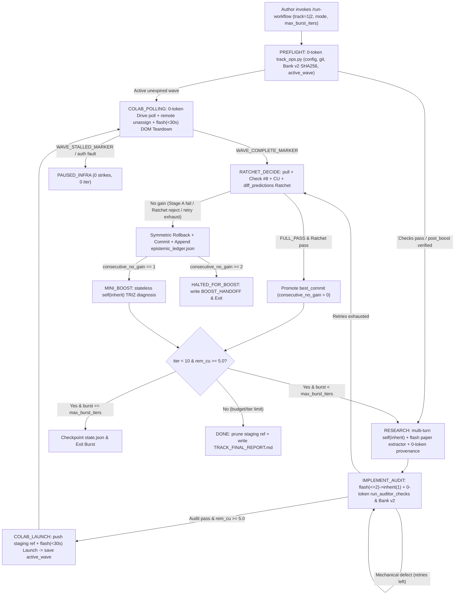
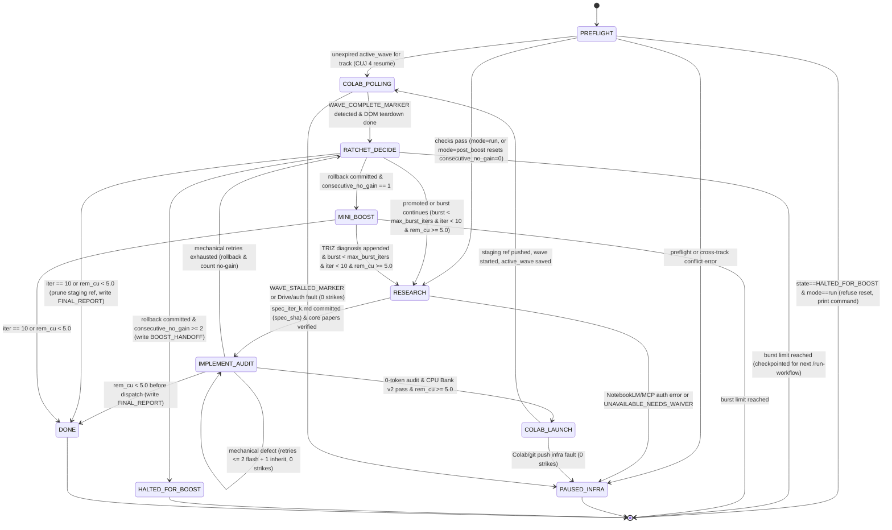

# Reusable Training-Free VLM Track Research Workflow (`/run-workflow` + Manual `/boost`)

*   **Author:** CaoAnhNato
*   **Status:** Proposed
*   **Date:** 2026-11-20

--------------------------------------------------------------------------------

## Overview

This document specifies a reusable, token-bounded research automation workflow built on Antigravity's `/run-workflow` runtime with manual `/boost` escalation (Antigravity's user-triggered multi-perspective analysis slash command) for iterative, training-free Vision-Language Model (VLM) decoding research on `5CD-AI/Vintern-1B-v3_5` (`InternViT-300M` + `Qwen2.5-0.5B-Instruct`, 24 decoder layers, 14:2 grouped-query attention, hidden dimension `D = 896`, vocabulary size `V = 151,936`) evaluated on 400 verified ViTextVQA images (`1,222` scene-text questions).

The system replaces the prior 10-agent `/swarm` message-board harness ([vlm_swarm_benchmark_system.md](./vlm_swarm_benchmark_system.md)) for a single researcher working on a Windows laptop (`4 GB` RTX 3050 Ti, CPU-only `CUDA_VISIBLE_DEVICES=""` locally) connected to Colab L4 GPUs through `colab-mcp`, remote git staging refs, and read-only Google Drive synchronization. It pairs an invariant methodology protocol (`docs/workflows/vlm_track_research_protocol.md`), centralized defaults plus minimal per-track overrides (`configs/tracks/workflow_defaults.json`, `configs/tracks/track_{1,2}.json`), and a thin disk-checkpointed `/run-workflow` orchestrator (`scripts/workflows/vlm_track_research/{workflow.json, main.py}`) calling one consolidated stdlib helper CLI (`scripts/workflows/track_ops.py`) alongside existing audit and benchmark utilities.

Two independent research tracks run sequentially from a shared frozen baseline branch (`base/frsa-011-frozen`), each capped at `10` iterations and `60` Colab Compute Units (`CU`), producing an independent best-checkpoint report with no cross-track auto-merging:

*   **Track 1 (`Team 1 - TF`)**: Post-`lm_head` output-trajectory calibration and dynamic Bellman/Lookahead decoding (`AdaCTB-BEIT` lineage targeting `BEIT-D Issue #1` under zoomed ROI; dataset-artifact `BEIT-D Issue #2` excluded).
*   **Track 2 (`Team 2 - TF`)**: Read-only intra-decoder self-verification across upper decoder layers (`[0.5, 1.0)` relative depth, enforcing zero KV-cache perturbation `max_kv_diff == 0.0`), locked to single-step decoding (multi-step dynamic programming and lookahead forbidden).

### Domain Glossary & Baseline Reference

*   **`NEVFE` (Non-Equilibrium Variational Free Energy)**: Core decoding package under `src/nevfe/` executing dual-stream contrastive decoding over visual-conditioned logits (`logits_plus`) and mean-field visual reference logits (`logits_zero`), using Bhattacharyya coefficient $\mathrm{BC}_t$ and optional query-token mask `q_mask`.
*   **`FRSA-PBCF` (Fisher-Rao Spherical Amplitude & Poisson-Bregman Chromatic Foveation)**: Prior campaign champion (commit `0f8a2d4d`, branch `swarm/team-1`, optical mask `"011"`), which raised ViTextVQA Token F1 from `60.19%` (Iteration 23) to `64.12%` (`62.19%` Substring Match, `63.16%` Composite, `36.99%` Exact Match) by pairing pure Layer-0 lexical-semantic spatial foveation (`p_lex`) and Poisson-Bregman ROI cropping with `IG-VFED (1, 1, 1)` decoding.
*   **`IG-VFED` (Information-Geometric Variational Free Energy Decoding)**: Base decoding equation combining Fisher-Rao geodesic visual coupling $\alpha_t = \lambda\sqrt{1 - \mathrm{BC}_t^2} + \lambda\mathrm{BC}_t\mathbf{1}_{t=1}$ (`lambda_param = 0.50`) and dynamic plausibility truncation $\beta_t = \beta \cdot \mathrm{BC}_t$ (`beta_param = 0.05`).
*   **`BEIT-D Issue #1` & `H_ffn`**: Under sharpened `FRSA-PBCF` ROI tiles, `BEIT-D` (Track 2's prior lookahead champion `a6fdcca6`) suffers pre-evidence candidate pruning when entropy drops, `t = 1`-only lookahead, and 2-step contrast saturation (`BEIT-D Issue #1`, Track 1's target via `AdaCTB-BEIT`). In parallel, upper-layer FFN blocks inject language-prior drift (`H_ffn`, Track 2's target via read-only intra-decoder verification).
*   **Evaluation Terms**: `QID` = question ID; `Stage A` = 100-QID stratified probe (`30` calibration QIDs + `70` held-out QIDs summarized by `comp_70`); `Stage B` = full `1,222`-QID benchmark; `Composite = (Token F1 + Substring Match) / 2`; `CLASS_A..CLASS_E` = five error-category buckets annotated on the 100-QID probe manifest; `W` = parallel GPU inference worker count; `SOP` = standard operating procedure.

## The Problem

Continuing iterative training-free VLM research on top of the `FRSA-PBCF` champion (`0f8a2d4d`: `64.12%` Token F1, `62.19%` Substring Match, `63.16%` Composite) faces five concrete bottlenecks if the previous `/swarm` architecture and repository scripts are reused unmodified:

1.  **Tool Isolation and Rule Drift in `/swarm`**: Built-in `/swarm` workers run with `EnableMCPTools=false`, blocking direct calls to `notebooklm`, `arxiv`, and `colab-mcp`. Enforcing scientific rules through message-board prompts across 10 long-lived agents increases token cost and allows rule drift, whereas `/run-workflow` agents with `type_name="self"` inherit full MCP access and let Python code enforce invariants deterministically at zero LLM token cost.
2.  **Baseline Code-Path Divergence on `swarm/team-1`**: On `swarm/team-1` (`4c8ee01`), `VinternNEVFEAdapter.generate()` bypasses `NEVFEEngine.decode_step()` and calls `nevfe_step_logits(..., comp_a=True, comp_b=True, comp_c=True)` directly, while `AlgorithmConfig` still defaults to `ablation_mask = (1, 1, 1)` and retains unused `gamma_param = 0.50`. Branching off `swarm/team-1` unmodified causes CPU tests (`decode_step`) to diverge from Colab runs (`generate`), exposes optical foveation to decoding ablations, and prevents Track 1/2 edits to `decode_step()` from taking effect on Colab.
3.  **Legacy Anchors and Live Defects in Reused Scripts**: Reused benchmark and audit scripts still anchor against Iteration 23 (`60.19%` F1 / `61.46%` Sub, Stage A `comp_70 = 37.19%`) rather than `FRSA-PBCF` (`64.12% / 62.19% / 63.16%`, Stage A `comp_70 = 40.92%`). `diff_predictions.py` compares `d_comp` against the initial baseline instead of the running best (allowing regressions after Iteration 1 to overwrite `<best_commit>`), `run_tier1_probe.py` drops custom `AlgorithmConfig` fields passed via `--config-json` and lacks a Leave-One-Out (LOO) net-contribution gate, `run_auditor_checks.py` ignores non-zero `git diff` exit codes on `metrics.py` and omits adapter/Track 2 checks, and `run_colab_swarm_wave.sh` lacks both a remote unassignment trap and pre-Stage-A `W = 4 -> 2 -> 1` VRAM calibration.
4.  **Storage Limits and Missing Signals in Local Calibration Data**: The legacy 30-sample bank (`data/local_calibration_bank/`) predates `FRSA-PBCF` ROI cropping and stores only step-1 logits. Dumping full-vocabulary (`V = 151,936`) `bf16` dual-stream logits across multi-step decoding requires `18.2 MB/step` across 30 questions (`219–365 MB` for `12–20` steps), exceeding the `< 200 MB` budget while leaving Track 2 unable to project upper-layer hidden vectors into token logits on CPU.
5.  **Lack of Structured Stagnation Escalation and Crash Resumability**: Multi-iteration runs span hours across Colab L4 waves and IDE restarts. Without atomic phase-level state persistence, a crash mid-wave risks leaking paid L4 Compute Units or re-running completed stages, while an unguarded loop either repeats falsified ideas or fails to distinguish accidental restarts from intentional manual `/boost` recovery after hitting a plateau.

## Goals

*   **Bit-Identical Shared Baseline (`base/frsa-011-frozen`)**: Isolate immutable `FRSA-PBCF` pure `p_lex` + Poisson-Bregman foveation (`src/nevfe/core/frozen_foveation.py`), remove unused `gamma_param`, keep `lambda_param = 0.50` and `beta_param = 0.05` locked inside `AlgorithmConfig` with `IG-VFED (1, 1, 1)` inside `NEVFEEngine.decode_step()`, route `VinternNEVFEAdapter.generate()` through `decode_step()`, and verify `max_abs_diff == 0.0` on CPU fixtures plus Stage A 100-question parity on Colab L4 before forking track branches.
*   **Factored Local Calibration Bank v2 (`< 200 MB`)**: Export a versioned, gitignored 30-sample bank (`data/calibration_bank_v2/`, worst-case `~80–87 MB` at `T = 16`, `bf16`, verified by `manifest.json` SHA-256 and `max_kv_diff == 0.0`) enabling local CPU diagnostics for Track 1 multi-step trajectories (`t = 1..16`) and Track 2 upper-layer hidden-to-logit verification outside `src/nevfe/` without loading full `Vintern-1B` weights locally.
*   **Compressed Single-Entrypoint `/run-workflow` State Machine**: Package the workflow as a thin stdlib-only orchestrator (`scripts/workflows/vlm_track_research/{workflow.json, main.py}` + externalized prompt files), an invariant methodology protocol (`docs/workflows/vlm_track_research_protocol.md`), centralized defaults plus 5-field track overrides (`configs/tracks/`), and one consolidated stdlib helper CLI (`scripts/workflows/track_ops.py`).
*   **Deterministic 0-Token Enforcement of Scientific & Resource Guardrails**:
    *   Training-free decoding only; zero regex, stopword, string-manipulation, or OCR heuristics across core and added adapter/pipeline diffs.
    *   Immutable `scripts/benchmark/metrics.py`, `tests/test_metrics_relaxation.py`, and `src/nevfe/core/frozen_foveation.py` (enforced via `returncode == 0` `git diff` plus pinned SHA-256).
    *   30-QID calibration blindfold: sample-level prediction diffs are restricted to the 30 `is_calibration: true` QIDs; `CLASS_A..CLASS_E` breakdowns cover the 100-QID probe subset, and the remaining `1,122` held-out QIDs report aggregate metrics only.
    *   Locked baseline constants (`lambda_param = 0.50`, `beta_param = 0.05`) plus at most `2` cumulative new theoretically grounded scalar parameters on `AlgorithmConfig` (preferring 1 adaptive expression), gated via Stage A LOO net-contribution checks anchored to the current best checkpoint.
    *   Single-step lock (`decoder_forward_calls_per_step == 1` per stream) and read-only KV invariance (`max_kv_diff == 0.0` under `DynamicCache`) for Track 2.
    *   Monotonic promotion ratchet (`cand_comp - eff_best_comp >= +0.25`, `cand_f1 >= max(64.12, eff_best_f1 - 0.50)`, `cand_sub >= max(62.19, eff_best_sub - 0.50)`) and committed symmetric rollback scoped to `src/nevfe/` and `tests/`.
*   **Verified Core-Paper Equations with Unrestricted Discovery**: Permit unrestricted NotebookLM (`Team 1 - TF` / `Team 2 - TF`) and rate-limited Semantic Scholar CLI (`~/.gemini/s2_api.lock`) discovery while verifying the `1–3` core papers driving each spec against cached raw arXiv LaTeX or original PDF sections (`<= 25 KB`/paper, emitting `VERIFIED_TEX | VERIFIED_PDF | UNAVAILABLE_NEEDS_WAIVER`).
*   **Token-Bounded Self-Improvement, Bounded Idle CU Exposure & Explicit `/boost` Handoff**:
    *   Enforce `<= 10` iterations and `<= 60 CU` per track on non-concurrent Colab L4 (pre-wave cutoff `remaining_cu < 5.0`), configurable burst size (`max_burst_iters = 2` default, `1..10`), `< 30s` `flash` Launch/Teardown micro-agents, 0-token Drive polling, remote staging-branch transport, and single-owner remote unassignment.
    *   Invoke an inline TRIZ contradiction diagnosis via `type_name="self"` (`model="inherit"`) only on the first non-improving iteration (`consecutive_no_gain == 1`); halt in `HALTED_FOR_BOOST` at `consecutive_no_gain >= 2` with `BOOST_HANDOFF_iter_<k>.md`; require explicit `mode="post_boost"` resumption to reset `consecutive_no_gain = 0` within the same `10`-iteration cap.
    *   Persist append-only cross-iteration negative knowledge in `epistemic_ledger.json` (projected to `< 3 KB` in prompts) and output an independent `TRACK_<id>_FINAL_REPORT.md` per track.

## Non-Goals

*   **Cross-Track Automatic Merging**: Combining winning Track 1 and Track 2 mechanisms into one unified branch is out of scope; each track produces an independent best-checkpoint report.
*   **Concurrent Colab L4 Execution**: Running Track 1 and Track 2 simultaneously on Colab L4 is forbidden; tracks execute sequentially under one shared OS mutex.
*   **Local GPU Inference**: Loading `Vintern-1B` onto the host `4 GB` RTX 3050 Ti GPU is forbidden; all local commands run under `CUDA_VISIBLE_DEVICES=""` with `<= 2.5 GB` RSS.
*   **Addressing `BEIT-D Issue #2`**: Adjacent signboard overflow caused by `15%` ROI border padding and dataset annotation conventions is excluded as a dataset artifact.
*   **Training, Heuristic Post-Processing, or Metric Edits**: Fine-tuning, LoRA, learned gating weights, external OCR engines, regex/stopword stripping, and modifications to `scripts/benchmark/metrics.py` are out of scope.
*   **Automated `/boost` Invocation**: `/boost` is a manual user slash command; the workflow only halts, writes the handoff dossier, and resumes explicitly after manual `/boost`.

## Open Questions

None.

## Critical User Journeys (CUJs)

### CUJ 1: Phase-0 Base Freezing & Calibration Bank v2 Export

*   **Given**: Branch `swarm/team-1` (`4c8ee01`) is checked out locally; host has `CUDA_VISIBLE_DEVICES=""`, non-interactive `git push` credentials to `origin`, read-only Google Drive access (`gdrive readonly` or host `RCLONE_DRIVE_TOKEN_JSON`), active Chrome `colab-mcp` `ProxyPort` connection, and Colab `userdata` containing `HF_TOKEN` and auto-refreshing `RCLONE_DRIVE_TOKEN_JSON` (`client_id`, `client_secret`, `refresh_token`).
*   **When**: The researcher branches `base/frsa-011-frozen` from `swarm/team-1`, commits all Phases 0–3 infrastructure/configs/anchors onto it, pushes `base/frsa-011-frozen` to `origin`, and runs the standalone Phase-0 Colab export command (`run_colab_track_wave.sh --phase0-export`).
*   **Then**: CPU parity fixtures confirm `max_abs_diff == 0.0` against `4c8ee01` `"011"`, Colab L4 confirms Stage A 100-question parity and exports **Factored Calibration Bank v2** (`~80–87 MB`, `< 200 MB`, `max_kv_diff == 0.0`) to Drive, the researcher pulls the bank into gitignored `data/calibration_bank_v2/` with verified `manifest.json` SHA-256 digests, tags `frsa-011-frozen-v1`, and unassigns the L4 runtime.

### CUJ 2: Executing a Bounded Autonomous Research Burst on Track 1 or Track 2

*   **Given**: A branch forked from `base/frsa-011-frozen` (e.g., `research/track-1` or `research/track-2`), verified `data/calibration_bank_v2/`, and valid track config under `configs/tracks/`.
*   **When**: The researcher invokes `/run-workflow` on `scripts/workflows/vlm_track_research/main.py` with `Args = {"track": 1, "mode": "run", "max_burst_iters": 2}` (or `"track": 2`).
*   **Then**:
    1.  0-token `PREFLIGHT` validates config, git ancestry, clean tree, Calibration Bank v2 SHA-256, `CUDA_VISIBLE_DEVICES=""`, and active-wave recovery state before spawning any LLM.
    2.  Each iteration runs the compressed pipeline detailed in Technical Plan §§4–6: multi-turn `RESEARCH` with verified core-paper provenance -> `IMPLEMENT_AUDIT` (bounded Implementer + 0-token AST/KV/Bank-v2 audit) -> `COLAB_LAUNCH` (push staging ref + `< 30s` Launch micro-agent) -> `COLAB_POLLING` (0-token Drive marker poll + `< 30s` DOM Teardown micro-agent) -> `RATCHET_DECIDE` (pull artifacts, Check #8, CU accounting, monotonic promotion ratchet, or committed symmetric rollback + `epistemic_ledger.json` update).
    3.  After `max_burst_iters` iterations complete without halting, the workflow checkpoints `state.json` and logs a compact scoreboard ready for the next burst call.

### CUJ 3: Tier-1 Contradiction Diagnosis & Tier-2 Manual `/boost` Circuit Breaker

*   **Given**: Track `i` finishes Iteration `k` without clearing Stage A `FULL_PASS` or the Stage B promotion ratchet and completes symmetric rollback.
*   **When**:
    *   **First non-improving iteration (`consecutive_no_gain == 1`)**: The workflow enters `MINI_BOOST`, invoking a stateless TRIZ contradiction diagnosis (`type_name="self"`, `model="inherit"`) over `spec_iter_<k>.md`, `forensic_delta.md`, and the `< 3 KB` epistemic preamble, appends the diagnosis to `epistemic_ledger.json`, and advances to Iteration `k + 1`.
    *   **Second consecutive non-improving iteration (`consecutive_no_gain >= 2`)**: The circuit breaker halts before starting another iteration.
*   **Then**: State transitions to `HALTED_FOR_BOOST`, L4 teardown is confirmed, `reports/track_<id>/iter_<k>/BOOST_HANDOFF_iter_<k>.md` is written (scoreboard, probe `CLASS_A..CLASS_E` deltas, Stage A LOO / `SUBMASK_HINT` diagnostics, TRIZ diagnosis, remaining CU/iterations, and a copy-pasteable `/boost` prompt), and the workflow exits.

### CUJ 4: Explicit Post-`/boost` Resume vs. Mid-Wave Crash Auto-Resume

*   **Given**: A track either (a) halted in `HALTED_FOR_BOOST`, or (b) exited unexpectedly mid-iteration due to an IDE restart or transient MCP fault.
*   **When**:
    *   **Post-`/boost` resume**: After running manual `/boost`, the researcher writes `reports/track_<id>/iter_<k>/BOOST_RESOLUTION_iter_<k>.md` (or commits manual edits) and invokes `/run-workflow` with `mode="post_boost"` and `boost_notes_path`.
    *   **Crash auto-resume**: The researcher re-runs `/run-workflow` with `mode="run"`.
*   **Then**:
    *   Under `mode="post_boost"`, `track_ops.py` validates the resolution file digest (preventing replay via `consumed_boost_digests`) or post-halt commit, appends the `/boost` directive to `epistemic_ledger.json`, resets `consecutive_no_gain = 0` once, and launches Iteration `k + 1` within the same `10`-iteration cap. Running `mode="run"` while in `HALTED_FOR_BOOST` refuses to reset `consecutive_no_gain` and prints the exact `mode="post_boost"` invocation.
    *   Under crash recovery (`mode="run"`), `PREFLIGHT` reconciles `state.json` against git `HEAD`: if `active_wave` is unexpired for the current track, it resumes `COLAB_POLLING` directly without spawning a duplicate VM; infrastructure faults (`PAUSED_INFRA`) resume with zero `iteration` or `consecutive_no_gain` increment.

### CUJ 5: Track Completion & Budget Termination

*   **Given**: A track reaches `iteration == 10` or drops below `remaining_cu < 5.0` at a pre-wave budget check.
*   **When**: The termination check runs in `RATCHET_DECIDE` or before `COLAB_LAUNCH`.
*   **Then**: The workflow verifies L4 unassignment, deletes the disposable remote staging ref (`refs/heads/colab-staging/track-<id>`), confirms zero diff against `<best_commit>` on `src/nevfe/` and `tests/`, writes `reports/track_<id>/TRACK_<id>_FINAL_REPORT.md` (scoreboard, `<best_commit>`, Stage A/B metrics, CU totals, verified core-paper citations), and transitions to `DONE` without cross-track merging.

--------------------------------------------------------------------------------

## Technical Plan (Architecture)

### 1. System Architecture & Sandbox Boundary

`/run-workflow` executes `main.py` in a standalone `python3` process that cannot import local repository modules, cannot invoke MCP tools directly, and raises `ToolError.denied` on any unapproved tool call (`model="inherit"` selects the parent's high-reasoning model; `model="flash"` selects the fast/low-cost tier; each invocation carries run ID `CONVERSATION_ID:STEP_INDEX`). The system therefore enforces a **Thin-Orchestrator / Single-Helper-CLI Boundary**:

*   **Thin Orchestrator (`scripts/workflows/vlm_track_research/{workflow.json, main.py}` + `prompts/*.md`)**: Stdlib-only Python script that loads resolved track config via `track_ops.py`, reads externalized prompt templates and `docs/workflows/vlm_track_research_protocol.md`, drives the 10-state FSM through subprocess CLIs, and dispatches bounded `await agent(...)` calls with explicit JSON `finish` schemas.
*   **Consolidated 0-Token CLI Layer**: One stdlib workflow helper (`scripts/workflows/track_ops.py`) paired with existing benchmark/audit scripts (`run_auditor_checks.py`, `diff_predictions.py`, `export_calibration_bank.py`, `colab_drive_sync.py`, `run_guarded.py`), invoked as UTF-8 PowerShell-5.1-safe subprocesses returning structured JSON stdout.
*   **Credentialed Tool Boundary**: All `colab-mcp`, `notebooklm`, and `arxiv` MCP tools execute inside `type_name="self"` workflow agents. Semantic Scholar queries remain serialized via `tools/s2_folks_cli/fetch_papers.py` (`~/.gemini/s2_api.lock`). Code transport to Colab uses a disposable git remote staging ref so host Drive access stays strictly read-only.

---

### 2. Shared Frozen Baseline (`base/frsa-011-frozen`) & Engine Interface Contract

To resolve the `swarm/team-1` code-path divergence and free `src/nevfe/core/engine.py` from legacy foveation code without breaking existing callers:

1.  **Immutable Foveation Module (`src/nevfe/core/frozen_foveation.py`)**: Extract the `"011"` optical foveation pipeline (`p_lex`, Poisson-Bregman subwindow selection, mean-field reference embeddings) out of `engine.py` and remove unused variational/Bregman optical helpers and `gamma_param`. Lock `frozen_foveation.py` via `git diff base/frsa-011-frozen` (`returncode == 0`, zero diff bytes) plus pinned SHA-256.
2.  **Locked Baseline Constants & Unified `AlgorithmConfig` (`src/nevfe/core/engine.py`)**:
    *   Keep `lambda_param: float = 0.50` and `beta_param: float = 0.05` directly inside frozen `AlgorithmConfig` (validated in `__post_init__` and audited by Check #2) rather than evicting them to module level, eliminating cross-file churn and keeping the Check #2 numeric-literal allowlist intact.
    *   Cap track additions at `<= 2` cumulative new tunable scalar fields (`<= 4` total scalars excluding `ablation_mask`, preferring `1` adaptive expression) alongside `COMPONENT_NAMES` and variable-length `ablation_mask`.
    *   Implement `IG-VFED (1, 1, 1)` directly inside `NEVFEEngine.decode_step()` as the base decoder when `ablation_mask` is empty or all-zero.
    *   Accept an explicit typed `step_context` mapping (`history_logits`, `upper_hidden_states`, `rollout_fn`) on `decode_step()` so Track 1 multi-step Bellman rollouts execute inside `src/nevfe/core/engine.py` via an adapter-supplied callback (reusing existing KV-cache cloning helpers) while Track 2 consumes read-only upper-layer states without altering core signatures.
3.  **Unified Adapter Routing & Non-Breaking Hooks (`src/nevfe/adapter/vintern_adapter.py`, `src/nevfe/pipeline.py`)**:
    *   Route `VinternNEVFEAdapter.generate()` directly through `self.engine.decode_step(...)` and expose per-generation `last_decoder_forward_calls` telemetry.
    *   Preserve existing `managed_forward_hooks(hook_specs)` unchanged for backward compatibility; add separate relative-depth helpers (`[0.5, 1.0)` over `num_hidden_layers`) supporting `register_forward_pre_hook` and enforcing `output_attentions=False`.
    *   Extract one shared config- and mask-resolution helper (`resolve_algorithm_config`, `parse_ablation_mask`) reused by both Stage A (`run_tier1_probe.py`) and Stage B (`evaluate_vitextvqa.py`).
4.  **Branch Topology & Phase-0 Parity Anchor**: Branch `base/frsa-011-frozen` from `swarm/team-1` (`4c8ee01`), commit all Phases 0–3 infrastructure, configs, scripts, and baseline metric/prediction anchors (`configs/frsa011_baseline_summary.json`, `configs/frsa011_baseline_predictions.jsonl`) onto `base/frsa-011-frozen`, push to `origin`, verify CPU `max_abs_diff == 0.0` + Colab Stage A parity, and tag `frsa-011-frozen-v1` before forking `research/track-1` and `research/track-2`.

---

### 3. Factored Calibration Bank v2 Schema (`< 200 MB`, Worst-Case `~80–87 MB`)

Stored in gitignored `data/calibration_bank_v2/` (separate from legacy `data/local_calibration_bank/`), exported once on Colab L4 in Phase 0 across the 30 `is_calibration: true` QIDs of `configs/probe_100_manifest.json` under frozen `FRSA-PBCF` ROI zoom (`max_steps = 16`, `bfloat16`, `output_attentions=False`):

| Artifact / Field | Shape & Dtype | Worst-Case Size (30 QIDs, `T = 16`) | Diagnostic Purpose |
| --- | --- | :---: | --- |
| `shared_readout.pt` (`norm_weight`, `rms_norm_eps`) | `[D]` (`[896]`, `bf16`) + `float` | `1.8 KB` | Final `RMSNorm` scaling for Track 2 CPU logit-lens |
| `qid_<id>.pt`: `logits_plus_t1`, `logits_zero_t1` | `[V]` each (`[151936]`, `bf16`) | `18.2 MB` | Exact full-vocabulary `t = 1` simplex for Track 1 & 2 |
| `qid_<id>.pt`: `step_topk_ids`, `step_topk_plus`, `step_topk_zero` (`t = 2..T`) | `[T-1, 2048]` (`int32`, `bf16`, `bf16`) | `7.4 MB` | Union top-2048 multi-step trajectories for Track 1 |
| `qid_<id>.pt`: `step_simplex_invariants` (`t = 1..T`) | `[T, 6]` (`fp32`: `lse_plus`, `lse_zero`, `H_plus`, `BC`, `p_max_plus`, `greedy_id`) | `< 0.1 MB` | Exact full-`V` normalizers & entropy invariants |
| `qid_<id>.pt`: `h_in_upper_{plus,zero}`, `h_post_attn_upper_{plus,zero}`, `h_post_ffn_upper_{plus,zero}` (`t = 1..T`) | Both streams: `2 × ([T, 1, D] + 2 × [T, L/2, D])` (`bf16`) | `43.0 MB` | Exact Attention and FFN deltas across upper `L/2 = 12` layers for both streams |
| `qid_<id>.pt`: `active_vocab_ids`, `lm_head_slice` | `[S_q]` (`int32`), `[S_q, D]` (`bf16`, `S_q <= 256`) | `13.8 MB` | Local CPU projection of Track 2 hidden states without loading `272 MB` `lm_head` |
| `manifest.json` | JSON (`schema_version: "2.0"`, `base_commit_sha`, `backbone_id`, `num_hidden_layers`, `max_steps`, `max_kv_diff: 0.0`, `total_bytes`, `files` map with `sha256`) | `< 10 KB` | 0-token preflight schema & integrity validation |
| **Total worst-case footprint (`T = 16`)** | Pure tensors + primitives (`weights_only=True`) | **`~82.4 MB` (`~80–87 MB` with serialization overhead; `< 200 MB` hard cap)** | Real CPU diagnostics for both tracks prior to Colab |

During Phase-0 export on Colab L4, the exporter compares an unhooked reference pass against the read-only hooked pass and aborts if `max_kv_diff > 0.0`. The Bank v2 CPU evaluator (`run_calibration_eval_v2`) lives entirely outside `src/nevfe/` inside `scripts/benchmark/export_calibration_bank.py` and calls only the unmodified `NEVFEEngine.decode_step()` interface.

---

### 4. Compressed 10-State FSM, Centralized Configuration & Failure Isolation

#### Centralized Defaults & Minimal Per-Track Configuration

Workflow-global settings (`base_ref`, baseline summary/prediction paths, mutable/immutable path lists, parameter cap `2`, budgets, and Drive root namespace) live once in `configs/tracks/workflow_defaults.json`. Per-track files `configs/tracks/track_{1,2}.json` store only the **5** track-specific overrides: `track_id`, `track_name`, `notebooklm_notebook_id` (non-secret UUIDs; auth is checked passively via MCP errors), `single_step_lock`, and `require_zero_kv_diff`. Stdlib validation inside `track_ops.py` merges and checks both files with zero third-party schema dependencies.

#### Reconcilable 10-State FSM & Explicit Post-`/boost` Handshake

All durable workflow state lives in two files: gitignored `.workflow_state/track_<id>/state.json` (embedding `fsm_state`, `iteration`, `consecutive_no_gain`, `<best_commit>`, `best_f1/sub/comp`, `best_probe_70_comp`, `halted_head_sha`, `consumed_boost_digests`, `active_wave`, `cu_ledger`, `cumulative_track_cu`, and bounded `event_log` keyed by `trace_id` and `workflow_run_id`) and tracked `reports/track_<id>/epistemic_ledger.json`. All state mutations and cross-track Colab exclusivity (`~/.gemini/colab_active_track.json`) serialize through one lock primitive (`run_guarded.acquire_os_lock` on `~/.gemini/colab_l4.mutex`).

*   **`workflow.json` `Args` Schema**:
    *   `track`: `int` (`1 | 2`, required)
    *   `mode`: `str` (`"run" | "post_boost" | "preflight" | "status"`, default `"run"`)
    *   `max_burst_iters`: `int` (`1..10`, default `2`)
    *   `boost_notes_path`: `str` (optional; required under `mode="post_boost"` unless a post-halt commit is present on `HEAD`)
*   **3-Tier Failure Isolation**:
    1.  *Fixable Mechanical Gate Violations* (AST, parameter cap, heuristic scan, `max_kv_diff > 0`, unit test or Bank v2 failure): bounded self-repair inside `IMPLEMENT_AUDIT` (`<= 2` `flash` retries + `1` `inherit` escalation, `0` CU spent). Exhausting all 3 attempts routes to `RATCHET_DECIDE` rollback and increments `consecutive_no_gain += 1`.
    2.  *Infrastructure / Auth / Stall Faults* (NotebookLM cookie expiry, `ToolError.denied`, `WAVE_STALLED_MARKER`, Colab disconnect, missing paper waiver, S2 `HTTP 429`): transition to `PAUSED_INFRA` after confirming L4 teardown; `0` iteration increment and `0` `consecutive_no_gain` increment.
    3.  *Scientific Non-Improvement* (Stage A fail/sub-mask-only hint or Stage B ratchet reject): `track_ops.py` executes a committed symmetric rollback to `<best_commit>` over `src/nevfe/` and `tests/` (preserving `docs/specs/`, `reports/`, `.workflow_state/`, and immutable `tests/test_metrics_relaxation.py`), appends a `<= 150`-token falsified claim record to `reports/track_<id>/epistemic_ledger.json`, and increments `consecutive_no_gain += 1`.

---

### 5. Segmented Colab L4 Lifecycle, Remote Staging Transport & Stage A LOO Gating

To prevent 45-minute stateful LLM polling, fresh-VM teardown races, and Drive write-permission conflicts:

1.  **Sequential Mutex & Crash-Safe Active-Wave Tracking**: `track_ops.py` acquires `~/.gemini/colab_l4.mutex` via `run_guarded.acquire_os_lock` around updates to `~/.gemini/colab_active_track.json` and `state.json`'s `active_wave` block (`{track_id, trace_id, wave_id, run_folder_id, added_cell_ids, launched_at, ttl_s}`). Remote wave liveness is decoupled from local process PIDs so IDE restarts resume `COLAB_POLLING` (`CUJ 4`) without killing active Stage B waves; orphan teardown triggers only on `ttl_s` expiration (`100 min`) or cross-track conflict.
2.  **Remote Staging-Ref Code Transport**: Before launch, `track_ops.py` force-pushes candidate `HEAD` to a disposable remote staging ref (`refs/heads/colab-staging/track-<id>`). Colab pulls that exact commit via `git fetch origin`, keeping host Google Drive permissions strictly `gdrive readonly` and Colab Drive sync strictly unidirectional upload.
3.  **3-Part Segmented Execution**:
    *   *Launch micro-agent (`flash`, `< 30s`)*: connects via `colab-mcp`, snapshots `initial_cell_ids`, verifies `RCLONE_DRIVE_TOKEN_JSON` auto-refresh credentials, starts detached `nohup /tmp/run_colab_track_wave.sh` (preserving `TBE_RUNTIME_ADDR`), returns `{wave_id, run_folder_id, added_cell_ids, connect_ts}`, and exits.
    *   *0-token Drive poll loop (`COLAB_POLLING`)*: polls the run folder (`run_folder_id`) every `120–180s` via pure-Python `colab_drive_sync.py --poll-markers` (when host Drive credentials are configured) or one static pre-approved `gdrive readonly ls` command until `WAVE_COMPLETE_MARKER` or `WAVE_STALLED_MARKER` appears (`0` LLM tokens, `0` Colab RPCs).
    *   *Single-owner Teardown*: On normal wave completion or remote stall, the remote guarded `EXIT` trap verifies Drive upload and calls `POST http://$TBE_RUNTIME_ADDR/unassign` (with an IPython background watcher fallback if `TBE_RUNTIME_ADDR` is absent). Local `Colab Teardown` (`flash`, `< 30s`) then performs kernel-free DOM cell cleanup (`delete_cell` over `reversed(added_cell_ids)`) without executing an IPython cell that would force Colab to reconnect and provision a fresh GPU VM; IPython `runtime.unassign()` runs only on confirmed orphan/still-connected fallback paths.
4.  **Remote Wave Safeguards & Stage A LOO Gating (`scripts/benchmark/run_colab_track_wave.sh`)**:
    *   Reuses the remote bash zero-progress stall watchdog (`600s` stall cutoff during calibration/Stage A, `1200s` during Stage B) plus a `90 min` (`5400s`) hard wall-clock ceiling, uploading partial diagnostics and `WAVE_STALLED_MARKER` into the polled run folder before unassigning.
    *   Calibrates worker count `W` (`4 -> 2 -> 1`, live background `nvidia-smi` peak VRAM `<= 16.0 GB`) once on 10 samples before Stage A and reuses `W` for Stage B.
    *   Runs `1 + M` compact bitstring masks (`M ∈ {0, 1, 2}` new components: `"base"` for `M = 0`, `"1"`/`"0"` for `M = 1`, `"11"`/`"10"`/`"01"`/`"00"` for `M = 2`) in Stage A against `best_probe_70_comp` persisted with `<best_commit>`:
        *   **`FULL_PASS`**: Proceeds to Stage B on the full mask strictly when `full_comp_70 > best_probe_70_comp` AND (for `M >= 1`) `full_comp_70 > max(sub_comp_70)` (breaking ties in favor of fewer active bits).
        *   **`SUBMASK_HINT` / `FAIL`**: Skips Stage B (saving `~35 min` / `~3 CU`). If a proper sub-mask `m*` beats both `best_probe_70_comp` and `1..1`, Stage A records `SUBMASK_HINT` in `probe_ablation_summary.json` -> `forensic_delta.md` and `epistemic_ledger.json` so the next iteration proposes that reduced 1-parameter specification directly with zero automated code pruning.
5.  **CU Accounting**: `state.json` tracks per-wave `{trace_id, iter_k, connect_ts, unassign_ts, wall_seconds, cu_rate_per_hr: 5.0, estimated_cu, unassign_confirmed, teardown_mode}` and `cumulative_track_cu`. Every pre-wave dispatch gates on `cumulative_track_cu + 5.0 <= 60.0` (`remaining_cu >= 5.0`).

---

### 6. Native Multi-Turn Literature Verification & Deterministic Audit Layer

1.  **Native Multi-Turn Research & Provenance Check (`RESEARCH`)**:
    *   Within a single iteration, `main.py` opens one stateful multi-turn Researcher handle `r = agent(..., type_name="self", model="inherit")` (discarded at iteration end to prevent `O(K^2)` cross-iteration context growth).
    *   *Turn 1*: Reads the `< 3 KB` compacted epistemic preamble and latest `forensic_delta.md`, queries NotebookLM (`Team 1 - TF` or `Team 2 - TF`) + rate-limited `fetch_papers.py`, and emits `1–3` core arXiv IDs/DOIs with target equations.
    *   *Extraction & Provenance*: A stateless `flash` extractor downloads raw arXiv `.tex` method sections (`<= 25 KB`/paper, cached in `.workflow_state/paper_cache/`) or original PDF pages and emits `verified_primitives_iter_<k>.md` + `core_paper_verification.json` (`VERIFIED_TEX | VERIFIED_PDF | UNAVAILABLE_NEEDS_WAIVER`, source SHA-256, section & anchor metadata). 0-token `track_ops.py papers verify` validates normalized section/equation provenance against cached source files; any `UNAVAILABLE_NEEDS_WAIVER` pauses in `PAUSED_INFRA` until an explicit author-signed waiver file is supplied.
    *   *Turn 2 (same `r` handle)*: Writes `docs/specs/track_<id>/spec_iter_<k>.md` from verified primitives and commits `spec_sha` via `track_ops.py`.
2.  **0-Token Audit Suite (`scripts/audit/run_auditor_checks.py --track {1|2}`)**:
    *   **Core + Adapter AST & Parameter Gate (Checks #2, #3, #5)**: Verifies `lambda_param == 0.50`, `beta_param == 0.05`, `<= 2` cumulative new tunable scalar fields in `AlgorithmConfig`, zero diff on `src/nevfe/core/frozen_foveation.py`, `<= 250` non-docstring AST lines in `engine.py`, zero undeclared numeric constants outside `AlgorithmConfig`, core-only ban on backbone-dimension literals, relative-depth indexing check on `vintern_adapter.py` diffs, and AST-diff-filtered ban on regex/stopword/OCR/string/GT-key heuristics across core and added adapter/pipeline lines.
    *   **Metrics & Spec Lock Gate (Checks #4, #7)**: Enforces `returncode == 0` AND empty diff vs. `base/frsa-011-frozen` plus pinned SHA-256 on `scripts/benchmark/metrics.py` and `tests/test_metrics_relaxation.py`, `# SPEC_REF` LF-normalized SHA-256 parity, and zero Implementer diff on `docs/specs/`.
    *   **Guarded CPU Execution & Authoritative Track 2 Runtime Gate (Check #6)**: Runs `scripts/local/run_guarded.py` (with configurable `--lock-path`, `CUDA_VISIBLE_DEVICES=""`, `<= 2` threads, `<= 2.5 GB` RSS) over `tests/test_nevfe_engine.py`, `tests/test_frsa011_base_parity.py`, optional non-accumulating `tests/test_track_candidate.py`, and `run_calibration_eval_v2` (resolved against `repo_root`). Under `--track 2`, runtime instrumentation is authoritative: synthetic 24-layer `Qwen2Model` pytest verifies `max_kv_diff == 0.0` across all `L` layers, both streams, and multi-step `DynamicCache` plus `decoder_forward_calls == 2 * steps` (`1`/stream/step), mirrored into post-Colab `colab_run_telemetry.json`.
    *   **Post-Colab Integrity Gate (Check #8)**: Single owner of post-Colab SHA-256 verification, Drive upload receipt check, UTF-8 / zero-null-byte lint on emitted `.md`/`.json` reports, cell restoration verification, and Stage-A-veto vs. Stage-B-complete artifact validation.
3.  **Monotonic Ratchet & Blindfold Forensics (`scripts/benchmark/diff_predictions.py`)**:
    *   Computes `d_comp = cand_comp - eff_best_comp`, raising an explicit error on missing summary keys.
    *   Promotes iff `d_comp >= +0.25` AND `cand_f1 >= max(64.12, eff_best_f1 - 0.50)` AND `cand_sub >= max(62.19, eff_best_sub - 0.50)`.
    *   Renders `forensic_delta.md` (`<= 8 KB` cap) with aggregate deltas, probe-subset `CLASS_A..CLASS_E` deltas, Stage A LOO matrix (`SUBMASK_HINT`), latency/VRAM/`max_kv_diff`, and sample-level diffs filtered to changed or failing `is_calibration: true` QIDs (deterministically truncated with count of omitted unchanged QIDs).

---

### 7. Token, Model Tiering & Role Allocation

| Phase / Role | Model / Cost Tier | Invocation Condition | Context Cap |
| --- | --- | --- | --- |
| `PREFLIGHT`, Audits, Bank v2 Eval, Drive Poll, Ratchet, Rollback, CU Accounting, FSM State | `0` LLM tokens (`track_ops.py` + repo CLIs) | Always | Deterministic JSON |
| `Researcher` (`type_name="self"`, multi-turn within iteration) | `model="inherit"` | Once per iteration (discarded between iterations) | `< 3 KB` epistemic preamble + `<= 8 KB` `forensic_delta.md` + verified primitives |
| `Paper Extractor` (`type_name="self"`) | `model="flash"` | `1–3` core papers per new spec (cached on disk) | `<= 25 KB` / paper |
| `Implementer` (`type_name="self"`) | `model="flash"` (`<= 2` tries) -> `inherit` (try `3`) | Once per iteration + bounded mechanical repair | Diff + failing audit/test receipt |
| `Colab Launch` & `Colab Teardown` (`type_name="self"`) | `model="flash"` (`< 30s` each) | Once per passing audit | Minimal wave manifest / `added_cell_ids` JSON |
| `Tier-1 Mini-Boost` (`type_name="self"` + inline TRIZ prompt) | `model="inherit"` | Only when `consecutive_no_gain == 1` | `spec_iter_<k>.md` + `forensic_delta.md` + `< 3 KB` epistemic preamble |
| `Tier-2 /boost` (Human Manual Escalation) | Manual slash command | Clean halt when `consecutive_no_gain >= 2` | `BOOST_HANDOFF_iter_<k>.md` |

--------------------------------------------------------------------------------

## Alternatives Considered

### Alternative A: Reusing `/swarm` 10-Agent Message-Board Orchestration

*   **Pros**: Existing named worker roster with public `@mention` threads and `.agents/swarm_roles/` prompts.
*   **Cons**: Built-in `/swarm` workers run with `EnableMCPTools=false`, blocking direct `notebooklm`, `arxiv`, and `colab-mcp` access; coordinating 10 persistent agents consumes higher token overhead and relies on LLM compliance instead of deterministic Python guards for rollbacks, parameter caps, and ratchets.
*   **Reason for Rejection**: `/run-workflow` with `type_name="self"` provides direct MCP access while moving every invariant check and rollback into 0-token Python code.

### Alternative B: Linking Only a Markdown Protocol to `/run-workflow` Without a Committed Python Script

*   **Pros**: Avoids maintaining a Python orchestrator beside `docs/workflows/vlm_track_research_protocol.md`.
*   **Cons**: `/run-workflow` executes a Python script (`ScriptPath`), not raw Markdown. Linking only a `.md` file forces repeated code synthesis per branch, wasting tokens, risking silent omission of hard guards (`max_kv_diff == 0.0`, CU cap, `consecutive_no_gain >= 2`), and breaking disk-backed resume.
*   **Reason for Rejection**: Committing one parameterized `scripts/workflows/vlm_track_research/{workflow.json, main.py}` alongside the invariant protocol eliminates synthesis drift and preserves deterministic resume state.

### Alternative C: Allowing Track 2 Multi-Step DP / Lookahead Decoding

*   **Pros**: Permits combining intra-decoder conflict signals (`H_ffn`) directly with multi-step lookahead inside one track.
*   **Cons**: Confounds the causal attribution of read-only intra-decoder Attention-vs-FFN verification with Track 1's output-trajectory dynamic programming and doubles Track 2 inference latency (`~2.0 s/Q`).
*   **Reason for Rejection**: Locking Track 2 to single-step decoding (`decoder_forward_calls_per_step == 1` per stream) isolates intra-decoder verification cleanly from multi-step search.

### Alternative D: Concurrent `colab-mcp` Execution & Automatic Cross-Track Merging

*   **Pros**: Compresses calendar wall-clock time across both tracks and attempts an automated joint checkpoint.
*   **Cons**: Both tracks share one Chrome `ProxyPort` / Colab L4 session and laptop RAM; concurrent waves risk cell clobbering, premature unassignment, and OOM. Auto-merging independent codebases complicates cumulative scalar budgets (`<= 2` new scalars) and obscures per-track attribution.
*   **Reason for Rejection**: Sequential execution (`60 CU` per track) with independent final reports eliminates hardware contention and preserves per-track scientific attribution.

### Alternative E: Forcing Constant alpha_t = 0.50 Inside `VinternNEVFEAdapter.generate()`

*   **Pros**: Removes Fisher-Rao $\alpha_t$ computation during decoding and matches legacy standalone `decode_step()` under `comp_a=False`.
*   **Cons**: On `swarm/team-1`, the `64.12%` F1 / `62.19%` Sub champion (`0f8a2d4d` `"011"`) bypassed `decode_step()` and executed full `IG-VFED (1, 1, 1)` inside `generate()`. Replacing `generate()` with constant $\alpha_t = 0.50$ breaks `64.12%` parity and requires spending `~4 CU` in Phase 0 to benchmark an unverified baseline.
*   **Reason for Rejection**: Locking `IG-VFED (1, 1, 1)` inside `decode_step()` and routing `generate()` through it preserves bit-identical `64.12%` parity while unifying CPU tests with Colab runs.

### Alternative F: Monolithic Workflow Script Importing Local Repository Modules Directly

*   **Pros**: Avoids subprocess invocation and JSON stdout serialization between the orchestrator and helper logic.
*   **Cons**: Violates `/run-workflow` sandbox rules (local modules are not importable inside workflow scripts), and embedding audit, ratchet, and rollback code beside runtime-injected globals (`agent`, top-level `await`) makes those gates untestable under `pytest`.
*   **Reason for Rejection**: Runtime sandbox constraints and `pytest` coverage requirements mandate a stdlib-only thin orchestrator invoking standalone CLI modules.

### Alternative G: Dense Multi-Step Full-Vocabulary (`V = 151,936`) Calibration Bank v2

*   **Pros**: Preserves exact full-vocabulary logits for every decoding step `t = 1..T` without top-`K` truncation.
*   **Cons**: Dual-stream `bf16` logits (`607.7 KB/step`) consume `18.2 MB/step` across 30 QIDs (`219–365 MB` for `12–20` steps), exceeding the `< 200 MB` cap while still leaving Track 2 unable to project upper-layer hidden vectors into logits on CPU (`lm_head.weight` is `272 MB`).
*   **Reason for Rejection**: Exceeds the `< 200 MB` storage budget and omits Track 2 CPU projection support; replaced by Factored Calibration Bank v2 (`~80–87 MB`).

### Alternative H: Minimal `t = 1`-Only (`~18 MB`) Calibration Bank v2

*   **Pros**: Fastest Phase-0 export (`< 2 min`) and smallest local footprint (`~18 MB`), reusing legacy `export_calibration_bank.py` with minimal changes.
*   **Cons**: Cannot locally exercise Track 1's multi-step (`t >= 2`) conflict-trigger logic or Track 2's upper-layer hidden-to-logit verification on real `Vintern-1B` tensors prior to spending Colab L4 Compute Units.
*   **Reason for Rejection**: Factored Calibration Bank v2 fits within `< 200 MB` (`~80–87 MB`) while providing real multi-step and upper-layer CPU diagnostics for both tracks without adding sparse paths to `src/nevfe/core/engine.py`.

### Alternative I: Single 45-Minute Stateful `flash` `Colab Runner` Agent

*   **Pros**: Consolidates launch, polling, and teardown into one agent prompt.
*   **Cons**: An uncaught error, host restart, or RPC timeout kills the in-flight agent, drops volatile metadata (`added_cell_ids`, `wave_id`), strands an active L4 VM burning paid CU, and accumulates `O(K^2)` polling tokens.
*   **Reason for Rejection**: Segmented `< 30s` `Launch` and DOM `Teardown` micro-agents paired with 0-token Drive polling and remote dead-man unassignment preserve crash resumability and bound idle CU exposure.

### Alternative J: Pre-Hoc Subjective LLM Spec Gating Before Stage A

*   **Pros**: Attempts to filter weak hypotheses before running Colab Stage A.
*   **Cons**: Reintroduces subjective LLM rejection (already retired in [vlm_swarm_benchmark_system.md](./vlm_swarm_benchmark_system.md) Alternative F) when Stage A empirically falsifies weak operators in `~2–3 min` (`~0.2 CU`).
*   **Reason for Rejection**: Deterministic static/CPU audits plus `~0.2 CU` Stage A empirical falsification provide objective, reproducible gating.

### Alternative K: Omitting Tier-1 Contradiction Diagnosis Before Manual `/boost`

*   **Pros**: Saves one `inherit`-tier call on the first non-improving iteration.
*   **Cons**: Removes structured contradiction analysis between Iteration `k`'s failure and Iteration `k + 1`'s hypothesis, increasing the likelihood of repeating a related failure mode before tripping `HALTED_FOR_BOOST`.
*   **Reason for Rejection**: A single stateless TRIZ diagnosis strictly on `consecutive_no_gain == 1` costs one bounded call while giving Iteration `k + 1` concrete counterexample feedback prior to halting for manual `/boost`.

### Alternative L: Fixed Continuous 10-Iteration Loop Without a Burst Cap

*   **Pros**: Requires one `/run-workflow` invocation when no host restart or `/boost` halt occurs over 8–10 hours.
*   **Cons**: Long uninterrupted invocations remain exposed to IDE restarts and offer no scheduled checkpoint for human inspection between multi-hour Colab waves.
*   **Reason for Rejection**: Parameterizing `max_burst_iters = 2` (configurable `1..10`) bounds restart exposure by default while still permitting `max_burst_iters = 10` on demand.

### Alternative M: Modifying Legacy `scripts/benchmark/run_colab_swarm_wave.sh` In Place

*   **Pros**: Avoids adding a second shell runner under `scripts/benchmark/`.
*   **Cons**: Legacy `run_colab_swarm_wave.sh` prohibits unassignment traps, expects multi-team manifests, and targets `VLM_Swarm_Runs/`; modifying it breaks archival reproducibility of the prior `/swarm` campaign.
*   **Reason for Rejection**: Creating `scripts/benchmark/run_colab_track_wave.sh` preserves legacy `/swarm` reproducibility while cleanly supporting single-track remote waves.

### Alternative N: Tunneling Unpushed Commits via Google Drive `git bundle`

*   **Pros**: Avoids pushing disposable staging branches to `origin`.
*   **Cons**: Uploading `bundle.git` from host requires `gdrive mutate` (violating host `gdrive readonly` permissions and triggering `ToolError.denied` in headless `/run-workflow`), requires adding bidirectional download logic to upload-only `colab_drive_sync.py`, and fails when `HEAD == base_ref` or on fresh Colab VMs lacking ancestor commits.
*   **Reason for Rejection**: Force-pushing a disposable per-track remote staging ref (`refs/heads/colab-staging/track-<id>`) keeps host Drive strictly read-only and reuses `git fetch origin`.

--------------------------------------------------------------------------------

## Non-Functional Requirements

*   **Security, Credentials & Secret Hygiene**:
    *   Zero personal email addresses, NotebookLM cookies, `HF_TOKEN`, or `RCLONE_DRIVE_TOKEN_JSON` values may be committed to git or written to reports. `configs/tracks/track_{1,2}.json` store only non-secret NotebookLM UUIDs.
    *   `SEMANTIC_SCHOLAR_API_KEY` (or `S2_API_KEY`) is read from host environment variables only, omitting empty `X-API-KEY` headers, enforcing TLS `verify=True`, and serializing requests on `~/.gemini/s2_api.lock` (`>= 1.1s` spacing).
    *   On Colab, `HF_TOKEN` and auto-refreshing `RCLONE_DRIVE_TOKEN_JSON` (`client_id`, `client_secret`, `refresh_token` verified in Phase 0 to survive waves `> 60 min`) are read in memory from `google.colab.userdata` and passed via `subprocess.Popen(env=...)` — never via CLI args, stdout, or logs, and never invoking `drive.mount()`, `notebook_login()`, `rclone` installers, or `files.download()`.
*   **Performance, Storage & Compute Budgets**:
    *   **Host Laptop Safety (`4 GB` RTX 3050 Ti)**: Local tests and CPU eval run through `scripts/local/run_guarded.py` (`CUDA_VISIBLE_DEVICES=""`, `0 MB` GPU VRAM, `<= 2` CPU threads, `<= 2.5 GB` RSS, `1800s` idle timeout, `BELOW_NORMAL_PRIORITY_CLASS`).
    *   **Storage Bounds**: `data/calibration_bank_v2/` stays `< 200 MB` (`~80–87 MB` worst case at `T = 16`), gitignored alongside `.workflow_state/` and `results/track_runs/`. Cached raw `.tex`/PDF extractions stay `<= 25 KB`/paper.
    *   **Colab L4 Budget**: Sequential execution guarded by `~/.gemini/colab_l4.mutex`; pre-Stage-A `W = 4 -> 2 -> 1` live VRAM calibration caps aggregate usage at `<= 16.0 GB` (out of `22.03 GB`); conservative `5.0 CU/hr` accounting enforces `<= 60.0 CU` per track with pre-wave cutoff at `remaining_cu < 5.0`, remote stall cutoffs (`600s` Stage A / `1200s` Stage B), and a `90 min` hard ceiling.
    *   **Token Efficiency**: Zero-token CLIs run all deterministic checks, polling, accounting, ratchets, and rollbacks; discarding Researcher handles across iterations prevents `O(K^2)` context growth (`< 3 KB` epistemic preamble, `<= 8 KB` `forensic_delta.md`).
*   **Platform Hygiene & Traceability**:
    *   All Python writers enforce UTF-8 with LF (`newline="\n"`) and sanitize control bytes in extracted PDF text; PowerShell commands avoid `>`/`Out-File` UTF-16LE redirection and `&&` chaining; Check #8 verifies UTF-8 decoding and zero `\x00` bytes on emitted reports.
    *   Every FSM transition, agent call (`model_tier`, `duration_s`, `status`, `error_class`), `run_guarded.py` receipt, and Colab wave records a deterministic `trace_id = track_<id>_iter_<k>_attempt_<n>` inside `state.json`.
    *   `scripts/benchmark/metrics.py`, `tests/test_metrics_relaxation.py`, and `src/nevfe/core/frozen_foveation.py` are verified via `git diff base/frsa-011-frozen` (`returncode == 0`, `0` diff bytes) plus pinned SHA-256 digests.

--------------------------------------------------------------------------------

## Risks, Limits & Mitigations

| Risk / System Limit | Failure Mode & Impact | Mitigation |
| --- | --- | --- |
| Hard Colab GPU Preemption | Sudden VM eviction bypasses shell `EXIT` traps, leaving `active_wave` unresolved and no Drive marker. | `active_wave.ttl_s = 6000s` (`100 min`) expires stale waves; next run runs fallback teardown and transitions to `PAUSED_INFRA` (`0` strikes). |
| Chrome `colab-mcp` Disconnection | Browser crash or `ProxyPort` loss mid-launch/teardown fails MCP calls. | `try/except` isolates MCP faults into `PAUSED_INFRA` (`0` strikes); remote `EXIT` trap still unassigns the VM independently after upload or stall. |
| Win32 PID Reuse on Host Restart | Checking local PID liveness to detect orphan remote waves can misclassify active waves after host restart. | Remote wave liveness is decoupled from local PIDs (`active_wave` tracks `(track_id, wave_id, run_folder_id, launched_at, ttl_s)` in `state.json`). |
| Calibration Bank v2 Open-Loop Ceiling (`T <= 16`, `S_q <= 256`) | Static trajectories cannot simulate closed-loop Track 1 `t >= 2` token divergence or rare tokens outside `S_q`. | Bank v2 acts strictly as a fast CPU sanity/stability filter (`finite_ratio`, KL/shift diagnostics); Stage A on Colab L4 remains the empirical closed-loop gate. |
| `epistemic_ledger.json` Growth Over 10 Iterations | Appending up to 9 failures + Mini-Boosts + `/boost` directives exceeds `3 KB` (~`10–12 KB` raw). | Full append-only ledger is stored on disk; `track_ops.py` renders a deterministic `< 3 KB` prompt projection (deduplicated 1-line dead-ends + 3 most recent full entries). |
| `transformers` `DynamicCache` API Drift | Upstream HuggingFace cache layout changes could break Track 2 KV invariance checks or Track 1 rollout cloning. | `tests/test_frsa011_base_parity.py` verifies synthetic 24-layer `Qwen2Model` `DynamicCache` invariance on every iteration, and Track 1 reuses existing `_clone_kv_cache`. |
| Unpruned Remote Staging Refs | Force-pushed `refs/heads/colab-staging/track-<id>` exposes unpromoted candidate commits on `origin`. | `track_ops.py` overwrites the single per-track ref per wave and deletes it (`git push origin --delete`) on track `DONE`. |

--------------------------------------------------------------------------------

## Additional Resources

*   Prior `/swarm` Benchmark Design: [vlm_swarm_benchmark_system.md](./vlm_swarm_benchmark_system.md)
*   Campaign Insights & Contrastive Overview: [FINAL_CAMPAIGN_INSIGHTS_REPORT.md](../FINAL_CAMPAIGN_INSIGHTS_REPORT.md), [Diacritic_Aware_Contrastive_Decoding_Overview.md](../Diacritic_Aware_Contrastive_Decoding_Overview.md)
*   Specification Templates: [SPEC_TEMPLATE.md](../specs/SPEC_TEMPLATE.md), [baseline_iter23.md](../specs/baseline_iter23.md)
*   Colab Auth & `ProxyPort` Prerequisites: `.agents/swarm_runtime/SWARM_OPERATIONAL_FIXES.md` (reference archive on prior swarm worktree)

## Future Improvements

*   **Post-Campaign Cross-Track Orthogonal Synthesis**: After Track 1 and Track 2 independently finish and emit their final reports, add a manual synthesis workflow combining the best Track 1 post-`lm_head` operator and Track 2 read-only intra-decoder verifier within manuscript parameter limits.
*   **Cross-Backbone Zero-Shot Transfer Validation**: Attach thin adapters under `src/nevfe/adapter/` for `Qwen2.5-VL-3B-Instruct` and `InternVL2.5-2B` to validate architecture-agnostic transfer of any winning track operator (`>= 70.0%` Token F1 / Substring Match) using the `[0.5, 1.0)` relative depth contract without editing `src/nevfe/core/engine.py`.

--------------------------------------------------------------------------------

## Detailed Implementation Plan

> [!IMPORTANT]
> **Branch Topology & Immutable Files**: Branch `base/frsa-011-frozen` from `swarm/team-1` (`4c8ee01`) and commit **all Phases 0–3** changes onto `base/frsa-011-frozen` before pushing to `origin`, tagging `frsa-011-frozen-v1`, and forking `research/track-1` / `research/track-2`. `scripts/benchmark/metrics.py` and `tests/test_metrics_relaxation.py` must never be modified; once `base/frsa-011-frozen` is tagged, `src/nevfe/core/frozen_foveation.py` is also immutable for all Track 1 and Track 2 iterations.

### Target Files to Create/Modify

#### Phase 0: Shared Baseline (`base/frsa-011-frozen`), Core/Adapter Unification & Tracked Anchors

##### 1. `.gitignore` ([Modify])
*   **Type / Scope**: Repository Git Ignore Configuration
*   **Proposed Changes**: Append `.workflow_state/` and `results/track_runs/` so FSM state, cached papers, local test receipts, and pulled Colab benchmark artifacts remain untracked (confirming existing `data/*` ignores `data/calibration_bank_v2/`).

##### 2. `src/nevfe/core/frozen_foveation.py` ([Create])
*   **Type / Scope**: Immutable Optical Foveation Core (Locked at `base/frsa-011-frozen`)
*   **Proposed Changes**: Extract verbatim from `swarm/team-1:src/nevfe/core/engine.py` the `"011"` optical foveation functions: `compute_lexical_spatial_distribution(patch_embeds, query_embeds=None, tau_v=1e-6)`, `select_poisson_bregman_subwindow(posterior_2d, comp_c=True, eps_k=1e-6, eps=1e-12)`, `compute_mean_field_reference_embeddings(vit_embeds)`, and entrypoint `foveate_frozen_011(patch_embeds, query_embeds=None) -> Tuple[Tuple[int, int, int, int], float, Tensor]`. Omit unused `compute_bregman_optical_distribution`, `compute_variational_posterior`, and `gamma_param`.

##### 3. `src/nevfe/core/engine.py` ([Modify])
*   **Type / Scope**: Backbone-Agnostic Mutable Decoding Engine (`<= 250` Non-Docstring AST Statement Lines)
*   **Proposed Changes**:
    *   Bind line-2 `# SPEC_REF: docs/specs/baseline_frsa011.md@v1.0 (sha256=<digest>)` and update module constant `SPEC_REF` (`line 14`) to match.
    *   Declare `COMPONENT_NAMES: Tuple[str, ...] = ()`. Keep `lambda_param: float = 0.50` and `beta_param: float = 0.05` directly inside `@dataclass(frozen=True) class AlgorithmConfig` (validating `lambda_param == 0.50` and `beta_param == 0.05` in `__post_init__`), remove unused `gamma_param`, and default `ablation_mask: Tuple[int, ...] = ()` (tracks may add `<= 2` cumulative new typed scalar fields, `<= 4` total scalars excluding `ablation_mask`).
    *   Update `nevfe_step_logits` and `NEVFEEngine.__init__` (`lines 113–115, 154–195`) for variable-length `ablation_mask` while executing base `IG-VFED (1, 1, 1)` (Fisher-Rao geodesic $\alpha_t$ + $t = 1$ preamble boost + dynamic $\beta_t$) inside `NEVFEEngine.decode_step(self, logits_plus, logits_zero, q_mask=None, step_idx=1, step_context: Optional[Mapping[str, Any]] = None) -> Tuple[Tensor, Tensor, Tensor, Tensor]`.
    *   Document `step_context` optional keys: `history_logits` (`Optional[Tensor]`), `upper_hidden_states` (`Optional[Dict[str, Tensor]]`), and `rollout_fn` (`Optional[Callable]` for Track 1 multi-step Bellman lookahead executed inside `engine.py`).
    *   Delegate `NEVFEEngine.foveate()` to `frozen_foveation.foveate_frozen_011`, re-export `compute_mean_field_reference_embeddings`, and update `set_ablation_switches(*bits, ablation_mask=None)` to use `dataclasses.replace(self.config, ablation_mask=...)`.

##### 4. `src/nevfe/core/__init__.py` & `src/nevfe/__init__.py` ([Modify])
*   **Type / Scope**: Package Public Exports (Split Explicitly to Prevent Circular Imports)
*   **Proposed Changes**:
    *   `src/nevfe/core/__init__.py`: Export `SPEC_REF`, `COMPONENT_NAMES`, `AlgorithmConfig`, `NEVFEEngine`, `nevfe_step_logits`, `foveate_frozen_011`, `compute_lexical_spatial_distribution`, `select_poisson_bregman_subwindow`, and `compute_mean_field_reference_embeddings`.
    *   `src/nevfe/__init__.py`: Re-export core symbols from `src.nevfe.core` alongside `VinternNEVFEAdapter`, `NEVFEPipeline`, and `NEVFEResult`.

##### 5. `src/nevfe/adapter/vintern_adapter.py` ([Modify])
*   **Type / Scope**: `Vintern-1B-v3_5` Backbone Adapter
*   **Proposed Changes**:
    *   Remove `gamma_param` references and update `__init__` / `set_ablation_switches` (`lines 173–217`) for variable-length `ablation_mask`.
    *   Replace the direct `nevfe_step_logits(..., comp_a=True, comp_b=True, comp_c=True)` call in `VinternNEVFEAdapter.generate()` (`lines 616–628`) with `self.engine.decode_step(logits_plus, logits_zero, q_mask=None, step_idx=step, step_context=step_context)`.
    *   Preserve existing `managed_forward_hooks(hook_specs)` (`lines 139–160`) unchanged so `test_12` continues passing untouched. Add two new helpers: `resolve_relative_decoder_layer_indices(num_layers: int, fraction: Tuple[float, float] = (0.5, 1.0)) -> List[int]` and `capture_upper_decoder_states(model, fraction=(0.5, 1.0))` context manager registering `register_forward_pre_hook` on `post_attention_layernorm` and `register_forward_hook` on decoder layer outputs (with `try...finally` handle removal and `output_attentions=False`).
    *   Reuse `_clone_kv_cache` from `scripts/benchmark/sg_vcd/attention_extractor.py:302-335` (extracted to a shared helper or imported cleanly) to supply `step_context["rollout_fn"]` for Track 1 without duplicating `DynamicCache` cloning.
    *   Track `self.last_decoder_forward_calls: int` across both streams per `generate()` call for Track 2 runtime verification.

##### 6. `src/nevfe/pipeline.py` ([Modify])
*   **Type / Scope**: End-to-End Inference Pipeline & Shared Config/Mask Resolution Helper
*   **Proposed Changes**:
    *   Remove `gamma_param` from `NEVFEPipeline.__init__` and `NEVFEResult.diagnostics`; validate `lambda_param == 0.50` and `beta_param == 0.05` (raising `ValueError` on non-frozen values); update `set_ablation_switches()` via `dataclasses.replace(self.config, ablation_mask=...)`; emit `component_names`, `ablation_mask`, `decoder_forward_calls`, and `asdict(cfg)` in `NEVFEResult.diagnostics`.
    *   Add shared helpers `parse_ablation_mask(mask_str: str, expected_len: Optional[int] = None) -> Tuple[int, ...]` (accepting compact bitstrings `"base"`/`""` -> `()`, `"0"`, `"1"`, `"01"`, `"10"`, `"11"`, rejecting comma-delimited single masks like `"1,0"`) and `resolve_algorithm_config(config_json: Optional[str], ablation_mask_str: Optional[str] = None) -> AlgorithmConfig` inspecting `dataclasses.fields(AlgorithmConfig)` dynamically and rejecting unknown keys.

##### 7. `docs/specs/baseline_frsa011.md` ([Create]) & `docs/specs/SPEC_TEMPLATE.md` ([Modify])
*   **Type / Scope**: Bootstrap Mathematical Specification & Track Spec Template
*   **Proposed Changes**: Author `baseline_frsa011.md` documenting frozen `p_lex` + Poisson-Bregman foveation and `IG-VFED (1, 1, 1)` decoding for `--mode bootstrap` `# SPEC_REF` SHA-256 verification. Strip legacy `/swarm` fields from `SPEC_TEMPLATE.md` and update it for locked `(lambda_param=0.50, beta_param=0.05)` + `<= 2` cumulative new tunable scalars, named `COMPONENT_NAMES`, and `core_paper_verification.json` (`1–3` verified core citations).

##### 8. `configs/frsa011_baseline_summary.json` & `configs/frsa011_baseline_predictions.jsonl` ([Create])
*   **Type / Scope**: Git-Tracked Baseline Metric Anchor & Prediction Archive
*   **Proposed Changes**: Copy the verified 1,222-QID `0f8a2d4d` `"011"` predictions from `results/swarm_runs/team_1_iter_3/predictions.jsonl` (Google Drive `VLM_Swarm_Runs/team_1_iter_3/`, locally mirrored in the `vlm_research_teamwork_benchmark` worktree) into `configs/frsa011_baseline_predictions.jsonl`. Commit `configs/frsa011_baseline_summary.json` following `configs/iter23_baseline_summary.json`'s schema with verified `team_1_iter_3` metrics: `probe_70_heldout` (`count: 70`, `token_f1_pct: 46.12`, `substring_match_pct: 35.71`, `composite_pct: 40.92`), `probe_100_full` (`count: 100`, `token_f1_pct: 46.56`, `substring_match_pct: 39.00`, `composite_pct: 42.78`), `benchmark_1222` (`count: 1222`, `token_f1_pct: 64.12`, `substring_match_pct: 62.19`, `composite_pct: 63.16`, `exact_match_pct: 36.99`, `anls_pct: 55.55`, `avg_latency_s: 1.932`), and `per_class_probe_100` (`CLASS_A..CLASS_E` scores derived from `predictions.jsonl` + `configs/probe_100_manifest.json`).

##### 9. `tests/test_nevfe_engine.py` ([Modify]) & `tests/test_frsa011_base_parity.py` ([Create])
*   **Type / Scope**: Core Engine & Base Parity Regression Suite
*   **Proposed Changes**:
    *   Update `test_nevfe_engine.py` (`test_01`, `test_11`, `test_14`, and `test_15+`, leaving `test_12` untouched) for removed `gamma_param`, locked `(lambda_param=0.50, beta_param=0.05)` validation, dynamic `AlgorithmConfig` fields, and variable-length `ablation_mask`.
    *   Create `test_frsa011_base_parity.py` verifying: (a) `max_abs_diff == 0.0` between `base/frsa-011-frozen` (`foveate_frozen_011` + `decode_step` + `generate`) and an inline reference implementation of `4c8ee01` `"011"` over seeded CPU tensors; (b) `DynamicCache`-compatible `max_kv_diff == 0.0` across all 24 layers, both streams, and multi-step generation for `capture_upper_decoder_states` on a tiny CPU `Qwen2Model` (`Qwen2Config(num_hidden_layers=24, hidden_size=64, intermediate_size=128, num_attention_heads=4, num_key_value_heads=2, vocab_size=256)`, `< 100 MB` RSS); and (c) `last_decoder_forward_calls == 2 * steps` (`1`/stream/step).

---

#### Phase 1: Legacy Benchmark, Audit & Factored Calibration Bank v2 Upgrades (0-Token Layer)

##### 10. `scripts/benchmark/export_calibration_bank.py` ([Modify])
*   **Type / Scope**: Phase-0 Factored Calibration Bank v2 Exporter & Standalone CPU Evaluator
*   **Proposed Changes**:
    *   Fix `line 315` import (`from nevfe.core.engine` -> `from src.nevfe.core.engine`).
    *   Add `--bank-version 2` (defaulting output to `data/calibration_bank_v2/`, hard cap `< 200 MB`, worst-case `~80–87 MB` at `T = 16`, `bfloat16`, `output_attentions=False`) and `--mock` offline fixture generation (producing deterministic synthetic Bank v2 `.pt` files + `manifest.json` on CPU).
    *   On live Colab export across the 30 `is_calibration: true` QIDs under frozen `FRSA-PBCF` ROI zoom: capture upper `L/2` layers via `capture_upper_decoder_states` (layer `L/2` input pre-hook for `h_in_upper`, `post_attention_layernorm` pre-hook for `h_post_attn_upper`, layer output hook for `h_post_ffn_upper`), assert `max_kv_diff == 0.0` against an unhooked reference pass, write `shared_readout.pt` (`norm_weight`, `rms_norm_eps`), write per-QID `.pt` tensors (`logits_plus_t1`, `logits_zero_t1`, `step_topk_ids` = deduplicated union top-1024 `plus` + top-1024 `zero` padded to 2048, `step_topk_plus`, `step_topk_zero`, `step_simplex_invariants` `[T, 6]`, `h_in_upper_{plus,zero}`, `h_post_attn_upper_{plus,zero}`, `h_post_ffn_upper_{plus,zero}`, `active_vocab_ids` = union greedy/top-8 per step + GT + EOS capped at `S_q <= 256`, `lm_head_slice`, `q_mask`), and write `manifest.json` (`schema_version: "2.0"`, `base_commit_sha`, `backbone_id`, `num_hidden_layers`, `max_steps`, `max_kv_diff: 0.0`, `total_bytes`, `files: {name: {size_bytes, sha256}}`).
    *   Implement `validate_cal_bank_v2(bank_dir, expected_base_sha)` and standalone `run_calibration_eval_v2(engine, bank_dir, track)` inside `export_calibration_bank.py` (never adding sparse decoding methods to `src/nevfe/core/engine.py`): calls unmodified `engine.decode_step()` on full-`V` `t = 1` logits, on reconstructed sparse-support `t = 2..T` logits (`-1e4` off-support, passing `step_simplex_invariants` via `step_context`) for Track 1, and passes CPU `RMSNorm(h, norm_weight, rms_norm_eps) @ lm_head_slice.T` upper-layer diagnostics via `step_context["upper_hidden_states"]` for Track 2; returns `{finite_ratio, nan_count, inf_count, simplex_kl_mean, top1_prior_shift_rate, max_kv_diff, wall_ms}`.

##### 11. `scripts/benchmark/diff_predictions.py` ([Modify])
*   **Type / Scope**: Blindfold-Safe Forensics & Monotonic Promotion Ratchet CLI
*   **Proposed Changes**:
    *   Default `--baseline-summary` to `configs/frsa011_baseline_summary.json` (`64.12 / 62.19 / 63.16`), retain `--baseline-preds` (`line 297`, adding `--baseline` as an alias) defaulting to `configs/frsa011_baseline_predictions.jsonl`, and update fallback defaults (`lines 74–75, 169–170`) to `64.12` / `62.19`.
    *   Fix `check_promotion_ratchet()` (`lines 83–96`) to compute `eff_best_comp = (eff_best_f1 + eff_best_sub) / 2.0`, return `eff_best_comp`, gate `d_comp = cand_comp - eff_best_comp >= +0.25`, and update `line 274` to display `ratchet['eff_best_comp'] + 0.25`. Raise `ValueError`/`KeyError` on missing summary keys instead of defaulting to `0.0`.
    *   Add optional CLI flags `--provenance-json`, `--probe-summary`, `--colab-telemetry`, and `--max-kv-diff` to embed provenance headers, Stage A LOO / `SUBMASK_HINT` table, latency/VRAM/`max_kv_diff`, and probe-subset `CLASS_A..CLASS_E` deltas inside `forensic_delta.md`.
    *   Enforce the `<= 8 KB` `forensic_delta.md` budget by emitting calibration-only (`is_calibration: true`) sample diffs filtered to changed or failing (`cand_f1 < 0.99`) QIDs sorted by `|cand_f1 - base_f1|` descending, appending `(+N unchanged calibration QIDs omitted)` if truncated.

##### 12. `scripts/benchmark/run_tier1_probe.py` & `scripts/benchmark/evaluate_vitextvqa.py` ([Modify])
*   **Type / Scope**: Stage A Stratified Probe & Stage B 1,222-QID Sharded Benchmark Runners
*   **Proposed Changes**:
    *   Default baseline summary to `configs/frsa011_baseline_summary.json` and replace hardcoded `CHAMPION_CLASS_SCORES` in `run_tier1_probe.py` with `per_class_probe_100` loaded from the baseline summary JSON.
    *   Replace duplicated `_resolve_algorithm_config` / `parse_ablation_mask` (`run_tier1_probe.py:77-140, 269-283, 635`) and `_resolve_nevfe_config` / `_parse_ablation_bits` (`evaluate_vitextvqa.py:553-590, 1045-1046, 1248-1249, 1538`) with calls to the shared `resolve_algorithm_config` and `parse_ablation_mask` helpers in `src/nevfe/pipeline.py`, standardizing compact bitstring masks (`"base"`, `"0"`, `"1"`, `"01"`, `"10"`, `"11"`) so `--ablation-masks` comma splitting never collides.
    *   In `run_tier1_probe.py`, accept `--best-probe-comp` (defaulting to `40.92` from baseline summary) and `--provenance-json`; implement the LOO net-contribution gate in `_write_ablation_summary()` emitting `{loo_decision: "FULL_PASS" | "SUBMASK_HINT" | "FAIL", selected_mask, submask_hint, full_comp_70, best_probe_70_comp, loo_deltas, provenance_header}` in `probe_ablation_summary.json` (handling `M = 0`, `M = 1`, `M = 2`, breaking ties in favor of fewer active bits).

##### 13. `scripts/audit/run_auditor_checks.py` ([Modify])
*   **Type / Scope**: 0-Token Automated Binary Gatekeeper CLI (`--track 1|2`)
*   **Proposed Changes**:
    *   Add CLI flags: `--track {1|2}`, `--base-ref` (default `base/frsa-011-frozen`), `--receipt-dir`, `--lock-path` (default `~/.gemini/local_exp.lock`), `--paper-verification-json`, `--cal-bank-dir`, `--pinned-sha256-json` (optional digest map override for unit tests), and `--stage-a-vetoed` (auto-detected from `probe_ablation_summary.json` if omitted). Rename default output report (`line 382`) to `reports/audit/track_{track}_iter_{iter_k}.json`. Leave legacy `scripts/audit/verify_transcript_pdf_reads.py` and `scripts/audit/check_swarm_liveness.py` untouched as deprecated `/swarm` archival scripts.
    *   **Mode Semantics**: `--mode bootstrap` runs Checks #2, #3, #4, #5, #6, #7a (skipping Check #1 and skipping Bank v2 eval when `--cal-bank-dir` is omitted); `--mode pre-colab` runs Checks #1–#7a; `--mode post-colab` runs Check #8.
    *   **Check Updates**:
        *   *Check #1*: Validate `core_paper_verification.json` (`1..3` entries, status `VERIFIED_TEX | VERIFIED_PDF`, or `UNAVAILABLE_NEEDS_WAIVER` only when a non-empty author-signed waiver path is recorded) and normalized section/anchor provenance against `.workflow_state/paper_cache/`.
        *   *Check #2*: Verify `AlgorithmConfig` locks `lambda_param == 0.50` and `beta_param == 0.05`, declares `<= 2` cumulative new tunable scalar fields (`<= 4` total excluding `ablation_mask`), and `src/nevfe/core/engine.py` contains zero undeclared numeric constants outside `AlgorithmConfig` / `ALLOWED_NUMERIC_LITERALS`.
        *   *Check #3*: Allow `{"__init__.py", "frozen_foveation.py", "engine.py"}` in `src/nevfe/core/`; verify `git diff <base_ref> -- src/nevfe/core/frozen_foveation.py` exits `0` with empty stdout plus pinned SHA-256; enforce `<= 250` non-docstring AST lines in `engine.py`; scan all of `src/nevfe/core/` plus **added AST nodes only** in `<base_ref>..<target_sha>` diffs of `src/nevfe/adapter/` and `src/nevfe/pipeline.py` for forbidden heuristic/OCR/GT-key constructs (preventing false flags on pre-existing `.strip()`).
        *   *Check #4*: Verify `git diff <base_ref> -- scripts/benchmark/metrics.py tests/test_metrics_relaxation.py` returns `returncode == 0` with empty stdout, verify pinned SHA-256 digests, and assert `pytest tests/test_metrics_relaxation.py` returns `returncode == 0`.
        *   *Check #5*: Ban hardcoded backbone dimension literals (`151936`, `151643`, `151667`, `896`, `256`, `448`, `64`, `24`, `14`) in `src/nevfe/core/` only; on `src/nevfe/adapter/vintern_adapter.py` diffs, audit strictly that any added decoder-layer indexing uses `resolve_relative_decoder_layer_indices` rather than hardcoded layer indices (`12..23`).
        *   *Check #6*: Invoke `scripts/local/run_guarded.py --lock-path <lock_path>` persisting `--receipt` JSON and heartbeats to `--receipt-dir` over `tests/test_nevfe_engine.py`, `tests/test_frsa011_base_parity.py`, optional `tests/test_track_candidate.py`, and (when `--cal-bank-dir` is passed, resolved against `repo_root`, not the `git archive` temp dir) `run_calibration_eval_v2`. Under `--track 2`, run the synthetic 24-layer `Qwen2Model` `DynamicCache` test (`max_kv_diff == 0.0` across all layers/streams + `decoder_forward_calls == 2 * steps`) and statically reject explicit KV-clone/beam/nested-forward calls in added diffs.
        *   *Check #7*: Verify `# SPEC_REF` LF-normalized SHA-256 parity and `git diff <spec_sha>..<impl_sha> -- docs/specs/` returns `returncode == 0` with empty stdout.
        *   *Check #8*: Single owner of post-Colab verification: validate `drive_upload_receipt.json`, `sha256sum.txt`, cell snapshot restoration, `colab_run_telemetry.json` (including Track 2 `decoder_forward_calls_per_step_max <= 1` and `max_kv_diff == 0.0`), and UTF-8 / zero-`\x00` lint on emitted `.md`/`.json` files. Under Stage-A-vetoed waves (`FAIL` or `SUBMASK_HINT`), validate Stage A artifacts (`probe_ablation_summary.json`, `colab_run_telemetry.json`, `sha256sum.txt`); under `FULL_PASS`, require all 9 Stage B artifacts and `--expected-qids 1222`.

##### 14. `scripts/benchmark/colab_drive_sync.py` ([Modify]) & `scripts/benchmark/run_colab_track_wave.sh` ([Create])
*   **Type / Scope**: Pure-Python Google Drive Syncer & Single-Track Colab L4 Wave Runner
*   **Proposed Changes**:
    *   `colab_drive_sync.py`:
        *   Skip `drive_upload_receipt.json` inside `_upload_single_dir()` (`line 119`) and return `(uploaded, existing.get("drive_upload_receipt.json"))` so `upload_dir_to_drive()` (`lines 175–181`) updates the receipt file ID in place when present.
        *   Relax `--local-dir` and `--folder` to `required=False` (validated only during upload mode); add `--verify-refresh-creds` asserting `client_id`, `client_secret`, and `refresh_token` in `RCLONE_DRIVE_TOKEN_JSON` without printing secrets; add `--poll-markers --folder-id <id>` (read-only Drive v3 list returning JSON `{complete: bool, stalled: bool, files: [...]}`).
    *   `run_colab_track_wave.sh` (leaving legacy `run_colab_swarm_wave.sh` untouched):
        *   Accept CLI flags: `--track <1|2>`, `--iter <k>`, `--attempt <n>`, `--staging-ref <ref>`, `--commit-sha <sha>`, `--drive-folder <path>`, `--best-probe-comp <float>`, `--max-wall-s <int>` (default `5400`), and `--phase0-export` (one-shot Phase-0 mode running Stage A 100-Q parity + `export_calibration_bank.py --bank-version 2` + upload).
        *   Fetch candidate code via `git fetch origin +${STAGING_REF}:refs/remotes/origin/track_stage && git checkout --force ${COMMIT_SHA}`.
        *   Preserve `TBE_RUNTIME_ADDR` and install a guarded `EXIT` trap that writes `WAVE_STALLED_MARKER` (on abnormal exit) into the polled `${DRIVE_FOLDER}`, uploads final/partial artifacts via `colab_drive_sync.py`, and calls `curl -fsS -X POST "http://${TBE_RUNTIME_ADDR}/unassign"` (falling back to IPython watcher teardown if `TBE_RUNTIME_ADDR` is unset).
        *   Reuse the bash zero-progress stall watchdog (`600s` calibration/Stage A, `1200s` Stage B), run live background `nvidia-smi` polling (`5s` interval) for `peak_vram_gb`, calibrate `W` (`4 -> 2 -> 1`, `<= 16.0 GB`) once on 10 samples before Stage A, execute Stage A on `1 + M` compact masks, run Stage B strictly on `FULL_PASS`, emit `colab_run_telemetry.json` (`{track_id, iter_k, trace_id, commit_sha, calibrated_w, peak_vram_gb, stage_a_decision, selected_mask, submask_hint, stage_b_ran, decoder_forward_calls_per_step_max, max_kv_diff, started_epoch, finished_epoch, wall_seconds, exit_status}`) + `WAVE_COMPLETE_MARKER`, and sync to Drive.

---

#### Phase 2: Centralized Track Configs, Invariant Protocol & Consolidated Helper CLI

##### 15. `configs/tracks/workflow_defaults.json`, `configs/tracks/track_1.json`, `configs/tracks/track_2.json` ([Create])
*   **Type / Scope**: Centralized Workflow Defaults & Minimal 5-Field Track Overrides
*   **Proposed Changes**: Store all workflow-global parameters once in `workflow_defaults.json` (`base_ref: "base/frsa-011-frozen"`, baseline summary/prediction paths, `allowed_mutable_paths`, `immutable_paths`, `max_new_scalars: 2`, `budgets`: `max_iterations: 10`, `max_cu: 60.0`, `min_stage_b_cu: 5.0`, `cu_rate_per_hr: 5.0`, `default_max_burst_iters: 2`, `max_mech_retries_flash: 2`, `max_mech_retries_inherit: 1`, `no_gain_halt_threshold: 2`, `active_wave_ttl_s: 6000`, `drive_root: "VLM_Track_Runs"`). Restrict `track_1.json` and `track_2.json` strictly to the 5 track-specific fields (`track_id`, `track_name`, `notebooklm_notebook_id`, `single_step_lock`, `require_zero_kv_diff`). Zero emails or secrets stored.

##### 16. `docs/workflows/vlm_track_research_protocol.md` ([Create])
*   **Type / Scope**: Invariant Research Methodology Protocol
*   **Proposed Changes**: Author the concise plain-English SOP covering domain glossary, theoretical guardrails, native multi-turn literature provenance rules, 3-tier failure taxonomy, `mode="post_boost"` workflow, and Windows UTF-8 LF / PowerShell 5.1 rules, referencing `configs/tracks/` rather than duplicating mutable numbers.

##### 17. `scripts/workflows/track_ops.py` ([Create])
*   **Type / Scope**: Consolidated 0-Token Stdlib Workflow Helper CLI (Replaces 5 Separate CLIs)
*   **Proposed Changes**: Implement one cohesive stdlib CLI reusing `run_guarded.acquire_os_lock` (`~/.gemini/colab_l4.mutex`) and a UTF-8 LF `atomic_write_json` helper (`tempfile` + `os.replace`) with 5 subcommand groups:
    *   `preflight --track <1|2> --mode <mode> [--boost-notes-path <path>]`: validates merged track config via stdlib rules, checks git ancestry against `base/frsa-011-frozen` and clean working tree, runs `validate_cal_bank_v2`, verifies `CUDA_VISIBLE_DEVICES == ""` and `PYTHONIOENCODING=utf-8` env var, reconciles `state.json`'s `active_wave` and `~/.gemini/colab_active_track.json` for crash resume (`COLAB_POLLING`) vs. expired orphan/cross-track conflict, and prints JSON `{ready, resume_action, checks, remediations}`.
    *   `state {init-or-load | transition | set-active-wave | clear-active-wave | record-cu | append-epistemic | render-epistemic-preamble | verify-post-boost | status}`: manages `.workflow_state/track_<id>/state.json` (`{schema_version, track_id, branch_name, base_commit_sha, worktree_root, fsm_state, iteration, consecutive_no_gain, best_commit, best_f1, best_sub, best_comp, best_probe_70_comp, halted_head_sha, consumed_boost_digests, active_wave, cu_ledger, cumulative_track_cu, event_log}`) and append-only `reports/track_<id>/epistemic_ledger.json` (`render-epistemic-preamble` compacts to `< 3 KB`: deduplicated 1-line dead-ends + 3 most recent full records). `verify-post-boost` validates `reports/track_<id>/iter_<k>/BOOST_RESOLUTION_iter_<k>.md` (`## Diagnosis` + `## Next Direction`, SHA-256 absent from `consumed_boost_digests`) or a verified post-halt commit, then resets `consecutive_no_gain = 0` once; `mode="run"` in `HALTED_FOR_BOOST` exits non-zero with the exact `mode="post_boost"` command.
    *   `git {commit-spec | commit-impl | verify-scope | push-staging | prune-staging | rollback-clean}`: owns all automated commits (`spec_sha`, `impl_sha`, rollback); `verify-scope --base-sha <spec_sha> --target-sha HEAD` checks diff + untracked files stay inside `allowed_mutable_paths` and never touch `immutable_paths` or `docs/specs/`; `push-staging` runs `git push --force origin HEAD:refs/heads/colab-staging/track-<id>`; `prune-staging` runs `git push origin --delete refs/heads/colab-staging/track-<id>` on `DONE`; `rollback-clean --best-commit <sha> --iter <k>` deletes paths added since `<best_commit>` (`git diff --name-only --diff-filter=A <best_commit>..HEAD -- src/nevfe/ tests/` -> `git rm -f --ignore-unmatch`), runs `git checkout <best_commit> -- src/nevfe/ tests/` and `git clean -fd -- src/nevfe/ tests/`, commits `rollback(track-<id>): iter_<k> -> <best_short_sha>` when staged diffs exist, and asserts empty `git status --porcelain` AND empty `git diff <best_commit> -- src/nevfe/ tests/`.
    *   `papers verify --verification-json <path> --cache-dir <dir>`: verifies `1..3` entries in `core_paper_verification.json`, checks normalized section/anchor provenance against `.workflow_state/paper_cache/`, and flags `UNAVAILABLE_NEEDS_WAIVER` without a signed waiver file for `PAUSED_INFRA`.
    *   `report {boost-handoff | final-report}`: writes UTF-8 LF `reports/track_<id>/iter_<k>/BOOST_HANDOFF_iter_<k>.md` and `reports/track_<id>/TRACK_<id>_FINAL_REPORT.md`.

---

#### Phase 3: Thin `/run-workflow` Entrypoint, Externalized Prompts & Test Suites

##### 18. `scripts/workflows/vlm_track_research/workflow.json`, `main.py` & `prompts/*.md` ([Create])
*   **Type / Scope**: Saved `/run-workflow` Args Schema, Stdlib-Only Thin Orchestrator (`<= 350` Lines) & Externalized Prompt Templates
*   **Proposed Changes**:
    *   `workflow.json`: Validates `Args = {"track": 1|2, "mode": "run"|"post_boost"|"preflight"|"status", "max_burst_iters": 1..10 (default 2), "boost_notes_path": optional str}`.
    *   `prompts/{researcher.md, paper_extractor.md, implementer.md, colab_launch.md, colab_teardown.md, mini_boost_triz.md}`: Concise prompt templates keeping `main.py` under `350` lines.
    *   `main.py` (stdlib imports only; zero `src.*`/`scripts.*` imports):
        *   Drives the 10-state FSM by invoking `track_ops.py`, `run_auditor_checks.py`, `diff_predictions.py`, and `colab_drive_sync.py --poll-markers` (or static `call_tool("run_command", "gdrive readonly ls ...")` fallback) via UTF-8 subprocesses.
        *   Wraps every `await agent(...)` in `try/except` routing MCP/auth/tool denials to `PAUSED_INFRA` (`0` strikes) with `finally` teardown guard.
        *   Enforces explicit JSON `finish` schemas per agent:
            *   `Researcher` Turn 1: `{hypothesis_summary, core_papers: [{id, source_type, target_section}], target_equations}` -> Turn 2: `{spec_path, component_names, num_new_scalars}`.
            *   `Paper Extractor`: `{verification_json_path, verified_primitives_path, statuses: [...]}`.
            *   `Implementer`: `{changed_files, candidate_test_path, summary}`.
            *   `Colab Launch`: `{wave_id, run_folder_id, added_cell_ids, connect_ts}`.
            *   `Colab Teardown`: `{cells_deleted, fallback_unassign_called, unassign_ts}`.
            *   `Mini-Boost` (`type_name="self"`, `model="inherit"` + `mini_boost_triz.md`, strictly at `consecutive_no_gain == 1`): `{contradiction, root_cause, dead_end_rule, next_direction_hint}`.

##### 19. `tests/test_swarm_auditor_checks.py` ([Modify]), `tests/test_diff_predictions_forensics.py` ([Modify]) & `tests/test_vlm_track_workflow.py` ([Create])
*   **Type / Scope**: Unit, Adversarial & State-Machine Integration Test Suites
*   **Proposed Changes**:
    *   `test_swarm_auditor_checks.py`: Update legacy `test_01` to test `core_paper_verification.json` + signed waiver gating; pass `--lock-path <tmp_dir>/.test_exp.lock` and `--pinned-sha256-json` to avoid OS-lock self-deadlock under `run_guarded.py`; cover `--mode bootstrap|pre-colab|post-colab`, `--track 1|2`, locked `lambda_param`/`beta_param` + `<= 2` new scalars, `frozen_foveation.py` immutability, AST-diff-filtered adapter heuristics (allowing pre-existing `.strip()`), core-only backbone literals + adapter relative-depth checks, non-zero `git diff` failure on `metrics.py`, Check #8 Stage-A-veto vs. Stage-B-complete modes, and Track 2 `DynamicCache` `max_kv_diff == 0.0` + `decoder_forward_calls == 2 * steps`.
    *   `test_diff_predictions_forensics.py`: Cover `64.12 / 62.19 / 63.16` anchor, `--baseline-preds` and `--baseline` alias, regression rejection when `cand_comp < eff_best_comp + 0.25` even if `cand_comp >= base_comp + 0.25`, `eff_best_comp` display on markdown anchor line, explicit failure on missing summary keys, `<= 8 KB` truncation of unchanged calibration diffs, and probe-subset `CLASS_A..CLASS_E` reporting with 30-QID blindfold preservation.
    *   `test_vlm_track_workflow.py`: Test `track_ops.py` in-process (for accurate branch coverage): `preflight` checks & crash-resume `active_wave` adoption vs. expired `ttl_s` orphan detection, `state` transitions & `mode="post_boost"` replay protection (`mode="run"` refuses to reset `HALTED_FOR_BOOST`), `< 3 KB` epistemic preamble compaction, `git rollback-clean` (verifying added tracked and untracked files in `src/nevfe/` and `tests/` are removed and committed cleanly with empty `git status --porcelain` while `reports/`, `docs/specs/`, `.workflow_state/`, and `test_metrics_relaxation.py` stay intact), `papers verify` provenance & waiver gating, `colab_drive_sync.py` idempotent receipt update / `--verify-refresh-creds` / `--poll-markers`, `export_calibration_bank.py --bank-version 2 --mock` `< 200 MB` + `run_calibration_eval_v2`, `run_tier1_probe.py` & `evaluate_vitextvqa.py` shared `resolve_algorithm_config` + LOO `FULL_PASS`/`SUBMASK_HINT`/`FAIL`, and top-level-`await`-aware AST verification (`compile(..., flags=ast.PyCF_ALLOW_TOP_LEVEL_AWAIT | ast.PyCF_ONLY_AST)`) confirming `main.py` imports stdlib modules only.

---

### Verification Plan

*   **Compilation, Schema, Top-Level-`await` AST & Shell Syntax**:
    *   `python -m py_compile` exits `0` across every created and modified `.py` file under `src/nevfe/`, `scripts/audit/`, `scripts/benchmark/`, `scripts/workflows/track_ops.py`, and `tests/` (explicitly excluding `scripts/workflows/vlm_track_research/main.py`).
    *   `compile(src, path, "exec", flags=ast.PyCF_ALLOW_TOP_LEVEL_AWAIT | ast.PyCF_ONLY_AST)` succeeds on `scripts/workflows/vlm_track_research/main.py` and confirms zero non-stdlib imports (covered in `tests/test_vlm_track_workflow.py`).
    *   `bash -n scripts/benchmark/run_colab_track_wave.sh` exits `0`.
    *   `track_ops.py preflight` stdlib validation passes on `configs/tracks/workflow_defaults.json`, `configs/tracks/track_1.json`, and `configs/tracks/track_2.json`, and `workflow.json` validates against the `run-workflow` `Args` JSON schema.
*   **Offline Unit & Adversarial Tests (`CUDA_VISIBLE_DEVICES=""`)**:
    *   `python scripts/local/run_guarded.py --receipt .workflow_state/verify_unit_receipt.json -- pytest tests/test_metrics_relaxation.py tests/test_nevfe_engine.py tests/test_frsa011_base_parity.py tests/test_run_guarded_governor.py tests/test_swarm_auditor_checks.py tests/test_diff_predictions_forensics.py tests/test_vlm_track_workflow.py` passes offline with `peak_rss_mb <= 2560`, `0 MB` GPU VRAM, and zero OS-lock deadlock.
*   **Static Analysis & Bootstrap Audits**:
    *   `python scripts/audit/run_auditor_checks.py --mode bootstrap --track 1 --base-ref base/frsa-011-frozen` and `--track 2` both exit `0` with `0` diff bytes on `scripts/benchmark/metrics.py`, `tests/test_metrics_relaxation.py`, and `src/nevfe/core/frozen_foveation.py`.
*   **Test Coverage Requirement**:
    *   `pytest --cov=scripts.workflows.track_ops --cov=scripts.audit.run_auditor_checks --cov=scripts.benchmark.diff_predictions --cov=src.nevfe.core --cov-branch tests/test_metrics_relaxation.py tests/test_nevfe_engine.py tests/test_frsa011_base_parity.py tests/test_swarm_auditor_checks.py tests/test_diff_predictions_forensics.py tests/test_vlm_track_workflow.py` achieves `>= 95%` branch coverage across core decision predicates (FSM/resume guards, symmetric rollback, `diff_predictions.py` ratchet, and `run_auditor_checks.py` `--track` gates), standard integration pass on CLI glue, and `>= 90%` line coverage across `src/nevfe/core/engine.py` and `src/nevfe/core/frozen_foveation.py`.
*   **Phase-0 End-to-End Integration Smoke (Colab L4 -> Local Preflight)**:
    1.  Execute standalone `scripts/benchmark/run_colab_track_wave.sh --phase0-export` via `colab-mcp` on `base/frsa-011-frozen`, confirming: (a) Stage A 100-Q parity against `0f8a2d4d` `"011"` (`|delta_f1_100| <= 0.25 pp`, `|delta_sub_100| <= 0.50 pp`), (b) Factored Calibration Bank v2 export `< 200 MB` (`~80–87 MB`) with `max_kv_diff == 0.0`, (c) `RCLONE_DRIVE_TOKEN_JSON` auto-refresh verification + idempotent `drive_upload_receipt.json`, and (d) remote single-owner unassignment + DOM cell restoration.
    2.  Pull `data/calibration_bank_v2/` locally, verify `manifest.json` SHA-256 digests and `export_calibration_bank.py --eval-only --bank-version 2`, then invoke `/run-workflow` on `scripts/workflows/vlm_track_research/main.py` with `Args = {"track": 1, "mode": "preflight"}` and verify `ready == true` and `cu_ledger` wall-clock accuracy within `+-10s` of `colab_run_telemetry.json`.

--------------------------------------------------------------------------------

*Drafted with EGM*
