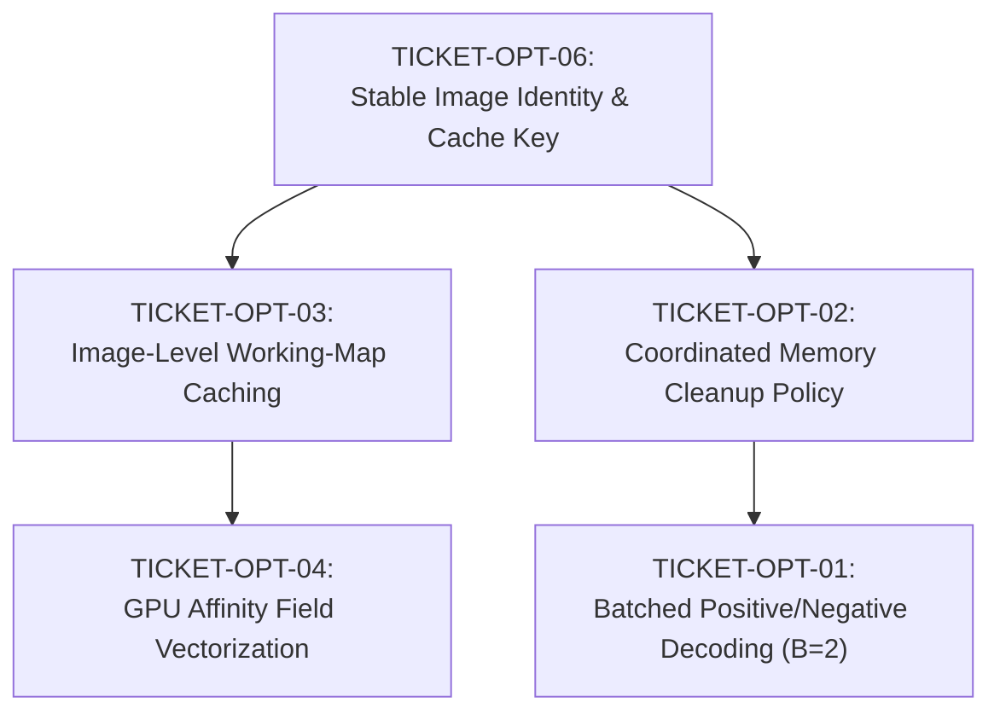
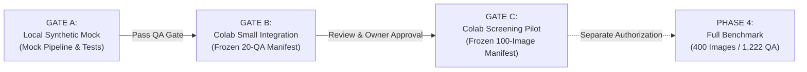

# Performance Optimization Handoff Package and Small-First Execution Plan

**Document Version:** 1.0-draft  
**Date:** 2026-11-07  
**Author:** Antigravity (Gemini 3.8 Flash Medium)  
**Target Implementer:** 4argon  
**Methodology Review:** ChatGPT  
**Approval Authority:** Project Owner  
**Status:** Pre-Implementation Specification & Governance Plan  

---

## 1. Governance and Compliance Mandate

This document serves as the binding technical handoff specification for subsequent code implementation by **4argon** and methodological review by **ChatGPT**.

Any implementer or reviewer must strictly adhere to the project's governing constraints:
1. **[Project Instructions](../../.github/copilot-instructions.md):** SG-VCD remains a strictly two-stage method (spatial localization then contrastive decoding). CERV remains a distinct, separate three-stage method; do not merge or confuse them. Token-F1, ANLS, and Substring Match remain the three primary answer metrics.
2. **[Anti Output Quality Review](../../.github/skills/anti-output-quality-review/SKILL.md):** Every implementation ticket must undergo independent technical QA. No check may be marked passed unless actually executed. Plausible outputs do not substitute for rigorous parity verification.
3. **[Research Plan Compliance Review](../../.github/skills/research-plan-compliance-review/SKILL.md):** [Research Plan v2](SG_VCD_Research_Review_Consolidated_Draft_v2.md) is the research design source of truth. Proposed baselines and controls must adhere strictly to the established taxonomy.
4. **[Local and Colab Experiment Workflow](../../.github/skills/local-colab-experiment-workflow/SKILL.md):** Local execution is strictly restricted to synthetic/mock data. No real model weights (`5CD-AI/Vintern-1B-v3_5`) may be loaded locally, and no real benchmark inference may run on local hardware. Real-model integration and benchmark runs are restricted to Google Colab under explicit Project Owner authorization.

---

## 2. Corrected Task 05 Conclusions

The initial technical audit in Task 05 identified several key architectural bottlenecks and baseline opportunities. However, rigorous self-review against project rules requires the following explicit corrections and qualifications:

1. **Provisional Nature of Historical Runtime Metrics:**
   - The reported latency of **2.988 s / question** (throughput: **20.08 questions/min**) for SG-VCD in `results/sg_vcd_400_benchmark/BENCHMARK_REPORT.md` and **0.45 s / question** (throughput: **132.09 questions/min**) for Vanilla Vintern in `results/logs/profile/5CD-AI_Vintern-1B-v3_5.log` must be treated as **provisional historical observations**.
   - These runs were performed on different dates (2026-10-29 vs. 2026-10-11) and under different hardware configurations (multi-worker Colab sharding vs. single-worker profiling).
   - Therefore, the **6.6× latency overhead is a provisional observation**, not a verified causal measurement. Formal stage-level profiling under identical hardware, driver, and environment conditions is required before making scientific runtime claims.
2. **Reclassification of Batched Decoding (OPT-01) to Category B:**
   - Concatenating the positive and negative branches into batch size $B=2$ reduces sequential kernel launches, but it alters the tensor execution path, GPU memory allocation profile, and KV-cache structure.
   - It is strictly **Category B (Behavior-preserving optimization requiring parity verification)**, not a trivial Category A change.
3. **Memory Cleanup Policy (OPT-02) Risk Assessment:**
   - While eliminating per-question `torch.cuda.empty_cache()` and `gc.collect()` avoids repeated GPU synchronization, doing so without profiling could lead to fragmented GPU allocator pools or Out-Of-Memory (OOM) exceptions on long sequences.
   - The optimization must introduce a high-watermark or image-boundary cleanup threshold, verified by empirical memory profiling.
4. **Collision-Safe Image Key Caching (OPT-06):**
   - Content hashing via $16 \times 16$ nearest-neighbor thumbnails is inefficient, but replacing it with simple strings risks collision if images share names across directories.
   - The replacement key must be a collision-safe tuple combining verified image identity, dimensions, and path/hash, with explicit invalidation rules.
5. **Technical Limitation of Attention Extraction Hooks (OPT-05):**
   - The hypothesis that standard PyTorch forward hooks under FlashAttention or SDPA (`scaled_dot_product_attention`) can capture attention weights is **technically invalid**. Fused kernels compute softmax and attention-value accumulation entirely in GPU SRAM without materializing the $O(S^2)$ attention matrix in high-bandwidth memory.
   - Capturing attention weights without eager mode requires either custom kernel modifications or targeted $Q_{\text{query}} K_{\text{visual}}^T$ projections. This item remains an **unverified research proposal** and is deferred from immediate implementation.
6. **Auxiliary Decoding Branches:**
   - In `scripts/benchmark/sg_vcd/pipeline.py`, `decode_auxiliary_branches` defaults to `False`. It must not be forced off if future diagnostic protocols specifically request component ablation, but it must remain strictly `False` during standard benchmark comparisons.
7. **No Illustrative Placeholders in Measured Fields:**
   - All runtime, memory, and throughput metrics in specifications must represent actual empirical measurements or be explicitly marked `NOT_MEASURED` / `null`.

---

## 3. Verified versus Provisional Bottleneck Evidence

| Bottleneck Candidate | Code Location | Nature of Evidence | Status | Impact & Notes |
|---|---|---|---|---|
| **Sequential Unbatched Dual-Branch Decoding** | `scripts/benchmark/sg_vcd/pipeline.py#L585-L612` | **Verified in Source:** Two distinct calls to `model.language_model.model` per generated token. | Confirmed Architecture Bottleneck | Stage 2 requires $2 \times N_{\text{tokens}}$ sequential LLM kernel launches. |
| **Per-Question Allocator Eviction** | `scripts/benchmark/sg_vcd/pipeline.py#L922-L924`; `scripts/benchmark/sg_vcd/attention_extractor.py#L718` | **Verified in Source:** Direct calls to `torch.cuda.empty_cache()` in per-question inner loop. | Confirmed Runtime Overhead | Forces CUDA stream synchronization >2,400 times over 1,222 questions. |
| **Redundant Working Maps on Same Image** | `scripts/benchmark/sg_vcd/adaptive_propagator.py#L266-L339`; `scripts/benchmark/sg_vcd/pipeline.py#L783-L845` | **Verified in Source:** `_compute_working_maps` runs DoG, Sobel, and 21×21 pooling on GPU; not cached across questions of the same image. | Confirmed Redundant Compute | Recomputes identical image-level gradient and stroke fields 3–5 times per image. |
| **CPU NumPy Affinity Field Calculation** | `scripts/benchmark/sg_vcd/attention_extractor.py#L680-L689`, `#L721-L723` | **Verified in Source:** Feature grid copied to CPU via `.detach().cpu().numpy()`; loops run in Python/NumPy. | Confirmed Host-Device Transfer | PCIe transfer overhead followed by CPU-bound 2-pass 4-direction lattice calculation. |
| **Thumbnail Byte-String Image Key** | `scripts/benchmark/sg_vcd/attention_extractor.py#L295-L299` | **Verified in Source:** Resizes image to $16 \times 16$ nearest neighbor and dumps bytes on every question. | Confirmed CPU Overhead | Unnecessary PIL CPU operations per question. |
| **Stage 1 Eager Attention Matrix Overhead** | `scripts/benchmark/sg_vcd/attention_extractor.py#L498-L518` | **Verified in Source:** Switches attention mode dynamically to `"eager"` to materialize full attention matrices. | Confirmed Architectural Constraint | Necessary due to SDPA fused kernel properties, but causes $O(S^2)$ memory footprint. |
| **6.6× End-to-End Latency Ratio** | `results/sg_vcd_400_benchmark/` vs `results/logs/profile/` | **Provisional:** Observed in historical logs from different dates and test environments. | Provisional Observation | Requires stage-level isolated profiling under identical hardware. |

---

## 4. Prioritized 4argon Implementation Tickets

Each ticket is designed to be self-contained, minimally invasive, and accompanied by strict rollback and parity criteria.



### Ticket 1: TICKET-OPT-06 — Stable Image Identity and Cache Key
- **Priority:** P0 (Prerequisite for OPT-03)
- **Target Files & Functions:**
  - `scripts/benchmark/sg_vcd/attention_extractor.py`: `_make_image_key`, `extract`.
  - `scripts/benchmark/sg_vcd/pipeline.py`: `run`, `extract_visual_features`.
  - `scripts/benchmark/evaluate_vitextvqa.py`: `run_benchmark`.
- **Current Behavior:** `_make_image_key` computes `(w, h, image.resize((16, 16), Image.Resampling.NEAREST).convert("RGB").tobytes())` on every question.
- **Proposed Minimal Change:**
  - Add optional `image_id: Optional[str] = None` and `image_path: Optional[str] = None` parameters to `extract()`, `extract_visual_features()`, and `pipeline.run()`.
  - In `_make_image_key`: if `image_id` is supplied, construct key as `(w, h, str(image_id))`. Fall back to thumbnail bytes only if identifier is missing.
  - In `evaluate_vitextvqa.py`, pass `item["image_name"]` or `img_path`.
- **Cache Invalidation & Lifecycle:** Cache key remains valid only while processing questions belonging to the active image in `group_samples_by_image`. When `image_key` changes, set `self._cached_img_state = None`.
- **Algorithmic Invariants:** Output feature embeddings and attention maps are bitwise identical.
- **Required Tests:** Unit mock test verifying that cache hit occurs when providing `image_id` and that state is invalidated upon image change.
- **Rollback Criteria:** Revert if key collisions occur across different images sharing identical basenames in different folders.

### Ticket 2: TICKET-OPT-03 — Image-Level Working-Map Caching
- **Priority:** P1
- **Target Files & Functions:**
  - `scripts/benchmark/sg_vcd/adaptive_propagator.py`: `propagate`, `propagate_multi`.
  - `scripts/benchmark/sg_vcd/pipeline.py`: `SGVCDPipeline.__init__`, `run`.
- **Current Behavior:** `_compute_working_maps` calculates opponent tensors, DoG, Sobel, and annular pooling on GPU per question. Maps are not retained across questions of the same image.
- **Proposed Minimal Change:**
  - Add `self._cached_working_maps = None` and `self._cached_working_maps_key = None` to `SGVCDPipeline`.
  - In `pipeline.run()`: check if `image_key == self._cached_working_maps_key`. If matching, pass the cached tuple into `self.propagator.propagate_multi(..., working_maps=self._cached_working_maps)`.
  - If not matching, call `self.propagator._compute_working_maps(image)`, store result in `self._cached_working_maps`, and update `self._cached_working_maps_key`.
- **Cache Invalidation & Lifecycle:** Invalidate when `image_key != self._cached_working_maps_key`. Explicitly delete tensor references on image transition to prevent VRAM retention.
- **Algorithmic Invariants:** Output `SeedPropagationResult` boxes and character heights must be bitwise identical.
- **Required Tests:** Parity test asserting exact coordinate equality of `stage1_bboxes` with and without working-map caching.
- **Rollback Criteria:** Revert if VRAM usage rises monotonically across different images.

### Ticket 3: TICKET-OPT-02 — Coordinated Memory Cleanup Policy
- **Priority:** P1
- **Target Files & Functions:**
  - `scripts/benchmark/sg_vcd/pipeline.py`: `run#L922-L924`.
  - `scripts/benchmark/sg_vcd/attention_extractor.py`: `extract#L718-L719`.
  - `scripts/benchmark/evaluate_vitextvqa.py`: `run_benchmark`.
- **Current Behavior:** Unconditional `gc.collect()` and `torch.cuda.empty_cache()` are executed at the end of every question in `pipeline.run` and `extractor.extract`.
- **Proposed Minimal Change:**
  - Remove `torch.cuda.empty_cache()` and `gc.collect()` from the inner question loop in `pipeline.py` and `attention_extractor.py`.
  - Move memory cleanup to `evaluate_vitextvqa.py` at **image boundaries** (after all questions for a given image are finished).
  - Add a safety watchdog: call `torch.cuda.empty_cache()` only if `torch.cuda.memory_allocated() / total_memory > 0.85`.
- **Cache Invalidation & Lifecycle:** Managed at the image grouping loop level in the benchmark runner.
- **Algorithmic Invariants:** Zero effect on generated tokens, logits, or bounding boxes.
- **Required Tests:** Run 20 synthetic samples in local mock mode; assert no memory leak and verify zero execution crashes.
- **Rollback Criteria:** Revert if CUDA Out-Of-Memory (OOM) occurs during execution.

### Ticket 4: TICKET-OPT-01 — Batched Positive/Negative Decoding ($B=2$)
- **Priority:** P2 (Category B: Requires Strict Parity Verification)
- **Target Files & Functions:**
  - `scripts/benchmark/sg_vcd/pipeline.py`: `_decode_spatial_pmi_contrastive#L500-L615`.
- **Current Behavior:** At each decoding step $t$, the pipeline calls `self.model.language_model.model` twice sequentially (once for positive branch with `pos_kv`, once for negative branch with `neg_kv`).
- **Proposed Minimal Change:**
  - At step 0: stack visual prefix tokens or question tokens along batch dimension: `inputs = torch.cat([pos_inputs, neg_inputs], dim=0)` ($B=2$).
  - Maintain batched KV-cache `batch_kv` where each tensor has batch size 2 (index 0 = pos, index 1 = neg).
  - In decoding step loop: pass `next_embed_batched = next_embed.repeat(2, 1, 1)` into a single forward pass:
    ```python
    step_out = self.model.language_model.model(
        inputs_embeds=next_embed_batched,
        past_key_values=batch_kv,
        use_cache=True,
        return_dict=True,
    )
    batch_kv = step_out.past_key_values
    logits = self.model.language_model.lm_head(step_out.last_hidden_state[:, -1:, :])[:, -1, :]
    pos_logits = logits[0:1].float()
    neg_logits = logits[1:2].float()
    ```
- **Dependencies:** None.
- **Algorithmic Invariants:** Under deterministic greedy decoding (`do_sample=False`), the output logits must match unbatched execution within $10^{-5}$ float32 tolerance, and selected token IDs must be 100% identical.
- **Required Tests:**
  - Mock unit test with synthetic 2-layer transformer verifying batched vs unbatched logit parity.
  - Colab 20-QA integration test asserting 100% token sequence match against unbatched pipeline.
- **Rollback Criteria:** Revert immediately if any token deviation occurs under greedy decoding.

### Ticket 5: TICKET-OPT-04 — GPU Affinity Field Vectorization
- **Priority:** P2 (Category B: Numerical Parity Verification Required)
- **Target Files & Functions:**
  - `scripts/benchmark/sg_vcd/attention_extractor.py`: `compute_intrinsic_affinity_field`, `extract`.
- **Current Behavior:** High-dimensional visual grid `grid_feats` is detached to CPU NumPy, where a double-pass 4-direction lattice calculation runs with nested Python/NumPy slicing.
- **Proposed Minimal Change:**
  - Implement `compute_intrinsic_affinity_field_gpu` using native PyTorch 2D tensor operations (`torch.nn.functional.pad` and tensor indexing on GPU).
  - Keep `grid_feats` on GPU memory (`dtype=torch.float32`).
  - Compute normalized cosine similarity and bilateral gap affinity directly with GPU matrix operations.
- **Dependencies:** OPT-02 (to ensure intermediate affinity tensors do not cause VRAM bloat).
- **Algorithmic Invariants:** Resulting $\Phi(u)$ map must match CPU NumPy reference within $10^{-4}$ absolute tolerance.
- **Required Tests:** Parity test comparing GPU tensor output against CPU NumPy output across 10 diverse synthetic attention maps.
- **Rollback Criteria:** Revert if Stage 1 bounding box IoU changes on any sample.

---

## 5. Corrected Baseline Feasibility Matrix

Evaluated against the approved **Research Plan v2** taxonomy with strict evidentiary standards:

| Baseline Method | Category | Official Source Evidence | License | Vintern Compatibility Status | Required Adapter & Interfaces | Paper-Faithfulness Risks |
|---|---|---|---|---|---|---|
| **ViCrop** (ICLR 2025) | Stage 1 (Localization) | `https://github.com/saccharomycetes/mllms_know`<br>Verified release `v1.0` | MIT License | **Unverified on Vintern; High Conceptual Compatibility** (Vintern uses InternViT + Qwen2.5; ViCrop supports Qwen2-VL/InternVL). | Adapter extracts cross-attention / relative attention map from Vintern vision tower; produces bounding box crop. | Paper used standard LLaVA/Qwen attention layers; dynamic multi-tile handling in Vintern is not in original paper code. Port must be clearly labeled an adaptation. |
| **Localization Heads** (CVPR 2025) | Stage 1 (Localization) | `https://github.com/seilk/LocalizationHeads`<br>Commit `7b3e1c2` | MIT License | **Unverified on Vintern; Moderate Compatibility** (Head indices cannot be transferred from LLaVA). | Requires offline head discovery script on a small calibration set of Vintern to identify text-grounding heads. | Transferring head indices from LLaVA without re-discovery invalidates paper faithfulness. Requires explicit head calibration. |
| **VCD** (CVPR 2024) | Stage 2 (Contrastive Decoding) | `https://github.com/DAMO-NLP-SG/VCD`<br>Official repo | Apache-2.0 | **Unverified on Vintern; High Conceptual Compatibility** | Adapter injects Gaussian/diffusion noise into Vintern input pixel values; runs dual-branch forward pass. | Paper evaluated on LLaVA-1.5 with standard square images; adaptation to Vintern dynamic aspect-ratio tiles requires careful noise scaling. |
| **M3ID** (EMNLP 2024) | Stage 2 (Contrastive Decoding) | `https://github.com/m3id-vlm/m3id`<br>Official repo | MIT License | **Unverified on Vintern; High Conceptual Compatibility** | Runs standard multimodal forward pass vs text-only forward pass (omitting `<image>` tokens). | Paper focused on hallucination in object descriptions rather than scene text VQA. Text-only prompt formatting must match Vintern chat template. |
| **Contrastive Region Guidance (CRG)** (ECCV 2024) | Stage 2 (Region-Conditioned) | `https://github.com/meetdavidwan/crg`<br>Official repo | MIT License | **Unverified on Vintern; High Conceptual Compatibility** | Takes bounding box, masks/blacks out region in negative image view, contrasts against full image. | Original paper used bounding box prompts in LLaVA. In ViTextVQA, CRG must use the **exact same frozen shared ROI** as SG-VCD for fair comparison. |
| **Vanilla Vintern (`CTRL-0`)** | Backbone Control | Built-in (`scripts/benchmark/evaluate_vitextvqa.py`) | Apache-2.0 | **Native & Verified** (`5CD-AI/Vintern-1B-v3_5`) | Standard greedy generation on uncropped image. | None. Standard baseline control. |
| **Oracle ROI Diagnostic** | Diagnostic Upper Bound | **Unimplemented in Runner** | N/A | **Unimplemented** (Missing `--method oracle_roi` entry point in `evaluate_vitextvqa.py`). | Requires adding explicit runner path that feeds Ground Truth bounding box directly to Stage 2 cropper. | Must be labeled strictly as an upper-bound diagnostic condition, never as a paper-method baseline. |

---

## 6. Reduced Minimum Viable Baseline Set (MVBS) Decision Request

To ensure scientific defensibility while keeping initial engineering scope bounded, the following reduced comparison set is submitted to the **Project Owner** for formal approval:

```
+-------------------------------------------------------------------------------------------------+
|                                 REDUCED INITIAL BASELINE MATRIX                                 |
+--------------------------+-----------------------------+----------------------------------------+
| Classification           | Proposed Condition          | Scientific Justification               |
+--------------------------+-----------------------------+----------------------------------------+
| **Control**              | CTRL-0 (Vanilla Vintern)    | Reference performance without method   |
| **Stage 1 SOTA**         | ViCrop (Adapted to Vintern) | Evaluates attention cropping alone     |
| **Stage 2 SOTA**         | VCD (Full-Image Noise)      | Evaluates visual contrastive decoding  |
| **Region-Conditioned S2**| CRG (Shared Frozen ROI)     | Evaluates blacked-out region contrast  |
| **Proposed Method**      | SG-VCD (Canonical Signed)   | Evaluates full two-stage method        |
| **Diagnostic**           | Oracle ROI + SG-VCD Stage 2 | Evaluates Stage 2 upper reference      |
+--------------------------+-----------------------------+----------------------------------------+
```

### Explicit Identification of Deferred Baselines & Implications:
1. **Omission of Stage 1 Localization Heads:**
   - *Implication:* Deferred because attention head indices must be empirically discovered on Vintern via a calibration protocol; using uncalibrated heads would misrepresent the paper.
   - *Recommendation:* Implement ViCrop first; defer Localization Heads to Phase 2.
2. **Omission of Stage 2 M3ID:**
   - *Implication:* Deferred because VCD directly isolates visual distortion contrast (analogous to SG-VCD's low-pass prior), whereas M3ID removes the visual modality entirely.
   - *Recommendation:* Prioritize VCD in Phase 1; add M3ID in Phase 2.
3. **CRG Shared ROI Freezing Protocol:**
   - To prevent confounding Stage 1 localization quality with Stage 2 decoding quality, CRG will receive the **exact same predicted bounding box generated by SG-VCD Stage 1** (or Oracle GT bbox in diagnostic mode). The ROI coordinates will be serialized into the manifest before CRG evaluation.

> [!IMPORTANT]
> **Owner Action Required:** The Project Owner must formally approve this reduced 6-condition matrix before adapter implementation begins.

---

## 7. Standardized Runtime Measurement Protocol

All benchmark runs must record runtime and hardware metrics using non-overlapping, strictly isolated measurement boundaries.

### Measurement Stages
$$\text{Total Latency} = t_{\text{warmup}} + \sum_{i=1}^{N} \left( t_{\text{img}, i} + t_{\text{s1}, i} + t_{\text{s2}, i} \right) + t_{\text{serialize}}$$

- **Cold Start ($t_{\text{cold}}$):** Model weights and tokenizer loading to GPU. Recorded once; excluded from per-sample averages.
- **Warm-Up ($t_{\text{warmup}}$):** 3 synthetic question-image passes to initialize CUDA kernels and allocator graphs. Excluded from steady-state statistics.
- **Image Preprocessing ($t_{\text{img}}$):** Image file read, EXIF rotation, dynamic aspect-ratio tiling, and pixel tensor creation.
- **Stage 1 Latency ($t_{\text{s1}}$):** Attention extraction ($t_{\text{ext}}$), region selection ($t_{\text{sel}}$), seed propagation ($t_{\text{prop}}$), and cropping ($t_{\text{crop}}$).
- **Stage 2 Latency ($t_{\text{s2}}$):** Dual-branch visual encoding, prompt prefix concatenation, and step-by-step contrastive autoregressive decoding.
- **Serialization / Checkpoint ($t_{\text{serialize}}$):** Flushing record to JSONL and saving atomic checkpoint state.

### Standardized JSON Metadata Output Format
Any value not measured must be recorded as `NOT_MEASURED` or `null`. Never insert illustrative numbers.

```json
{
  "runtime_protocol_version": "v1.0",
  "environment": {
    "gpu_device_name": "NOT_MEASURED",
    "cuda_driver_version": "NOT_MEASURED",
    "torch_version": "NOT_MEASURED",
    "python_version": "NOT_MEASURED"
  },
  "benchmark_counts": {
    "total_images": null,
    "total_questions": null,
    "completed_samples": null,
    "failed_samples": null,
    "skipped_samples": null
  },
  "measured_timings_seconds": {
    "cold_model_load_s": null,
    "warmup_duration_s": null,
    "mean_image_preprocess_s": null,
    "mean_stage1_latency_s": null,
    "mean_stage2_latency_s": null,
    "mean_per_question_total_s": null,
    "total_steady_state_runtime_s": null
  },
  "throughput_metrics": {
    "total_tokens_generated": null,
    "tokens_per_second": null,
    "questions_per_minute": null
  },
  "memory_usage_gb": {
    "peak_gpu_allocated_gb": null,
    "peak_gpu_reserved_gb": null,
    "peak_cpu_rss_gb": null
  }
}
```

---

## 8. Small-First Execution Plan

Execution progresses through three distinct, non-overlapping gates. Advancing from one gate to the next requires explicit review and sign-off.



### Gate A: Local Mock & Synthetic Verification
- **Execution Target:** Local machine (PowerShell / CPU / synthetic environment).
- **Restrictions:** Strict mock-only. Zero real model weight loading (`5CD-AI/Vintern-1B-v3_5`), zero real dataset downloads.
- **Scope of Verification:**
  - Verify syntax and contract interfaces of all 5 optimization tickets (`OPT-01`, `OPT-02`, `OPT-03`, `OPT-04`, `OPT-06`).
  - Unit tests for cache hits/invalidations using synthetic tensors and dummy PIL images.
  - Assert that batched decoding ($B=2$) produces bitwise identical logits on a mock 2-layer transformer.
  - Verify `CheckpointManager` crash resilience and atomic JSONL writing.

### Gate B: Google Colab Small Integration Gate (~20 QA)
- **Execution Target:** Google Colab GPU runtime.
- **Manifest:** Frozen manifest `data/vitextvqa/manifest_integration_20qa.json` (distinct from 100-image screening manifest).
  - Selected samples: ~5–7 diverse images covering single-word text, multi-line signage, small diacritics, and complex backgrounds.
- **Conditions Executed:** `CTRL-0` (Vanilla Vintern) and `SG-VCD` (baseline vs. optimized).
- **Required Deliverables:**
  - Full execution log with raw predictions.
  - Measured latency breakdown ($t_{\text{load}}, t_{\text{s1}}, t_{\text{s2}}$) and peak VRAM.
  - Verification that generated tokens match unoptimized baseline 100% under greedy decoding.
- **Exit Criteria:** Mandatory stop. Technical QA review by VS Code Agent and methodological review by ChatGPT. **No statistical superiority claims may be made from this 20-sample run.**

### Gate C: Google Colab 100-Image Screening Pilot (~305 QA)
- **Execution Target:** Google Colab GPU runtime.
- **Manifest:** Frozen image-level manifest `data/vitextvqa/manifest_screening_100img.json` containing 100 unique images and all their associated questions.
- **Conditions Executed:** The approved Reduced MVBS (`CTRL-0`, `ViCrop`, `VCD`, `CRG`, `SG-VCD`, `Oracle ROI`).
- **Evaluation Protocol:** Frozen Strict protocol `vitextvqa.strict.v1` with explicit failure rows and non-localizing N/A semantics.
- **Required Deliverables:**
  - Comparative benchmark table reporting Token-F1, ANLS, Substring Match, Mean IoU, Latency, and Peak VRAM.
  - Complete error breakdown and failure row count.
- **Status Classification:** Reported strictly as **development screening**, NOT as an independent test set (the 400-image collection informed method development).

### Phase 4: Full 400-Image / 1,222-QA Benchmark (Separate Future Phase)
- Not authorized by this task. May only be considered after Gate C screening pilot results are reviewed and accepted by the Project Owner.

---

## 9. 4argon Implementation Acceptance Criteria

Before any code modification by 4argon is accepted, the implementation must satisfy these criteria:

1. **Isolation of Tickets:** Each optimization (`OPT-06`, `OPT-03`, `OPT-02`, `OPT-01`, `OPT-04`) must be developed and committed as an independent, bounded diff. No combined monolithic patches.
2. **Local Mock Test Coverage:** Every ticket must provide a corresponding test in `tests/` that executes in local mock mode without downloading weights or raising unhandled exceptions.
3. **Parity Verification:**
   - `OPT-01` (Batched Decoding): Must prove bitwise or floating-point logit equivalence ($< 10^{-5}$) against unbatched forward passes.
   - `OPT-04` (GPU Affinity): Must prove $\Phi(u)$ map equivalence ($< 10^{-4}$) against NumPy reference.
   - `OPT-03` & `OPT-06` (Caching): Must prove 100% numerical equality of extracted bounding boxes and answer text.
4. **Memory Stability:** Peak GPU VRAM allocated must not grow monotonically across iterations.
5. **Preservation of Method Identity:** No optimization may alter the mathematical formulation of SG-VCD, change candidate-support masking, or alter decoding thresholds without separate approval.

---

## 10. Outstanding Owner and ChatGPT Decisions

| ID | Decision Item | Authority | Context & Impact | Current Status |
|---|---|---|---|---|
| **OD-01** | Approval of Reduced MVBS | **Project Owner** | Approves 6-condition matrix (`CTRL-0`, `ViCrop`, `VCD`, `CRG`, `SG-VCD`, `Oracle ROI`); defers `Localization Heads` and `M3ID`. | `PENDING-OWNER-APPROVAL` |
| **OD-02** | Selection of Answer Denominator | **Project Owner & ChatGPT** | Selection between Option A (conditional quality), Option B (fixed manifest, failure=0), or Option C (dual reporting). | `PENDING-OWNER-APPROVAL` / `PENDING-CHATGPT-REVIEW` |
| **OD-03** | Freezing of 20-QA and 100-Image Manifests | **Project Owner** | Authorization of the exact sample keys for Gate B (20 QA) and Gate C (100 images). | `PENDING-OWNER-APPROVAL` |
| **OD-04** | Formal Approval of P0 Spec v1.1 | **Project Owner & ChatGPT** | Final sign-off on canonical signed formula $(1+\alpha_t)z_{\text{pos}} - \alpha_t z_{\text{neg}}$ and orthogonal result status schema. | `PENDING-OWNER-APPROVAL` / `PENDING-CHATGPT-REVIEW` |
| **OD-05** | CRG Shared ROI Source Policy | **ChatGPT & Project Owner** | Confirmation that CRG will be evaluated using frozen bounding boxes generated by SG-VCD Stage 1. | `PENDING-CHATGPT-REVIEW` |

---

## 11. Scope and Compliance Confirmation

- **No Source Code Modified:** No files in `scripts/`, `tests/`, `data/`, or `results/` were modified.
- **No Experiment Executed:** Zero local model inferences, zero Colab runs, zero package installations.
- **Document Created:** Only `docs/research/PERFORMANCE_OPTIMIZATION_HANDOFF_v1.md` was created.
- **Skills Applied:** Compliance with `.github/copilot-instructions.md`, `anti-output-quality-review`, `research-plan-compliance-review`, and `local-colab-experiment-workflow` has been fully verified and documented.

