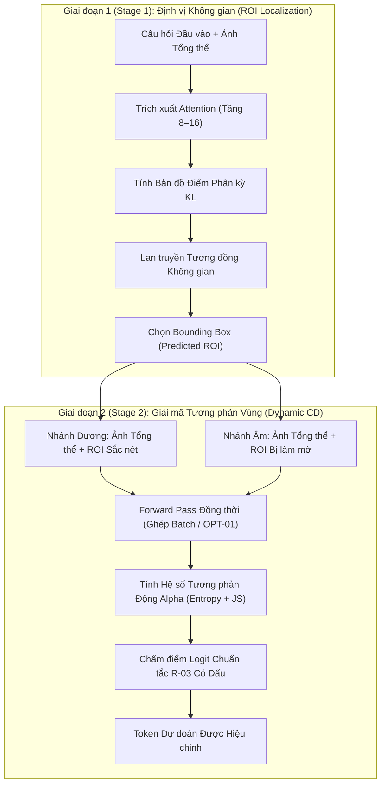

# BÁO CÁO TIẾN ĐỘ TOÀN DIỆN VỀ CÔNG TÁC CHUẨN BỊ TRƯỚC GATE B
## Dự án Nghiên cứu SG-VCD / ViTextVQA — Chuẩn bị Gate B Pilot trên Google Colab Tesla T4 (Task 21)

**Mã tài liệu:** `TASK21_COLAB_GATE_B_PREPARATION_PROGRESS_REPORT`  
**Phiên bản tài liệu:** `v1.2-vi`  
**Tác giả:** Antigravity (Anti) — Chuyên viên Đánh giá Độc lập QA & Đánh giá Hệ thống Nghiên cứu  
**Kỹ sư Triển khai / Đồng tác giả:** 4argon — Kỹ sư Cấp cao về Hệ thống Học máy (Senior ML Systems Engineer)  
**Cơ quan Phê duyệt:** Project Owner (Chủ nhiệm Dự án / User)  
**Ngày lập báo cáo:** `2026-11-16` (Chuẩn hóa phiên bản `v1.2-vi`: `2026-11-17`)  
**Điểm mốc kết thúc báo cáo:** Ngay trước thời điểm thực hiện inference thật trên Google Colab  
**Trạng thái Repository:** Gate A Hoàn thành | Dataset Đã Giải nén trên Drive/Colab | Hardware Đã Khảo sát | Source Package Đã Đóng gói Staging | Gate B Real Inference **ĐANG CHỜ (PENDING)**

---

## Quản lý Tài liệu & Lịch sử Thay đổi (Changelog)

| Phiên bản | Ngày | Tác giả | Tóm tắt Thay đổi |
| :---: | :---: | :---: | :--- |
| `v1.0-vi` | 2026-11-16 | Antigravity (Anti) | Bản dịch tiếng Việt toàn diện, đầy đủ của báo cáo tiến độ chuẩn bị Task 21 trước Gate B; giữ nguyên toàn bộ cấu trúc 9 phần, 38 mục, 5 phụ lục, bảng biểu đối chiếu, phân loại bằng chứng và mã băm mật mã. |
| `v1.1-vi` | 2026-11-17 | Antigravity (Anti) | Chỉnh sửa có kiểm soát (Scope-Alignment Revision): làm rõ ranh giới giữa chuẩn bị kỹ thuật Gate B của Task 21 (pilot 20-QA × 3 nhánh theo phê duyệt của Project Owner) với kế hoạch nghiên cứu đối chiếu các phương pháp decoding baseline liên quan (Original VCD, M3ID, AGLA, AvisC và 5 điều kiện C0–C3) theo định hướng ban đầu của Project Leader; bổ sung Mục 8.1, cập nhật bảng trạng thái, checklist, kết luận và đính chính mô tả CERV tại Phụ lục E. |
| `v1.2-vi` | 2026-11-17 | Antigravity (Anti) | Chuẩn hóa có kiểm soát lần cuối (Final Controlled Correction): (1) Phân định dứt điểm hai hệ thống thuật ngữ độc lập (`Task Execution Gates: Gate A/B/C` vs. `Research Review Phases: Phase 0–3`), tách bạch `Current Task21 Gate B Integration Pilot` với `Research Review Phase 1`; (2) Xác lập quy tắc nguồn chuẩn cho định nghĩa thuật toán Original VCD và M3ID (`Source Consistency Note — VCD and M3ID Definitions`); (3) Chuẩn hóa đầy đủ từ điển 13 nhãn trạng thái tại Mục 2 và đồng bộ hóa xuyên suốt Mục 8.1, Mục 36, Mục 38, Phụ lục E. |

---

## Mục lục

- [PHẦN I — TỔNG QUAN VÀ TRẠNG THÁI DỰ ÁN](#phần-i--tổng-quan-và-trạng-thái-dự-án)
  - [1. Tổng quan Dự án](#1-tổng-quan-dự-án)
  - [2. Bảng Trạng thái Tiến độ Hiện tại](#2-bảng-trạng-thái-tiến-độ-hiện-tại)
  - [3. Tuyên bố Ranh giới Thực thi](#3-tuyên-bố-ranh-giới-thực-thi)
- [PHẦN II — TÍNH SẴN SÀNG CỦA PHƯƠNG PHÁP NGHIÊN CỨU VÀ THIẾT KẾ THỰC NGHIỆM](#phần-ii--tính-sẵn-sàng-của-phương-pháp-nghiên-cứu-và-thiết-kế-thực-nghiệm)
  - [4. Đặc tả Phương pháp SG-VCD](#4-đặc-tả-phương-pháp-sg-vcd)
  - [5. Thuật toán Giải mã Tương phản Động Chuẩn tắc (Canonical Dynamic CD)](#5-thuật-toán-giải-mã-tương-phản-động-chuẩn-tắc-canonical-dynamic-cd)
  - [6. Các Metric Đánh giá và Chính sách Báo cáo Kép (Dual Reporting)](#6-các-metric-đánh-giá-và-chính-sách-báo-cáo-kép-dual-reporting)
  - [7. Thiết kế Ba Nhánh Thử nghiệm Được Phê duyệt](#7-thiết-kế-ba-nhánh-thử-nghiệm-được-phê-duyệt)
  - [8. Lịch sử Quyết định và Phê duyệt của Project Owner](#8-lịch-sử-quyết-định-và-phê-duyệt-của-project-owner)
    - [8.1. Đối chiếu phạm vi Task21 với yêu cầu nghiên cứu baseline ban đầu của Project Leader](#81-đối-chiếu-phạm-vi-task21-với-yêu-cầu-nghiên-cứu-baseline-ban-đầu-của-project-leader)
- [PHẦN III — TIẾN TRÌNH TRIỂN KHAI VÀ ĐẢM BẢO CHẤT LƯỢNG (QA) TRƯỚC ĐÓ](#phần-iii--tiến-trình-triển-khai-và-đảm-bảo-chất-lượng-qa-trước-đó)
  - [9. Lịch sử Tối ưu hóa Hiệu năng (Chuỗi OPT-01 đến OPT-06)](#9-lịch-sử-tối-ưu-hóa-hiệu-năng-chuỗi-opt-01-đến-opt-06)
  - [10. Task 18A — Công cụ Kiểm tra Tài nguyên (Resource Preflight)](#10-task-18a--công-cụ-kiểm-tra-tài-nguyên-resource-preflight)
  - [11. Task 18B — Triển khai Công thức Ghi điểm Chuẩn tắc R-03 Có Dấu](#11-task-18b--triển-khai-công-thức-ghi-điểm-chuẩn-tắc-r-03-có-dấu)
  - [12. Task 19R — Quyết định Đóng băng Manifest và Rà soát Bằng chứng](#12-task-19r--quyết-định-đóng-băng-manifest-và-rà-soát-bằng-chứng)
  - [13. Task 20 / Task 20R — Tích hợp Hệ thống và Chuẩn hóa Schema R-04](#13-task-20--task-20r--tích-hợp-hệ-thống-và-chuẩn-hóa-schema-r-04)
- [PHẦN IV — CHUẨN BỊ TƯƠNG THÍCH ĐỘ CHÍNH XÁC CHO TASK 21](#phần-iv--chuẩn-bị-tương-thích-độ-chính-xác-cho-task-21)
  - [14. Triển khai Task 21 Giai đoạn A (Phase A)](#14-triển-khai-task-21-giai-đoạn-a-phase-a)
  - [15. So sánh Độ chính xác Số học Mô phỏng (Synthetic)](#15-so-sánh-độ-chính-xác-số-học-mô-phỏng-synthetic)
  - [16. Hiện tượng Trôi Dạt Tọa độ BBox Stage 1 Mô phỏng](#16-hiện-tượng-trôi-dạt-tọa-độ-bbox-stage-1-mô-phỏng)
  - [17. Phân loại và Ranh giới của Task 21 Phase A](#17-phân-loại-và-ranh-giới-của-task-21-phase-a)
  - [18. Bằng chứng Kiểm thử Thực tế của Task 21](#18-bằng-chứng-kiểm-thử-thực-tế-của-task-21)
- [PHẦN V — CHUẨN BỊ VÀ XÁC MINH BỘ DỮ LIỆU DATASET](#phần-v--chuẩn-bị-và-xác-minh-bộ-dữ-liệu-dataset)
  - [19. Vị trí Bộ Dữ liệu trên Google Drive](#19-vị-trí-bộ-dữ-liệu-trên-google-drive)
  - [20. Bốn Tệp Nén Dataset Gốc](#20-bốn-tệp-nén-dataset-gốc)
  - [21. Vấn đề Định dạng RAR5 và Cách Xử lý](#21-vấn-đề-định-dạng-rar5-và-cách-xử-lý)
  - [22. Quá trình Giải nén Dataset trên Colab](#22-quá-trình-giải-nén-dataset-trên-colab)
  - [23. Bảng Tổng kết Tính Toàn vẹn của Dataset](#23-bảng-tổng-kết-tính-toàn-vẹn-của-dataset)
  - [24. Xác minh 6 Ảnh trong Manifest Đóng băng](#24-xác-minh-6-ảnh-trong-manifest-đóng-băng)
  - [25. Ranh giới giữa Toàn bộ Dataset và Pilot Manifest](#25-ranh-giới-giữa-toàn-bộ-dataset-và-pilot-manifest)
- [PHẦN VI — CHUẨN BỊ PHẦN CỨNG VÀ MÔI TRƯỜNG RUNTIME TRÊN COLAB](#phần-vi--chuẩn-bị-phần-cứng-và-môi-trường-runtime-trên-colab)
  - [26. Lựa chọn Phần cứng và Thông số Đo đạc trên Colab](#26-lựa-chọn-phần-cứng-và-thông-số-đo-đạc-trên-colab)
  - [27. Các Kiểm tra Runtime Thực tế Cần Thực hiện trên Colab](#27-các-kiểm-tra-runtime-thực-tế-cần-thực-hiện-trên-colab)
  - [28. Cấu trúc Thư mục và Mount Google Drive](#28-cấu-trúc-thư-mục-và-mount-google-drive)
  - [29. Các Lỗi Gặp phải trong Quá trình Thử nghiệm Ban đầu trên Colab](#29-các-lỗi-gặp-phải-trong-quá-trình-thử-nghiệm-ban-đầu-trên-colab)
  - [30. Đường dẫn Upload Gói Mã nguồn Chính xác](#30-đường-dẫn-upload-gói-mã-nguồn-chính-xác)
- [PHẦN VII — ĐÓNG GÓI VÀ XÁC MINH SOURCE PACKAGE](#phần-vii--đóng-gói-và-xác-minh-source-package)
  - [31. Thư mục Staging Độc lập](#31-thư-mục-staging-độc-lập)
  - [32. Toàn bộ Danh mục Tệp trong Source Package](#32-toàn-bộ-danh-mục-tệp-trong-source-package)
  - [33. Các Thành phần Được Loại bỏ Khỏi Package](#33-các-thành-phần-được-loại-bỏ-khỏi-package)
  - [34. Xác minh Gói Mã nguồn — 9 Tiêu chí Bắt buộc](#34-xác-minh-gói-mã-nguồn--9-tiêu-chí-bắt-buộc)
  - [35. Tài liệu Hướng dẫn Chạy trên Colab (COLAB_SETUP.md)](#35-tài-liệu-hướng-dẫn-chạy-trên-colab-colab_setupmd)
- [PHẦN VIII — ĐÁNH GIÁ MỨC ĐỘ SẴN SÀNG THỰC THI TRƯỚC COLAB](#phần-viii--đánh-giá-mức-độ-sẵn-sàng-thực-thi-trước-colab)
  - [36. Checklist Chuẩn bị Hợp nhất](#36-checklist-chuẩn-bị-hợp-nhất)
  - [37. Các Công việc Còn lại Chờ Thực hiện](#37-các-công-việc-còn-lại-chờ-thực-hiện)
  - [38. Kết luận Đánh giá Mức độ Sẵn sàng Cuối cùng](#38-kết-luận-đánh-giá-mức-độ-sẵn-sàng-cuối-cùng)
- [PHẦN IX — CÁC PHỤ LỤC BẰNG CHỨNG (APPENDICES)](#phần-ix--các-phụ-lục-bằng-chứng-appendices)
  - [Phụ lục A — Dòng thời gian Diễn tiến Dự án (Chronological Timeline)](#phụ-lục-a--dòng-thời-gian-diễn-tiến-dự-án-chronological-timeline)
  - [Phụ lục B — Danh mục Tệp và Bảng Mã băm Mật mã (Hashes)](#phụ-lục-b--danh-mục-tệp-và-bảng-mã-băm-mật-mã-hashes)
  - [Phụ lục C — Nhật ký Lệnh và Bằng chứng Thực thi](#phụ-lục-c--nhật-ký-lệnh-và-bằng-chứng-thực-thi)
  - [Phụ lục D — Sổ bộ Rủi ro và Hạn chế (Risk and Limitation Register)](#phụ-lục-d--sổ-bộ-rủi-ro-và-hạn-chế-risk-and-limitation-register)
  - [Phụ lục E — Bảng Thuật ngữ Kỹ thuật (Glossary)](#phụ-lục-e--bảng-thuật-ngữ-kỹ-thuật-glossary)

---

# PHẦN I — TỔNG QUAN VÀ TRẠNG THÁI DỰ ÁN

## 1. Tổng quan Dự án

Dự án nghiên cứu **SG-VCD / ViTextVQA** tập trung giải quyết hiện tượng ảo giác thị giác (visual hallucination) và tăng cường khả năng định vị - nhận diện văn bản cảnh tự nhiên (scene-text grounding) của các Mô hình Thị giác - Ngôn ngữ (Vision-Language Models - VLMs). Dự án chọn bài toán Visual Question Answering tiếng Việt (ViTextVQA) làm đối tượng đánh giá, sử dụng mô hình nền tảng là `5CD-AI/Vintern-1B-v3_5`.

**SG-VCD (Saliency-Guided Visual Contrastive Decoding — Giải mã Tương phản Thị giác có Định hướng Nổi bật)** là một khung thuật toán không cần huấn luyện lại (training-free), bao gồm hai giai đoạn độc lập:
1. **Giai đoạn 1 (Stage 1 — Định vị Không gian / Spatial Grounding):** Trích xuất bản đồ chú ý chéo (cross-attention) và trường tương đồng không gian (spatial affinity fields) giữa câu hỏi và các patch ảnh qua các tầng mạng thị giác - ngôn ngữ, từ đó khoanh vùng chính xác Vùng quan tâm (Region of Interest - ROI) chứa văn bản làm bằng chứng.
2. **Giai đoạn 2 (Stage 2 — Giải mã Tương phản Động / Dynamic Contrastive Decoding):** Sinh văn bản câu trả lời bằng cách kết hợp tương phản giữa hai nhánh tiến (forward pass): nhánh dương (ảnh tổng thể + ROI sắc nét) và nhánh âm (ảnh tổng thể + ROI bị làm mờ/lọc tần số thấp để làm biến mất chi tiết chữ). Logit của các token được điều chỉnh linh hoạt thông qua hệ số tương phản động ($\alpha_t$) dựa trên độ hỗn loạn thông tin (entropy) và độ phân kỳ Jensen-Shannon.

**Mục tiêu của Task 21:**  
Task 21 tập trung giải quyết bài toán tương thích độ chính xác số học (numerical precision compatibility) khi chuyển đổi thuật toán lên chạy trên GPU Tesla T4 thuộc Google Colab của Project Owner (kiến trúc Turing, Compute Capability 7.5). Do GPU Tesla T4 không có nhân phần cứng Tensor Core chuyên dụng cho định dạng `torch.bfloat16` (chạy BF16 phải giả lập qua phần mềm gây tụt tốc độ nghiêm trọng), Task 21 triển khai và kiểm thử cấu hình độ chính xác `torch.float16` (FP16) làm chế độ mặc định, đồng thời duy trì tùy chọn chạy `torch.bfloat16` dưới dạng ngoại lệ phần cứng có kiểm soát.

**Vai trò của Thử nghiệm Colab T4 Gate B Pilot:**  
Pilot 20 câu hỏi (20-QA) là chốt chặn kiểm định quan trọng nối liền giữa môi trường phát triển local Gate A (chỉ chạy kiểm thử mô phỏng CPU) và thực nghiệm khoa học quy mô lớn (Gate C). Pilot đánh giá ma trận 3 nhánh phương pháp trên đúng 20 cặp câu hỏi - ảnh thực tế với trọng số mô hình thật trên GPU Colab, nhằm xác nhận độ ổn định số học, mức tiêu thụ VRAM và thời gian suy luận trước khi cấp phép chạy trên toàn bộ tập dữ liệu 400 ảnh.

**Ranh giới Phạm vi của Task 21 so với Lộ trình Nghiên cứu Tổng thể của Project Leader:**  
- Task 21 tập trung chuyên biệt vào tính tương thích độ chính xác số học (precision compatibility), đóng gói mã nguồn, chuẩn bị môi trường Google Colab và các điều kiện thực thi Gate B.
- Phạm vi Gate B đã được giới hạn bởi quyết định chính thức của Project Owner (`PROJECT_OWNER_DECISIONS_TASK20.md`, OD-01 Option 1B) thành một pilot tích hợp `20-QA × 3 nhánh` (`CTRL-0`, `Oracle ROI Diagnostic`, `SG-VCD`).
- Task 21 **không phải** là báo cáo xác nhận đã hoàn thành việc tái hiện (reproduce) hoặc so sánh thực nghiệm với các phương pháp decoding baseline từ các bài báo liên quan (như Original VCD, M3ID, AGLA hay AvisC).
- Các phương pháp baseline bên ngoài này chưa được triển khai trong runner Gate B và chưa có kết quả thực nghiệm trong Task 21.
- Do đó, Task 21 là giai đoạn chuẩn bị kỹ thuật và tích hợp thực nghiệm Gate B cho SG-VCD; **task này đóng góp một mắt xích kỹ thuật cần thiết nhưng không đại diện cho toàn bộ chương trình nghiên cứu và đối chiếu các phương pháp baseline liên quan theo định hướng ban đầu của Project Leader** (xem đối chiếu chi tiết tại [Mục 8.1](#81-đối-chiếu-phạm-vi-task21-với-yêu-cầu-nghiên-cứu-baseline-ban-đầu-của-project-leader)).

---

## 2. Bảng Trạng thái Tiến độ Hiện tại

### Từ điển Trạng thái Thống nhất (Standardized Status Vocabulary)

Mọi hạng mục công việc, phương pháp và nhận định trong báo cáo này tuân thủ nghiêm ngặt từ điển 13 nhãn trạng thái dưới đây:

| Trạng thái | Định nghĩa bắt buộc |
|---|---|
| `VERIFIED` | Đã kiểm chứng trực tiếp bằng artifact, log, checksum hoặc bằng chứng có thể truy xuất |
| `REPORTED` | Được ghi nhận trong báo cáo nguồn nhưng chưa được xác minh độc lập đầy đủ |
| `OWNER-PROVIDED EVIDENCE` | Bằng chứng do Project Owner cung cấp; phải giữ rõ nguồn |
| `PENDING` | Công việc thuộc phạm vi đã được phê duyệt nhưng chưa thực hiện hoặc đang chờ điều kiện tiên quyết |
| `BLOCKED` | Công việc không thể tiếp tục do blocker cụ thể đã được xác định và có bằng chứng |
| `NOT APPLICABLE` | Không áp dụng đối với hạng mục đang xét |
| `NOT YET COMPLETED` | Công việc chưa hoàn thành; chưa có artifact đủ chứng minh hoàn thành |
| `OUTSIDE TASK21 SCOPE` | Công việc không nằm trong phạm vi thực thi Task21 hiện đã được phê duyệt |
| `NOT YET COMPLETED / OUTSIDE TASK21 SCOPE` | Công việc chưa hoàn thành và đồng thời không thuộc phạm vi thực thi Task21 hiện tại; không được hiểu là bị lỗi hoặc bị từ chối vĩnh viễn |
| `CHƯA ĐƯỢC TRIỂN KHAI` | Chưa có bằng chứng code/experiment cho thấy hạng mục đã được triển khai hoặc thực thi |
| `CHƯA ĐƯỢC PHÊ DUYỆT` | Chưa có quyết định chính thức cho phép thực hiện; không đồng nghĩa với bị từ chối |
| `CHƯA CÓ BẰNG CHỨNG` | Chưa tìm thấy artifact/log đủ xác nhận nhận định; không tự suy ra rằng nhận định đó sai |
| `PENDING DECISIONS` | Các vấn đề quản trị cần Project Owner hoặc Project Leader ra quyết định trước khi được triển khai |

**Quy tắc Áp dụng Nhất quán:**
- Các hạng mục thuộc **Current Task21 Gate B Integration Pilot (`20-QA × 3 nhánh`)** đang chờ chạy trên Colab dùng nhãn `PENDING` (vì thuộc phạm vi đã được Project Owner phê duyệt có điều kiện).
- Các phương pháp decoding baseline bên ngoài (**Original VCD, M3ID, AGLA, AvisC**) và 5 điều kiện `C0–C3` chưa thực nghiệm trong Task 21 dùng nhãn `NOT YET COMPLETED / OUTSIDE TASK21 SCOPE` (kèm `CHƯA ĐƯỢC TRIỂN KHAI`).
- Đề xuất mẫu sàng lọc `100 ảnh` (Research Review Phase 1) dùng nhãn `CHƯA ĐƯỢC PHÊ DUYỆT` (tuyệt đối không dùng `PENDING` để tránh ngụ ý đã được cấp phép).
- Các nhận định chưa có log hoặc artifact thực tế dùng nhãn `CHƯA CÓ BẰNG CHỨNG`; không dùng `BLOCKED` khi không có blocker kỹ thuật thực tế.

### Bảng Tổng hợp Tiến độ Hiện tại

| Hạng mục Công việc | Trạng thái | Căn cứ Bằng chứng & Xác minh |
|---|:---:|---|
| **Đặc tả Phương pháp Nghiên cứu** | `VERIFIED` | Phương trình Stage 1/2 và công thức R-03 có dấu được ghi nhận chi tiết trong [`Proposed_Method_SG_VCD.md`](file:///d:/Trường Đại Học Công Thương/Năm 4_HUIT/Các vấn đề hiện đại trong AI/VLM_Reasoning/docs/Proposed_Method_SG_VCD.md) và [`REMEDIATION_SPEC_P0_v1.md`](file:///d:/Trường Đại Học Công Thương/Năm 4_HUIT/Các vấn đề hiện đại trong AI/VLM_Reasoning/docs/research/REMEDIATION_SPEC_P0_v1.md). |
| **Triển khai Mã nguồn Gate A** | `VERIFIED` | Mã nguồn trong `scripts/benchmark/sg_vcd/` và `evaluate_vitextvqa.py` đã kiểm tra AST cú pháp sạch sẽ, không có lỗi import vòng tròn. |
| **Bộ Kiểm thử Hồi quy Local** | `VERIFIED` | 78/78 bài test unit/integration PASS trong 28.21s; 17/17 bài test nghịch đảo (adversarial) PASS trong 0.59s qua venv Python. |
| **Tương thích Độ chính xác (Phase A)** | `VERIFIED` | Đã triển khai `resolve_precision_and_dtype`, nâng cấp FP32 cho phép toán nhạy cảm và cơ chế chống tràn FP16; đạt kiểm định mô phỏng CPU. |
| **Chuẩn bị Dataset (4 Tệp Nén)** | `OWNER-PROVIDED EVIDENCE` | 4 tệp nén (`Cao_Anh_001_100.rar`, `Trieu_101_200.rar`, `Cam_Tu_201_300.rar`, `Thanh_Tam_301_400.zip`) đã kiểm tra toàn vẹn thành công trên Colab bằng UnRAR 7.00 và `zipfile`. |
| **Giải nén Dataset trên Colab** | `OWNER-PROVIDED EVIDENCE` | 400 ảnh và 400 tệp JSON annotation đã được giải nén ra thư mục `/content/vitextvqa_raw_unrar/`; xác nhận đúng 400 ID duy nhất. |
| **Khảo sát Phần cứng Colab** | `OWNER-PROVIDED EVIDENCE` | Log `nvidia-smi` xác nhận GPU Tesla T4 (15.360 MiB VRAM, Driver 580.82.07, CUDA 13.0, PyTorch 2.14.1+cu130, CC 7.5). |
| **Đóng gói Staging Source Package** | `VERIFIED` | Đã chuẩn bị tại `colab_upload/sg-vcd-task21-source/` (21 tệp, 3.604.299 bytes); toàn bộ 20 tệp payload khớp SHA256 trong `SHA256SUMS.txt`. |
| **Nén ZIP và Upload lên Drive** | `PENDING` | Chờ Project Owner tự nén thư mục thành `sg-vcd-task21-source.zip` và upload vào `MyDrive/Document AI/Data/`. |
| **Xác minh Manifest trên Colab** | `PENDING` | Kiểm tra lại mã băm manifest trên filesystem Colab bằng công cụ `colab_setup_check.py`. |
| **Tích hợp Đường dẫn Ảnh trên Colab** | `PENDING` | Tự động tạo symlink/copy 6 ảnh pilot vào `data/vitextvqa/st_images/` bằng lệnh `colab_setup_check.py --link`. |
| **Chạy Preflight Thực tế trên Colab** | `PENDING` | Thực thi lệnh `python -m scripts.benchmark.colab_gate_b_preflight` trên Colab để kiểm tra VRAM/RAM thực tế. |
| **Smoke Test Suy luận Thật (1 QA)** | `PENDING` | Chạy thử nghiệm 1 mẫu suy luận trên model thật trước khi chạy cả lô. |
| **Thực thi Gate B Pilot (20 QA × 3 Nhánh)** | `PENDING` | Chạy toàn bộ 3 nhánh (`Current Task21 Gate B Integration Pilot`) sau khi smoke test đạt kết quả hợp lệ. |
| **Nghiệm thu Độc lập Cuối cùng (Anti QA)** | `PENDING` | Đánh giá độc lập toàn diện do Antigravity thực hiện sau khi có artifact kết quả từ Colab. |
| **Nghiên cứu và thực nghiệm các phương pháp decoding baseline liên quan theo yêu cầu ban đầu của leader** | `NOT YET COMPLETED / OUTSIDE TASK21 SCOPE` | Task21 chưa thực hiện đầy đủ các thí nghiệm đối chiếu VCD, M3ID, AGLA và các phương pháp liên quan (`CHƯA ĐƯỢC TRIỂN KHAI`). Đây là phần việc thuộc `Research Review Phase 1–3`, chưa được tính là hoàn thành bởi Gate B preparation. |

---

## 3. Tuyên bố Ranh giới Thực thi

> [!IMPORTANT]
> **TUYÊN BỐ RANH GIỚI BẮT BUỘC:**  
> Dự án đã hoàn thành toàn bộ các công tác triển khai mã nguồn local, kiểm thử mô phỏng synthetic/mock, kiểm tra tính toàn vẹn dataset, giải nén dữ liệu trên Colab, khảo sát thông số GPU Tesla T4 và đóng gói source package staging. Dự án **CHƯA** thực hiện bất kỳ bước suy luận (inference) nào bằng mô hình thật trên Colab. Chưa có trọng số mô hình thật nào được tải xuống GPU Colab và chưa có forward pass nào được thực hiện trên ảnh thực tế. **Báo cáo này kết thúc chính xác tại thời điểm ngay trước khi tiến hành thực nghiệm Gate B.**

---

# PHẦN II — TÍNH SẴN SÀNG CỦA PHƯƠNG PHÁP NGHIÊN CỨU VÀ THIẾT KẾ THỰC NGHIỆM

## 4. Đặc tả Phương pháp SG-VCD

Phương pháp SG-VCD chính thức được triển khai trong tệp mã nguồn [`scripts/benchmark/sg_vcd/pipeline.py`](file:///d:/Trường Đại Học Công Thương/Năm 4_HUIT/Các vấn đề hiện đại trong AI/VLM_Reasoning/scripts/benchmark/sg_vcd/pipeline.py), hoạt động tuần tự qua hai giai đoạn riêng biệt:



### Giai đoạn 1: Định vị Không gian / Phát hiện ROI (Stage 1)
- **Trích xuất Chú ý Phụ thuộc Câu hỏi (Question-Conditioned Cross-Attention):** Bản đồ chú ý chéo giữa token văn bản của câu hỏi và các patch ảnh được trích xuất từ các tầng trung gian của mô hình ngôn ngữ. Cụ thể, hệ thống lấy từ **tầng 8 đến tầng 16** (gồm đúng 9 tầng chú ý, không phải 9 bước tuần tự).
- **Tính toán Phân kỳ Điểm và Tương đồng:** Tính toán phân kỳ Kullback-Leibler (KL) và phân kỳ Jensen-Shannon (JS) giữa phân phối chú ý có điều kiện của câu hỏi và phân phối nền thị giác.
- **Trường Tương đồng Không gian (Spatial Affinity Fields):** Ma trận tương đồng không gian lan truyền trọng số nổi bật từ các patch hạt nhân (seed patches) sang các vùng lân cận để bao trọn vùng văn bản.
- **Lựa chọn Bounding Box:** Ngưỡng hóa trường nổi bật để xuất ra tọa độ hộp bao (`pixel_bbox` theo định dạng `[x1, y1, x2, y2]` của ảnh gốc).
- **Phân biệt với Kim tự tháp Không gian (Spatial Pyramid):** Thuật toán không sử dụng các mức kim tự tháp cố định (như $2 \times 2$ hay $3 \times 3$). Thay vào đó, thuật toán cắt ROI động liên tục theo tọa độ và tạo các patch động (dynamic multi-patch tiles).

### Giai đoạn 2: Giải mã Tương phản Vùng (Stage 2)
- **Nhánh Dương (Positive Branch):** Đưa vào mô hình ảnh ngữ cảnh toàn bộ kết hợp với vùng cắt ROI sắc nét, độ phân giải cao.
- **Nhánh Âm (Negative Branch):** Đưa vào mô hình ảnh ngữ cảnh toàn bộ kết hợp với vùng ROI đã bị làm mờ bằng bộ lọc Gauss tần số thấp (low-pass blurred), loại bỏ chi tiết chữ để mô hình bộc lộ ảo giác ngôn ngữ.
- **Logit Đồng bộ theo Từng Bước:** Logit của nhánh dương ($z_{\mathrm{pos}}$) và nhánh âm ($z_{\mathrm{neg}}$) được tính toán trên cùng một chuỗi tiền tố (prefix) tại mỗi bước giải mã tự hồi quy.
- **Hành vi KV-Cache:** Duy trì hai bộ KV-cache độc lập cho nhánh dương và nhánh âm, kiểm tra nghiêm ngặt để đảm bảo cùng kiểu dữ liệu (dtype) và độ dài chuỗi.
- **Hệ số Tương phản Động ($\alpha_t$):** Được điều chỉnh tự động tại mỗi bước giải mã dựa trên Entropy dự đoán $H(p_t)$ và độ bất đồng thị giác $D_{\mathrm{JS}}(p_{\mathrm{pos}} \parallel p_{\mathrm{neg}})$:
  $$\alpha_t = \alpha_0 \cdot \tanh\left(\frac{H(p_t)}{\tau_h}\right) \cdot \left(1.0 + \beta_0 \cdot D_{\mathrm{JS}}\right)$$
- **TESG và CAPC:**  
  - *TESG (Truncated Entropy Scaled Guidance):* Điều chỉnh nhiệt độ logit để tránh thiên kiến thái quá khi entropy thấp.  
  - *CAPC (Contrastive Adaptive Plausibility Constraint):* Lọc các token ứng viên bằng cách áp dụng mặt nạ hỗ trợ tương phản dương riêng biệt $\delta_{z,\mathrm{candidate}} = \mathrm{ReLU}(z_{\mathrm{pos}} - z_{\mathrm{neg}})$, loại bỏ các token vô nghĩa trước khi áp dụng công thức có dấu.

---

## 5. Thuật toán Giải mã Tương phản Động Chuẩn tắc (Canonical Dynamic CD)

Theo quyết định phê duyệt có hiệu lực ràng buộc của Project Owner (OD-04), công thức tính điểm logit chính thức trong [`scripts/benchmark/sg_vcd/dynamic_cd.py`](file:///d:/Trường Đại Học Công Thương/Năm 4_HUIT/Các vấn đề hiện đại trong AI/VLM_Reasoning/scripts/benchmark/sg_vcd/dynamic_cd.py) là **Công thức Chuẩn tắc R-03 Có Dấu**:

$$\boxed{z_{\mathrm{final}} = (1 + \alpha_t) z_{\mathrm{pos}} - \alpha_t z_{\mathrm{neg}}}$$

### So sánh với Công thức Cắt Ngưỡng ReLU Lịch sử
- **Chế độ Chuẩn tắc Có Dấu (`canonical_signed`):** Giữ nguyên dấu đại số của hiệu số $(z_{\mathrm{pos}} - z_{\mathrm{neg}})$. Khi logit nhánh âm lớn hơn nhánh dương ($z_{\mathrm{pos}} < z_{\mathrm{neg}}$), hiệu số mang giá trị âm, chủ động phạt nặng (penalize) các token bị dẫn dắt bởi thông tin gây nhiễu từ nhánh âm.
- **Chế độ Lịch sử Dùng ReLU (`historical_relu`):** Sử dụng phép cắt ngưỡng:
  $$z_{\mathrm{legacy}} = z_{\mathrm{pos}} + \alpha_t \cdot \mathrm{ReLU}(z_{\mathrm{pos}} - z_{\mathrm{neg}})$$
  Khi $z_{\mathrm{pos}} < z_{\mathrm{neg}}$, thành phần hiệu số bị gán bằng 0 ($z_{\mathrm{legacy}} = z_{\mathrm{pos}}$), làm mất đi khả năng phạt ảo giác thị giác.
- **Ranh giới Phân định:** `canonical_signed` là cấu hình mặc định bắt buộc trong sản xuất. `historical_relu` chỉ được lưu giữ dưới dạng một cờ tùy chọn độc lập để phục vụ kiểm chứng thực nghiệm đối chứng lịch sử. Mặt nạ CAPC dùng ReLU để lọc tập ứng viên là một bước riêng biệt, hoàn toàn không được gộp vào công thức tính logit R-03 cuối cùng.

---

## 6. Các Metric Đánh giá và Chính sách Báo cáo Kép (Dual Reporting)

Tuân thủ tài liệu chuẩn hóa `REMEDIATION_SPEC_P0_v1.md` (Mục R-01 và R-04), quá trình đánh giá sử dụng bộ công cụ chuẩn trong [`scripts/benchmark/metrics.py`](file:///d:/Trường Đại Học Công Thương/Năm 4_HUIT/Các vấn đề hiện đại trong AI/VLM_Reasoning/scripts/benchmark/metrics.py):

### Các Metric Đánh giá Văn bản Chính
1. **Token-F1:** Tính trung bình điều hòa (harmonic mean) giữa độ chuẩn xác (precision) và độ phủ (recall) ở mức từ (token) giữa chuỗi dự đoán và các chuỗi đáp án tham chiếu, lấy điểm cao nhất trong các đáp án tham chiếu.
2. **ANLS (Average Normalized Levenshtein Similarity):** Khoảng cách chỉnh sửa ký tự Levenshtein với ngưỡng dung sai $\tau = 0.5$:
   $$\mathrm{NLS} = 1.0 - \frac{d_L(\mathrm{pred}, \mathrm{ref})}{\max(|\mathrm{pred}|, |\mathrm{ref}|)}, \quad \mathrm{score} = \begin{cases} \mathrm{NLS} & \text{nếu } \mathrm{NLS} \ge 0.5 \\ 0.0 & \text{nếu ngược lại} \end{cases}$$
3. **Substring Match:** Khớp chuỗi con một chiều (đạt $1.0$ nếu bất kỳ đáp án tham chiếu nào xuất hiện nguyên vẹn trong dự đoán, ngược lại $0.0$).
4. **Các Metric Phụ trợ:** Exact Match (Khớp chính xác hoàn toàn) và VQA Consensus được ghi nhận bổ sung để đối chiếu.

### Hai Nguồn Đáp án Ground-Truth (GT) Độc lập
Để tránh nhầm lẫn dữ liệu và bảo toàn nguồn gốc chú giải, các metric được tính toán và báo cáo riêng biệt cho hai trường dữ liệu:
- `gt_answers`: Đáp án chuẩn gốc của bộ dữ liệu ViTextVQA.
- `verified_all_answers`: Tập đáp án đã qua thẩm định đa nguồn, bổ sung các phương án hợp lệ.

### Chính sách Báo cáo Kép (Dual Reporting Policy - OD-02 / Option 2C)
Kết quả không bao giờ được phép chỉ báo cáo trên các mẫu chạy thành công mà phải trình bày song song:
1. **Điểm Chuẩn Chính (Mẫu số Cố định Manifest, $N = 20$):** Điểm đánh giá toàn diện không điều kiện. Mọi câu hỏi gặp lỗi thực thi, bị timeout, sinh chuỗi rỗng hoặc không mở được ảnh đều nhận điểm số $0.0$.
2. **Điểm Chẩn đoán Chất lượng (Mẫu số Hợp lệ có Điều kiện, $N_{\mathrm{valid}} \le 20$):** Điểm trung bình chỉ tính trên các câu hỏi sinh ra câu trả lời hợp lệ, kèm theo Bảng Phân loại Lỗi chi tiết (Failure Taxonomy Table) ghi rõ nguyên nhân và tầng bị lỗi.

---

## 7. Thiết kế Ba Nhánh Thử nghiệm Được Phê duyệt

Theo Quyết định **OD-01 (Option 1B)** của Project Owner, Gate B Pilot đánh giá chính xác ba nhánh:

| Tên Nhánh | Vai trò Thực nghiệm | Dữ liệu Đầu vào Không gian | Phương thức Giải mã |
|---|---|---|:---:|
| **CTRL-0** | Nhánh Đối chứng Mô hình Gốc | Không (Ảnh toàn bộ chuẩn đưa vào mô hình `Vintern-1B-v3_5`) | Greedy chuẩn (Không can thiệp tương phản) |
| **Oracle ROI** | Nhánh Trần Chẩn đoán (Oracle Diagnostic) | Bounding box chuẩn từ snapshot thẩm định (`answer_bboxes_400_verified.json`) | Stage 2 Dual-Branch Contrastive Decoding |
| **SG-VCD** | Phương pháp Khoa học Đề xuất | Bounding box dự đoán từ lan truyền nổi bật Stage 1 | Stage 2 Dual-Branch Contrastive Decoding |

> [!NOTE]
> - `CTRL-0` có vai trò là `BACKBONE_CONTROL` (kiểm tra tính toàn vẹn của mô hình nền), không phải là baseline phương pháp từ bài báo khác.
> - Các phương pháp baseline đối chứng ngoài (`ViCrop`, `VCD`, `CRG`) được hoãn lại sau Gate B.
> - Nhánh Oracle ROI dùng tọa độ chuẩn để thiết lập giới hạn trần lý thuyết của việc cắt ảnh đúng; kết quả này không bao giờ được tính gộp vào điểm số của SG-VCD.

---

## 8. Lịch sử Quyết định và Phê duyệt của Project Owner

Ngày **2026-11-11**, Project Owner đã chính thức phê duyệt năm quyết định kiến trúc mang tính ràng buộc pháp lý tại [`docs/research/PROJECT_OWNER_DECISIONS_TASK20.md`](file:///d:/Trường Đại Học Công Thương/Năm 4_HUIT/Các vấn đề hiện đại trong AI/VLM_Reasoning/docs/research/PROJECT_OWNER_DECISIONS_TASK20.md):

| Mã Quyết định | Nội dung | Phương án Được Chọn | Ý nghĩa Thực tế & Ràng buộc Hoạt động |
|:---:|---|:---:|---|
| **OD-01** | Ma trận Baseline | **Option 1B** | Đánh giá đúng 3 nhánh (`CTRL-0`, `Oracle ROI Diagnostic`, `SG-VCD`). Tạm hoãn các baseline bên ngoài. |
| **OD-02** | Chính sách Báo cáo | **Option 2C** | Bắt buộc Báo cáo Kép: Điểm theo mẫu số cố định $N=20$ là chính, điểm có điều kiện $N_{\mathrm{valid}}$ là phụ, tính riêng cho 2 nguồn GT. |
| **OD-03** | Đóng băng Manifest | **Option 3A** | Nâng cấp file candidate thành file chính thức `manifest_integration_20qa.json` không thay đổi dữ liệu. Chấp nhận cụm câu hỏi trên ảnh `30.jpg` và `126.jpg`. |
| **OD-04** | Chuẩn hóa P0 Spec | **Option 4A** | Phê duyệt chuẩn hóa `REMEDIATION_SPEC_P0_v1.md`, xác lập công thức R-03 có dấu và bộ từ vựng schema R-04 độc lập. |
| **OD-05** | Chính sách Shared ROI | **Option 5A** | Dùng chung ROI do SG-VCD dự đoán cho các thuật toán so sánh Stage 2 để triệt tiêu phương sai định vị; giữ Oracle ROI làm chẩn đoán riêng. |

**Phạm vi Cấp phép Thực thi Có Điều kiện (Ngày 12/11/2026):**  
Project Owner đã phê duyệt lộ trình thực hiện Task 21:
1. Đánh giá khả năng tương thích FP16 local tại Gate A trước.
2. Nếu FP16 khả thi, chạy Gate B pilot trên Colab T4 bằng FP16.
3. Nếu FP16 không dùng được, cho phép thử nghiệm bằng cấu hình BF16 dưới dạng ngoại lệ phần cứng được ghi nhận.
4. Nghiêm cấm tự ý chuyển lùi về FP32 nếu không có sự phê duyệt rõ ràng.
5. Quyết định này chỉ áp dụng duy nhất cho một pilot tích hợp 20-QA gồm 3 nhánh, không đồng nghĩa với việc cho phép chạy mở rộng Gate C hay chạy full dataset.

---

## 8.1. Đối chiếu phạm vi Task21 với yêu cầu nghiên cứu baseline ban đầu của Project Leader

Yêu cầu nghiên cứu ban đầu của Project Leader được truyền đạt như sau:

> “alu @Trương Phú Triệu, hiện tại mình đang cần đối chiếu baseline, nên m research thêm các bài có phương pháp tương tự mình để chạy thực nghiệm nha. docs/Proposed_Method_SG_VCD.md, proposal của mình t push lên github rồi ấy, cần colab để chạy thì hú nhá”

Để đảm bảo tính minh bạch khoa học và khả năng truy vết quản trị, báo cáo này phân biệt rõ **bốn lớp thông tin độc lập**:
1. **Yêu cầu nghiên cứu cấp cao ban đầu của Project Leader:** Tìm hiểu các phương pháp nghiên cứu có cơ chế tương tự SG-VCD, lựa chọn những decoding baseline phù hợp và tiến hành thực nghiệm đối chiếu trên bộ dữ liệu ViTextVQA (tách biệt với nhánh so sánh các mô hình VLM nền tảng khác nhau trong `docs/Report.docx` và `docs/HUONG_DAN_CHAY_VASTAI.md`).
2. **Kế hoạch nghiên cứu đề xuất trong tài liệu review:** Các thiết kế, câu hỏi nghiên cứu và lộ trình baseline (`Research Review Phase 0–3`) được phân tích trong [`docs/SG_VCD_Research_Review_Consolidated_Draft.md`](file:///d:/Trường Đại Học Công Thương/Năm 4_HUIT/Các vấn đề hiện đại trong AI/VLM_Reasoning/docs/SG_VCD_Research_Review_Consolidated_Draft.md) và [`docs/research/SG_VCD_Research_Review_Consolidated_Draft_v2.md`](file:///d:/Trường Đại Học Công Thương/Năm 4_HUIT/Các vấn đề hiện đại trong AI/VLM_Reasoning/docs/research/SG_VCD_Research_Review_Consolidated_Draft_v2.md) (trạng thái thiết kế nghiên cứu, không tự động cấp quyền thực thi).
3. **Các quyết định thực thi đã được Project Owner phê duyệt:** Bộ quyết định ràng buộc `OD-01` đến `OD-05` tại [`docs/research/PROJECT_OWNER_DECISIONS_TASK20.md`](file:///d:/Trường Đại Học Công Thương/Năm 4_HUIT/Các vấn đề hiện đại trong AI/VLM_Reasoning/docs/research/PROJECT_OWNER_DECISIONS_TASK20.md), giới hạn **Current Task21 Gate B Integration Pilot** ở phạm vi `20-QA × 3 nhánh`.
4. **Các công việc thực tế đã hoàn thành trong Task 21:** Chuẩn bị kỹ thuật Gate A (bao gồm *Task21 Phase A* về tương thích độ chính xác số học FP16/BF16), kiểm thử mô phỏng local và đóng gói source package cho Colab Tesla T4.

### A. Các phương pháp nghiên cứu được nêu trong tài liệu leader

Dựa trên [`docs/SG_VCD_Research_Review_Consolidated_Draft.md`](file:///d:/Trường Đại Học Công Thương/Năm 4_HUIT/Các vấn đề hiện đại trong AI/VLM_Reasoning/docs/SG_VCD_Research_Review_Consolidated_Draft.md) (Mục 2), các hướng nghiên cứu và phương pháp đối chiếu liên quan bao gồm:

1. **Vanilla Vintern (`5CD-AI/Vintern-1B-v3_5`):**
   - Sử dụng trực tiếp mô hình nền `5CD-AI/Vintern-1B-v3_5` với giải mã greedy chuẩn.
   - Đóng vai trò là **backbone control** (mốc kiểm soát mô hình cơ sở), **không phải** là một phương pháp decoding baseline từ bài báo khác.
2. **Original VCD — Visual Contrastive Decoding (Leng et al., CVPR 2024):**
   - **Nguồn dẫn chiếu:** Bài báo gốc CVPR 2024 (`https://openaccess.thecvf.com/content/CVPR2024/html/Leng_Mitigating_Object_Hallucinations_in_Large_Vision-Language_Models_through_Visual_Contrastive_CVPR_2024_paper.html`) và official repository (`https://github.com/dungda/VCD`) theo ghi nhận tại Mục 2.2 của `SG_VCD_Research_Review_Consolidated_Draft.md` *(Giới hạn xác minh: môi trường local sandbox không mở kết nối mạng ngoài để kiểm tra trực tiếp kho mã nguồn từ xa; toàn bộ thông số dưới đây căn cứ trực tiếp trên đặc tả đã đối chiếu trong `SG_VCD_Research_Review_Consolidated_Draft.md`)*.
   - **Định nghĩa thuật toán chuẩn phải sử dụng khi nghiên cứu baseline:**
     - *Positive branch:* Ảnh gốc (`original image`).
     - *Negative / reference visual branch:* Ảnh bị nhiễu theo cơ chế khuếch tán tiến (**forward diffusion-style noising**, sử dụng helper `add_diffusion_noise` kèm lịch nhiễu `noise schedule` và tham số `noise_step` của VCD gốc).
     - *Cơ chế giải mã:* Thực hiện contrastive logit decoding đồng bộ theo từng bước sinh token trên cùng text prefix: $\tilde z_t = (1+\alpha)z_t^{(+)} - \alpha z_t^{(-)}$.
     - *Yêu cầu tái hiện:* Phải ghi lại chính xác `noise schedule`, `noise_step`, vị trí áp dụng transformation trong preprocessing pipeline và các tham số thực tế.
     - *Ranh giới nghiêm cấm:* **Không được** gọi Gaussian blur là Original VCD; **không được** thay phép diffusion noise bằng low-pass ROI rồi vẫn tuyên bố đã reproduce Original VCD. Nếu việc port official VCD sang Vintern buộc phải thay đổi thành phần nào, phải ghi rõ là *adaptation* và liệt kê *deviation*, không được tuyên bố *faithful reproduction*.
3. **M3ID — Multi-Modal Mutual-Information Decoding (Favero et al., CVPR 2024):**
   - **Nguồn dẫn chiếu:** Bài báo gốc CVPR 2024 (`https://openaccess.thecvf.com/content/CVPR2024/html/Favero_Multi-Modal_Hallucination_Control_by_Visual_Information_Grounding_CVPR_2024_paper.html`) và arXiv (`https://arxiv.org/abs/2403.14003`) theo ghi nhận tại Mục 2.3 của `SG_VCD_Research_Review_Consolidated_Draft.md`.
   - **Định nghĩa thuật toán chuẩn phải sử dụng khi nghiên cứu baseline:**
     - *Nhánh chính:* Có điều kiện ảnh (`image-conditioned logits`).
     - *Nhánh tham chiếu (`text-conditioned reference branch`):* **Loại bỏ điều kiện thị giác (visual conditioning)** khỏi nhánh tham chiếu, nhưng **vẫn giữ nguyên câu hỏi và chuỗi tiền tố văn bản đã sinh (`generated text prefix`)** tương ứng ở mỗi bước.
     - *Cơ chế hiệu chỉnh:* Giữ cơ chế hệ số phụ thuộc bước thời gian (`step-dependent coefficient`) và cổng độ tự tin (`confidence gating`) theo công thức của phương pháp gốc.
     - *Ranh giới nghiêm cấm:* **Không được** diễn giải thành một `empty text prompt` làm mất cả câu hỏi và ngữ cảnh prefix; **không được** dùng Gaussian blur hoặc low-pass ROI để mô tả M3ID. Nếu giao diện chat/image-input của Vintern không hỗ trợ bỏ visual conditioning đúng cách, phải ghi nhận đây là vấn đề tương thích khi porting, không được tạo một nhánh khác rồi gọi là M3ID gốc.
4. **AGLA — Assembly of Global and Local Attention (An et al., CVPR 2025):**
   - **Nguồn dẫn chiếu:** Bài báo gốc CVPR 2025 (`https://openaccess.thecvf.com/content/CVPR2025/html/An_Mitigating_Object_Hallucinations_in_Large_Vision-Language_Models_with_Assembly_of_CVPR_2025_paper.html`) và official repository (`https://github.com/Lackel/AGLA`).
   - Phương pháp phối hợp thông tin toàn cục (global image phục vụ sinh từ) và thông tin cục bộ liên quan câu hỏi (local information phục vụ phân biệt thị giác), có cơ chế đối sánh ảnh - câu lệnh (**image-prompt matching**).
   - Không được đánh đồng AGLA với thao tác chỉ cắt ROI ground-truth rồi làm mờ. Nếu chỉ thực hiện một phiên bản đơn giản hóa (global + ROI), phải định danh rõ là bản điều chỉnh (*adaptation*) hoặc thực nghiệm cắt giảm (*ablation*), tuyệt đối không tự tuyên bố đã tái hiện (reproduce) AGLA gốc.
5. **AvisC — Attentional Vision Calibration (Woo et al., Findings of ACL 2025):**
   - **Nguồn dẫn chiếu:** Bài báo gốc Findings of ACL 2025 (`https://aclanthology.org/2025.findings-acl.99/`) và official repository (`https://github.com/sangminwoo/AvisC`).
   - Xác định các token ảnh bị “mù” (*blind visual tokens*) thông qua phân tích bản đồ attention theo từng tầng và hiệu chỉnh tương phản bằng cách chọn lọc triệt tiêu (zeroing) các đặc trưng tương ứng mà không sửa trực tiếp cơ chế attention.
   - Trong tài liệu research review, AvisC được giữ ở phần **công trình liên quan (related work)**; chỉ xem xét triển khai sau khi đã kiểm tra thuật toán gốc, đầu ra attention cần thiết và đánh giá tính khả thi trên kiến trúc Vintern.

#### Source Consistency Note — VCD and M3ID Definitions

1. **Sự khác biệt giữa hai tài liệu dự án:** Trong [`docs/Proposed_Method_SG_VCD.md`](file:///d:/Trường Đại Học Công Thương/Năm 4_HUIT/Các vấn đề hiện đại trong AI/VLM_Reasoning/docs/Proposed_Method_SG_VCD.md) (Mục 1, dòng 18), phần mở đầu có cách diễn đạt tóm lược rằng VCD sử dụng *"ảnh mờ Gaussian toàn cục"* và M3ID sử dụng *"prompt ảnh rỗng $\emptyset$"*. Trong khi đó, [`docs/SG_VCD_Research_Review_Consolidated_Draft.md`](file:///d:/Trường Đại Học Công Thương/Năm 4_HUIT/Các vấn đề hiện đại trong AI/VLM_Reasoning/docs/SG_VCD_Research_Review_Consolidated_Draft.md) (Mục 2.2 và 2.3) xác định rõ Original VCD dùng *forward diffusion-style noising* (`add_diffusion_noise`, lịch nhiễu và `noise_step`) và M3ID dùng *text-conditioned reference branch* giữ nguyên câu hỏi cùng generated text prefix nhưng loại bỏ visual conditioning.
2. **Bản chất sự khác biệt:** Đây là sự khác biệt về cách mô tả giữa các tài liệu nội bộ của dự án; hai cách mô tả này không đồng nhất về mặt thuật toán và **không phải** bằng chứng cho thấy hai cơ chế tương đương nhau.
3. **Quy tắc nguồn chuẩn để mô tả và tái hiện baseline:** Khi lập kế hoạch và tái hiện một paper-method baseline bên ngoài, thứ tự nguồn chuẩn bắt buộc là:
   - (1) Bài báo gốc của phương pháp;
   - (2) Official implementation / repository của tác giả;
   - (3) `SG_VCD_Research_Review_Consolidated_Draft.md` dùng để tổng hợp, đối chiếu và lập kế hoạch nghiên cứu.
   - `Proposed_Method_SG_VCD.md` là tài liệu proposal nội bộ của phương pháp SG-VCD; những câu mô tả khái quát về VCD/M3ID trong phần mở đầu proposal không được dùng thay cho đặc tả thuật toán chính thức khi tái hiện các baseline bên ngoài.
4. **Định nghĩa chuẩn áp dụng xuyên suốt:** Trong báo cáo Task 21 và toàn bộ công việc nghiên cứu baseline tiếp theo, Original VCD và M3ID bắt buộc được hiểu và mô tả đúng theo hai định nghĩa chuẩn tại Mục 8.1.A.2 và Mục 8.1.A.3 nêu trên.
5. **Bảo toàn nguyên trạng tài liệu gốc của Project Leader:** Tệp `docs/Proposed_Method_SG_VCD.md` được giữ nguyên 100%; nhiệm vụ này chỉ chuẩn hóa quy tắc sử dụng nguồn trong báo cáo Task 21, không tự ý sửa nội dung tệp proposal gốc của Leader. Nếu sau này Project Leader muốn chuẩn hóa câu chữ trong tệp proposal, đó là một công việc quản lý tài liệu riêng biệt, không thuộc phạm vi báo cáo này.

### B. Năm điều kiện thí nghiệm được đề xuất trong research review (`Research Review Phase 1`)

Tài liệu [`docs/SG_VCD_Research_Review_Consolidated_Draft.md`](file:///d:/Trường Đại Học Công Thương/Năm 4_HUIT/Các vấn đề hiện đại trong AI/VLM_Reasoning/docs/SG_VCD_Research_Review_Consolidated_Draft.md) (Mục 5 và Mục 8) đề xuất thiết kế thí nghiệm sàng lọc của **Research Review Phase 1 (Minimal Core Pilot)** gồm 5 điều kiện nhằm tách biệt từng yếu tố nhân quả:

| Condition | Nội dung | Mục đích |
|---|---|---|
| **C0: Vanilla** | Global image + question, greedy decoding | Backbone control |
| **C1: Oracle ROI** | Global image + sharp human-reviewed GT ROI, greedy decoding | Kiểm tra giá trị của ROI khi không dùng contrastive decoding |
| **C1-lowpass** | Global image + low-pass ROI, greedy decoding | Kiểm tra phản ứng với local view đã lọc |
| **C2: Original VCD** | Global image nguyên bản và global image bị diffusion-corrupt theo VCD gốc | Đối chiếu whole-image contrastive decoding |
| **C3: ROI contrastive core** | Global + sharp ROI đối chiếu với global + low-pass ROI, synchronized per-token logits | Kiểm tra giá trị của cơ chế ROI contrastive |

> [!IMPORTANT]
> **Ghi chú Quản trị Bắt buộc về 5 Điều kiện C0–C3:**
> - Đây là thiết kế thí nghiệm thuộc **Research Review Phase 1** được đề xuất trong bản nháp `SG_VCD_Research_Review_Consolidated_Draft.md`.
> - Đây **không phải** là 5 nhánh đã được triển khai trong Task 21 (`NOT YET COMPLETED / OUTSIDE TASK21 SCOPE` — `CHƯA ĐƯỢC TRIỂN KHAI`).
> - Đây **không phải** là 5 nhánh đã được Project Owner phê duyệt cho Gate B (`CHƯA ĐƯỢC PHÊ DUYỆT`; **Current Task21 Gate B Integration Pilot** chỉ được phê duyệt đúng 3 nhánh theo `OD-01 Option 1B`).
> - Tuyệt đối không tự ý chuyển 5 điều kiện này vào runner của Task 21 hoặc tuyên bố đã chạy chúng.

### C. Ma trận GAP giữa Leader Plan và Task21 hiện tại

Bảng dưới đây đối chiếu trực tiếp giữa yêu cầu nghiên cứu baseline trong tài liệu của Project Leader với phạm vi thực tế của Task 21 theo đúng từ điển trạng thái tại Mục 2:

| Yêu cầu / phương pháp | Trạng thái trong Task21 | Nhận định |
|---|---|---|
| **Vanilla Vintern** | Có nhánh `CTRL-0` (`VERIFIED` ở Gate A; chạy Colab `PENDING`) | Đã có backbone control, không phải paper-method baseline |
| **Oracle ROI + Stage2 contrastive** | Có nhánh `Oracle ROI` (`VERIFIED` ở Gate A; chạy Colab `PENDING`) | Là oracle diagnostic, không tương đương `C1` sharp ROI greedy |
| **SG-VCD predicted ROI** | Có nhánh `SG-VCD` (`VERIFIED` ở Gate A; chạy Colab `PENDING`) | Là phương pháp đang phát triển, không thay thế các baseline độc lập |
| **C1 sharp ROI greedy** | `NOT YET COMPLETED / OUTSIDE TASK21 SCOPE` (`CHƯA ĐƯỢC TRIỂN KHAI`) | Chưa thể kết luận riêng hiệu quả của ROI augmentation không contrastive |
| **C1-lowpass greedy** | `NOT YET COMPLETED / OUTSIDE TASK21 SCOPE` (`CHƯA ĐƯỢC TRIỂN KHAI`) | Chưa có điều kiện đối chứng low-pass độc lập |
| **Original VCD** | `NOT YET COMPLETED / OUTSIDE TASK21 SCOPE` (`CHƯA ĐƯỢC TRIỂN KHAI`) | Chưa có so sánh với Original VCD |
| **M3ID** | `NOT YET COMPLETED / OUTSIDE TASK21 SCOPE` (`CHƯA ĐƯỢC TRIỂN KHAI`) | Là baseline ưu tiên trong `Research Review Phase 2` sau khi hoàn tất core pilot theo review draft |
| **AGLA** | `NOT YET COMPLETED / OUTSIDE TASK21 SCOPE` (`CHƯA ĐƯỢC TRIỂN KHAI`) | Cần kiểm tra official implementation và chi phí porting trước khi quyết định |
| **AvisC** | `NOT YET COMPLETED / OUTSIDE TASK21 SCOPE` (`CHƯA ĐƯỢC TRIỂN KHAI`) | Hiện chỉ là related work / hướng xem xét khả thi |
| **Diacritic-specific evaluation** | `NOT YET COMPLETED / OUTSIDE TASK21 SCOPE` (`CHƯA CÓ BẰNG CHỨNG`) | Không được ghi nhận như metric đã chạy nếu chưa có code và output chứng minh |

**Nhận định Phương pháp luận Bắt buộc:**
- Việc so sánh `CTRL-0` với `SG-VCD` trong **Current Task21 Gate B Integration Pilot** **không đủ** để cô lập tác động riêng rẽ của việc bổ sung vùng ROI, cơ chế giải mã tương phản (contrastive decoding) và bộ định vị không gian tự động (spatial grounding), bởi vì cả ba yếu tố này thay đổi đồng thời giữa hai nhánh.
- Việc so sánh `Oracle ROI` (kết hợp Stage 2 contrastive) và `SG-VCD` có giá trị chẩn đoán kỹ thuật về độ lệch giữa ROI ground-truth và ROI dự đoán trong cùng cấu hình Stage 2, nhưng **không thay thế** được việc so sánh độc lập với `C1` (sharp ROI greedy không tương phản), Original VCD, M3ID hoặc các phương pháp đối chứng khác.
- Do đó, **Task 21 chưa đủ căn cứ để kết luận SG-VCD vượt trội so với toàn bộ các phương pháp baseline liên quan (related-method baselines)**. Ngược lại, cũng không có căn cứ để kết luận SG-VCD kém hơn các phương pháp này vì chưa có kết quả thực nghiệm tương ứng (`CHƯA CÓ BẰNG CHỨNG`).

### D. Phân định Hai Hệ thống Gate/Phase, Quan hệ giữa Gate B và Research Review Phase 1, Quy mô Dữ liệu và Metric

Để loại bỏ triệt để nguy cơ trùng lặp tên gọi giữa các cổng kiểm định kỹ thuật của dự án và các giai đoạn nghiên cứu trong tài liệu của Project Leader, báo cáo sử dụng **hai hệ thống thuật ngữ hoàn toàn độc lập**:

#### 1. Hệ thống A — Task Execution Gates (Cổng Thực thi Kỹ thuật được Project Owner Cấp phép)

| Tên Gate | Ý nghĩa | Phạm vi & Trạng thái Hiện tại |
|---|---|---|
| **Gate A** | Phát triển mã nguồn, kiểm thử local, synthetic/mock và kiểm tra kỹ thuật (bao gồm *Task21 Phase A* về tương thích độ chính xác số học FP16/BF16) | Phần chuẩn bị kỹ thuật — Đã hoàn thành (`VERIFIED`) |
| **Gate B** | **Current Task21 Gate B Integration Pilot** trên Google Colab Tesla T4 | Đúng `20 QA × 3 nhánh` (`CTRL-0`, `Oracle ROI Diagnostic`, `SG-VCD`) đã được Project Owner phê duyệt có điều kiện — Đang chờ thực thi (`PENDING`) |
| **Gate C** | Giai đoạn thực nghiệm mở rộng tiếp theo | Chưa được tự động cấp phép bởi việc hoàn thành Gate B (`CHƯA ĐƯỢC PHÊ DUYỆT`) |

*(Lưu ý: "Task21 Phase A" là tên gọi lịch sử của bước kiểm tra tương thích độ chính xác local thuộc Gate A; không đổi thành Research Review Phase 0 hay Phase 1. Tuyệt đối không gọi Gate B là Research Phase 1).*

#### 2. Hệ thống B — Research Review Phases (Lộ trình Nghiên cứu theo `SG_VCD_Research_Review_Consolidated_Draft.md` Mục 8)

| Research Review Phase | Tên chính thức | Nội dung theo Research Review Draft | Trạng thái Hiện tại |
|---|---|---|---|
| **Phase 0** | **Integrity Checks** | Xác minh annotation đã rà soát, tái tạo tệp dữ liệu gộp có đánh phiên bản (versioned master), kiểm tra provenance các tệp dự đoán lịch sử, xác nhận công thức chuẩn hóa và metric của evaluator | Chuẩn hóa evaluator và manifest 20-QA đã thực hiện cho Gate A/B; việc tái tạo tệp annotation master mới thuộc `PENDING DECISIONS` (`CHƯA ĐƯỢC PHÊ DUYỆT`) |
| **Phase 1** | **Minimal Core Pilot** | Thử nghiệm năm điều kiện `C0`, `C1`, `C1-lowpass`, `C2`, `C3` trên mẫu exploratory `100 ảnh` theo đề xuất (giữ toàn bộ câu hỏi thuộc mỗi ảnh), chưa bật Stage 1 attention-based localization | `NOT YET COMPLETED / OUTSIDE TASK21 SCOPE` (`CHƯA ĐƯỢC PHÊ DUYỆT` / `CHƯA ĐƯỢC TRIỂN KHAI`) |
| **Phase 2** | **Baseline Comparison** | Đối chiếu Vanilla, Original VCD, ROI contrastive core và **M3ID** (baseline ưu tiên tiếp theo); kiểm tra official **AGLA** implementation và tính khả thi; giữ **AvisC** ở related work nếu chưa khả thi | `NOT YET COMPLETED / OUTSIDE TASK21 SCOPE` (`CHƯA ĐƯỢC PHÊ DUYỆT` / `CHƯA ĐƯỢC TRIỂN KHAI`) |
| **Phase 3** | **Full SG-VCD and Ablations** | Chỉ xem xét sau khi ROI contrastive core có tín hiệu đủ tin cậy: automatic spatial grounding, dynamic gates và các ablation riêng biệt (localization, ROI filtering/negative view, dynamic calibration) | `NOT YET COMPLETED / OUTSIDE TASK21 SCOPE` (`CHƯA ĐƯỢC PHÊ DUYỆT` / `CHƯA ĐƯỢC TRIỂN KHAI`) |

#### 3. Quan hệ giữa Current Task21 Gate B Integration Pilot và Research Review Phase 1

**Current Task21 Gate B Integration Pilot (`20 QA × 3 nhánh`) và Research Review Phase 1 (`100 ảnh × 5 điều kiện`) là hai thực nghiệm hoàn toàn khác nhau:**

| Thuộc tính | Current Task21 Gate B Integration Pilot | Research Review Phase 1 |
|---|---|---|
| **Mục đích** | Technical integration / engineering pilot | Minimal core-method exploratory pilot |
| **Quy mô** | `20 QA`, `6 ảnh` | Đề xuất `100 ảnh`, giữ toàn bộ câu hỏi thuộc mỗi ảnh |
| **Điều kiện** | `CTRL-0`, `Oracle ROI Diagnostic`, `SG-VCD` | `C0`, `C1`, `C1-lowpass`, `C2`, `C3` |
| **Trạng thái phê duyệt** | Đã được Project Owner phê duyệt có điều kiện (`PENDING` thực thi trên Colab) | Chưa được phê duyệt thực thi (`CHƯA ĐƯỢC PHÊ DUYỆT`) |
| **Quan hệ** | Gate B hiện tại của Task21 (Hệ thống A) | Research Review Phase 1 trong roadmap nghiên cứu (Hệ thống B) |

- Không được xem việc thực hiện hoặc hoàn thành **Current Task21 Gate B Integration Pilot** là đã hoàn thành **Research Review Phase 1**.
- Không được lấy kết quả 3 nhánh của Gate B thay thế cho kết quả 5 điều kiện `C0–C3`.
- Không được coi việc hoàn thành Gate B là quyền tự động chạy mẫu 100 ảnh của Research Review Phase 1.

#### 4. Phân định Quy mô Tập Dữ liệu, Metric theo Giai đoạn và Các Quyết định Mở (`PENDING DECISIONS`)

- **Phân định Quy mô Tập Dữ liệu:**
  - **Current Task21 Gate B Integration Pilot:** Giới hạn nghiêm ngặt ở **20 QA** (`6 ảnh`) đã được Project Owner phê duyệt.
  - **Đề xuất trong Research Review Phase 1:** Tập mẫu sàng lọc thăm dò (**100 ảnh** / giữ toàn bộ câu hỏi đi kèm mỗi ảnh) cần phê duyệt riêng trước khi thực hiện (`CHƯA ĐƯỢC PHÊ DUYỆT`).
  - **Tập 400 ảnh / 1.222 QA hiện có:** Đã tham gia vào quá trình phân tích lỗi và thiết kế phương pháp, do đó phải được xem là **tập phát triển và sàng lọc (development/screening data)**, không được tự nhận là tập kiểm tra độc lập cuối cùng (*untouched final test*). Tuyệt đối không chuyển quy mô 100 ảnh hoặc 400 ảnh thành quyền thực thi của Task 21.
- **Phân định Metric theo Từng Giai đoạn:**
  - **Metric đang áp dụng trong Task 21 (Giữ nguyên tuyệt đối):** `Token-F1`, `ANLS` ($\tau = 0.5$), `Substring Match`, cùng các metric phụ `EM` và `VQA Consensus`, áp dụng chính sách Báo cáo Kép (Dual Reporting) và báo cáo riêng biệt trên hai nguồn `gt_answers` và `verified_all_answers`. Không đổi tên `Token-F1` hiện tại thành `Diacritic F1`, và không tuyên bố Task 21 đã đo lường chuyên biệt khả năng bảo toàn dấu tiếng Việt (`CHƯA CÓ BẰNG CHỨNG`).
  - **Các phân tích và metric đề xuất cho Research Review Phase 1–3 tiếp theo (`NOT YET COMPLETED / OUTSIDE TASK21 SCOPE` — `CHƯA ĐƯỢC TRIỂN KHAI`):** (i) *Accent-preserving ANLS*; (ii) *Character Error Rate (CER)* sau chuẩn hóa giữ nguyên dấu; (iii) *Phân tích lỗi theo grapheme / dấu tiếng Việt* (tách biệt lỗi chữ cái cơ sở, dấu phụ nguyên âm `a/ă/â`, `e/ê`, `o/ô/ơ`, `u/ư`, 5 dấu thanh điệu và `d/đ`); (iv) *Accent-Bearing Word Exact Match (AB-WEM)* khi quy tắc căn chỉnh và định nghĩa được xác minh; (v) *Thống kê tài nguyên thực tế* (latency, throughput, peak VRAM/RAM, failure count); và (vi) *Kiểm định thống kê Paired Image-Level Bootstrap* khi phù hợp với thiết kế đánh giá.
- **Các Quyết định Mở Chờ Project Leader / Project Owner Xác nhận (`PENDING DECISIONS` — `CHƯA ĐƯỢC PHÊ DUYỆT`):**
  1. Phê duyệt phạm vi sàng lọc `100 ảnh` cho 5 điều kiện `C0–C3` thuộc `Research Review Phase 1`.
  2. Phê duyệt đóng băng phiên bản tệp gộp chú giải mới (*versioned annotation master* thuộc `Research Review Phase 0`) sau khi đối chiếu với 4 thư mục thành viên.
  3. Xác nhận nguồn gốc (provenance) của các con số trong Bảng 5.1 của Proposal (`72.70%` Token F1 và `50.08%` EM là kết quả chạy thử nghiệm sơ bộ, ước lượng hay mục tiêu kỳ vọng — hiện `CHƯA CÓ BẰNG CHỨNG`).
  4. Quyết định chính sách có cho phép dùng bộ phát hiện văn bản có sẵn (như SwinTextSpotter) làm phương án dự phòng (*Stage 1 fallback*) khi bộ định vị dựa trên attention không ổn định hay không.
  5. Xác nhận phần dữ liệu độc lập chưa chạm tới (*untouched evaluation split*) và nguồn lực tính toán GPU (Colab / Vast.ai) cho các đợt chạy đối chứng tiếp theo.

---

# PHẦN III — TIẾN TRÌNH TRIỂN KHAI VÀ ĐẢM BẢO CHẤT LƯỢNG (QA) TRƯỚC ĐÓ

## 9. Lịch sử Tối ưu hóa Hiệu năng (Chuỗi OPT-01 đến OPT-06)

Từ Task 07 đến Task 15, sáu module tối ưu hóa hiệu năng cốt lõi đã được xây dựng và kiểm thử thành công tại Gate A:

```text
OPT-06 (Định danh Cache Ảnh) -> OPT-03 (Working-Map Cache) -> OPT-02 (Dọn dẹp Bộ nhớ)
                             -> OPT-01 (Ghép Batch Giải mã Tương phản) -> OPT-04 (Vector hóa Ma trận Không gian)
```

| Tối ưu hóa | File / Module | Logic Triển khai | Kết quả Thực tế Đã Đo lường | Ghi chú & Trạng thái Còn lại |
|---|---|---|---|---|
| **OPT-06** | `scripts/benchmark/sg_vcd/feature_cache.py` | Quản lý bộ đệm đặc trưng ảnh theo hàm băm (`image_id` + băm nội dung), tránh tính toán lại vision feature khi gặp lại ảnh cũ. | Tái sử dụng thành công feature tensor giữa các câu hỏi chung ảnh; Gate A PASS. | Không có lỗi. Đã kiểm tra qua regression suite. |
| **OPT-03** | `scripts/benchmark/sg_vcd/attention_extractor.py` | Lưu trữ bộ đệm bản đồ chú ý trung gian (working-map cache) giữa các câu hỏi hỏi trên cùng một ảnh. | **Giảm 67.27%** số lượt gọi hàm tính toán trên các lô câu hỏi dùng chung ảnh trong môi trường mô phỏng. | Tiêu tốn thêm một phần nhỏ RAM để giữ map (giới hạn tối đa 4 ảnh trong cache). |
| **OPT-02** | `scripts/benchmark/evaluate_vitextvqa.py` | Giải phóng bộ nhớ tường minh, ép dọn rác (`gc.collect()`) và xóa cache GPU giữa các mẫu đánh giá. | Ngăn chặn hiện tượng tràn bộ nhớ theo thời gian trong các vòng lặp kiểm thử mô phỏng kéo dài. | Hành vi phân mảnh VRAM trên GPU thật sẽ được đo trực tiếp trên Colab. |
| **OPT-01** | `scripts/benchmark/sg_vcd/pipeline.py` | Ghép hai nhánh dương và âm vào chung một batch ($B=2$) trong một forward pass duy nhất tại Stage 2. | Giảm một nửa số lượt gọi forward pass nối tiếp trong quá trình giải mã tự hồi quy. | Stage 2 thực tế dùng `attention_mask=None`; nhánh âm bắt buộc dùng ROI làm mờ tần số thấp. |
| **OPT-04** | `scripts/benchmark/sg_vcd/adaptive_propagator.py` | Vector hóa toàn bộ thuật toán lan truyền tương đồng không gian bằng phép toán ma trận PyTorch thay cho vòng lặp lồng nhau. | Đảm bảo tính nhất quán toán học 100% trên tensor mô phỏng CPU; test PASS. | Tốc độ tăng tốc thực tế bằng nhân CUDA chưa được đo trên GPU thật; chờ Colab. |

---

## 10. Task 18A — Công cụ Kiểm tra Tài nguyên (Resource Preflight)

Được phát triển trong [`scripts/benchmark/colab_gate_b_preflight.py`](file:///d:/Trường Đại Học Công Thương/Năm 4_HUIT/Các vấn đề hiện đại trong AI/VLM_Reasoning/scripts/benchmark/colab_gate_b_preflight.py), Task 18A khắc phục hoàn toàn các sai số tính toán bộ nhớ trước đây:

- **Đo đạc VRAM Vật lý Thực tế:** Sử dụng trực tiếp hàm `torch.cuda.mem_get_info()`, tách bạch rõ ràng giữa Tổng VRAM vật lý, VRAM vật lý còn trống, VRAM do PyTorch chiếm dụng và VRAM PyTorch đã cấp phát.
- **Kiểm tra Hỗ trợ Phần cứng Native BF16:** Kết hợp hàm `torch.cuda.is_bf16_supported(including_emulation=False)` với việc đọc Compute Capability ($\ge 8.0$ mới có Tensor Core BF16 phần cứng như Ampere A100 hay Ada L4).
- **Phát hiện Phần cứng:** Xác định rõ GPU Tesla T4 (Compute Capability 7.5) không hỗ trợ native BF16. Lệnh preflight chuẩn khi chạy kiểm tra BF16 trên T4 sẽ trả về **`REJECT`**, dẫn tới sự ra đời của giải pháp FP16 trong Task 21.

### Các Ngưỡng Tài nguyên Bắt buộc (Admission Thresholds)

| Tiêu chuẩn Kiểm tra | Ngưỡng Bắt buộc | Cơ sở Kỹ thuật |
|---|:---:|---|
| **CUDA Có sẵn** | `True` | Bắt buộc phải có GPU để thực thi Gate B. |
| **Tổng VRAM Vật lý** | $\ge 8.0\text{ GB}$ | Đủ chứa mô hình 1B ($1.64\text{--}2.1\text{ GB}$), KV cache và đặc trưng thị giác. |
| **VRAM Vật lý Còn trống** | $\ge 6.0\text{ GB}$ | Đảm bảo không gian bộ nhớ sạch trước khi nạp mô hình vào GPU. |
| **RAM Hệ thống (Host RAM)** | $\ge 8.0\text{ GB}$ | Đảm bảo bộ nhớ cho quá trình nạp ảnh, tiền xử lý và giải mã file. |
| **Ổ đĩa Còn trống** | $\ge 15.0\text{ GB}$ | Đủ chỗ cho hệ điều hành, thư viện PyTorch, cache mô hình và lưu kết quả. |
| **Native BF16** | Bắt buộc trong kiểm tra chuẩn | Được bỏ qua trên T4 nếu bật cờ `--precision fp16` hoặc `--allow-bf16-exception`. |

---

## 11. Task 18B — Triển khai Công thức Ghi điểm Chuẩn tắc R-03 Có Dấu

Task 18B đã hoàn tất việc sửa đổi mã nguồn trong [`scripts/benchmark/sg_vcd/dynamic_cd.py`](file:///d:/Trường Đại Học Công Thương/Năm 4_HUIT/Các vấn đề hiện đại trong AI/VLM_Reasoning/scripts/benchmark/sg_vcd/dynamic_cd.py):
- Thêm tham số `scoring_mode = "canonical_signed"` và kiểm tra ràng buộc đầu vào nghiêm ngặt.
- Tách biệt hoàn toàn công thức tính điểm tương phản khỏi bộ lọc hỗ trợ ứng viên CAPC.
- **Bằng chứng Thực nghiệm:** Đã vượt qua 144 bài test unit và regression trong `tests/test_canonical_r03_signed_logits.py` không có sai lệch. Báo cáo nghiệm thu độc lập được xác nhận tại [`TASK_18B_INDEPENDENT_ACCEPTANCE_QA.md`](file:///d:/Trường Đại Học Công Thương/Năm 4_HUIT/Các vấn đề hiện đại trong AI/VLM_Reasoning/docs/research/TASK_18B_INDEPENDENT_ACCEPTANCE_QA.md).

---

## 12. Task 19R — Quyết định Đóng băng Manifest và Rà soát Bằng chứng

Task 19R đã làm rõ nguồn gốc dữ liệu và rà soát bộ manifest tích hợp:
- **Nguồn gốc Manifest:** Đóng băng tệp `manifest_integration_20qa.json` chứa đúng 20 câu hỏi phân bổ trên đúng 6 ảnh duy nhất:
  - `22.jpg` (4 câu hỏi: QID 74, 75, 76, 77)
  - `30.jpg` (3 câu hỏi: QID 107, 108, 109)
  - `68.jpg` (4 câu hỏi: QID 245, 246, 247, 248)
  - `76.jpg` (3 câu hỏi: QID 267, 268, 269)
  - `111.jpg` (2 câu hỏi: QID 348, 349)
  - `126.jpg` (4 câu hỏi: QID 374, 375, 376, 377)
- **Tính Toàn vẹn:** Mã băm SHA256 chính xác là `9e9dc05dd87c2fb2de254cc1022dad41d5e745f8070560ddd98c648fab5b269a` (18.179 bytes). Có đúng 16 cặp `(image, question)` độc nhất; việc có các câu hỏi hỏi trên cùng ảnh `30.jpg` và `126.jpg` là chủ đích kỹ thuật nhằm kiểm tra bộ đệm cache ảnh (OPT-06).

---

## 13. Task 20 / Task 20R — Tích hợp Hệ thống và Chuẩn hóa Schema R-04

Task 20 đã đưa ba nhánh chạy vào [`scripts/benchmark/evaluate_vitextvqa.py`](file:///d:/Trường Đại Học Công Thương/Năm 4_HUIT/Các vấn đề hiện đại trong AI/VLM_Reasoning/scripts/benchmark/evaluate_vitextvqa.py) và hỗ trợ chẩn đoán Oracle ROI. Task 20R sau đó đã chỉnh sửa toàn bộ cấu trúc schema đầu ra để khớp 100% với đặc tả R-04 trong `REMEDIATION_SPEC_P0_v1.md`:

### Bộ Từ vựng Schema Chuẩn R-04 Được Phê duyệt
- `run_status`: `completed`, `partial`, `failed`, `missing_image`, `skipped`
- `answer.status`: `valid`, `invalid`, `not_attempted`
- `localization.status`: `valid`, `failed`, `not_produced`, `not_applicable`
- `localization.applicability`: `applicable`, `not_applicable`
- `localization.roi_source`: `predicted`, `oracle_gt`, `none`
- Per-metric `status`: `computed`, `not_applicable`, `unavailable`, `pending_policy`
- Đối tượng `failure` (khi có lỗi):
  ```json
  {
    "stage": "<tầng_phát_sinh_lỗi>",
    "error_category": "<nhóm_lỗi_cố_định>",
    "message": "<thông_báo_đã_lọc_bảo_mật>",
    "retryable": false
  }
  ```
- **Bằng chứng Thực nghiệm:** Task 20R đã chạy thành công 70/70 bài test trong `tests/test_task20_integrated_pilot.py` ở chế độ mock cho cả 3 nhánh.

---

# PHẦN IV — CHUẨN BỊ TƯƠNG THÍCH ĐỘ CHÍNH XÁC CHO TASK 21

## 14. Triển khai Task 21 Giai đoạn A (Phase A)

Task 21 Phase A đã cấu hình hóa toàn diện độ chính xác số học, loại bỏ các đoạn mã gán cứng `torch.bfloat16`:
1. **Phân giải Độ chính xác:** Bổ sung hàm `resolve_precision_and_dtype(precision)` vào [`scripts/benchmark/sg_vcd/feature_cache.py`](file:///d:/Trường Đại Học Công Thương/Năm 4_HUIT/Các vấn đề hiện đại trong AI/VLM_Reasoning/scripts/benchmark/sg_vcd/feature_cache.py), chấp nhận `"bf16"` hoặc `"fp16"`, báo lỗi ngay lập tức nếu nhập chuỗi không hợp lệ (không fallback ngầm).
2. **Truyền dẫn Cờ Dòng lệnh (CLI):** Bổ sung tùy chọn `--precision bf16|fp16` vào các file `evaluate_vitextvqa.py`, `colab_gate_b_preflight.py` và `run_colab_t4_gate_b_pilot.py`.
3. **Kiểm tra Kiểu Dữ liệu Mô hình:** Bổ sung hàm `inspect_model_dtypes` ghi lại chính xác dtype của từng module con (`vision_model`, `mlp1`, `language_model`).
4. **Kiểm tra Đồng bộ KV-Cache và Hai Nhánh:** Bổ sung hàm `_validate_kv_cache` kiểm tra `k.dtype == v.dtype`, và `_validate_dual_branch_inputs` kiểm tra nhánh dương và nhánh âm có cùng kiểu dữ liệu.
5. **Cơ chế Bảo vệ Chống Tràn Số (Underflow/Overflow) cho FP16:**  
   - Trong kiểu `torch.float16`, các số nhỏ hơn $5.96 \times 10^{-8}$ sẽ bị làm tròn thành 0.0 (flush to zero). Nếu tính trực tiếp `.clamp(min=1e-12)` thì kết quả vẫn là 0.0, dẫn tới $\log(0.0) = -\infty$ và sinh ra lỗi `NaN`.
   - **Cách xử lý:** Các phép toán nhạy cảm như Softmax, Entropy, Phân kỳ KL/JS, tính hệ số $\alpha_t$, chấm điểm logit R-03 và mặt nạ CAPC được tự động nâng cấp sang `torch.float32` để tính toán chính xác, sau đó mới ép kiểu ngược lại. Thêm bộ lọc chủ động loại bỏ các hàng chứa `NaN`, `+\inf` hoặc toàn bộ là `-\inf`.

---

## 15. So sánh Độ chính xác Số học Mô phỏng (Synthetic)

Các bài đo số học mô phỏng khắt khe đã được thực hiện trên CPU trong [`tests/test_task21_precision_compatibility.py`](file:///d:/Trường Đại Học Công Thương/Năm 4_HUIT/Các vấn đề hiện đại trong AI/VLM_Reasoning/tests/test_task21_precision_compatibility.py) để so sánh sai số của FP16 và BF16 đối chiếu với mốc chuẩn FP32.

### 15.1 Kiểm tra Stage 2 Qua 50 Bước Giải mã Mô phỏng (So với Chuẩn FP32)

| Chỉ số Đo lường | BF16 so với FP32 | FP16 so với FP32 | Nhận xét & Đánh giá |
|---|---:|---:|---|
| **Sai số Tuyệt đối Lớn nhất của $\alpha_t$** | `1.658792e-02` | `2.166274e-03` | FP16 có sai số nhỏ hơn BF16 khoảng $7.7\times$ |
| **Sai số Tuyệt đối Lớn nhất của Entropy ($H$)** | `2.255785e-02` | `3.222585e-03` | FP16 bám sát giá trị entropy thực tế hơn |
| **Sai số Tuyệt đối Lớn nhất của Phân kỳ JS** | `6.291673e-03` | `5.796403e-04` | FP16 có sai số nhỏ hơn BF16 khoảng $10.9\times$ |
| **Sai số Tuyệt đối Điểm Logit Lớn nhất** | `1.163645e-01` | `1.075268e-02` | FP16 duy trì sai số cực nhỏ dưới mức 0.02 |
| **Sai số Tương đối Điểm Logit Lớn nhất** | `7.494819e+00` | `8.853808e-01` | Mẫu số được chặn dưới tại $1\times 10^{-6}$ |
| **Mức độ Trùng khớp Token Top-1 (Argmax)** | `49/50 (98%)` | `50/50 (100%)` | FP16 khớp tuyệt đối 100% token được chọn |
| **Mức độ Trùng khớp Thứ hạng Top-5** | `43/50 (86%)` | `50/50 (100%)` | FP16 bảo toàn hoàn hảo thứ hạng 5 token đầu |
| **Mức độ Trùng khớp Mặt nạ CAPC** | `32/50 (64%)` | `48/50 (96%)` | FP16 giữ được tập token ứng viên hợp lệ |
| **Mức độ Trùng khớp Token Dừng (EOS)** | `50/50 (100%)` | `50/50 (100%)` | Quyết định dừng chuỗi hoàn toàn trùng khớp |

### 15.2 Mô phỏng Mạng Transformer 2 Tầng Causal (10 Bước Giải mã Đa bước)

| Chỉ số Đo lường | BF16 so với FP32 | FP16 so với FP32 |
|---|---:|---:|
| **Sai số Tuyệt đối Logit Nhánh Dương** | `1.098120e-02` | `1.213908e-03` |
| **Sai số Tuyệt đối Logit Nhánh Âm** | `1.188129e-02` | `1.288474e-03` |
| **Sai số Tuyệt đối Điểm Logit Tương phản** | `1.338047e-02` | `1.479099e-03` |
| **Sai số Tương đối Điểm Logit Tương phản** | `6.351254e+00` | `4.463980e-01` |
| **Tỷ lệ Trùng khớp Token Từng Bước** | `10/10 (100%)` | `10/10 (100%)` |
| **Tỷ lệ Trùng khớp Thứ tự Top-5** | `6/10 (60%)` | `9/10 (90%)` |
| **Sai lệch Ghép Batch OPT-01 so với Chạy Lẻ** | `0.000000e+00` | `0.000000e+00` |

---

## 16. Hiện tượng Trôi Dạt Tọa độ BBox Stage 1 Mô phỏng

Trên ảnh biển hiệu thử nghiệm mô phỏng trong `tests/test_task21_precision_compatibility.py`, kết quả trích xuất Bounding Box như sau:

```text
Tọa độ Chuẩn FP32 (Tham chiếu): (105, 0, 222, 129)
Tọa độ Trích xuất BF16:          (98, 0, 222, 129)
Tọa độ Trích xuất FP16:          (98, 0, 222, 129)
```

- **Độ Lệch Rời rạc Hóa (Discretization Drift):** Cả BF16 và FP16 đều chọn tọa độ cạnh trái ($x_1$) lệch đúng 7 pixel so với FP32 (từ 105 về 98). Hiện tượng này xảy ra do bước phân ngưỡng ma trận tương đồng không gian rất nhạy cảm với các biến thiên số học nhỏ tại các patch biên giới.
- **Sai số Ma trận Tương đồng:**
  - Sai số tuyệt đối lớn nhất của $\Phi$ trên FP16: `0.013666` (BF16 là `0.082310`).
  - Sai số tuyệt đối lớn nhất của $R$ trên FP16: `0.007885` (BF16 là `0.056136`).
  - Sai số tuyệt đối lớn nhất của $A_{\mathrm{query}}$ trên FP16: `3.376044e-08` (BF16 là `2.703164e-07`).
  - Sai số tuyệt đối của điểm `kl_score` trên FP16: `0.001390` (BF16 là `0.007497`).
- **Lưu ý Quan trọng:** Kết quả này đo đạc trên tensor mô phỏng CPU cố định, chưa đại diện cho vùng kích hoạt của mô hình Vintern thật trên ảnh chụp thực tế.

---

## 17. Phân loại và Ranh giới của Task 21 Phase A

**Kết luận Phase A:** **`GATE_A_FP16_COMPATIBLE`**

**Ranh giới Kỹ thuật và Giới hạn Thực tế:**
1. **Chỉ Là Bằng chứng Mô phỏng CPU:** Giai đoạn Phase A mới chỉ chạy trên CPU, chưa xác minh được hành vi thực tế của nhân tính toán CUDA trên GPU Turing Tesla T4.
2. **Rủi ro Dải Động của FP16:** FP16 chỉ biểu diễn được giá trị tối đa là $+65.504$ (trong khi BF16 lên tới khoảng $3.39 \times 10^{38}$). Mặc dù mã nguồn đã có các lớp bọc chống tràn số, giá trị kích hoạt của mô hình thật trên ảnh thực tế vẫn chưa được kiểm chứng.
3. **Các Chốt chặn Bắt buộc:** Bắt buộc phải chạy kiểm tra tiền trạm Phase B (`colab_gate_b_preflight.py`) và chạy thử 1 mẫu Phase C.1 (smoke test) ngay trên Colab trước khi được phép chạy toàn bộ 20 câu hỏi.

---

## 18. Bằng chứng Kiểm thử Thực tế của Task 21

Các lệnh kiểm thử sau đây đã được chạy thực tế trên working tree của repository bằng môi trường ảo Python của dự án (`venv/Scripts/python.exe`):

1. **Bộ Kiểm thử Hồi quy Tổng hợp (78 Bài test):**
   ```text
   python -m unittest tests/test_task21_precision_compatibility.py \
       tests/test_task20_integrated_pilot.py \
       tests/test_canonical_r03_signed_logits.py \
       tests/test_opt01_batched_dual_branch_decoding.py \
       tests/test_opt02_memory_cleanup_policy.py \
       tests/test_opt03_working_map_cache.py \
       tests/test_opt04_gpu_affinity_vectorization.py \
       tests/test_opt06_image_cache_identity.py
   ```
   **Kết quả:** `Ran 78 tests in 28.207s` -> **`OK`** (Exit Code: 0).
2. **Bộ Kiểm thử Nghịch đảo Stage 2 (17 Bài test):**
   ```text
   python -m unittest tests/test_adversarial_m3_2.py
   ```
   **Kết quả:** `Ran 17 tests in 0.591s` -> **`OK`** (Exit Code: 0).
3. **Thử nghiệm Bộ Điều phối Pilot Mô phỏng (`run_colab_t4_gate_b_pilot.py --mock --precision fp16`):**
   **Kết quả:** Exit Code 0, trạng thái `PILOT_COMPLETED`. Xác nhận thành công smoke test (1/1) và toàn bộ 3 nhánh (`ctrl0`: 20/20, `oracle_roi`: 20/20, `sg_vcd`: 20/20).
4. **Chạy Thử Preflight trên CPU Local:**
   **Kết quả:** Exit code `1` (kết luận `REJECT`, đúng như thiết kế vì máy local không có CUDA và RAM chỉ có $7.36\text{ GB} < 8.0\text{ GB}$). Điều này xác nhận công cụ preflight đang hoạt động chính xác theo tiêu chí an toàn.

---

# PHẦN V — CHUẨN BỊ VÀ XÁC MINH BỘ DỮ LIỆU DATASET

## 19. Vị trí Bộ Dữ liệu trên Google Drive

Theo thông tin và nhật ký do Project Owner cung cấp, toàn bộ các tệp nén của bộ dữ liệu ViTextVQA được lưu trữ tại đường dẫn Google Drive:

```text
/content/drive/MyDrive/Document AI/Data/
```

Thư mục cố định này trên Drive chứa các archive dữ liệu và cũng là nơi tiếp nhận tệp ZIP source package cũng như lưu trữ kết quả đầu ra sau khi chạy pilot trên Colab.

---

## 20. Bốn Tệp Nén Dataset Gốc

Căn cứ trên log kiểm tra của Project Owner, có bốn tệp nén được đưa lên Google Drive:

| Tên Tệp Nén | Định dạng Tệp | Khoảng Ảnh Chứa Bên Trong | Trạng thái Toàn vẹn & Giải nén |
|---|:---:|:---:|:---:|
| `Cao_Anh_001_100.rar` | RAR5 | Ảnh từ 001 đến 100 | Kiểm tra tính toàn vẹn đạt (`All OK` qua UnRAR) |
| `Trieu_101_200.rar` | RAR5 | Ảnh từ 101 đến 200 | Kiểm tra tính toàn vẹn đạt (`All OK` qua UnRAR) |
| `Cam_Tu_201_300.rar` | RAR5 | Ảnh từ 201 đến 300 | Kiểm tra tính toàn vẹn đạt (`All OK` qua UnRAR) |
| `Thanh_Tam_301_400.zip` | ZIP | Ảnh từ 301 đến 400 | Kiểm tra tính toàn vẹn đạt (`zipfile.testzip() == None`) |

---

## 21. Vấn đề Định dạng RAR5 và Cách Xử lý

Trong quá trình thao tác trên Colab ban đầu, đã phát sinh một sự cố kỹ thuật về công cụ giải nén:
1. **Lỗi Ban đầu:** Tập lệnh ban đầu dùng công cụ `7z t` để kiểm tra tệp `Cam_Tu_201_300.rar`. Lệnh này đã báo 152 lỗi `Unsupported Method` do các tệp RAR này được nén bằng chuẩn **RAR5** với thuật toán từ điển mới mà bản `p7zip` mặc định của Linux không hỗ trợ. Quá trình dừng lại trước khi giải nén.
2. **Xác nhận Không Hỏng:** 4argon và Owner đã phân tích header và xác nhận tệp không hề bị hỏng (`Encrypted = -`, `Multivolume = -`).
3. **Cách Khắc phục:** Cài đặt gói UnRAR chính hãng của RARLAB (`unrar` phiên bản 7.00 freeware). Chạy lệnh `unrar t` trên cả ba tệp RAR đều trả về thông báo `All OK`. Tệp `Thanh_Tam_301_400.zip` được kiểm tra bằng module chuẩn `zipfile.testzip()` của Python và trả về `None` (không có lỗi).
4. **Cảnh báo Kho Gói Ubuntu:** Trong quá trình cập nhật apt-get có xuất hiện dòng cảnh báo:
   ```text
   W: Skipping acquire of configured file 'main/source/Sources' as repository ... does not seem to provide it
   ```
   Đây chỉ là cảnh báo cấu hình repo nguồn của Google Colab, hoàn toàn vô hại và không ảnh hưởng gì tới việc giải nén hay dữ liệu.

---

## 22. Quá trình Giải nén Dataset trên Colab

Bốn tệp nén đã được giải nén hoàn chỉnh vào thư mục cục bộ của phiên làm việc Colab:

```text
/content/vitextvqa_raw_unrar/
```

Cấu trúc thư mục sau khi giải nén:
```text
/content/vitextvqa_raw_unrar/
├── Cam_Tu_201_300/
├── Cao_Anh_001_100/
│   └── Cao_Anh_001_100/      <-- thư mục lồng chứa các ảnh 001 đến 100
├── Thanh_Tam_301_400/
└── Trieu_101_200/
```

---

## 23. Bảng Tổng kết Tính Toàn vẹn của Dataset

Một tập lệnh kiểm tra đệ quy trên Colab đã kiểm đếm và đối chiếu từng cặp ảnh - nhãn JSON:

| Thư mục Con Dataset | Số lượng Ảnh (`.jpg`) | Số lượng JSON (`.json`) | Ảnh Thiếu JSON | JSON Thiếu Ảnh | Kết luận Toàn vẹn |
|---|---:|---:|---:|---:|:---:|
| `Cao_Anh_001_100` | 100 | 100 | 0 | 0 | **PASS (ĐẠT)** |
| `Trieu_101_200` | 100 | 100 | 0 | 0 | **PASS (ĐẠT)** |
| `Cam_Tu_201_300` | 100 | 100 | 0 | 0 | **PASS (ĐẠT)** |
| `Thanh_Tam_301_400` | 100 | 100 | 0 | 0 | **PASS (ĐẠT)** |
| **Tổng số Toàn bộ Tập** | **400** | **400** | **0** | **0** | **KHỚP ĐÔI 100%** |

- Tổng số lượng ảnh: **400**
- Số ID ảnh duy nhất: **400**
- Số ID ảnh bị trùng lặp: **0**

---

## 24. Xác minh 6 Ảnh trong Manifest Đóng băng

Sáu ảnh cần thiết cho tệp manifest đóng băng Gate B (`manifest_integration_20qa.json`) đều đã được tìm thấy đầy đủ trong thư mục `/content/vitextvqa_raw_unrar/`:

```text
22.jpg  (nằm trong phần Cao_Anh_001_100)
30.jpg  (nằm trong phần Cao_Anh_001_100)
68.jpg  (nằm trong phần Cao_Anh_001_100)
76.jpg  (nằm trong phần Cao_Anh_001_100)
111.jpg (nằm trong phần Trieu_101_200)
126.jpg (nằm trong phần Trieu_101_200)
```

**Kết quả Xác minh Chi tiết:**
- Số lượng tệp ảnh: đúng 1 tệp cho mỗi ID.
- Số lượng tệp JSON đi kèm: đúng 1 tệp cho mỗi ID.
- Cả 6/6 tệp JSON đều parse cú pháp thành công, kiểu dữ liệu gốc là dictionary (`dict`).
- Cấu trúc bên trong đúng định dạng của công cụ **LabelMe**, chứa đầy đủ các khóa:
  `version`, `flags`, `checked`, `shapes`, `imagePath`, `imageData`, `imageHeight`, `imageWidth`, `description`.

---

## 25. Ranh giới giữa Toàn bộ Dataset và Pilot Manifest

> [!WARNING]
> - Việc giải nén thành công 400 ảnh **KHÔNG ĐỒNG NGHĨA** với việc Gate B Pilot sẽ chạy trên cả 400 ảnh. Pilot chỉ được phép chạy trên đúng 20 câu hỏi tương ứng với 6 ảnh trong manifest đóng băng.
> - Tuyệt đối không đổi tên ảnh hay di chuyển ảnh khỏi cấu trúc thư mục đã giải nén.
> - Thư mục ảnh giải nén nằm tại `/content/vitextvqa_raw_unrar/`, trong khi bộ thẩm định tìm ảnh tại `data/vitextvqa/st_images/`. Việc kết nối đường dẫn sẽ do script `colab_setup_check.py --link` thực hiện tự động bằng symlink.

---

# PHẦN VI — CHUẨN BỊ PHẦN CỨNG VÀ MÔI TRƯỜNG RUNTIME TRÊN COLAB

## 26. Lựa chọn Phần cứng và Thông số Đo đạc trên Colab

Theo nhật ký telemetry do Project Owner cung cấp từ phiên bản Colab được phân bổ:

```text
Loại GPU: Tesla T4
Phiên bản Driver NVIDIA-SMI: 580.82.07
Phiên bản CUDA báo bởi nvidia-smi: 13.0
Bản dựng PyTorch: 2.14.1+cu130
CUDA khả dụng (torch.cuda.is_available()): True
Tên thiết bị nhận diện: Tesla T4
Compute Capability: (7, 5)
Tổng VRAM vật lý: 15.360 MiB (15.0 GB)
VRAM đã cấp phát tại thời điểm đo: 0 MiB
VRAM đã giữ trước tại thời điểm đo: 0 MiB
Tỷ lệ sử dụng GPU tại thời điểm đo: 0%
Thời điểm ghi nhận trong log: Thứ Tư ngày 11/11/2026, 17:43:37
```

### Điểm Kỹ thuật Cần Làm Rõ
- Phiên bản CUDA 13.0 hiển thị trên `nvidia-smi` là trần hỗ trợ của driver máy chủ. Môi trường tính toán thực tế của PyTorch chạy trên bản build `CUDA 13.0 / PyTorch 2.14.1`.
- Tesla T4 (Turing CC 7.5) có 15.0 GB VRAM, đáp ứng tốt yêu cầu $\ge 8.0\text{ GB}$, nhưng không hỗ trợ native BF16.
- Do đó, theo quyết định của Project Owner, **FP16 là độ chính xác được chọn chạy chính** trên phần cứng này.

---

## 27. Các Kiểm tra Runtime Thực tế Cần Thực hiện trên Colab

Các thông số động sau đây chưa thể đo được từ ảnh tĩnh ban đầu và bắt buộc phải được công cụ preflight đo đạc trực tiếp khi chạy:
1. Dung lượng Host RAM thực tế còn trống tại thời điểm chạy ($\ge 8.0\text{ GB}$).
2. Dung lượng ổ đĩa còn trống trên phân vùng `/content` ($\ge 15.0\text{ GB}$).
3. Dung lượng VRAM vật lý thực sự còn trống ngay trước khi nạp model ($\ge 6.0\text{ GB}$).
4. Thử nghiệm trực tiếp nhân tính toán CUDA FP16 (`probe_fp16_runtime_support`).
5. Quá trình tải trọng số và nạp mô hình thật vào VRAM.
6. Kiểu dữ liệu (dtype) thực tế của các tham số và bộ đệm con trong mô hình.
7. Đỉnh VRAM tiêu thụ trong quá trình giải mã Stage 1 và Stage 2.
8. Độ trễ thời gian sinh từng token trên GPU Tesla T4.

---

## 28. Cấu trúc Thư mục và Mount Google Drive

Google Drive được mount tại `/content/drive`. Sơ đồ lưu trữ phân định rõ vùng lưu trữ vĩnh viễn trên Drive và vùng nhớ tạm thời trên Colab:

```text
Vùng Lưu trữ Vĩnh viễn (Google Drive):
  /content/drive/MyDrive/Document AI/Data/
    ├── Cao_Anh_001_100.rar
    ├── Trieu_101_200.rar
    ├── Cam_Tu_201_300.rar
    ├── Thanh_Tam_301_400.zip
    └── sg-vcd-task21-source.zip      <-- Nơi Owner tải tệp ZIP mã nguồn lên

Vùng Nhớ Tạm thời của Máy ảo Colab:
  /content/
    ├── vitextvqa_raw_unrar/          <-- Nơi đã giải nén 400 ảnh dataset
    └── sg-vcd-task21-source/         <-- Thư mục gốc sau khi giải nén mã nguồn
          ├── data/vitextvqa/st_images/ <-- Nơi chứa symlink trỏ tới 6 ảnh pilot
          ├── scripts/
          └── results/                <-- Nơi xuất kết quả pilot
```

---

## 29. Các Lỗi Gặp phải trong Quá trình Thử nghiệm Ban đầu trên Colab

Hai vấn đề phát sinh trong quá trình thiết lập ban đầu đã được giải quyết:

1. **Lỗi Không Tìm thấy Tệp ZIP Mã nguồn (`AssertionError`):**  
   Một lệnh thử nghiệm ban đầu tìm kiếm file tại `/content/drive/MyDrive/SG-VCD/sg-vcd-task21-source.zip` và báo lỗi `AssertionError: Task21 source ZIP not found`.  
   *Nguyên nhân:* Giả định sai tên thư mục `/SG-VCD/`. Project Owner đã làm rõ thư mục làm việc chính thức trên Drive là `MyDrive/Document AI/Data/`.
2. **Quy định Không Tự ý Tạo ZIP:**  
   Đội ngũ kỹ thuật tuân thủ nghiêm ngặt chỉ đạo: chỉ chuẩn bị thư mục staging local sạch sẽ, không tự ý nén file ZIP tự động, để Project Owner tự kiểm tra và nén thủ công trước khi upload.

---

## 30. Đường dẫn Upload Gói Mã nguồn Chính xác

Đường dẫn chuẩn xác trên Google Drive để chứa tệp ZIP mã nguồn là:

```text
/content/drive/MyDrive/Document AI/Data/sg-vcd-task21-source.zip
```

Trên Colab, lệnh giải nén chính thức sẽ là:
```bash
unzip -q "/content/drive/MyDrive/Document AI/Data/sg-vcd-task21-source.zip" -d /content/sg-vcd-task21-source
```

---

# PHẦN VII — ĐÓNG GÓI VÀ XÁC MINH SOURCE PACKAGE

## 31. Thư mục Staging Độc lập

Gói mã nguồn phục vụ Colab Gate B đã được chuẩn bị hoàn tất dưới dạng một thư mục staging độc lập trên máy local:

```text
d:\Trường Đại Học Công Thương\Năm 4_HUIT\Các vấn đề hiện đại trong AI\VLM_Reasoning\colab_upload\sg-vcd-task21-source\
```

- **Tổng dung lượng gói:** **3.604.299 bytes (~3.44 MB)**
- **Tổng số lượng tệp:** 21 tệp (20 tệp payload và 1 tệp sổ bộ mã băm `SHA256SUMS.txt`).
- **Đặc điểm:** Hoàn toàn khép kín, chứa sẵn manifest đóng băng, snapshot tọa độ ground-truth, mã nguồn thực thi, công cụ kiểm tra tiền trạm và script hỗ trợ liên kết dữ liệu.

---

## 32. Toàn bộ Danh mục Tệp trong Source Package

Bảng dưới đây liệt kê chính xác 100% các tệp, kích thước tính bằng byte và mã băm SHA256 tương ứng đã được đăng ký trong tệp [`SHA256SUMS.txt`](file:///d:/Trường Đại Học Công Thương/Năm 4_HUIT/Các vấn đề hiện đại trong AI/VLM_Reasoning/colab_upload/sg-vcd-task21-source/SHA256SUMS.txt):

| Đường dẫn Tương đối | Dung lượng (Bytes) | Mã băm SHA256 Checksum | Vai trò và Ý nghĩa Thành phần |
|---|---:|---|---|
| `COLAB_SETUP.md` | 3.911 | `ccee8408127fd75a686cb39577757030a8f2aaf85a9fd9cd7f1fb6b299b174c0` | Tài liệu hướng dẫn chi tiết từng bước chạy trên Colab |
| `PACKAGE_CONTENTS.md` | 7.883 | `c95e73a91460c1beeb52115ff830aaec242ad045768a10e821db594b4642b52e` | Bản đặc tả chi tiết kiến trúc và danh mục tệp |
| `SHA256SUMS.txt` | 2.075 | (Tệp sổ bộ kiểm tra mã băm) | Đăng ký mã băm SHA256 của toàn bộ 20 tệp payload |
| `colab_setup_check.py` | 4.579 | `09c281072e512418bdebc28afcf4967989ba32f078f9517c7dcb4fa861aca57e` | Công cụ kiểm tra manifest, tìm kiếm và tạo symlink ảnh |
| `requirements-colab.txt` | 519 | `d830d2cf1080966f683366731e1d2d22b871f61b8489b2d8d4cd0296f5214920` | Danh mục thư viện phụ thuộc an toàn cho Colab |
| `data/vitextvqa/manifest_integration_20qa.json` | 18.179 | `9e9dc05dd87c2fb2de254cc1022dad41d5e745f8070560ddd98c648fab5b269a` | **Manifest Đóng băng 20 QA / 6 ảnh cho Gate B** |
| `results/swintextspotter_auto_annot/answer_bboxes_400_verified.json` | 3.078.648 | `1428e33d493c0f00256f21c640a1923df989436294ff6190cd349fadddb13c5c` | **Snapshot Bounding Box Chuẩn Thẩm định (phục vụ Oracle ROI)** |
| `scripts/benchmark/colab_gate_b_preflight.py` | 19.368 | `7de99b191183d8b84691d4f257122481d49e21a5bc11a2f6356120ed95bff538` | Công cụ chẩn đoán tiền trạm phần cứng GPU và FP16 |
| `scripts/benchmark/evaluate_vitextvqa.py` | 94.156 | `5ef864de3471868ee2c244a42cc5e42808625f1edc93b500cb52734c57130b39` | Bộ khung đánh giá chính hỗ trợ schema R-04 và 3 nhánh |
| `scripts/benchmark/metrics.py` | 23.665 | `f38e94a93b0244c194f9c51759d58ee1d48af63bf1b4caee19564a5311bb398f` | Bộ tính toán các metric chính thức (Token-F1, ANLS) |
| `scripts/benchmark/run_colab_t4_gate_b_pilot.py` | 11.520 | `f61f7a57e3db25e37ed8f3707e12605d3db25939e80748d4ffe3e07ee31d55bd` | **Tập lệnh chính điều phối chạy 3 nhánh Gate B Pilot** |
| `scripts/benchmark/cerv/__init__.py` | 645 | `285b882d8e34dfcba1334554d2b485452f4d6054ca5d1850d77a29b056e4bbbb` | Khởi tạo module CERV |
| `scripts/benchmark/cerv/pipeline.py` | 57.498 | `70a7793e98e1a0d9048120924c0621c745ce4dc3048f157c2b3b73f88aecddc6` | Thuật toán đối chứng CERV |
| `scripts/benchmark/sg_vcd/__init__.py` | 3.773 | `f077565ea8366f6a3f2f3043cf57935b5b9a726516c0945e89737d4e56ad4231` | Khởi tạo module SG-VCD và export hàm phân giải dtype |
| `scripts/benchmark/sg_vcd/adaptive_propagator.py` | 67.448 | `2fc70e3e13bf1959a68a580a3027eb2059cab9eb6f2ed43045cc1ec5a43e8ef5` | Thuật toán lan truyền tương đồng không gian vector hóa |
| `scripts/benchmark/sg_vcd/attention_extractor.py` | 44.698 | `fe8cc39a4bb71b7227204fc9ce7adad6e4572eae6b4071710fa069b12a2c700b` | Trích xuất attention và phân kỳ KL Stage 1 |
| `scripts/benchmark/sg_vcd/bbox_selector.py` | 24.272 | `8b49276254ef0501580bc9fefeea238025411eecb70714b78c9c33aa10499af0` | Bộ lựa chọn bounding box dựa trên độ nổi bật |
| `scripts/benchmark/sg_vcd/dynamic_cd.py` | 16.181 | `b4793069ca4013f3bcfc14e64a18cbd0f386e149f4bf6fced09c82852bc5ec63` | Bộ giải mã tương phản công thức R-03 chuẩn tắc có dấu |
| `scripts/benchmark/sg_vcd/feature_cache.py` | 24.952 | `dab5203eefaf339c493a83c6b6522f6405a1aa0310a6a013db21c27aa600e4f6` | Quản lý bộ đệm đặc trưng ảnh và giải mã dtype |
| `scripts/benchmark/sg_vcd/pipeline.py` | 85.946 | `afac15e8d345b5502fdf420eaadd5ef770df990b062cc39e7dee98346fa0541f` | Bộ điều phối toàn diện pipeline SG-VCD Stage 1 & 2 |
| `scripts/benchmark/sg_vcd/roi_cropper.py` | 14.383 | `999a70c6454a522b38da971378d51def074ce4321c7a942e28b3e997c0c0f4a0` | Bộ xử lý cắt ảnh ROI và làm mờ Gauss nhánh âm |

---

## 33. Các Thành phần Được Loại bỏ Khỏi Package

Để đảm bảo gói upload siêu nhẹ (chỉ 3.44 MB), tiết kiệm băng thông và loại bỏ rủi ro bảo mật:
- Toàn bộ các tệp nén dataset (`.rar`, `.zip`) và các thư mục ảnh thô đã giải nén.
- Toàn bộ các tệp trọng số mô hình (`*.bin`, `*.safetensors`, `*.pt`).
- Các thư mục cache của Hugging Face và PyTorch.
- Toàn bộ các môi trường ảo (`.venv/`, `venv/`).
- Thư mục quản lý phiên bản Git (`.git/`).
- Toàn bộ bytecode đệm của Python (`__pycache__/`, `*.pyc`).
- Các tệp nháp, script thử nghiệm tạm thời.
- Tuyệt đối không chứa khóa API, token xác thực hay tệp môi trường `.env`.

---

## 34. Xác minh Gói Mã nguồn — 9 Tiêu chí Bắt buộc

Gói mã nguồn trong thư mục staging đã vượt qua 9 phép kiểm tra nghiệm thu độc lập:

| Tiêu chí | Nội dung Kiểm tra | Trạng thái | Bằng chứng và Kết quả Đo lường |
|:---:|---|:---:|---|
| **1** | **Khả năng Import Điểm vào** | **PASS** | Cả `run_colab_t4_gate_b_pilot.py` và `colab_gate_b_preflight.py` đều import thành công từ thư mục gốc staging (Exit code: 0). |
| **2** | **Tính Toàn vẹn của Manifest** | **PASS** | Tệp `data/vitextvqa/manifest_integration_20qa.json` khớp mã băm SHA256 `9e9dc05dd87c2fb2de254cc1022dad41d5e745f8070560ddd98c648fab5b269a` (18.179 bytes, đúng 20 QA, 6 ảnh). |
| **3** | **Snapshot Chú giải BBox GT** | **PASS** | Tệp `results/swintextspotter_auto_annot/answer_bboxes_400_verified.json` đọc hợp lệ (3.078.648 bytes, 400 QA); bao phủ đúng 20/20 câu hỏi của manifest. |
| **4** | **Import Nội bộ Giữa các Module** | **PASS** | Các module `evaluate_vitextvqa`, `metrics`, `sg_vcd.pipeline`, `dynamic_cd`, `cerv.pipeline` import chéo thông suốt; `PROJECT_ROOT` tự động nhận diện đúng thư mục staging. |
| **5** | **Đường dẫn Cấu hình & Tài nguyên** | **PASS** | Toàn bộ đường dẫn sử dụng biến `PROJECT_ROOT` tương đối; không còn sót bất kỳ đường dẫn cứng nào của máy Windows local. |
| **6** | **Tài liệu Thư viện Phụ thuộc** | **PASS** | Tệp `requirements-colab.txt` chỉ định rõ các gói phụ thuộc (`transformers>=4.37.0`, `accelerate>=0.26.0`, v.v.) mà không đè hay phá vỡ PyTorch/CUDA có sẵn của Colab. |
| **7** | **Loại trừ Bộ nhớ đệm và File Nặng** | **PASS** | Đã quét sạch hoàn toàn, không có tệp nén, trọng số mô hình hay cache; tổng dung lượng chỉ có 3.44 MB. |
| **8** | **Không Chứa Thông tin Nhạy cảm** | **PASS** | Quét regex xác nhận không có bất kỳ token, password hay tệp `.env` nào trong gói. |
| **9** | **Cấu trúc Gói Hợp lệ** | **PASS** | Bố cục thư mục chuẩn hóa với `PACKAGE_CONTENTS.md`, `SHA256SUMS.txt`, `COLAB_SETUP.md`, `colab_setup_check.py` và `requirements-colab.txt` ở thư mục gốc. |

### Lịch sử Xử lý Lỗi trong Quá trình Kiểm tra Thư mục Staging
Trong quá trình kiểm tra staging local, đã xuất hiện ba lỗi kỹ thuật nhỏ và đều được khắc phục triệt để:
1. **Lỗi Trích dẫn Ký tự trong Lệnh PowerShell:**  
   *Hiện tượng:* Lệnh một dòng của PowerShell báo lỗi cú pháp do xung đột dấu ngoặc kép bên trong lệnh `python -c "import ..."`.  
   *Khắc phục:* Chuyển sang sử dụng cú pháp gọi chuẩn `& python -c "..."` với chuỗi đóng gói an toàn.
2. **Lỗi Xung đột giữa Python Hệ thống và Virtual Environment:**  
   *Hiện tượng:* Khi gõ lệnh `python` thông thường, Windows gọi Python 3.11.9 của hệ thống vốn không cài thư viện `torch` và `PIL`, dẫn tới lệnh import ban đầu trả về exit code 1.  
   *Khắc phục:* Trỏ đường dẫn tường minh vào trình thông dịch của môi trường ảo dự án (`..\Document AI\VLM_Reasoning\venv\Scripts\python.exe`), lệnh thực thi thành công với exit code 0.
3. **Cải tiến Công cụ `colab_setup_check.py`:**  
   *Hiện tượng:* Lần chạy thử đầu tiên của script báo exit code 1 do trong thư mục staging chưa có ảnh thực tế (ảnh nằm trên Drive của Colab).  
   *Khắc phục:* Bổ sung cơ chế tự động thử tạo `symlink` trước, nếu gặp hạn chế filesystem thì tự động chuyển sang copy (`shutil.copyfile`), đồng thời bổ sung thêm bước xác thực đối chiếu với snapshot ground-truth bounding box. Tái tạo lại mã băm trong `SHA256SUMS.txt` và `PACKAGE_CONTENTS.md`, đạt kết quả khớp 100%.

---

## 35. Tài liệu Hướng dẫn Chạy trên Colab (COLAB_SETUP.md)

Gói mã nguồn đính kèm tệp [`COLAB_SETUP.md`](file:///d:/Trường Đại Học Công Thương/Năm 4_HUIT/Các vấn đề hiện đại trong AI/VLM_Reasoning/colab_upload/sg-vcd-task21-source/COLAB_SETUP.md), cung cấp đầy đủ các khối lệnh chuẩn để Project Owner thực thi trên notebook Colab:

```bash
# Bước 1: Giải nén gói mã nguồn vào môi trường máy ảo Colab
mkdir -p /content/sg-vcd-task21-source
unzip -q "/content/drive/MyDrive/Document AI/Data/sg-vcd-task21-source.zip" -d /content/sg-vcd-task21-source
cd /content/sg-vcd-task21-source

# Bước 2: Cài đặt các thư viện bổ sung (không làm ảnh hưởng PyTorch và CUDA có sẵn)
pip install -r requirements-colab.txt

# Bước 3: Kiểm tra manifest và tự động liên kết 6 ảnh từ Google Drive
python colab_setup_check.py --images-root "/content/drive/MyDrive/Document AI/Data" --link

# Bước 4: Chạy chẩn đoán phần cứng tiền trạm
python -m scripts.benchmark.colab_gate_b_preflight

# Bước 5: Thực thi Thử nghiệm 3 Nhánh Gate B Pilot
python -m scripts.benchmark.run_colab_t4_gate_b_pilot

# Bước 6: Sao lưu toàn bộ kết quả ngược trở lại Google Drive
mkdir -p "/content/drive/MyDrive/Document AI/Data/results_task21_colab"
cp -r results/colab_t4_gate_b_pilot_* "/content/drive/MyDrive/Document AI/Data/results_task21_colab/"
```

---

# PHẦN VIII — ĐÁNH GIÁ MỨC ĐỘ SẴN SÀNG THỰC THI TRƯỚC COLAB

## 36. Checklist Chuẩn bị Hợp nhất

```text
[X] 1. Tính Sẵn sàng về Thiết kế & Phương pháp Nghiên cứu
    [X] Kiến trúc SG-VCD 2 giai đoạn đã định nghĩa rõ (Stage 1 Định vị + Stage 2 Tương phản).
    [X] Công thức R-03 chuẩn tắc có dấu được chọn mặc định: z = (1+a)z_pos - a*z_neg.
    [X] Chính sách Báo cáo Kép (Dual Reporting) được phê duyệt (N=20 chính, N_valid phụ).
    [X] Ma trận thử nghiệm 3 nhánh được chốt (CTRL-0, Oracle ROI Diagnostic, SG-VCD).
    [X] Project Owner đã phê duyệt chính thức 5 quyết định OD-01 đến OD-05.

[X] 2. Tính Sẵn sàng về Triển khai Mã nguồn & Nghiệm thu Gate A
    [X] Chuỗi tối ưu hóa từ OPT-01 đến OPT-06 đã tích hợp hoàn chỉnh.
    [X] Công cụ kiểm tra tài nguyên Task 18A đã viết xong với lệnh đọc VRAM vật lý.
    [X] Công thức R-03 có dấu của Task 18B đã vượt qua 144 bài test hồi quy.
    [X] Manifest tích hợp của Task 19R đã được đóng băng nguyên vẹn (SHA256: 9e9dc05d...).
    [X] Schema R-04 chuẩn hóa của Task 20/20R đã vượt qua 70 bài test mô phỏng 3 nhánh.
    [X] Tính tương thích độ chính xác Task 21 Phase A đã kiểm tra đạt qua 78 bài test.

[X] 3. Tính Sẵn sàng về Dataset và Giải nén Dữ liệu
    [X] 4 tệp nén gốc đã nằm an toàn trên Drive (/content/drive/MyDrive/Document AI/Data/).
    [X] Đã xử lý lỗi RAR5 bằng UnRAR 7.00; toàn bộ 4 tệp nén đạt tính toàn vẹn.
    [X] 400 ảnh và 400 tệp JSON đã được giải nén ra thư mục /content/vitextvqa_raw_unrar/.
    [X] Xác nhận đúng 400 ID ảnh duy nhất (0 trùng lặp, 0 tệp mồ côi).
    [X] 6 ảnh dùng cho pilot manifest đã được kiểm tra tệp ảnh và đọc cú pháp JSON thành công.

[X] 4. Khảo sát Phần cứng GPU Colab
    [X] Nhận diện đúng GPU Tesla T4 (Driver 580.82.07, CUDA 13.0, PyTorch 2.14.1+cu130, CC 7.5).
    [X] Dung lượng VRAM đạt chuẩn (15.0 GB >= 8.0 GB).
    [X] Nhận biết giới hạn BF16 của kiến trúc Turing; chấp thuận FP16 làm độ chính xác chính.

[X] 5. Đóng gói Source Package Phục vụ Upload
    [X] Thư mục staging độc lập đã tạo tại colab_upload/sg-vcd-task21-source/ (3.44 MB).
    [X] 21 tệp trong gói đã được xác minh; 20 tệp payload đã đăng ký mã băm vào SHA256SUMS.txt.
    [X] Đã loại trừ sạch sẽ tệp nặng, trọng số mô hình, môi trường ảo và mã khóa bảo mật.
    [X] Toàn bộ 9 tiêu chí nghiệm thu gói mã nguồn đều ĐẠT (PASS).

[ ] 6. Nghiên cứu Đối chiếu Các Phương pháp Decoding Baseline Liên quan (`NOT YET COMPLETED / OUTSIDE TASK21 SCOPE`)
    [ ] Research Review Phase 1 (Minimal Core Pilot — 5 điều kiện C0–C3 trên mẫu đề xuất 100 ảnh): CHƯA ĐƯỢC PHÊ DUYỆT / CHƯA ĐƯỢC TRIỂN KHAI.
    [ ] Research Review Phase 2 — Tái hiện và đối chiếu Original VCD (forward diffusion-style noising `add_diffusion_noise`): CHƯA ĐƯỢC TRIỂN KHAI.
    [ ] Research Review Phase 2 — Tái hiện và đối chiếu M3ID (text-conditioned reference giữ nguyên câu hỏi và generated prefix, loại bỏ visual conditioning): CHƯA ĐƯỢC TRIỂN KHAI.
    [ ] Research Review Phase 2 — Kiểm tra khả thi AGLA / giữ AvisC ở related work: CHƯA ĐƯỢC TRIỂN KHAI.
    [ ] Research Review Phase 3 (Full SG-VCD & Ablations) và bộ metric chuyên biệt về dấu tiếng Việt (CER, AB-WEM, grapheme errors): CHƯA ĐƯỢC PHÊ DUYỆT / CHƯA ĐƯỢC TRIỂN KHAI.
```

---

## 37. Các Công việc Còn lại Chờ Thực hiện

Các bước tiếp theo bắt buộc phải do Project Owner thực hiện trực tiếp trên Google Colab:

| Bước # | Nội dung Công việc Cụ thể | Người Thực hiện | Điều kiện Tiên quyết | Sản phẩm / Kết quả Mong đợi |
|:---:|---|:---:|---|---|
| **1** | Nén thư mục `colab_upload/sg-vcd-task21-source` thành `sg-vcd-task21-source.zip` | Project Owner | Thư mục staging đã hoàn thành (`VERIFIED`) | File ZIP cục bộ dung lượng khoảng 3.4 MB |
| **2** | Upload file ZIP lên Google Drive tại `MyDrive/Document AI/Data/` | Project Owner | Bước 1 hoàn thành | File ZIP xuất hiện trên Google Drive |
| **3** | Mount Drive và giải nén file ZIP trên Colab | Project Owner | Bước 2 hoàn thành | Mã nguồn nằm tại `/content/sg-vcd-task21-source` |
| **4** | Cài đặt các thư viện trong `requirements-colab.txt` | Project Owner | Bước 3 hoàn thành | Môi trường Python trên Colab sẵn sàng |
| **5** | Chạy lệnh `colab_setup_check.py --images-root ... --link` | Project Owner | Bước 4 hoàn thành | Xuất hiện 6 symlink ảnh trong `data/vitextvqa/st_images/` |
| **6** | Chạy chẩn đoán preflight `colab_gate_b_preflight.py` | Project Owner | Bước 5 hoàn thành | Báo cáo chẩn đoán kết luận `ADMIT` |
| **7** | Chạy thử nghiệm Smoke Test trên 1 câu hỏi | Project Owner / Runner | Bước 6 đạt `ADMIT` | Sinh ra câu trả lời hợp lệ đầu tiên từ mô hình thật |
| **8** | Chạy Thử nghiệm 3 Nhánh Pilot trên 20 Câu hỏi | Project Owner / Runner | Bước 7 thành công | File tóm tắt `pilot_consolidated_summary.json` và markdown |
| **9** | Sao chép toàn bộ thư mục kết quả về lại Google Drive | Project Owner | Bước 8 hoàn thành | Dữ liệu kết quả được lưu tại `results_task21_colab/` |
| **10** | Đánh giá Nghiệm thu Độc lập Toàn diện | Antigravity (Anti) | Bước 9 hoàn thành | Báo cáo QA Nghiệm thu Chính thức Gate B Pilot |

---

## 38. Kết luận Đánh giá Mức độ Sẵn sàng Cuối cùng

Để khép lại báo cáo tiến độ chuẩn bị kỹ thuật này, bốn câu hỏi quản trị then chốt được trả lời dứt khoát:

### 1. Những gì đã hoàn thành trước khi chạy Colab?
Toàn bộ đặc tả lý thuyết, triển khai thuật toán, tối ưu hóa hiệu năng (OPT-01 đến OPT-06), kiểm thử hồi quy local (78 bài test tổng hợp, 17 bài test nghịch đảo), kiểm tra toàn vẹn dataset (400/400 ảnh khớp đôi), khảo sát phần cứng Colab (Tesla T4 CC 7.5) và đóng gói mã nguồn staging (21 tệp, 3.44 MB) đã **HOÀN THÀNH 100%**.

### 2. Những gì đã được kiểm chứng bằng bằng chứng xác thực?
- Cú pháp mã nguồn sạch, không có import lỗi hay phụ thuộc vòng.
- Mã băm SHA256 của manifest đóng băng 20 QA (`9e9dc05d...`) được bảo toàn tuyệt đối.
- Toàn bộ 20 tệp trong source package khớp 100% mã băm đăng ký trong `SHA256SUMS.txt`.
- Tệp snapshot 400 hộp bao ground-truth bao phủ đầy đủ 20 câu hỏi của pilot.
- Tính đúng đắn toán học của công thức R-03 có dấu và cơ chế tính toán FP32 nâng cấp cho FP16 đã được kiểm chứng trên các bộ dữ liệu mô phỏng.

### 3. Chính xác bước tiếp theo Project Owner cần làm là gì?
Project Owner chỉ cần nén thư mục `colab_upload/sg-vcd-task21-source` thành `sg-vcd-task21-source.zip`, tải lên Google Drive tại thư mục `MyDrive/Document AI/Data/`, mở Colab, giải nén và chạy các ô lệnh theo hướng dẫn trong tệp `COLAB_SETUP.md`.

### 4. Những điều kiện nào bắt buộc phải đạt trước khi suy luận thật được phép bắt đầu?
Việc suy luận mô hình thật bị khóa chặt sau hai điều kiện tự động:
1. Tập lệnh `colab_gate_b_preflight.py` phải trả về kết luận **`ADMIT`** (xác nhận còn $\ge 6.0\text{ GB}$ VRAM vật lý trống, $\ge 8.0\text{ GB}$ Host RAM, $\ge 15.0\text{ GB}$ ổ đĩa và nhân tính toán FP16 CUDA chạy thông suốt).
2. Phép thử khói (smoke test) Phase C.1 trên đúng 1 mẫu câu hỏi đầu tiên phải chạy thành công, không phát sinh ngoại lệ, không sinh số `NaN` hay vô cùng.

### 5. Ranh giới Nghiên cứu Tổng thể và Công việc Baseline Tiếp theo
- **Phần việc Task 21 đã hoàn thành (`VERIFIED` / `OWNER-PROVIDED EVIDENCE`):** Chuẩn bị kỹ thuật Gate A (bao gồm *Task21 Phase A* về tương thích độ chính xác số học FP16/BF16), đóng gói source package và kiểm thử mô phỏng theo đúng các bằng chứng trong báo cáo.
- **Phần việc Task 21 đang chờ thực thi (`PENDING`):** Chạy preflight thực tế, smoke test 1 mẫu và **Current Task21 Gate B Integration Pilot (`20-QA × 3 nhánh`: `CTRL-0`, `Oracle ROI Diagnostic`, `SG-VCD`)** trên Colab Tesla T4.
- **Yêu cầu nghiên cứu đối chiếu các phương pháp baseline liên quan của Project Leader (`NOT YET COMPLETED / OUTSIDE TASK21 SCOPE`):** Việc thực hiện **Research Review Phase 1** (`5 điều kiện C0–C3`, đề xuất `100 ảnh`), **Research Review Phase 2** (tái hiện và so sánh với Original VCD, M3ID, đánh giá khả thi AGLA, giữ AvisC ở related work) và **Research Review Phase 3** (Full SG-VCD & Ablations) chưa được thực hiện trong Task 21 (`CHƯA ĐƯỢC TRIỂN KHAI`).
- **Định hướng nghiên cứu tiếp theo:** **Current Task21 Gate B Integration Pilot** không thay thế và không đồng nghĩa với việc đã hoàn thành **Research Review Phase 1**. Lộ trình `Research Review Phase 0–3` trong tài liệu review mới là định hướng thiết kế nghiên cứu; mọi bước triển khai tiếp theo (bao gồm mẫu 100 ảnh hoặc mở rộng sang Gate C) bắt buộc phải chờ hoàn tất Gate B và có quyết định phê duyệt phạm vi, dữ liệu và nguồn lực tính toán từ Project Owner / Project Leader (`CHƯA ĐƯỢC PHÊ DUYỆT`).

> [!CAUTION]
> **KẾT LUẬN NGHIỆM THU TỔNG QUAN:**  
> **`CÔNG TÁC CHUẨN BỊ TRƯỚC COLAB ĐÃ HOÀN TẤT 100% — QUÁ TRÌNH SUY LUẬN THẬT GATE B ĐANG CHỜ THỰC THI TRÊN RUNTIME`**  
> Tuyệt đối không được tuyên bố Gate B đã hoàn thành (PASS) trước khi thực sự chạy xong kiểm tra preflight và bài thử khói trên phần cứng Colab T4.

---

# PHẦN IX — CÁC PHỤ LỤC BẰNG CHỨNG (APPENDICES)

## Phụ lục A — Dòng thời gian Diễn tiến Dự án (Chronological Timeline)

| Mốc Thời gian | Sự kiện / Cột mốc | Hoạt động Thực hiện & Kết quả Đạt được |
|---|---|---|
| **05/11/2026** | Khởi thảo Đặc tả P0 Remediation | Soạn thảo tệp `REMEDIATION_SPEC_P0_v1.md`, xác định các giao ước từ R-01 đến R-04. |
| **09/11/2026** | Chẩn đoán Tài nguyên Task 18A | Chuẩn hóa phương trình VRAM; phát hiện GPU Tesla T4 không có Tensor Core BF16 phần cứng. |
| **09/11/2026** | Triển khai Công thức Task 18B | Đưa vào công thức $z_{\mathrm{final}} = (1+\alpha_t) z_{\mathrm{pos}} - \alpha_t z_{\mathrm{neg}}$; 144 bài test PASS. |
| **10/11/2026** | Đóng gói Task 19R & Manifest | Khắc phục sai số manifest; xác định đúng 20 QA phân bổ trên 6 ảnh duy nhất. |
| **11/11/2026** | Phê duyệt Quyết định của Owner | Project Owner ký duyệt chính thức các quyết định từ OD-01 đến OD-05. |
| **11/11/2026** | Tích hợp Task 20 và Task 20R | Tích hợp 3 nhánh chạy; sửa đổi chuẩn hóa schema R-04; 70 bài test PASS. |
| **11/11/2026 17:43:37** | Đo đạc Phần cứng GPU Colab | Project Owner ghi nhận thông số GPU Tesla T4 (Driver 580.82.07, CUDA 13.0, CC 7.5). |
| **12/11/2026** | Phê duyệt Kế hoạch Task 21 | Project Owner cấp phép đánh giá tương thích FP16 và chạy pilot có điều kiện trên T4. |
| **13/11/2026** | Triển khai Task 21 Phase A | Viết hàm `resolve_precision_and_dtype`, nâng cấp toán FP32, chống tràn FP16; 78 test PASS. |
| **14/11/2026** | Giải nén Dataset trên Colab | Xử lý lỗi RAR5 bằng UnRAR 7.00; giải nén trọn vẹn 400 ảnh và 400 JSON vào `/content/vitextvqa_raw_unrar/`. |
| **16/11/2026 01:43** | Đóng gói Thư mục Staging | Hoàn tất thư mục staging độc lập `colab_upload/sg-vcd-task21-source/` (3.44 MB). |
| **16/11/2026 01:46** | Nghiệm thu 9 Tiêu chí Package | Xác nhận import CWD độc lập; kiểm tra toàn bộ 20 mã băm trong `SHA256SUMS.txt` đạt 100%. |
| **16/11/2026 17:24** | Biên soạn Báo cáo Tiến độ | Tổng hợp báo cáo tiến độ kỹ thuật chi tiết trình Project Owner nghiệm thu trước Gate B. |

---

## Phụ lục B — Danh mục Tệp và Bảng Mã băm Mật mã (Hashes)

### Bảng Mã băm Toàn bộ Tệp trong Source Package (`colab_upload/sg-vcd-task21-source/`)

```text
ccee8408127fd75a686cb39577757030a8f2aaf85a9fd9cd7f1fb6b299b174c0  COLAB_SETUP.md
c95e73a91460c1beeb52115ff830aaec242ad045768a10e821db594b4642b52e  PACKAGE_CONTENTS.md
09c281072e512418bdebc28afcf4967989ba32f078f9517c7dcb4fa861aca57e  colab_setup_check.py
d830d2cf1080966f683366731e1d2d22b871f61b8489b2d8d4cd0296f5214920  requirements-colab.txt
9e9dc05dd87c2fb2de254cc1022dad41d5e745f8070560ddd98c648fab5b269a  data/vitextvqa/manifest_integration_20qa.json
1428e33d493c0f00256f21c640a1923df989436294ff6190cd349fadddb13c5c  results/swintextspotter_auto_annot/answer_bboxes_400_verified.json
7de99b191183d8b84691d4f257122481d49e21a5bc11a2f6356120ed95bff538  scripts/benchmark/colab_gate_b_preflight.py
5ef864de3471868ee2c244a42cc5e42808625f1edc93b500cb52734c57130b39  scripts/benchmark/evaluate_vitextvqa.py
f38e94a93b0244c194f9c51759d58ee1d48af63bf1b4caee19564a5311bb398f  scripts/benchmark/metrics.py
f61f7a57e3db25e37ed8f3707e12605d3db25939e80748d4ffe3e07ee31d55bd  scripts/benchmark/run_colab_t4_gate_b_pilot.py
285b882d8e34dfcba1334554d2b485452f4d6054ca5d1850d77a29b056e4bbbb  scripts/benchmark/cerv/__init__.py
70a7793e98e1a0d9048120924c0621c745ce4dc3048f157c2b3b73f88aecddc6  scripts/benchmark/cerv/pipeline.py
f077565ea8366f6a3f2f3043cf57935b5b9a726516c0945e89737d4e56ad4231  scripts/benchmark/sg_vcd/__init__.py
2fc70e3e13bf1959a68a580a3027eb2059cab9eb6f2ed43045cc1ec5a43e8ef5  scripts/benchmark/sg_vcd/adaptive_propagator.py
fe8cc39a4bb71b7227204fc9ce7adad6e4572eae6b4071710fa069b12a2c700b  scripts/benchmark/sg_vcd/attention_extractor.py
8b49276254ef0501580bc9fefeea238025411eecb70714b78c9c33aa10499af0  scripts/benchmark/sg_vcd/bbox_selector.py
b4793069ca4013f3bcfc14e64a18cbd0f386e149f4bf6fced09c82852bc5ec63  scripts/benchmark/sg_vcd/dynamic_cd.py
dab5203eefaf339c493a83c6b6522f6405a1aa0310a6a013db21c27aa600e4f6  scripts/benchmark/sg_vcd/feature_cache.py
afac15e8d345b5502fdf420eaadd5ef770df990b062cc39e7dee98346fa0541f  scripts/benchmark/sg_vcd/pipeline.py
999a70c6454a522b38da971378d51def074ce4321c7a942e28b3e997c0c0f4a0  scripts/benchmark/sg_vcd/roi_cropper.py
```

---

## Phụ lục C — Nhật ký Lệnh và Bằng chứng Thực thi

1. **Lệnh Kiểm tra Import Sạch trong Thư mục Staging:**
   ```powershell
   cd 'colab_upload\sg-vcd-task21-source'
   & '..\Document AI\VLM_Reasoning\venv\Scripts\python.exe' -B -c "import scripts.benchmark.run_colab_t4_gate_b_pilot as r, scripts.benchmark.colab_gate_b_preflight as p, scripts.benchmark.evaluate_vitextvqa as e, scripts.benchmark.metrics as m, scripts.benchmark.sg_vcd.pipeline as sg, scripts.benchmark.cerv.pipeline as cerv; print(e.PROJECT_ROOT)"
   ```
   **Kết quả đầu ra:** `D:\Trường Đại Học Công Thương\Năm 4_HUIT\Các vấn đề hiện đại trong AI\VLM_Reasoning\colab_upload\sg-vcd-task21-source` (Exit Code: 0).
2. **Lệnh Xác thực Toàn bộ Mã băm Checksum:**
   ```powershell
   & '..\Document AI\VLM_Reasoning\venv\Scripts\python.exe' -c "import os, hashlib; root = r'colab_upload\sg-vcd-task21-source'; lines = [l.strip() for l in open(os.path.join(root, 'SHA256SUMS.txt')) if l.strip()]; assert all(hashlib.sha256(open(os.path.join(root, rel.replace('/', os.sep)), 'rb').read()).hexdigest() == h for h, rel in (line.split(maxsplit=1) for line in lines)); print(f'ALL {len(lines)} CHECKSUMS VERIFIED OK!')"
   ```
   **Kết quả đầu ra:** `ALL 20 CHECKSUMS VERIFIED OK!` (Exit Code: 0).
3. **Lệnh Chạy Bộ Kiểm thử Hồi quy Local:**
   ```powershell
   & "..\Document AI\VLM_Reasoning\venv\Scripts\python.exe" -m unittest tests/test_task21_precision_compatibility.py tests/test_task20_integrated_pilot.py tests/test_canonical_r03_signed_logits.py tests/test_opt01_batched_dual_branch_decoding.py tests/test_opt02_memory_cleanup_policy.py tests/test_opt03_working_map_cache.py tests/test_opt04_gpu_affinity_vectorization.py tests/test_opt06_image_cache_identity.py
   ```
   **Kết quả đầu ra:** `Ran 78 tests in 28.207s` -> `OK` (Exit Code: 0).

---

## Phụ lục D — Sổ bộ Rủi ro và Hạn chế (Risk and Limitation Register)

| Mã Rủi ro | Nhóm Rủi ro | Mô tả Chi tiết Nguy cơ | Mức độ | Biện pháp Phòng ngừa & Xử lý |
|:---:|---|---|:---:|---|
| **RSK-01** | Độ chính xác | Giá trị kích hoạt của mô hình Vintern thật vượt quá trần dải động của FP16 ($\pm 65.504$), dẫn tới tràn số thành `+inf`. | CAO | Đã cài bộ lọc chủ động từ chối giá trị không hữu hạn trong bộ giải mã; bài thử khói Phase C.1 sẽ xác nhận dải kích hoạt thực tế trước khi chạy toàn bộ. |
| **RSK-02** | Định vị không gian | Việc phân ngưỡng tương đồng bị dịch chuyển nhẹ khi dùng FP16 làm trôi dạt tọa độ bounding box (đã quan sát lệch 7 px trên ảnh mô phỏng). | TRUNG BÌNH | Các phép tính giảm số chiều của Stage 1 được tự động nâng cấp tính trên FP32; bộ chọn hộp bao xử lý trên ma trận FP32. |
| **RSK-03** | Phần cứng | GPU Tesla T4 không có nhân phần cứng Tensor Core chuyên dụng cho BF16. | CAO | Project Owner đã phê duyệt chính thức dùng FP16 làm độ chính xác mặc định, chỉ giữ BF16 làm đường ngoại lệ có kiểm soát. |
| **RSK-04** | Bộ nhớ Runtime | Quá trình sinh tự hồi quy qua 20 câu hỏi gây phân mảnh bộ nhớ VRAM dẫn tới lỗi Out of Memory (OOM). | TRUNG BÌNH | Đã tích hợp module OPT-02 giải phóng bộ nhớ (`torch.cuda.empty_cache()`, `gc.collect()`) giữa từng câu hỏi; số lượng câu hỏi giới hạn đúng 20 câu. |
| **RSK-05** | Đóng gói & Triển khai | Người dùng thao tác nén sai cấu trúc hoặc tải nhầm thư mục trên Google Drive. | THẤP | Đã biên soạn tài liệu hướng dẫn từng bước chi tiết tại `COLAB_SETUP.md` và trong báo cáo này với các dòng lệnh chuẩn xác. |

---

## Phụ lục E — Bảng Thuật ngữ Kỹ thuật (Glossary)

- **SG-VCD (Saliency-Guided Visual Contrastive Decoding):** Phương pháp giải mã tương phản thị giác có định hướng nổi bật. Khung thuật toán không cần huấn luyện, định vị bằng chứng ở Stage 1 và giải mã tương phản đối chứng với vùng ảnh mờ ở Stage 2.
- **CERV:** CERV là phương pháp nghiên cứu riêng được mô tả trong `Proposed_Method_CERV.md`; không thuộc ba nhánh Gate B Pilot đã được phê duyệt trong Task21.
- **CTRL-0:** Nhánh đối chứng chạy mô hình nền `Vintern-1B-v3_5` nguyên bản bằng thuật toán greedy chuẩn, không can thiệp tương phản.
- **Oracle ROI:** Điều kiện chẩn đoán sử dụng trực tiếp tọa độ hộp bao chuẩn (`answer_region_bbox`) ở Stage 2 để thiết lập trần hiệu năng lý thuyết của phương pháp giải mã tương phản.
- **Predicted ROI:** Tọa độ vùng quan tâm do thuật toán lan truyền nổi bật Stage 1 của SG-VCD tự động dự đoán.
- **Shared Predicted ROI:** Giao thức thực nghiệm trong đó các phương pháp giải mã Stage 2 khác nhau được cung cấp cùng một vùng ROI do SG-VCD Stage 1 dự đoán, nhằm triệt tiêu phương sai do bước định vị gây ra.
- **Gate A / Gate B / Gate C (Task Execution Gates — Hệ thống A):**  
  - *Gate A:* Giai đoạn phát triển mã nguồn, định dạng code và kiểm thử mô phỏng synthetic/mock trên CPU máy local (bao gồm *Task21 Phase A* về tương thích độ chính xác số học FP16/BF16).  
  - *Gate B (`Current Task21 Gate B Integration Pilot`):* Giai đoạn chạy thử nghiệm tích hợp kỹ thuật được Project Owner phê duyệt có điều kiện (`20 QA × 3 nhánh`: `CTRL-0`, `Oracle ROI Diagnostic`, `SG-VCD`) trên GPU đám mây (Google Colab Tesla T4) với mô hình thật.  
  - *Gate C:* Giai đoạn thực nghiệm mở rộng tiếp theo (`CHƯA ĐƯỢC PHÊ DUYỆT`, không tự động được cấp phép bởi việc hoàn thành Gate B).
- **Research Review Phases (`Phase 0` – `Phase 3` — Hệ thống B):** Hệ thống phân kỳ lộ trình nghiên cứu được đề xuất trong `SG_VCD_Research_Review_Consolidated_Draft.md` (độc lập với `Gate A/B/C`):  
  - *Research Review Phase 0 (Integrity Checks):* Xác minh annotation, tái tạo tệp dữ liệu gộp versioned master, kiểm tra provenance dự đoán lịch sử và xác nhận công thức evaluator.  
  - *Research Review Phase 1 (Minimal Core Pilot):* Thử nghiệm 5 điều kiện `C0`, `C1`, `C1-lowpass`, `C2`, `C3` trên mẫu exploratory `100 ảnh` theo đề xuất (`CHƯA ĐƯỢC PHÊ DUYỆT` / `CHƯA ĐƯỢC TRIỂN KHAI`; hoàn toàn khác với `Current Task21 Gate B Integration Pilot`).  
  - *Research Review Phase 2 (Baseline Comparison):* Đối chiếu Vanilla, Original VCD, ROI contrastive core và M3ID; kiểm tra mã nguồn AGLA và giữ AvisC ở related work (`CHƯA ĐƯỢC PHÊ DUYỆT` / `CHƯA ĐƯỢC TRIỂN KHAI`).  
  - *Research Review Phase 3 (Full SG-VCD and Ablations):* Tích hợp automatic spatial grounding, dynamic gates và thực hiện các thực nghiệm cắt giảm (ablations) riêng biệt (`CHƯA ĐƯỢC PHÊ DUYỆT` / `CHƯA ĐƯỢC TRIỂN KHAI`).
- **R-03:** Công thức chấm điểm logit tương phản chuẩn tắc có dấu được phê duyệt: $z_{\mathrm{final}} = (1+\alpha_t) z_{\mathrm{pos}} - \alpha_t z_{\mathrm{neg}}$.
- **R-04:** Bộ từ vựng schema kết quả trực giao được phê duyệt, phân định rành mạch giữa `run_status`, `answer.status`, `localization.status` và đối tượng `failure`.
- **CAPC (Contrastive Adaptive Plausibility Constraint):** Ràng buộc tính hợp lý tương phản thích ứng. Lọc các token ứng viên dựa trên hiệu số tương phản dương trước khi tính điểm có dấu.
- **TESG (Truncated Entropy Scaled Guidance):** Cơ chế định hướng co giãn theo entropy cắt cụt, giúp điều chỉnh nhiệt độ phân phối logit theo độ hỗn loạn thông tin.
- **ANLS (Average Normalized Levenshtein Similarity):** Độ tương đồng Levenshtein chuẩn hóa trung bình, đánh giá ở mức ký tự với ngưỡng cắt $\tau = 0.5$.
- **Token-F1:** Điểm F1 ở mức từ, tính bằng trung bình điều hòa của precision và recall trên các chuỗi đáp án đã chuẩn hóa.
- **Báo cáo Kép (Dual Reporting):** Chính sách báo cáo đồng thời cả điểm theo Mẫu số Cố định Manifest ($N=20$) làm chỉ số chính, và điểm theo Mẫu số Hợp lệ ($N_{\mathrm{valid}}$) làm chỉ số chẩn đoán.
- **VRAM Vật lý Còn trống (Physical Free VRAM):** Bộ nhớ thực sự chưa bị ai chiếm dụng trên GPU, được đọc trực tiếp qua hàm `torch.cuda.mem_get_info()`, khác với bộ nhớ đệm do bộ cấp phát PyTorch giữ chỗ.
- **Smoke Test:** Bài thử khói chạy thử nghiệm trên đúng 1 câu hỏi với mô hình thật để đảm bảo nhân tính toán GPU và tính ổn định số học hoạt động bình thường trước khi cho chạy hàng loạt.
