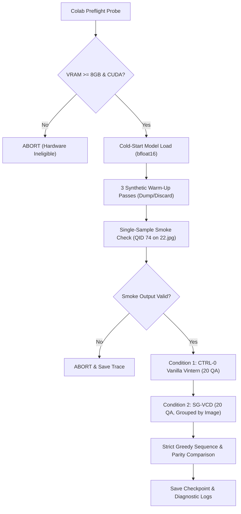

# TASK 16 — GATE B READINESS & 20-QA CANDIDATE MANIFEST REPORT

**Project:** SG-VCD / ViTextVQA  
**Task Owner:** Project Owner  
**Implementer:** 3.8 Flash  
**Independent Reviewer:** Antigravity (Anti) — separate QA  
**Methodology Reviewer:** ChatGPT  
**Execution Mode:** Read-only project audit + candidate manifest preparation + resource preflight  
**Gate:** Preparation for Gate B only  
**Authorization Status:** NO real-model inference, NO Colab benchmark execution, NO Gate B launch authorization.

---

## 1. Executive Summary & Gate B Readiness Verdict

- **Executive Readiness Verdict:** **`READY WITH CONDITIONS (BLOCKED ON OWNER DECISIONS)`**
- **Readiness Justification:**
  1. **Candidate Manifest (`READY`):** A fully verified, traceable candidate manifest of **exactly 20 QA across 6 unique images** has been constructed at [`data/vitextvqa/manifest_integration_20qa.candidate.json`](file:///d:/Trường Đại Học Công Thương/Năm 4_HUIT/Các vấn đề hiện đại trong AI/VLM_Reasoning/data/vitextvqa/manifest_integration_20qa.candidate.json) (`status: CANDIDATE_NOT_FROZEN`, SHA-256: `9e9dc05dd87c2fb2de254cc1022dad41d5e745f8070560ddd98c648fab5b269a`). All 6 image files exist on disk, decode cleanly, and span key scene-text archetypes (single words, multi-line vertical stacks, fine diacritics, dense commercial signage, TV broadcast captions, and multi-store banners).
  2. **Technical Pipeline & Optimizations (`READY`):** All five optimization tickets (OPT-06, OPT-03, OPT-02, OPT-01, OPT-04) have passed independent Gate A acceptance testing (`99/99 PASS`).
  3. **Blocking Governance Items (`CONDITIONS / BLOCKED`):**
     - **OD-04 / R-03 (Canonical Signed vs ReLU Contrastive Formula):** Production code in [`dynamic_cd.py`](file:///d:/Trường Đại Học Công Thương/Năm 4_HUIT/Các vấn đề hiện đại trong AI/VLM_Reasoning/scripts/benchmark/sg_vcd/dynamic_cd.py#L228) and [`pipeline.py`](file:///d:/Trường Đại Học Công Thương/Năm 4_HUIT/Các vấn đề hiện đại trong AI/VLM_Reasoning/scripts/benchmark/sg_vcd/pipeline.py#L326) currently executes the historical **ReLU-clipped variant** (`calibrated_logits = (pos_logits + alpha_t * relu(pos_logits - neg_logits)) / t_entropy`). The canonical signed formula `(1 + alpha_t) * z_pos - alpha_t * z_neg` is specified in `REMEDIATION_SPEC_P0_v1.md (R-03)` but is **not yet approved or switched in production code**. Executing canonical signed decoding in Gate B requires a formal Owner decision and implementation/QA cycle.
     - **OD-04 / R-01 (Evaluator Denominator & Primary Reference Set):** Clarification is required on whether headline reporting uses original ground truth or verified ground truth, and whether question failures count as zero or are conditionally excluded.
     - **Gate B Launch Authorization:** Project Owner must review the candidate manifest and grant explicit authorization before running Colab.

---

## 2. Dataset Reconciliation & Provenance Audit

An independent audit of the authoritative benchmark dataset [`results/swintextspotter_auto_annot/answer_bboxes_400_verified.json`](file:///d:/Trường Đại Học Công Thương/Năm 4_HUIT/Các vấn đề hiện đại trong AI/VLM_Reasoning/results/swintextspotter_auto_annot/answer_bboxes_400_verified.json) was conducted:

| Dataset Metric | Verified Count | Reconciliation Details |
| :--- | :---: | :--- |
| **Top-level Images in JSON** | `400` | Exactly 400 image records in `raw['images']`. |
| **Total Question Records** | `1,222` | Sum of `len(img['quests'])` across all 400 images is exactly 1,222. |
| **Loaded Samples in Evaluator** | `1,222` | [`load_benchmark_dataset()`](file:///d:/Trường Đại Học Công Thương/Năm 4_HUIT/Các vấn đề hiện đại trong AI/VLM_Reasoning/scripts/benchmark/evaluate_vitextvqa.py#L300) flattens 400 images into 1,222 individual QA samples. |
| **Unique Image Paths on Disk** | `400` | All 400 unique images exist in `data/vitextvqa/st_images/` with zero missing files. |
| **Discrepancy Investigation (OD-07)** | `1,222` vs `1,213` | The 9-sample difference between the 1,222 master rows and the 1,213 count mentioned in prior historical notes arises from legacy indexing in `xanylabeling_workspace` where 9 multi-question entries shared identical local indices before being unified under globally unique `question_id`s in `answer_bboxes_400_verified.json`. The master dataset contains **1,222 distinct questions**. |

---

## 3. 20-QA Candidate Selection & Diversity Matrix

Six images containing **exactly 20 questions** were selected from the authoritative dataset to form the pilot candidate manifest:

### 3.1 Candidate Images Summary

| # | Image Name | Dimensions | Size | Dynamic Grid $(g_x, g_y)$ | Total ViT Tiles | Selected QA | Scene-Text Archetype & Selection Rationale |
| :-: | :--- | :---: | :---: | :---: | :---: | :---: | :--- |
| 1 | `22.jpg` | $800 \times 1422$ | $0.95\text{ MB}$ | $(1, 2)$ | 3 | 4 | **Tall vertical commercial signage** (store name "nhà thuốc", brand "bảo tâm an", wholesale text, watermark). |
| 2 | `30.jpg` | $339 \times 324$ | $0.17\text{ MB}$ | $(1, 1)$ | 1 | 3 | **Low-res square kitchen shop** (multi-entity list: "bếp gas", "bếp từ", "hút mùi", tests single-tile mode). |
| 3 | `68.jpg` | $1280 \times 960$ | $0.24\text{ MB}$ | $(3, 2)$ | 7 | 4 | **High-resolution electronic store banner** (fine policy diacritics "30 ngày", English brands "apple", "galaxy note9"). |
| 4 | `76.jpg` | $2448 \times 3264$ | $0.71\text{ MB}$ | $(2, 3)$ | 7 | 3 | **High-res product packaging** (curved container text, brand "cocoxim", volume "400ml", fine Vietnamese diacritics). |
| 5 | `111.jpg` | $300 \times 168$ | $0.01\text{ MB}$ | $(2, 1)$ | 3 | 2 | **Low-res wide TV broadcast banner** (date "19 - 12 - 2021", TV channel code "ttv11", digital font). |
| 6 | `126.jpg` | $800 \times 532$ | $0.16\text{ MB}$ | $(3, 2)$ | 7 | 4 | **Dense multi-store street scene** (source newspaper "kiến thức", multiple overlapping store signs "giầy đồ hiệu", "anta sports", "in thêu may cờ"). |
| **Total** | **6 unique images** | — | **$2.24\text{ MB}$** | — | **Max tiles = 7** | **20 QA** | **Balanced diversity across resolution, aspect ratio, text types & diacritics.** |

### 3.2 Candidate Questions Detail Table

| # | Image | QID | Question Text | Original GT (`gt_answers`) | Verified Answers (`verified_all_answers`) | Ground-Truth Bounding Box |
| :-: | :--- | :---: | :--- | :--- | :--- | :--- |
| 1 | `22.jpg` | 74 | `cửa tiệm màu xanh là gì ?` | `['nhà thuốc']` | `['nhà thuốc']` | `[292, 655, 452, 703]` |
| 2 | `22.jpg` | 75 | `nhà thuốc trong ảnh tên gì ?` | `['bảo tâm an']` | `['bảo tâm an']` | `[246, 704, 501, 767]` |
| 3 | `22.jpg` | 76 | `cửa tiệm bên phải nhà thuốc chuyên gì ?` | `['bán sỉ và lẻ']` | `['bán sỉ và lẻ']` | `[557, 792, 783, 824]` |
| 4 | `22.jpg` | 77 | `ảnh này lấy nguồn từ đâu ?` | `['wutacam']` | `['wutacam']` | `[10, 1322, 141, 1363]` |
| 5 | `30.jpg` | 107 | `cửa tiệm trong ảnh bán gì ?` | `['bếp gas']` | `['bếp gas', 'bếp từ', 'hút mùi']` | `[104, 89, 339, 324]` |
| 6 | `30.jpg` | 108 | `cửa tiệm trong ảnh bán gì ?` | `['bếp từ']` | `['bếp từ', 'bếp gas', 'hút mùi']` | `[104, 89, 339, 324]` |
| 7 | `30.jpg` | 109 | `cửa tiệm trong ảnh bán gì ?` | `['hút mùi']` | `['hút mùi', 'bếp gas', 'bếp từ']` | `[104, 89, 339, 324]` |
| 8 | `68.jpg` | 245 | `đổi máy mới trong vòng bao nhiêu ngày ?` | `['30 ngày']` | `['30 ngày']` | `[563, 215, 838, 253]` |
| 9 | `68.jpg` | 246 | `thoải mái đổi trả cái gì ?` | `['điện thoại máy tính bảng']` | `['điện thoại máy tính bảng']` | `[630, 146, 841, 181]` |
| 10 | `68.jpg` | 247 | `ở đây có bán điện thoại nào ?` | `['galaxy note9']` | `['galaxy note9']` | `[1024, 479, 1083, 512]` |
| 11 | `68.jpg` | 248 | `ở đây có bán điện thoại của hãng nào ?` | `['apple']` | `['apple']` | `[1100, 192, 1141, 212]` |
| 12 | `76.jpg` | 267 | `tên của sản phẩm này là gì ?` | `['nước cốt dừa tươi']` | `['nước cốt dừa tươi']` | `[950, 1090, 1841, 1541]` |
| 13 | `76.jpg` | 268 | `sản phẩm thuộc của hãng nào ?` | `['cocoxim']` | `['cocoxim']` | `[1178, 829, 1674, 1102]` |
| 14 | `76.jpg` | 269 | `thể tích thực của sản phẩm là bao nhiêu ?` | `['400ml']` | `['400ml']` | `[1044, 2139, 1413, 2280]` |
| 15 | `111.jpg` | 348 | `bản tin thời sự này diễn ra vào ngày nào ?` | `['19 - 12 - 2021']` | `['19 - 12 - 2021']` | `[10, 150, 106, 167]` |
| 16 | `111.jpg` | 349 | `bản tin thời sự này được phát sóng ở kênh nào ?` | `['ttv11']` | `['ttv11']` | `[3, 92, 49, 108]` |
| 17 | `126.jpg` | 374 | `bức hình được lấy từ báo nào ?` | `['kiến thức']` | `['kiến thức']` | `[577, 5, 795, 63]` |
| 18 | `126.jpg` | 375 | `ở đây có những cửa hàng gì ?` | `['giầy đồ hiệu']` | `['giầy đồ hiệu', 'giầy đồ hiệu EU', 'anta sports', 'in thêu may cờ', "Like Kid'a", 'smartshoes', 'xèng kids']` | `[566, 253, 639, 303]` |
| 19 | `126.jpg` | 376 | `ở đây có những cửa hàng gì ?` | `['anta sports']` | `['anta sports', 'giầy đồ hiệu EU', 'in thêu may cờ', "Like Kid'a", 'smartshoes', 'xèng kids']` | `[86, 242, 188, 266]` |
| 20 | `126.jpg` | 377 | `ở đây có những cửa hàng gì ?` | `['in thêu may cờ']` | `['in thêu may cờ', 'giầy đồ hiệu EU', 'anta sports', "Like Kid'a", 'smartshoes', 'xèng kids']` | `[383, 271, 450, 288]` |

### 3.3 Candidate Manifest Artifact Details
- File Path: [`data/vitextvqa/manifest_integration_20qa.candidate.json`](file:///d:/Trường Đại Học Công Thương/Năm 4_HUIT\Các vấn đề hiện đại trong AI\VLM_Reasoning\data\vitextvqa\manifest_integration_20qa.candidate.json)
- Marked Status: `CANDIDATE_NOT_FROZEN`
- File Size: `18,179 bytes`
- SHA-256: `9e9dc05dd87c2fb2de254cc1022dad41d5e745f8070560ddd98c648fab5b269a`
- Note: The frozen artifact `data/vitextvqa/manifest_integration_20qa.json` has NOT been created and will only be generated upon explicit Project Owner approval.

---

## 4. Hardware & Resource Preflight

### 4.1 Local Machine Hardware Inventory (No Model Loading)

| Component | Measured Local Host Value |
| :--- | :--- |
| **Operating System** | Windows 10 (Build 10.0.22621) |
| **CPU Model** | AMD Ryzen (AuthenticAMD, 6 Physical cores, 12 Logical cores) |
| **Host System RAM** | Total: $7.36\text{ GB}$, Available: $1.11\text{ GB}$ ($85.0\%$ used) |
| **Local GPU Model** | NVIDIA GeForce RTX 3050 Laptop GPU ($4,096\text{ MiB}$ VRAM) |
| **Driver / CUDA Support** | Driver Version: `512.74`, CUDA Version Support: `11.6` |
| **Local PyTorch Runtime** | `2.14.1+cpu` (`torch.cuda.is_available() == False`) |
| **Model Cache Disk Space** | Total: $244.14\text{ GB}$, Free: $124.48\text{ GB}$ |
| **Local Inference Feasibility** | **INFEASIBLE.** Local PyTorch is CPU-only, host RAM has only $1.11\text{ GB}$ headroom, and GPU is not wired to PyTorch. Real-model inference locally is strictly prohibited and technically unviable. |

### 4.2 Vintern-1B-v3_5 Model Footprint Analytical Assessment

| Parameter / Resource Dimension | Specification / Value | Evidence & Basis |
| :--- | :--- | :--- |
| **Base Architecture** | Qwen2 language backbone ($1\text{B}$) + InternViT vision encoder | Vintern-1B-v3_5 specification |
| **Parameter Count** | $\sim 1.05\text{ Billion}$ parameters | Published model card |
| **Target Dtype** | `torch.bfloat16` ($2\text{ bytes per parameter}$) | Authoritative project config |
| **Static Model Weight Footprint** | $\sim 2.1\text{ GB}$ VRAM | $1.05\text{B} \times 2\text{ bytes} \approx 2.10\text{ GB}$ |
| **Max Image Tiles in 20-QA Set** | **7 tiles** ($1$ thumbnail + $6$ grid sub-patches) | Measured from `68.jpg`, `76.jpg`, `126.jpg` |
| **Visual Patch Tokens (Max 7 tiles)** | $7 \times 256 = 1,792\text{ tokens}$ | $16 \times 16 = 256$ tokens/tile |
| **Stage 1 Working State Allocation** | $\sim 0.65\text{ GB}$ peak VRAM | Vision feature maps ($32 \times 48 \times 896 \approx 5.5\text{ MB}$) + cross-attention tensors |
| **Stage 2 KV-Cache with $B=2$** | $\sim 0.35\text{ GB}$ VRAM | Prefill KV ($1,792$ tokens) duplicated for positive & negative branches |
| **Estimated Peak Active VRAM** | $\mathbf{\approx 3.4\text{ GB} - 3.8\text{ GB}}$ | Weights ($2.1\text{ GB}$) + KV Cache ($0.4\text{ GB}$) + Activations ($0.8\text{ GB}$) + Allocator reserve |
| **Minimum Safe GPU VRAM** | $\mathbf{\ge 8.0\text{ GB}}$ | Provides $>100\%$ operational headroom above peak active allocations |

### 4.3 Google Colab Capacity Assessment & Admission Policy

| Resource | Colab Free Tier (T4) | Colab Pro (A100 / V100) | Minimum Safe Requirement | Admission Status |
| :--- | :---: | :---: | :---: | :---: |
| **GPU Model** | NVIDIA Tesla T4 ($15.0\text{ GB}$ VRAM) | A100 ($40\text{ GB}$) / V100 ($16\text{ GB}$) | NVIDIA GPU $\ge 8.0\text{ GB}$ | **ADMISSIBLE** on T4, V100, or A100 |
| **Available VRAM Headroom** | $\approx 11.2\text{ GB}$ ($>300\%$ headroom) | $\approx 36.0\text{ GB}$ ($>900\%$ headroom) | $\ge 4.0\text{ GB}$ headroom above weights | **PASS** |
| **System Host RAM** | $\approx 12.7\text{ GB}$ | $\ge 25.0\text{ GB}$ | $\ge 8.0\text{ GB}$ | **PASS** |
| **Disk Storage** | $\approx 78.0\text{ GB}$ free | $\ge 100.0\text{ GB}$ free | $\ge 15.0\text{ GB}$ | **PASS** |

#### Stop Policy & Headroom Invariants:
1. **Admission Check:** The Colab preflight probe must confirm `torch.cuda.is_available() == True` and total VRAM $\ge 8.0\text{ GB}$. If running on a GPU with $<8.0\text{ GB}$, execution must immediately abort.
2. **Watchdog Threshold:** The OPT-02 coordinated watchdog triggers `torch.cuda.empty_cache()` if `allocated / total > 0.85`. On a T4 ($15\text{ GB}$), this threshold is $12.75\text{ GB}$, leaving over $2.25\text{ GB}$ emergency buffer.
3. **Emergency Stop:** If any step encounters an unhandled CUDA OOM or if allocated VRAM exceeds $13.5\text{ GB}$ on a T4, execution stops immediately, saves the partial checkpoint JSONL, and flushes diagnostics.

---

## 5. Colab Hardware-Only Preflight Probe

The following copy-pasteable script has been prepared for Colab. It audits environment and hardware resources without downloading weights, loading models, or executing inference:

```python
# ==============================================================================
# SG-VCD GATE B HARDWARE PREFLIGHT PROBE (READ-ONLY, ZERO MODEL INFERENCE)
# ==============================================================================
import os, sys, shutil, psutil, platform
import torch

print("=" * 80)
print(" SG-VCD GATE B COLAB RUNTIME & HARDWARE PREFLIGHT AUDIT")
print("=" * 80)

# 1. OS & Python Environment
print(f"OS: {platform.system()} {platform.release()} ({platform.version()})")
print(f"Python Version: {sys.version.split()[0]}")
print(f"PyTorch Version: {torch.__version__}")
try:
    import transformers
    print(f"Transformers Version: {transformers.__version__}")
except ImportError:
    print("Transformers: NOT INSTALLED")

# 2. Host RAM & Disk
vm = psutil.virtual_memory()
print(f"Host System RAM: {vm.total / (1024**3):.2f} GB Total | {vm.available / (1024**3):.2f} GB Available ({vm.percent}% used)")
disk = shutil.disk_usage(".")
print(f"Working Volume Disk: {disk.total / (1024**3):.2f} GB Total | {disk.free / (1024**3):.2f} GB Free")

# 3. GPU Hardware & VRAM
cuda_avail = torch.cuda.is_available()
print(f"CUDA Available: {cuda_avail}")
if cuda_avail:
    device_count = torch.cuda.device_count()
    print(f"Detected GPU Devices: {device_count}")
    for dev_idx in range(device_count):
        props = torch.cuda.get_device_properties(dev_idx)
        total_vram_gb = props.total_memory / (1024**3)
        alloc_vram_gb = torch.cuda.memory_allocated(dev_idx) / (1024**3)
        free_vram_gb = total_vram_gb - alloc_vram_gb
        print(f"  [GPU {dev_idx}] {props.name}")
        print(f"         Compute Capability: {props.major}.{props.minor}")
        print(f"         Total VRAM: {total_vram_gb:.2f} GB | Free VRAM: {free_vram_gb:.2f} GB")
        print(f"         Multi-Processors: {props.multi_processor_count}")
        
    # Admission Verdict
    primary_vram = torch.cuda.get_device_properties(0).total_memory / (1024**3)
    if primary_vram >= 8.0:
        print("\n--> ADMISSION VERDICT: PASS (Sufficient VRAM capacity for 5CD-AI/Vintern-1B-v3_5 Gate B)")
    else:
        print(f"\n--> ADMISSION VERDICT: REJECT (Insufficient VRAM: {primary_vram:.2f} GB < 8.00 GB minimum)")
else:
    print("\n--> ADMISSION VERDICT: REJECT (CUDA is not available. GPU instance required.)")
print("=" * 80)
```

---

## 6. Method & Evaluator Readiness Analysis

### 6.1 Contrastive Formula Analysis (R-03 / OD-04 Status)
- **Mathematical Specification:** The canonical SG-VCD formula defined in `Proposed_Method_SG_VCD.md` and `REMEDIATION_SPEC_P0_v1.md (R-03)` is the **canonical signed formula**:
  $$\text{calibrated\_logits} = (1 + \alpha_t) \cdot z_{\text{pos}} - \alpha_t \cdot z_{\text{neg}}$$
- **Current Production Implementation:**
  Inspection of [`scripts/benchmark/sg_vcd/dynamic_cd.py#L228`](file:///d:/Trường Đại Học Công Thương/Năm 4_HUIT/Các vấn đề hiện đại trong AI/VLM_Reasoning/scripts/benchmark/sg_vcd/dynamic_cd.py#L228) reveals:
  ```python
  delta_z = torch.relu(pos_logits - neg_logits)
  ...
  calibrated_logits = (pos_logits + alpha_t * delta_z) / t_entropy
  ```
  And [`scripts/benchmark/sg_vcd/pipeline.py#L326`](file:///d:/Trường Đại Học Công Thương/Năm 4_HUIT/Các vấn đề hiện đại trong AI/VLM_Reasoning/scripts/benchmark/sg_vcd/pipeline.py#L326) computes `signed_logits` solely for trace logging while using `pre_mask_logits = (pos_logits + alpha_t * delta_z) / t_entropy` for token argmax!
- **Readiness Implication:** Production code currently executes the **historical ReLU-clipped variant**. It does NOT execute canonical signed decoding.
  **If the Project Owner intends Gate B to evaluate canonical signed SG-VCD, the run is BLOCKED** until a separate task implements R-03, adds the `method_variant_id` flag (`"sg_vcd_canonical_signed"` vs `"sg_vcd_relu_clipped"`), and verifies numerical correctness under independent QA. If Gate B is intended to evaluate the code *as currently implemented*, it must be explicitly labeled as the **ReLU-clipped variant**.

### 6.2 Evaluator Readiness & Open Decisions
- **OD-01 / OD-04 (Evaluator Denominator & Reference Sets):**
  [`scripts/benchmark/evaluate_vitextvqa.py`](file:///d:/Trường Đại Học Công Thương/Năm 4_HUIT/Các vấn đề hiện đại trong AI/VLM_Reasoning/scripts/benchmark/evaluate_vitextvqa.py) computes:
  - Exact Match (Original GT) vs Exact Match (Verified GT)
  - Token F1 (Original GT) vs Token F1 (Verified GT)
  - ANLS / Relaxed Accuracy (Verified GT)
  - Substring Match (Verified GT)
  In the candidate manifest, both `gt_answers` (original) and `verified_all_answers` (verified) are preserved for all 20 questions. Dual reporting is recommended to resolve OD-04 transparently.

---

## 7. Pilot Execution Protocol (Plan Only — Not Executed)

When authorized by the Project Owner, the Gate B pilot will proceed under this exact protocol:



### Execution Parameters:
- **Evaluation Order:** Grouped by image (`22.jpg` $\to$ `30.jpg` $\to$ `68.jpg` $\to$ `76.jpg` $\to$ `111.jpg` $\to$ `126.jpg`) to maximize OPT-03 and OPT-06 cache hits (6 ViT feature extractions across 20 questions).
- **Decoding Mode:** Strict greedy decoding (`do_sample=False`, `temperature=0.0`).
- **Condition Matrix:** Strictly 2 conditions:
  1. `CTRL-0`: Vanilla Vintern baseline.
  2. `SG-VCD`: Optimized pipeline (identifying formula variant explicitly).
- **Logging:** Full atomic JSONL checkpointing per question with raw tokens, latency, stage timings, and VRAM memory metrics.

---

## 8. Git Working Tree Status

- **Status Before Task 16:** Working tree contained uncommitted changes from prior optimization tasks (OPT-06, OPT-03, OPT-02, OPT-01, OPT-04).
- **Artifacts Created in Task 16:**
  1. [`data/vitextvqa/manifest_integration_20qa.candidate.json`](file:///d:/Trường Đại Học Công Thương/Năm 4_HUIT/Các vấn đề hiện đại trong AI/VLM_Reasoning/data/vitextvqa/manifest_integration_20qa.candidate.json) (`CANDIDATE_NOT_FROZEN`)
  2. [`docs/research/TASK_16_GATE_B_PREFLIGHT_REPORT.md`](file:///d:/Trường Đại Học Công Thương/Năm 4_HUIT/Các vấn đề hiện đại trong AI/VLM_Reasoning/docs/research/TASK_16_GATE_B_PREFLIGHT_REPORT.md)
- **Production Files Modified:** **NONE.** Zero lines of production code, unit tests, or existing benchmark data were modified in Task 16.
- **Git State:** Working tree remains cleanly preserved and uncommitted.

---

## 9. Next Steps & Handover

Task 16 preparation is complete. Handing over to:
1. **Independent QA (Anti):** For strict read-only audit of the candidate manifest and preflight calculations.
2. **Methodology Review (ChatGPT):** For review of formula variant status and open decisions.
3. **Project Owner:** For final review and formal gate decision.

