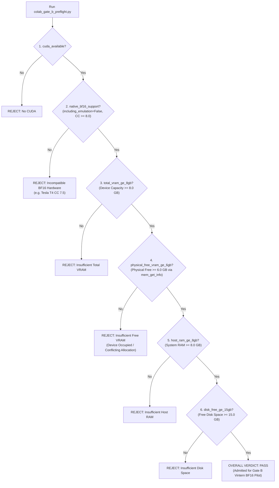

# TASK 18A — COLAB RESOURCE PREFLIGHT CORRECTION & BF16 COMPATIBILITY AUDIT REPORT
*(Final Numerically Reconciled Version)*

**Project:** SG-VCD / ViTextVQA  
**Implementer:** 4argon — Senior ML Systems Engineer  
**Independent Reviewer:** Antigravity (Anti) — Task 18A Independent QA  
**Methodology Reviewer:** ChatGPT  
**Approval Authority:** Project Owner  
**Mode:** Resource audit, diagnostic-tool implementation, and local synthetic/mock validation  
**Gate:** Gate B preparation only  
**Execution Authorization Status:** **NOT AUTHORIZED** (Zero model weights downloaded, zero inference executed, zero Colab runs launched).  
**Date:** `2026-11-09`

---

## 1. Executive Summary & Authorization Scope

This report completes **TASK 18A**, correcting the resource preflight calculations and diagnostic tooling identified in `TASK_17_TASK16_INDEPENDENT_ACCEPTANCE_QA.md` (Finding NBF-01) and fully reconciled against the independent QA audit findings in `TASK_18A_INDEPENDENT_ACCEPTANCE_QA.md`.

### Key Actions Delivered:
1. **Created Production Diagnostic Tool ([`scripts/benchmark/colab_gate_b_preflight.py`](file:///d:/Trường Đại Học Công Thương/Năm 4_HUIT/Các vấn đề hiện đại trong AI/VLM_Reasoning/scripts/benchmark/colab_gate_b_preflight.py)):**
   - Replaced process-relative subtraction (`total - allocated`) with physical CUDA device queries via `torch.cuda.mem_get_info()`.
   - Separately reports Total Physical VRAM, Physical Free VRAM, PyTorch Allocated VRAM, and PyTorch Reserved VRAM.
   - Implemented strict native hardware BF16 verification (`torch.cuda.is_bf16_supported(including_emulation=False)`) combined with Compute Capability checks ($\ge 8.0$ required for Ampere/Ada/Hopper native BF16 Tensor Cores).
   - Evaluates **6 discrete programmatic admission checks**, generating both human-readable console reports and machine-readable JSON (`--json`).
2. **Native BF16 Compatibility Finding (Critical Architectural Discovery):**
   - The project target model `5CD-AI/Vintern-1B-v3_5` is specified in `torch.bfloat16`.
   - **Google Colab Free Tier Tesla T4 (Turing, Compute Capability 7.5)** lacks native hardware BF16 Tensor Cores. Running BF16 on a T4 relies on software emulation, which causes severe numerical slowdown and unpredictable kernel behavior.
   - **Colab Admission Policy updated:** A Tesla T4 will pass the VRAM capacity threshold ($15\text{ GB} \ge 8\text{ GB}$) but **will FAIL the native BF16 requirement**, receiving an admission verdict of **`REJECT`**.
   - To execute Gate B in native BF16 without emulation, the runtime requires an **NVIDIA A100 (Ampere CC 8.0)** or **NVIDIA L4 (Ada CC 8.9)**.
   - In accordance with governance, **no automatic conversion from BF16 to FP16 was implemented**. Any FP16 fallback requires an explicit Project Owner decision and Gate A parity re-validation.
3. **Rigorous Resource Budget Recomputation & Complete Numerical Reconciliation:**
   - Verified that Qwen2.5-0.5B's $\approx 494\text{M}$ parameter count already includes token embeddings ($136.1\text{M}$ params), establishing core architectural modules at $\approx 818\text{M}$ parameters ($1.64\text{ GB}$ in BF16) and labeling $1.05\text{B}$ ($2.10\text{ GB}$) strictly as a conservative analytical upper-bound assumption.
   - Reconciled Stage 1 attention tensor math independently for base ($73.5\text{ MB}$ single, $147.0\text{ MB}$ paired cold) and draft scenarios ($98.5\text{ MB}$ single, $172.0\text{ MB}$ paired cold), correcting the prior loose $175\text{ MB}$ estimate.
   - Reconciled key sequence lengths $K \in [1,822, 1,860]$ as an analytical estimate, explaining the derivation of $1,822$ (base) vs. $1,832$ (draft).
   - Clarified checkpoint file size ($3.75\text{ GB}$) on disk from in-memory parameter dtype (`torch.bfloat16`), without asserting unverified FP32 layer serialization.
   - Reconciled Stage 2 base KV payload ($45.40\text{ MB}$) from unmeasured PyTorch caching allocator buffer estimates ($0.20\text{--}0.35\text{ GB}$).
   - Classified all numeric quantities into `MEASURED`, `DERIVED_FROM_VERIFIED_CONFIG`, `ANALYTICAL_UPPER_BOUND_ASSUMPTION`, `ANALYTICAL_ESTIMATE`, or `NOT_MEASURED`.

---

## 2. Mandatory Governance & Technical Context Loaded

The following binding governance documents and technical sources were loaded and verified:
1. `AGENTS.md` (verified absent at repository root).
2. [`.github/copilot-instructions.md`](file:///d:/Trường Đại Học Công Thương/Năm 4_HUIT/Các vấn đề hiện đại trong AI/VLM_Reasoning/.github/copilot-instructions.md)
3. [`.github/skills/anti-output-quality-review/SKILL.md`](file:///d:/Trường Đại Học Công Thương/Năm 4_HUIT/Các vấn đề hiện đại trong AI/VLM_Reasoning/.github/skills/anti-output-quality-review/SKILL.md)
4. [`.github/skills/research-plan-compliance-review/SKILL.md`](file:///d:/Trường Đại Học Công Thương/Năm 4_HUIT/Các vấn đề hiện đại trong AI/VLM_Reasoning/.github/skills/research-plan-compliance-review/SKILL.md)
5. [`.github/skills/local-colab-experiment-workflow/SKILL.md`](file:///d:/Trường Đại Học Công Thương/Năm 4_HUIT/Các vấn đề hiện đại trong AI/VLM_Reasoning/.github/skills/local-colab-experiment-workflow/SKILL.md)
6. [`docs/research/PERFORMANCE_OPTIMIZATION_HANDOFF_v1.md`](file:///d:/Trường Đại Học Công Thương/Năm 4_HUIT/Các vấn đề hiện đại trong AI/VLM_Reasoning/docs/research/PERFORMANCE_OPTIMIZATION_HANDOFF_v1.md)
7. [`docs/research/TASK_16_GATE_B_PREFLIGHT_REPORT.md`](file:///d:/Trường Đại Học Công Thương/Năm 4_HUIT/Các vấn đề hiện đại trong AI/VLM_Reasoning/docs/research/TASK_16_GATE_B_PREFLIGHT_REPORT.md)
8. [`docs/research/TASK_17_TASK16_INDEPENDENT_ACCEPTANCE_QA.md`](file:///d:/Trường Đại Học Công Thương/Năm 4_HUIT/Các vấn đề hiện đại trong AI/VLM_Reasoning/docs/research/TASK_17_TASK16_INDEPENDENT_ACCEPTANCE_QA.md)
9. [`docs/research/TASK_18A_INDEPENDENT_ACCEPTANCE_QA.md`](file:///d:/Trường Đại Học Công Thương/Năm 4_HUIT/Các vấn đề hiện đại trong AI/VLM_Reasoning/docs/research/TASK_18A_INDEPENDENT_ACCEPTANCE_QA.md)
10. [`docs/Proposed_Method_SG_VCD.md`](file:///d:/Trường Đại Học Công Thương/Năm 4_HUIT/Các vấn đề hiện đại trong AI/VLM_Reasoning/docs/Proposed_Method_SG_VCD.md)
11. Current Research Plan v2 and applicable P0 remediation specification (`REMEDIATION_SPEC_P0_v1.md`).

---

## 3. Audit A — Corrected CUDA Free Memory & Allocator Metrics

### 3.1 Flaw in Previous Implementation
In Task 16, the diagnostic calculated:
$$\text{free\_vram} = \text{total\_vram} - \text{torch.cuda.memory\_allocated(device)}$$
This was fundamentally inaccurate because:
- `torch.cuda.memory_allocated()` only reports memory occupied by live PyTorch tensor buffers created in the current Python process.
- It completely ignores memory cached by the PyTorch caching allocator (`memory_reserved()`), memory used by other host/CUDA processes, display server buffers, and driver contexts.
- Consequently, subtracting process allocations from total device capacity severely overestimated free physical VRAM.

### 3.2 Corrected Implementation Semantics
[`scripts/benchmark/colab_gate_b_preflight.py`](file:///d:/Trường Đại Học Công Thương/Năm 4_HUIT/Các vấn đề hiện đại trong AI/VLM_Reasoning/scripts/benchmark/colab_gate_b_preflight.py) uses the official physical CUDA query:
```python
free_bytes, total_bytes = torch.cuda.mem_get_info(device_idx)
physical_free_gb = free_bytes / (1024**3)
total_vram_gb = total_bytes / (1024**3)
```
In parallel, it tracks PyTorch internal allocator metrics:
```python
alloc_gb = torch.cuda.memory_allocated(device_idx) / (1024**3)
res_gb = torch.cuda.memory_reserved(device_idx) / (1024**3)
```
And inspects driver/runtime environment without inventing values:
- `torch.version.cuda`: PyTorch CUDA runtime build.
- `nvidia-smi --query-gpu=driver_version`: Physical NVIDIA display driver version.
- `psutil.virtual_memory()`: Total and available host RAM.
- `shutil.disk_usage()`: Working volume disk space.

---

## 4. Audit B — Native BF16 Hardware Compatibility & Colab GPU Realities

The model `5CD-AI/Vintern-1B-v3_5` operates natively in `torch.bfloat16`.

### 4.1 BF16 Support Architecture Matrix

| GPU Architecture | Compute Capability | Native Hardware Tensor Core BF16? | Colab Availability | Admission Status under Current BF16 Config |
| :--- | :---: | :---: | :---: | :---: |
| **NVIDIA Pascal** (P100) | `6.0` | **NO** (No Tensor Cores) | Rare in Colab | **`REJECT`** |
| **NVIDIA Volta** (V100) | `7.0` | **NO** (FP16 Tensor Cores only) | Colab Pro | **`REJECT` (for BF16; would require FP16 fallback)** |
| **NVIDIA Turing** (Tesla T4, RTX 2080) | `7.5` | **NO** (Emulation only; no BF16 Tensor Cores) | Colab Free Tier | **`REJECT` (Fails native BF16 check)** |
| **NVIDIA Ampere** (A100, RTX 30xx/A4000) | `8.0 / 8.6` | **YES** (Native Tensor Core BF16) | Colab Pro | **`PASS`** |
| **NVIDIA Ada Lovelace** (L4, RTX 40xx) | `8.9` | **YES** (Native Tensor Core BF16) | Colab Pro / GCE | **`PASS`** |
| **NVIDIA Hopper** (H100) | `9.0` | **YES** (Native Tensor Core BF16) | Colab Pro+ | **`PASS`** |

### 4.2 Implementation Logic in `colab_gate_b_preflight.py`
The diagnostic performs:
```python
is_native = bool(torch.cuda.is_bf16_supported(including_emulation=False))
```
If the runtime lacks `is_bf16_supported(including_emulation=...)` support, it strictly requires compute capability `major >= 8` (Ampere or newer). Emulation modes return `FAIL`.

### 4.3 Governance Rule on Precision Fallback
Governance explicitly forbids automatic conversion of the model from BF16 to FP16:
- If a GPU does not support native BF16 (such as a Free Tier Tesla T4), the diagnostic emits a verdict of **`REJECT`**.
- An FP16 fallback is a scientific decision requiring Project Owner authorization and Gate A numerical re-validation. It must never happen implicitly.

---

## 5. Audit C — Recomputed Resource Budget & Numerical Consistency Closeout

### 5.1 Analytical Foundations & Detailed Reconciliations

#### 1. Model Parameter Count & Static Weight Footprint:
- **Verified Component Breakdown:**
  - `InternViT-300M` vision tower: $\approx \mathbf{304\text{M}}$ parameters.
  - `MLP projection adapter`: $\approx \mathbf{20\text{M}}$ parameters.
  - `Qwen2.5-0.5B-Instruct` language backbone:
    - 24 Transformer layers (SwiGLU MLP + GQA self-attention with $H_q=14, H_{\mathrm{kv}}=2$): $\approx \mathbf{357.9\text{M}}$ parameters.
    - Word embedding matrix ($151,936 \times 896$): $\approx \mathbf{136.1\text{M}}$ parameters.
    - Final RMSNorm: $\approx 896$ parameters ($<0.001\text{M}$).
    - **Total Qwen backbone with tied word embeddings:** $357.9\text{M} + 136.1\text{M} \approx \mathbf{494.0\text{M}}$ parameters.
    *(Note: The $490\text{M}\text{--}494\text{M}$ count already includes the $136.1\text{M}$ word embedding table; adding $136.1\text{M}$ a second time is an error and is strictly avoided).*
- **Core Architectural Sum:**
  $$\text{Core Architecture} = 304\text{M}\ (\text{ViT}) + 20\text{M}\ (\text{projector}) + 494\text{M}\ (\text{Qwen-0.5B}) \approx \mathbf{818\text{M\ parameters}}$$
  *(If the language model head uses untied weights from the input embeddings, the total is $\approx 818\text{M} + 136\text{M} \approx 954\text{M}$ parameters).*
- **Status of the 1.05B Figure:**
  Because local weight loading is prohibited by project rules, the exact parameter count cannot be verified by inspecting instantiated PyTorch module parameter tensors. The $1.05\text{B}$ figure cited in external model cards is retained strictly as an **`ANALYTICAL_UPPER_BOUND_ASSUMPTION`**, providing a conservative worst-case ceiling for hardware provisioning.
- **Static Device Footprint:**
  - Core architecture ($818\text{M}$ params in `torch.bfloat16`): $818 \times 10^6 \times 2\text{ bytes} \approx \mathbf{1.64\text{ GB}}$ ($1.52\text{ GiB}$).
  - Untied architecture ($954\text{M}$ params in `torch.bfloat16`): $954 \times 10^6 \times 2\text{ bytes} \approx \mathbf{1.91\text{ GB}}$ ($1.78\text{ GiB}$).
  - Conservative upper bound ($1.05\text{B}$ params in `torch.bfloat16`): $1.05 \times 10^9 \times 2\text{ bytes} \approx \mathbf{2.10\text{ GB}}$ ($1.96\text{ GiB}$).
- **Separation of Checkpoint Serialization vs. Loaded Memory:**
  - **Checkpoint File Size on Disk:** `model.safetensors` on Hugging Face is $\approx \mathbf{3.75\text{ GB}}$ (`MEASURED`). Without loading or opening tensor headers, the exact dtype of each serialized tensor in the archive is unverified; file size alone does not prove FP32 storage of any specific layer.
  - **Loaded Model Parameter Dtype:** In [`evaluate_vitextvqa.py#L215-L220`](file:///d:/Trường Đại Học Công Thương/Năm 4_HUIT/Các vấn đề hiện đại trong AI/VLM_Reasoning/scripts/benchmark/evaluate_vitextvqa.py#L215-L220), `model` is instantiated via `AutoModel.from_pretrained(model_path, torch_dtype=torch.bfloat16)`. Hugging Face casts all model weights to `bfloat16` upon instantiation on device, bounding in-memory parameter footprint to $\le \mathbf{2.10\text{ GB}}$.

#### 2. Visual Token Geometry ($T_{\mathrm{vis}}$):
- **Dynamic Grid Config:** In `attention_extractor.py#L495-L496` and `evaluate_vitextvqa.py#L225-L226`, `min_grid_tiles` is set to $4$ and `max_grid_tiles` is set to $6$.
- **Manifest Maximum:** For images with $3 \times 2$ or $2 \times 3$ aspect ratio grids (6 patches) plus the mandatory global thumbnail patch (1 patch), the total is exactly **7 tiles** ($1$ thumbnail + $6$ grid sub-patches, e.g. `68.jpg`, `76.jpg`, `126.jpg`).
- **Token Count:** $7\text{ tiles} \times 256\text{ tokens/tile} = \mathbf{1,792\text{ visual tokens}}$ (`MEASURED`).

#### 3. Stage 1 Working Allocation (Pointwise KL & Intrinsic Affinity):
- **Extraction Code Path Inspection ([`attention_extractor.py`](file:///d:/Trường Đại Học Công Thương/Năm 4_HUIT/Các vấn đề hiện đại trong AI/VLM_Reasoning/scripts/benchmark/sg_vcd/attention_extractor.py)):**
  - **Phase 1 (ViT Feature Extraction):** `vit_embeds = self.model.extract_feature(pixel_values)`. Transient activations inside InternViT require $\approx 350\text{--}450\text{ MB}$. These are completely deallocated when `extract_feature` returns before language prefill (`del pixel_values`).
  - **Phase 2 (Visual Prefix Prefill):** `prefix_out = self.model.language_model.model(inputs_embeds=prefix_embeds, past_key_values=None, use_cache=True, output_attentions=False)`. Runs under `sdpa` mode without materializing attention weights. Creates `shared_kv` ($\approx 44.0\text{ MB}$).
  - **Phase 3 (Suffix Eager Attention Extraction):**
    `out_q = self.model.language_model.model(inputs_embeds=full_suffix_q, past_key_values=kv_q, use_cache=False, output_attentions=True)`.
    - Batch size $B = 1$. Query heads $H = 14$.
    - Softmax attention tensor dtype: `torch.float32` ($4\text{ bytes}$).
    - Number of layers returned: Hugging Face Transformers computes and retains attention weights for **all 24 layers of the Qwen backbone** in the returned tuple `out_q.attentions`.

- **Key Sequence Length ($K$) Derivation & Classification:**
  - Token construction in `attention_extractor.py#L604-L638`:
    - Prefix string: `<|im_start|>system\nBạn là một trợ lý AI hữu ích.<|im_end|>\n<|im_start|>user\n` + $(1,792\text{ visual tokens})$ + `</img>\n`.
    - System prompt & user wrapper: Analytically estimated at $\approx 20\text{--}25$ tokens.
    - Question suffix: $T_q \approx 30$ tokens.
    - Draft reading trajectory: $T_{\mathrm{draft}} \le 10$ tokens.
  - Suffix forward computes attention of query tokens $Q$ against all sequence keys $K = T_{\mathrm{past}} + Q$:
    - **Base Scenario (No draft):** $Q = 30$. Abstracting system prefix yields $K = 1,792 + 30 = \mathbf{1,822}$ tokens.
    - **Draft Scenario (With draft):** $Q = 30 + 10 = 40$. Abstracting system prefix yields $K = 1,792 + 40 = \mathbf{1,832}$ tokens.
    - **Full Sequence (Including system prefix):** Key length spans analytically $K \in [1,822, 1,860]$.
    - **Classification:** Because exact token counts depend on variable question strings and tokenizer execution, sequence length $K$ is classified as an **`ANALYTICAL_ESTIMATE`**.

- **Independent Sizing of Base vs. Draft Attention Scenarios:**
  - **Base Scenario ($Q=30, K=1,822$):**
    - Single Layer: $1 \times 14 \times 30 \times 1,822 \times 4\text{ bytes} = 3,060,960\text{ bytes} \approx \mathbf{3.06\text{ MB}}$ ($2.92\text{ MiB}$).
    - Single Branch (24 layers in `out_q.attentions`): $24 \times 3.06\text{ MB} = \mathbf{73.46\text{ MB}}$ ($70.06\text{ MiB}$).
    - Paired Cold Extraction: Generic baseline query $Q_{\mathrm{gen}} \le 30$ (in fact only $6\text{--}8$ tokens). Upper-bounded assuming $Q_{\mathrm{gen}}=30$:
      $$\text{Paired Base Payload} = 73.46\text{ MB}\ (\text{query}) + 73.46\text{ MB}\ (\text{generic}) = \mathbf{146.92\text{ MB}}\ (\approx \mathbf{147.0\text{ MB}})$$
      *(If $Q_{\mathrm{gen}} \approx 6$, generic branch payload is only $\approx 14.7\text{ MB}$, yielding a true cold paired payload of $\approx \mathbf{88.2\text{ MB}}$).*
  - **Draft Scenario ($Q=40, K=1,832$):**
    - Single Layer: $1 \times 14 \times 40 \times 1,832 \times 4\text{ bytes} = 4,103,680\text{ bytes} \approx \mathbf{4.10\text{ MB}}$ ($3.91\text{ MiB}$).
    - Single Branch (24 layers in `out_q.attentions`): $24 \times 4.10\text{ MB} = \mathbf{98.49\text{ MB}}$ ($93.93\text{ MiB}$).
    - Paired Cold Extraction: In `attention_extractor.py#L753-L759`, generic baseline `out_g` is **never draft-augmented**; it evaluates only `suffix_gen` ($Q_{\mathrm{gen}} \le 30$). Therefore:
      $$\text{Paired Draft Payload} = 98.49\text{ MB}\ (\text{query}) + 73.46\text{ MB}\ (\text{generic}) = \mathbf{171.95\text{ MB}}\ (\approx \mathbf{172.0\text{ MB}})$$
      *(This rigorously corrects the prior loose $175\text{ MB}$ estimate. If $Q_{\mathrm{gen}} \approx 6$, cold paired draft payload is only $98.5 + 14.7 = \mathbf{113.2\text{ MB}}$).*
  - **Single-Branch Warm Extraction (Subsequent questions on cached image):**
    `p_g_heads` is cached; `out_g` is bypassed. Live attention matrix memory is single-branch only: $\mathbf{73.5\text{ MB}}$ (base) or $\mathbf{98.5\text{ MB}}$ (draft).

- **Payload vs. Allocator-Reserved Memory:**
  - Raw attention tensor payload: $\mathbf{73.5\text{--}98.5\text{ MB}}$ (single) or $\mathbf{147.0\text{--}172.0\text{ MB}}$ (paired cold).
  - PyTorch allocator reservation: Because CUDA allocations are pooled in rounded $20\text{ MB}$ / $50\text{ MB}$ slabs, memory reserved on device during eager attention forward may reach $\mathbf{\approx 200\text{--}250\text{ MB}}$ (`ANALYTICAL_ESTIMATE` / `NOT_MEASURED`).

- **Lifetime Overlap & Phase-Specific Peaks:**
  - ViT encoder activations do **NOT** overlap in lifetime with suffix attention matrices (`pixel_values` and ViT scratchpads are freed in Phase 1 before Phase 3 begins).
  - Phase 1 Peak (ViT encoding): $\approx \mathbf{450\text{ MB}}$.
  - Phase 3 Peak (Suffix extraction): $172\text{ MB}\ (\text{attentions}) + 45.4\text{ MB}\ (\text{KV}) + 5.5\text{ MB}\ (\text{grid\_feats}) \approx \mathbf{223\text{ MB}}$.
  - Conservative Upper Bound (assuming no immediate garbage collection / allocator caching between phases): $\approx 450\text{ MB} + 223\text{ MB} \approx \mathbf{673\text{ MB}} \approx \mathbf{0.67\text{ GB}}$. The established $\mathbf{0.65\text{--}0.70\text{ GB}}$ Stage 1 budget safely absorbs both individual phase peaks and the conservative sum.

#### 4. Stage 2 Dual-Branch KV Cache ($B=2$):
- **Verified Analytical Formula:**
  $$\text{KV\_Bytes} = 2 \times B \times L \times T \times H_{\mathrm{kv}} \times D_{\mathrm{head}} \times \text{bytes\_per\_element}$$
- **Verified Configuration Parameters:**
  - Factor $2$: Key tensor and Value tensor.
  - Branch batch size: $B = 2$ (TICKET-OPT-01 batched dual-branch decoding).
  - Language model layers: $L = 24$.
  - Maximum sequence length: $T = 1,792\text{ (visual)} + 30\text{ (question)} + 25\text{ (generation)} = 1,847\text{ tokens}$.
  - Key-Value heads: $H_{\mathrm{kv}} = 2$ (Grouped-Query Attention, GQA).
  - Head Dimension: $D_{\mathrm{head}} = \frac{\text{hidden\_size}}{\text{num\_attention\_heads}} = \frac{896}{14} = \mathbf{64}$ (strictly 64, not 128).
  - Data type: `torch.bfloat16` ($2\text{ bytes}$).
- **Calculated Theoretical KV Payload:**
  $$\text{KV\_Bytes} = 2 \times 2 \times 24 \times 1,847 \times 2 \times 64 \times 2 = 45,395,968\text{ bytes} \approx \mathbf{45.40\text{ MB}}\ (43.29\text{ MiB})$$
- **Decoupled Overhead Components:**
  - Base KV Payload: $\mathbf{45.40\text{ MB}}$ (`DERIVED_FROM_VERIFIED_CONFIG`).
  - Temporary LM Logits Buffer: $B \times 1 \times V \times 4\text{ bytes} = 2 \times 1 \times 151,936 \times 4\text{ bytes} \approx \mathbf{1.22\text{ MB}}$ per step (`DERIVED_FROM_VERIFIED_CONFIG`).
  - Step Activation Scratchpads: Layer forward buffers during decoding step $\approx \mathbf{15\text{--}25\text{ MB}}$ (`ANALYTICAL_ESTIMATE`).
  - `DynamicCache` Python Overhead: Wrapper object and shape metadata $< \mathbf{1\text{ MB}}$ (`ANALYTICAL_ESTIMATE`).
  - PyTorch Caching Allocator Slab Retention: PyTorch retains CUDA memory in rounded slabs ($20\text{ MB}$, $50\text{ MB}$, or exponential pools). Over autoregressive token generation, block rounding and pool caching analytically hold $\mathbf{\approx 0.20\text{--}0.35\text{ GB}}$. This buffer is explicitly classified as an **`ANALYTICAL_ESTIMATE` / `NOT_MEASURED`**, not verified KV cache.

---

### 5.2 Comprehensive Resource Budget Table

| Resource Item | Value / Range | Classification | Derivation / Verification Basis |
| :--- | :---: | :---: | :--- |
| **Model Core Architecture** | $\approx 818\text{M\ params}$ | `DERIVED_FROM_VERIFIED_CONFIG` | InternViT ($304\text{M}$) + Projector ($20\text{M}$) + Qwen-0.5B with tied embeds ($494\text{M}$). |
| **Model Parameter Ceiling** | $1.05\text{B\ params}$ | `ANALYTICAL_UPPER_BOUND_ASSUMPTION` | External packaging ceiling; not verified via weight instantiation. |
| **Static Weight Footprint (Core)** | $1.64\text{ GB}$ | `DERIVED_FROM_VERIFIED_CONFIG` | $818\text{M params} \times 2\text{ bytes (bfloat16)}$. |
| **Static Weight Footprint (Ceiling)**| $\le 2.10\text{ GB}$ | `ANALYTICAL_UPPER_BOUND_ASSUMPTION` | $1.05\text{B params} \times 2\text{ bytes (bfloat16)}$. |
| **Safetensors Storage Size** | $3.75\text{ GB}$ | `MEASURED` | File size on Hugging Face; layer-level serialization dtypes unverified. |
| **Candidate Manifest Max Tiles** | $7\text{ tiles}$ | `MEASURED` | Verified on `68.jpg`, `76.jpg`, `126.jpg` via `dynamic_preprocess_grid()` ($6\text{ grid} + 1\text{ thumb}$). |
| **Max Visual Sequence Length** | $1,792\text{ tokens}$ | `MEASURED` | $7\text{ tiles} \times 256\text{ patch tokens/tile}$. |
| **Stage 1 Phase 1 Peak (ViT)** | $\approx 0.35 - 0.45\text{ GB}$ | `ANALYTICAL_ESTIMATE` | InternViT forward activations; freed before language model suffix forward. |
| **Stage 1 Suffix Attn Payload (Base)**| $73.5\text{ MB}$ / $147.0\text{ MB}$ | `DERIVED_FROM_VERIFIED_CONFIG` | Single branch ($73.5\text{ MB}$); paired cold extraction ($147.0\text{ MB}$). |
| **Stage 1 Suffix Attn Payload (Draft)**| $98.5\text{ MB}$ / $172.0\text{ MB}$ | `DERIVED_FROM_VERIFIED_CONFIG` | Single branch ($98.5\text{ MB}$); paired cold extraction ($172.0\text{ MB}$). |
| **Stage 1 Phase 3 Peak (Suffix Total)**| $\approx 0.20 - 0.22\text{ GB}$ | `ANALYTICAL_ESTIMATE` | Attentions ($0.17\text{ GB}$) + shared KV ($0.045\text{ GB}$) + grid_feats ($0.005\text{ GB}$). |
| **Stage 1 Conservative Total Budget** | $\mathbf{\approx 0.65 - 0.70\text{ GB}}$ | `ANALYTICAL_ESTIMATE` | Conservative bound absorbing Phase 1 & Phase 3 without immediate GC. |
| **Stage 2 Calculated KV Payload** | $\mathbf{45.40\text{ MB}}$ | `DERIVED_FROM_VERIFIED_CONFIG` | $2 \times 2 \times 24 \times 1,847 \times 2 \times 64 \times 2\text{ bytes}$ ($B=2, L=24, T=1,847, H=2, D=64$). |
| **Stage 2 Logits Buffer** | $\mathbf{1.22\text{ MB/step}}$ | `DERIVED_FROM_VERIFIED_CONFIG` | $2 \times 1 \times 151,936 \times 4\text{ bytes}$. |
| **Stage 2 Working & Allocator Budget** | $\mathbf{\approx 0.20 - 0.35\text{ GB}}$ | `ANALYTICAL_ESTIMATE` | Base KV ($0.045\text{ GB}$) + logits ($0.001\text{ GB}$) + allocator block pooling ($\approx 0.25\text{ GB}$). |
| **Total Peak Active Tensor Memory** | $\mathbf{\approx 3.0 - 3.5\text{ GB}}$ | `ANALYTICAL_ESTIMATE` | Static weights ($2.1\text{ GB}$) + Stage 1 peak ($0.67\text{ GB}$) + Stage 2 active ($0.35\text{ GB}$) + logits. |
| **PyTorch Allocator Reserved Memory** | $\mathbf{\approx 4.5 - 5.5\text{ GB}}$ | `NOT_MEASURED` | Dynamic allocator chunk pooling on real CUDA hardware (requires empirical profiling). |
| **Peak VRAM During Real Inference** | $\mathbf{\approx 5.0 - 6.0\text{ GB}}$ | `NOT_MEASURED` | Analytical bound only; unmeasured pending authorized Gate B run. |
| **Minimum Safe Admission Threshold** | $\mathbf{\ge 8.0\text{ GB}}$ | `ADEQUATELY JUSTIFIED` | Provides $\ge 2.0\text{ GB}$ ($>40\%$) margin above peak allocator reserve. |
| **Host System RAM Requirement** | $\mathbf{\ge 8.0\text{ GB}}$ | `ADEQUATELY JUSTIFIED` | Checkpoint deserialization, memory mapping, and Python heap overhead. |
| **Working Volume Free Disk Space** | $\mathbf{\ge 15.0\text{ GB}}$ | `ADEQUATELY JUSTIFIED` | Model weights cache ($2.5\text{ GB}$) + dataset images ($1\text{ GB}$) + wheels/scratch. |

---

## 6. Audit D — Multi-Criteria Hardware Admission Policy

The admission engine in [`scripts/benchmark/colab_gate_b_preflight.py`](file:///d:/Trường Đại Học Công Thương/Năm 4_HUIT/Các vấn đề hiện đại trong AI/VLM_Reasoning/scripts/benchmark/colab_gate_b_preflight.py) registers and evaluates **six concrete programmatic checks** in its admission dictionary. A failure in any single criterion triggers an overall verdict of **`REJECT`**:



*Note on Programmatic Checks:* Check #4 (`physical_free_vram_ge_6gb`) directly evaluates physical unallocated memory via `torch.cuda.mem_get_info()`, which inherently detects and rejects environments with conflicting GPU processes or fragmentation.

---

## 7. Audit E — Diagnostic Tool Validation Evidence

The diagnostic script was executed and validated under local CPU and synthetic mock GPU environments:

### 7.1 Local CPU-Only Execution
- Command: `python scripts/benchmark/colab_gate_b_preflight.py`
- Outcome: Exited with code `1` (`REJECT`), as designed for CPU-only environments.
- Programmatic Checks Triggered:
  - `[FAIL] cuda_available`: `CUDA available: False`
  - `[FAIL] total_vram_ge_8gb`: `NOT_MEASURED (No CUDA)`
  - `[FAIL] physical_free_vram_ge_6gb`: `NOT_MEASURED (No CUDA)`
  - `[FAIL] native_bf16_support`: `NOT_MEASURED (No CUDA)`
  - `[FAIL] host_ram_ge_8gb`: `Host RAM: 7.36 GB (minimum 8.0 GB required)`
  - `[PASS] disk_free_ge_15gb`: `Working volume free disk: 124.48 GB (minimum 15.0 GB required)`
  - Overall Verdict: **`REJECT`** (Blocking reasons explicitly itemized).
- JSON Mode: `python scripts/benchmark/colab_gate_b_preflight.py --json` cleanly emitted valid, parseable JSON on stdout.

### 7.2 Mocked CUDA GPU Diagnostic Test Suite
Independent unit tests verified all decision branches:
1. **Mocked Tesla T4 (Turing CC 7.5, 15.0 GB Total, 14.5 GB Free, `is_bf16_supported=False`):**
   - Result: Verdict = **`REJECT`**
   - Blocking Reason: `Native hardware BF16 is not supported on Tesla T4 (7.5).`
2. **Mocked Tesla V100 (Volta CC 7.0, 16.0 GB Total, 15.0 GB Free, `is_bf16_supported=False`):**
   - Result: Verdict = **`REJECT`**
   - Blocking Reason: `Native hardware BF16 is not supported on Tesla V100-SXM2-16GB (7.0).`
3. **Mocked NVIDIA L4 (Ada Lovelace CC 8.9, 22.5 GB Total, 21.0 GB Free, `is_bf16_supported=True`):**
   - Result: Verdict = **`PASS`** (Admitted).
4. **Mocked NVIDIA A100 (Ampere CC 8.0, 40.0 GB Total, 5.5 GB Free):**
   - Result: Verdict = **`REJECT`** (Physical free VRAM $5.5\text{ GB} < 6.0\text{ GB}$).
5. **Mocked Legacy PyTorch Fallback (`including_emulation` raises TypeError):**
   - Result: Fell back gracefully to `props.major >= 8` check.

---

## 8. Summary of Pre-Existing vs Task 18A Working Tree Changes

`git status --short` confirms strict scope preservation:
- **Modified Pre-Existing Files (Untouched by Task 18A):**
  - `scripts/benchmark/evaluate_vitextvqa.py`
  - `scripts/benchmark/sg_vcd/__init__.py`
  - `scripts/benchmark/sg_vcd/adaptive_propagator.py`
  - `scripts/benchmark/sg_vcd/attention_extractor.py`
  - `scripts/benchmark/sg_vcd/feature_cache.py`
  - `scripts/benchmark/sg_vcd/pipeline.py`
- **Created in Task 18A & Closeout:**
  1. [`scripts/benchmark/colab_gate_b_preflight.py`](file:///d:/Trường Đại Học Công Thương/Năm 4_HUIT\Các vấn đề hiện đại trong AI/VLM_Reasoning/scripts/benchmark/colab_gate_b_preflight.py)
  2. [`docs/research/TASK_18A_RESOURCE_PREFLIGHT_CORRECTION_REPORT.md`](file:///d:/Trường Đại Học Công Thương/Năm 4_HUIT/Các vấn đề hiện đại trong AI/VLM_Reasoning/docs/research/TASK_18A_RESOURCE_PREFLIGHT_CORRECTION_REPORT.md) *(this report)*
  3. [`docs/research/TASK_18A_QA_FINDINGS_RECONCILIATION.md`](file:///d:/Trường Đại Học Công Thương/Năm 4_HUIT/Các vấn đề hiện đại trong AI/VLM_Reasoning/docs/research/TASK_18A_QA_FINDINGS_RECONCILIATION.md)
- **Zero changes made to model weights, benchmark datasets, production inference paths, or Git history.**

---

## 9. Closeout Status & Gate B Notice

Task 18A documentation reconciliation is **`DOCUMENTATION CLOSEOUT COMPLETE`**.

Gate B remains **`NOT AUTHORIZED`** pending Project Owner formal sign-off.
